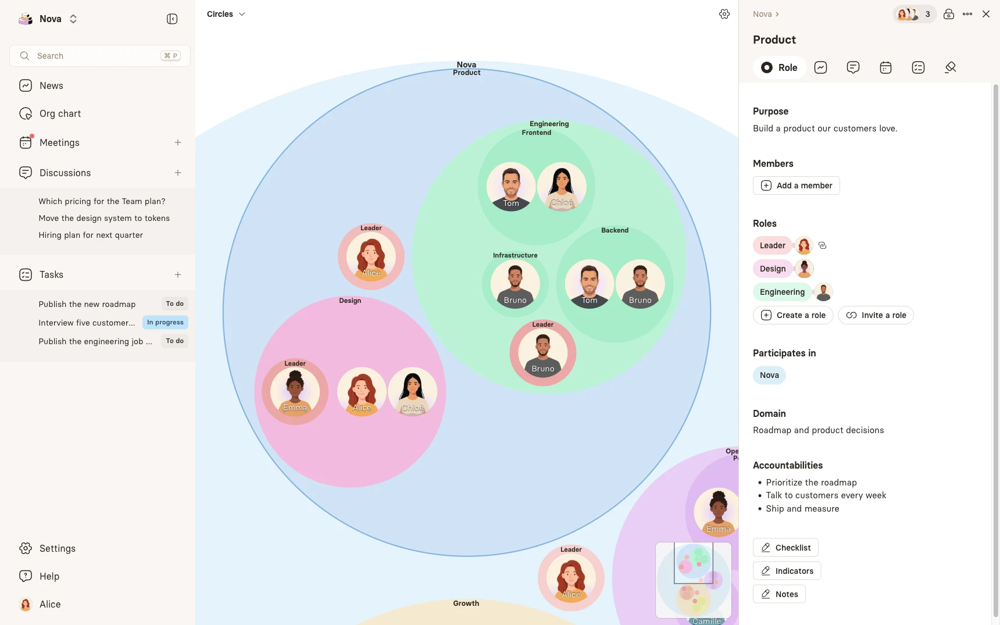
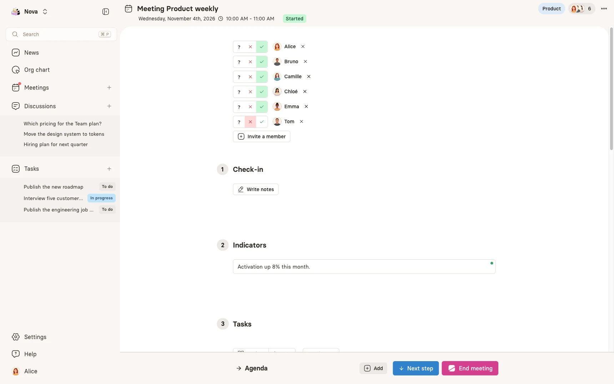
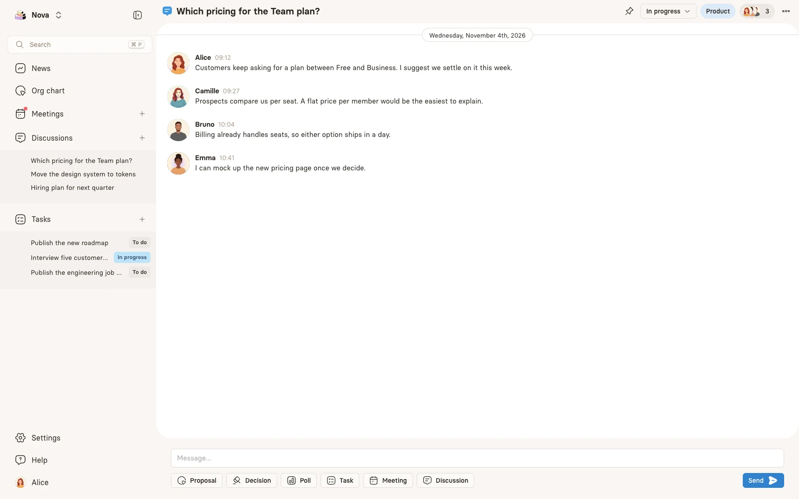
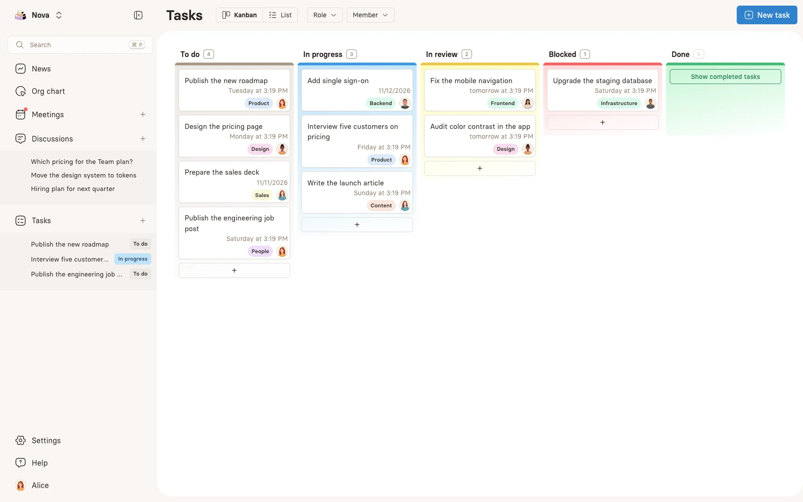
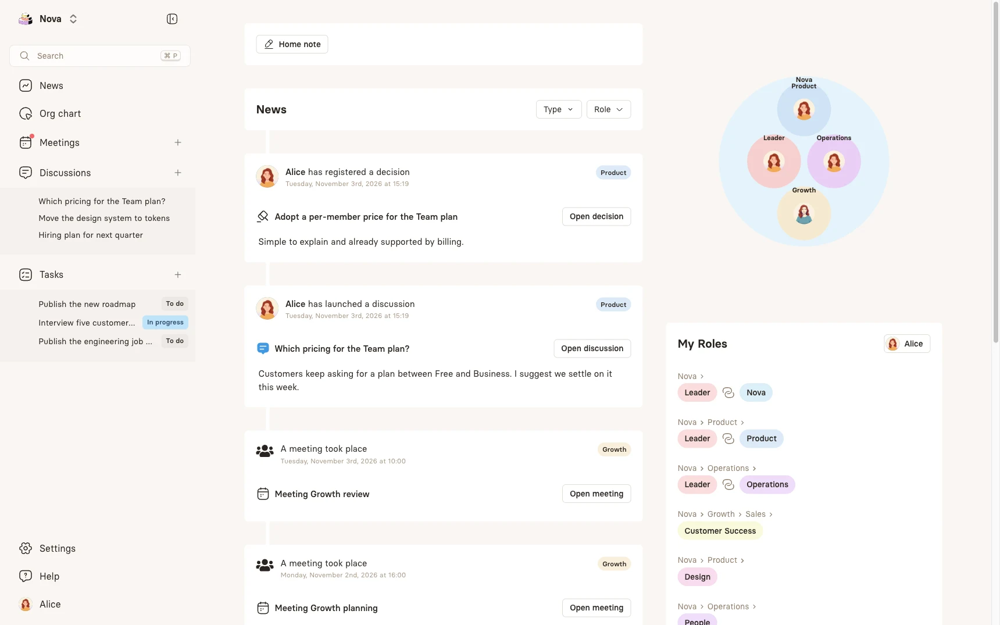

<p align="center">
  <a href="https://rolebase.io">
    <picture>
      <source media="(prefers-color-scheme: dark)" srcset=".github/assets/readme/logo-dark.svg" />
      <source media="(prefers-color-scheme: light)" srcset=".github/assets/readme/logo-light.svg" />
      
    </picture>
  </a>
</p>

<h3 align="center">Clarify who does what and give your teams real autonomy</h3>

<p align="center">
  The open source platform to map your roles, run better meetings and let every team self-organize.
</p>

<p align="center">
  <a href="https://rolebase.io"><b>Website</b></a> ·
  <a href="https://rolebase.io/en/docs"><b>Documentation</b></a> ·
  <a href="https://rolebase.io/en/guides"><b>Guides</b></a> ·
  <a href="https://rolebase.io/en/developers"><b>Developers</b></a> ·
  <a href="https://rolebase.io/en/pricing"><b>Pricing</b></a>
</p>

<p align="center">
  <a href="./LICENSE"></a>
  <a href="https://github.com/Godefroy/rolebase/stargazers"></a>
  <a href="https://github.com/Godefroy/rolebase/commits/main"></a>
  <a href="./CONTRIBUTING.md"></a>
</p>

<p align="center">
  <a href="https://rolebase.io/signup"><b>Create your organization for free →</b></a>
</p>

<br />

<a href="https://rolebase.io">
  <picture>
    <source media="(prefers-color-scheme: dark)" srcset=".github/assets/readme/orgchart-dark.webp" />
    <source media="(prefers-color-scheme: light)" srcset=".github/assets/readme/orgchart-light.webp" />
    
  </picture>
</a>

## Why Rolebase

Teams lose time when nobody knows who decides, when meetings end without a decision and when information lives in five different tools. Rolebase brings it all together around one living org chart, so everyone sees their place and knows who to turn to.

- **All-in-one.** Roles, meetings, discussions, tasks and decisions attach to the role they belong to.
- **Flexible.** From Free to Strict mode, you choose how much structure to enforce. Rolebase suits Holacracy, Sociocracy, [liberated companies](https://en.wikipedia.org/wiki/Liberated_company) and more classic organizations alike.
- **Open source and sovereign.** AGPL-licensed code, self-hostable, with hosted data stored in Europe.

## Features

<table>
  <tr>
    <td width="50%" valign="top">
      <b>Meetings that decide</b><br />
      Structured steps, attendance, shared notes, recurring meetings and templates.
      <br /><br />
      
    </td>
    <td width="50%" valign="top">
      <b>Discussions in the right place</b><br />
      Each discussion belongs to a role, and can lead to a proposal, a poll, a decision or a task.
      <br /><br />
      
    </td>
  </tr>
  <tr>
    <td width="50%" valign="top">
      <b>Tasks everyone can see</b><br />
      A shared kanban or list, filtered by role or by member.
      <br /><br />
      
    </td>
    <td width="50%" valign="top">
      <b>News at a glance</b><br />
      The latest decisions, discussions and meetings next to your own roles.
      <br /><br />
      
    </td>
  </tr>
</table>

And also:

- **Org chart views** as nested circles, a hierarchical tree or by member, with PNG export
- **Real-time editing** for workshops and meetings, in person or remote
- **Calendar sync** with Google Calendar, Outlook and any iCal-compatible calendar
- **Global search** across members, roles, discussions, tasks and decisions
- **Import and export**, with Holaspirit import and XLSX or JSON export
- **Notifications and digests**, daily or weekly
- **Activity log** with the full history of changes

## Works with your AI assistant

Ask your assistant who holds a role, prepare the agenda of the next meeting or create a task, in plain language.

- **[MCP connector](https://rolebase.io/en/docs/mcp)** for Claude, ChatGPT and Mistral Vibe, also available to [coding agents](https://rolebase.io/en/developers/mcp)
- **[Rolebase skill](https://rolebase.io/en/developers/skill)** for Claude Code, Codex, Cursor and VS Code

```
/plugin marketplace add Godefroy/rolebase
/plugin install rolebase@rolebase
```

## Get started

| | |
| --- | --- |
| **Cloud** | [Create an organization](https://rolebase.io/signup) in minutes. The [Small plan](https://rolebase.io/en/pricing) is free forever. |
| **Self-hosting** | Follow the [install and self-host guide](https://rolebase.io/en/developers/install-self-host) to keep control of your data and infrastructure. |
| **API** | Read and update your data with the [GraphQL API](https://rolebase.io/en/developers/graphql-api) and an API key that carries your permissions. |

### Run it locally

You need Node.js, Docker and the [Nhost CLI](https://docs.nhost.io/platform/cli/local-development).

```bash
git clone https://github.com/Godefroy/rolebase.git
cd rolebase
npm install
cp .secrets.template .secrets   # Then fill in the values
nhost login
nhost up                         # PostgreSQL, Hasura, Auth and Storage
npm run dev                      # Webapp and backend, on http://localhost:5175
```

[`CONTRIBUTING.md`](./CONTRIBUTING.md) covers configuration, external services, emails and the project structure.

## Built with

| Layer | Stack |
| --- | --- |
| **Frontend** | [React](https://react.dev), [Chakra UI](https://chakra-ui.com), [Apollo Client](https://www.apollographql.com/docs/react), [Tiptap](https://tiptap.dev) |
| **Backend** | [Nhost](https://nhost.io), [Hasura](https://hasura.io), [PostgreSQL](https://www.postgresql.org), [tRPC](https://trpc.io) |
| **Website** | [Astro](https://astro.build), [MDX](https://mdxjs.com), [Tailwind CSS](https://tailwindcss.com) |

## Contributing

Pull requests are welcome. Read [`CONTRIBUTING.md`](./CONTRIBUTING.md) to get set up and to see what we check before merging.

## Help

[Contact us](https://rolebase.io/en/contact) or [open an issue](https://github.com/Godefroy/rolebase/issues) on this repository.

## License

This repository uses two licenses:

- The Rolebase application (everything outside `website/`) is licensed under the [GNU Affero General Public License v3.0](./LICENSE). You can use, modify and self-host it freely. If you run a modified version as a service for other people, you must publish your changes under the same license.
- The `website/` directory is proprietary and governed by [`website/LICENSE`](./website/LICENSE). Its source is publicly visible but not licensed for reuse.

Versions published before the switch to AGPL were released under the MIT License and remain available under it.

The Rolebase name and logo are trademarks. A fork you distribute or host for others needs its own name and logo. Read the [trademark policy](https://rolebase.io/en/trademark).
