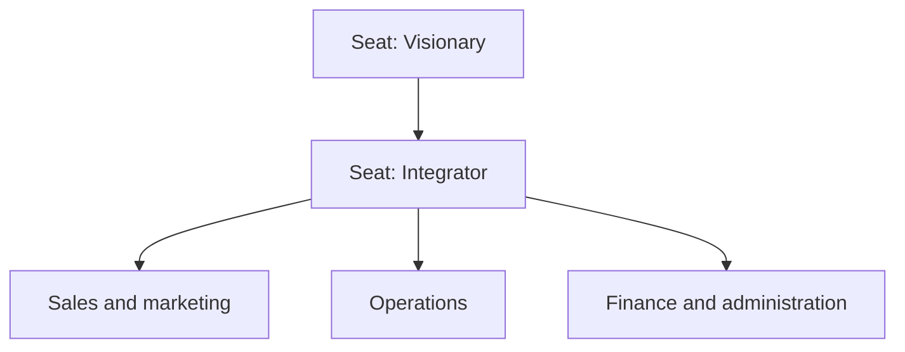
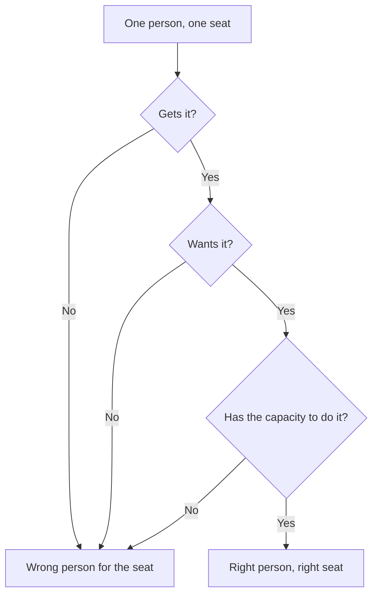
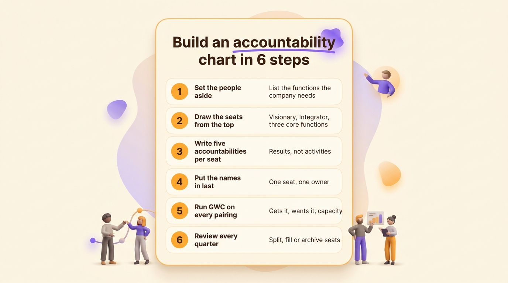
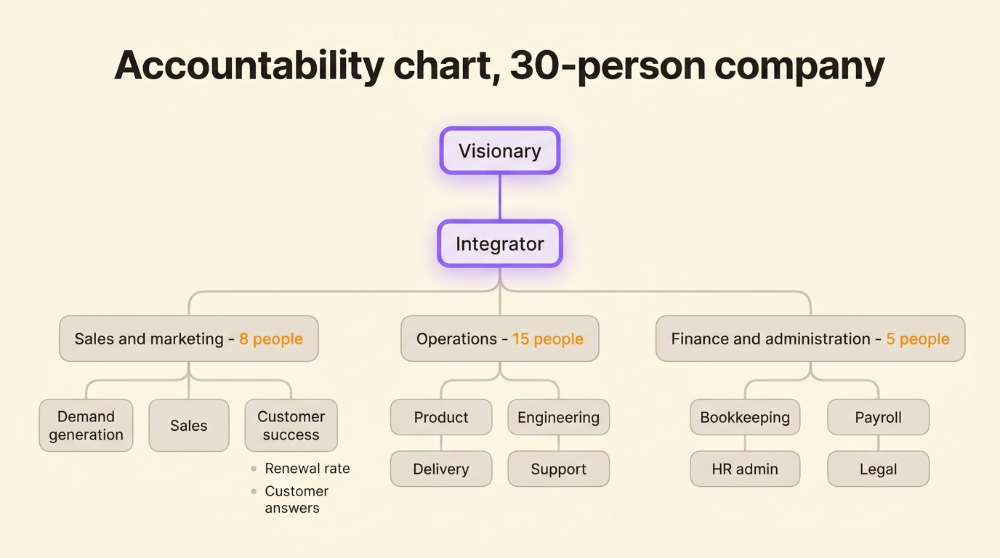

An accountability chart maps a company by the functions it needs and the results each one owns, before it says anything about who reports to whom. Each box is a seat, defined by a short list of written accountabilities, and each seat has one owner who answers for it. The tool comes from the Entrepreneurial Operating System (EOS), a management method for small and mid-sized companies, and it replaces the org chart as the main map of the business.

Here is what the chart contains, how it differs from an org chart, which seats EOS puts at the top, a six-step build you can run in a day, and an example for a 30-person company. The format also has limits. They are worth knowing before you draw anything, because once the chart exists, keeping it current is the whole game.

## What an accountability chart is

Gino Wickman, founder of the leadership consultancy EOS Worldwide, published the tool in his book *Traction* in 2010. The company still sells it under a registered trademark, the Accountability Chart®, as part of its operating system for small and mid-sized businesses.

A seat on the chart is a function. The seat exists whether or not anyone fills it, and what defines it is what it owns: EOS gives each seat about five accountabilities, written as the results the seat answers for. EOS Worldwide's current guidance says five to seven. An Integrator seat, for instance, owns the execution of the business plan and the company's profit and loss.

The rule that gives the chart its value: build the structure first, put the names in last. EOS draws the structure the company needs for its next stage of growth, sets the current team aside while drawing it, then checks which people fit which seats. An org chart starts from the people you have. An accountability chart starts from the work the company needs.

The word itself needs a warning. EOS writes the accountabilities of a seat as results. Role-based governance, in Holacracy and sociocracy, writes the accountabilities of a role as ongoing activities, with an -ing verb: "Publishing to the quarterly editorial calendar". The two formats describe the same work at different altitudes, and [the difference between accountability and responsibility](/en/blog/accountability-vs-responsibility) untangles the words if they blur. The [glossary entry on accountability](/en/glossary/redevabilite) covers both senses too.

## Accountability chart vs org chart

Both charts draw boxes over the same company. They answer different questions.

| | Org chart | Accountability chart |
|---|---|---|
| Question it answers | Who reports to whom? | Who owns what? |
| Basic unit | A person in a position | A seat with written accountabilities |
| Built from | The people you have today | The functions the company needs |
| When names appear | First, in the boxes | Last, once the structure holds |
| A missing person means | An empty box in a reporting line | A result nobody answers for |
| Updated | At reorganizations | At every quarterly review |

An empty seat is the sharpest difference between the two. On an org chart, a vacant position waits for a hire. On an accountability chart, a seat nobody holds is a result nobody owns, and it reads as a warning rather than as a vacancy.

The accountability chart still draws a hierarchy, with the Integrator reporting to the Visionary. Following a line gets you the owner of a result, not the approver of your time off.

The classic org chart comes in several shapes, and [the main types of org chart](/en/blog/org-chart-types) cover them. The accountability chart borrows the hierarchy shape and changes what the boxes contain. For work that crosses seats once, on a project, a [RACI matrix](/en/blog/raci-matrix) does the split better than any chart. The two cover different horizons: the RACI dies with the project, the chart outlives it.

## The seats: Visionary, Integrator, and three core functions

EOS tops the chart with two seats, and gives each five accountabilities.

The Visionary owns the direction. Usually a founder, the Visionary carries the new ideas and the new offers, solves the problems nobody else in the company can solve, holds the major outside relationships, carries the culture, and closes the biggest deals.

The Integrator runs the company day to day: leading the team and holding it accountable, executing the business plan and answering for the profit and loss, integrating the major functions, resolving the issues that cross functions, and keeping information flowing across the company.

Gino Wickman and Mark Winters, an EOS implementer, devoted a whole book to this pairing, *Rocket Fuel* (2015). By EOS Worldwide's own count, about half the companies they work with have a Visionary seat, and every one of them needs an Integrator.

Under the Integrator, EOS recognizes three core functions in any business: sales and marketing, operations, and finance and administration. Everything else rolls up into one of the three. Each function then breaks into sub-seats, one owner per seat, five accountabilities each, down to individual contributors.

## How to build one in six steps

1. **Set the people aside and list the functions.** Ask what work must exist for the company to reach its next stage, and write the functions down in that order. The current team takes no part in this step, which is what makes it hard, and what makes it useful.

2. **Draw the seats from the top.** Visionary, Integrator, three core functions, then the sub-seats under each. One seat, one owner, all the way down.

3. **Write five accountabilities per seat.** Results, not activities. The wording rules for the accountabilities of a role apply here too: "ensuring", "collaborating" and "overseeing" hollow out a seat, and [the guide to defining roles](/en/blog/define-roles) shows how to replace them. A [roles and responsibilities template](/en/blog/roles-responsibilities-template), one entry per seat, keeps the wording consistent across the chart.

4. **Put the names in last.** Walk each seat and place the person who fits it. Seats nobody on the team can hold stay empty, and they tell you what to hire for.

5. **Run GWC on every pairing.** EOS asks three questions about a person in a seat: do they get it, do they want it, do they have the capacity to do it? Three yes answers make a right person in a right seat.

6. **Review at the quarterly session.** EOS puts the chart on the agenda of the quarterly planning meeting. Compare the seats with the work people actually did, split the seats that grew too big, and archive the ones that describe nothing anymore.

Two checks keep the chart readable while you maintain it. A seat with more than seven accountabilities covers a job, so split it. A seat nobody holds describes work nobody is doing, so fill it or remove it. Both checks take minutes.

{/* IMAGE regen: api.py image, infographic, 1600x900. Scene: "Vertical numbered checklist card titled 'Build an accountability chart in 6 steps'. Six numbered rows, each with a short label and a one-line description: 1 'Set the people aside' with 'List the functions the company needs', 2 'Draw the seats from the top' with 'Visionary, Integrator, three core functions', 3 'Write five accountabilities per seat' with 'Results, not activities', 4 'Put the names in last' with 'One seat, one owner', 5 'Run GWC on every pairing' with 'Gets it, wants it, capacity', 6 'Review every quarter' with 'Split, fill or archive seats'. Numbers in warm orange #FB9803, labels in dark warm grey, the card on a cream background with a purple #9870F0 accent on the title." Regenerate if the six steps change. Last data sync: 2026-10-28. */}

## An example: a 30-person software company

Take a software company that sells a project management tool, thirty people, two founders. Drawn as an accountability chart:

- One founder holds the Visionary seat, the other holds the Integrator seat.
- Sales and marketing, eight people, splits into demand generation, sales, and customer success.
- Operations, fifteen people, holds product, engineering, delivery, and support.
- Finance and administration, five people, holds bookkeeping, payroll, HR administration, and legal compliance.

Each function leader holds a leader seat with five accountabilities. The head of customer success, for instance, owns the renewal rate, owns the answers customers get, owns the escalation path for unhappy accounts, owns the product feedback that reaches the product team, and owns the handover from sales to success.

Everyone, from the newest hire to the two founders, holds at least one seat, and can point at the chart and name the results they answer for. That is the test of a finished chart: ask anyone what they own, and they answer without looking.

{/* IMAGE regen: api.py image, infographic, 1600x900. Scene: "An accountability chart of a 30-person software company, drawn as a clean tree on a cream background. Top row: 'Visionary' box (purple accent) connected to 'Integrator' box below it. The Integrator connects to three function boxes: 'Sales and marketing - 8 people', 'Operations - 15 people', 'Finance and administration - 5 people'. Under each function, small sub-seat boxes: under Sales and marketing 'Demand generation', 'Sales', 'Customer success'; under Operations 'Product', 'Engineering', 'Delivery', 'Support'; under Finance and administration 'Bookkeeping', 'Payroll', 'HR admin', 'Legal'. Each function box lists two short accountabilities as bullet lines, for example under Customer success 'Renewal rate' and 'Customer answers'. Boxes in warm grey with rounded corners, the two top seats accented purple #9870F0, the orange #FB9803 reserved for the people counts. Title at the top: 'Accountability chart, 30-person company'. Clean legible sans-serif typography." Regenerate if the example company structure changes. Last data sync: 2026-10-28. */}

## Where accountability charts break

**One seat, one person.** The rule keeps ownership clear, and it makes shared work invisible. When two people genuinely own something together, co-leadership for instance, the format forces either a fake split or one name on the box. The EOS workaround is to let one person hold several seats, which most companies do, but a seat shared by a pair stays off the drawing.

**The drawing goes stale.** The chart usually lives in a slide deck or a PDF, redrawn for the quarterly session. Between sessions it drifts away from reality, and once people notice the drift, they stop trusting the chart and ask around instead. A chart nobody trusts is worse than no chart, because it still answers questions with confidence.

**Seats drift back into job titles.** Rename a seat after the person holding it, "Alice's team" for instance, and the chart becomes an org chart with extra steps. The seat outlives its holder only as long as the box keeps the function's name instead of the person's.

**A fixed tree fits slow change.** The chart draws functions, and functions move slowly. A company that reorganizes around projects, or grows fast enough to reshuffle every quarter, outgrows the shape faster than the quarterly review can redraw it. [Dynamic org charts](/en/blog/dynamic-org-chart), which teams update themselves as roles change, exist for exactly that situation.

## Keeping it alive: a chart the team can edit

The content of an accountability chart travels well. The seats become roles, the five accountabilities become each role's written accountabilities, and the drawing stops being the point. What matters is that the whole company can open the current chart, and that the team owning a role can change it without waiting for the next quarterly session.

In Rolebase, every role carries a purpose, its accountabilities and a domain, the three pieces a seat needs. The org chart shows the whole company as nested circles, a tree or a photo directory, and every member opens the same live version. Several people can share a role when the work is shared, a role can be limited to a single member when the ownership needs to stay individual, and the vacant roles list shows in one click which work nobody holds: the empty seat of the paper chart, made visible before it hurts.

Rolebase ships no EOS template. The chart you drew translates seat by seat: each seat becomes a role, each list of five becomes the role's accountabilities, and the review you ran quarterly becomes an edit the team makes the week the work changes.

<OrgChartView demo="demo" height="440px" showAllNodes={false} />

Click a role to open its purpose, its accountabilities and its members.

## Frequently asked questions

<FaqList>

<FaqItem question="What is the accountability chart?">

The accountability chart is a map of an organization by functions and the results each one owns. It comes from the EOS method, from Gino Wickman's book *Traction*. Each box is a seat with about five written accountabilities, held by one owner who answers for them. It replaces the org chart's question, who reports to whom, with who owns what.

</FaqItem>

<FaqItem question="What is an organizational chart for an organization?">

An organizational chart shows the structure of an organization: its positions, who holds them, and who reports to whom. It is drawn top-down from the leadership, it is built from the people the company has today, and it is usually updated when the structure changes. The accountability chart starts instead from the functions the company needs and places the names last.

</FaqItem>

<FaqItem question="Is there an accountability chart template?">

EOS Worldwide publishes a template on its site, with the Visionary, the Integrator and the three core functions already drawn. Any document with one entry per seat works as a starting point: a [roles and responsibilities template](/en/blog/roles-responsibilities-template) holds the seat's name, its purpose, its five accountabilities and its owner, one page per seat.

</FaqItem>

<FaqItem question="What is the difference between an accountability chart and an org chart?">

An org chart answers who reports to whom, starting from the people the company has today. An accountability chart answers who owns what, starting from the functions the company needs for its next stage. Both draw a hierarchy, but the boxes of an accountability chart hold written accountabilities and one owner, and the names come in only once the structure holds.

</FaqItem>

<FaqItem question="What is GWC in EOS?">

GWC stands for "gets it, wants it, capacity to do it". EOS asks the three questions about every person in a seat. A person who gets the seat understands how it works, a person who wants it is motivated to hold it, and a person with the capacity has the time and the skills to do it. Three yes answers make a right person in a right seat.

</FaqItem>

</FaqList>

## Where to start

Draw five seats on one page today: the Visionary, the Integrator, and the three core functions. Write five accountabilities per seat without looking at who works at the company, then put the names in and run GWC on each one. That first page tells you more about your company than a full org chart redraw, because every box holds a result and an owner.

Rolebase keeps the chart alive once it exists: roles with written accountabilities, in an org chart the whole company opens. You can see [how roles, meetings and decisions fit together](/en/features), and [create a free account](/signup) for up to five active members.
