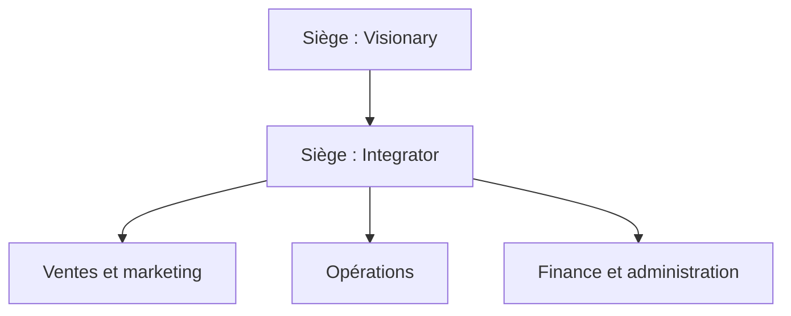
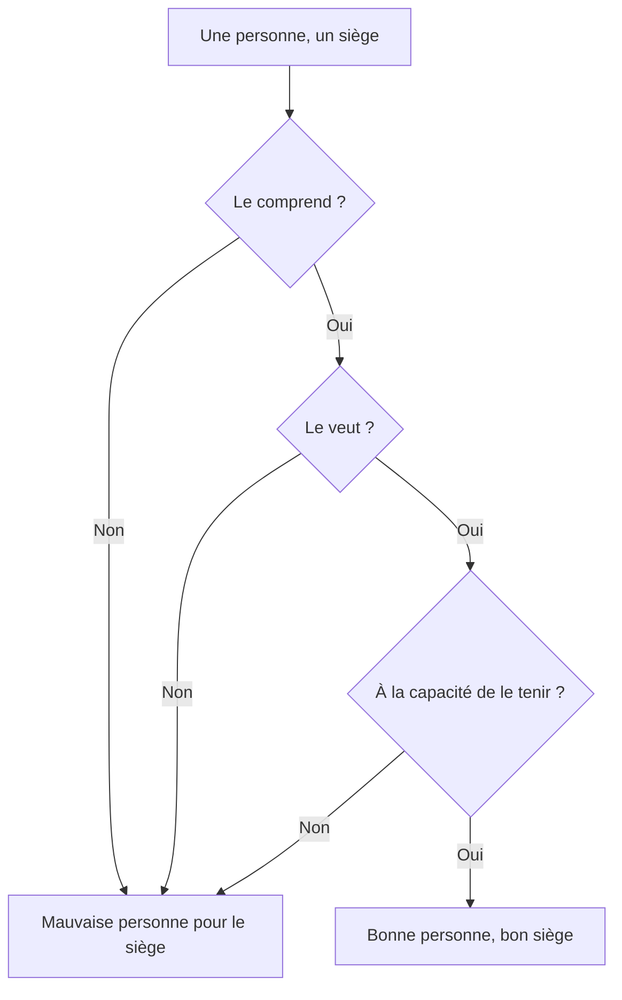
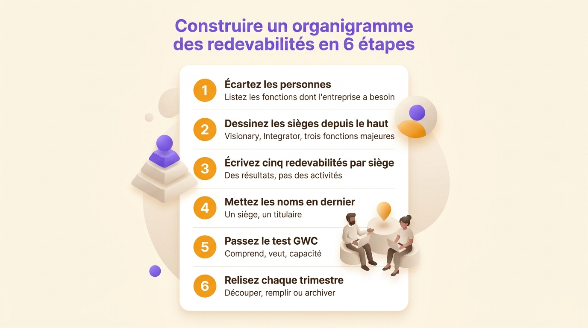
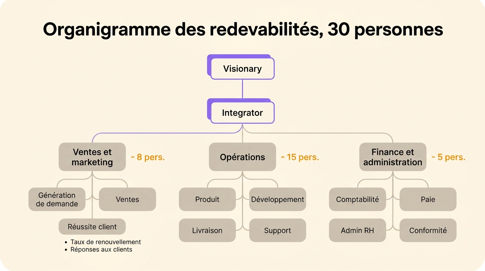

Un organigramme des redevabilités cartographie l’entreprise par les fonctions dont elle a besoin et les résultats que chacune possède, avant de dire quoi que ce soit sur les lignes hiérarchiques. Chaque case est un siège, défini par une courte liste de redevabilités écrites, et chaque siège a un seul titulaire qui en répond. L’outil vient de l’Entrepreneurial Operating System (EOS), une méthode de management pour les PME, où il remplace l’organigramme classique comme représentation principale de l’entreprise.

Voici ce que contient cet organigramme, ce qui le distingue de l’organigramme classique, les sièges que la méthode EOS place en haut, une construction en six étapes à mener en une journée, et un exemple d’entreprise à 30 personnes. Le format a aussi des limites. Mieux vaut les connaître avant de dessiner quoi que ce soit, parce qu’une fois l’organigramme là, tout se joue dans sa mise à jour.

## Définition de l’organigramme des redevabilités

Gino Wickman, fondateur du cabinet de conseil EOS Worldwide, a publié l’outil dans son livre *Traction* en 2010. L’entreprise le commercialise toujours sous une marque déposée, l’Accountability Chart®, au sein de sa méthode pour dirigeants de PME.

Un siège sur l’organigramme est une fonction. Le siège existe qu’on le remplisse ou non, et ce qui le définit est ce qu’il possède : la méthode EOS donne à chaque siège environ cinq redevabilités, écrites comme les résultats dont le siège répond. Les indications actuelles d’EOS Worldwide parlent de cinq à sept. Le siège d’Integrator, par exemple, possède l’exécution du plan d’affaires et le résultat économique de l’entreprise.

La règle qui fait la valeur de l’organigramme : construisez la structure d’abord, les noms ensuite. La méthode EOS dessine la structure dont l’entreprise a besoin pour son prochain palier de croissance, écarte l’équipe actuelle pendant le dessin, puis regarde quelles personnes tiennent quels sièges. Un organigramme classique part des personnes présentes. Un organigramme des redevabilités part du travail dont l’entreprise a besoin.

Le mot lui-même appelle un avertissement. EOS écrit les redevabilités d’un siège comme des résultats. La gouvernance par rôles, en holacratie et en sociocratie, écrit les redevabilités d’un rôle comme des activités continues, à l’infinitif : « Publier selon le calendrier éditorial trimestriel ». Les deux formats décrivent le même travail à des altitudes différentes, et [la différence entre accountability et responsabilité](/fr/blog/accountability-vs-responsibility) démêle les mots quand ils se brouillent. La [fiche de glossaire sur la redevabilité](/fr/glossary/redevabilite) couvre aussi les deux sens.

## Les différences avec l’organigramme classique

Les deux organigrammes dessinent des cases sur la même entreprise. Ils ne répondent pas à la même question.

| | Organigramme classique | Organigramme des redevabilités |
|---|---|---|
| Question à laquelle il répond | Qui rapporte à qui ? | Qui répond de quoi ? |
| Unité de base | Une personne dans un poste | Un siège avec ses redevabilités écrites |
| Construit à partir de | Les personnes présentes aujourd’hui | Les fonctions dont l’entreprise a besoin |
| Moment des noms | En premier, dans les cases | En dernier, une fois la structure tenue |
| Une personne manquante signifie | Une case vide dans une ligne hiérarchique | Un résultat dont personne ne répond |
| Mise à jour | Aux réorganisations | À chaque revue trimestrielle |

Le siège vide est la différence la plus nette entre les deux. Sur un organigramme classique, un poste vacant attend un recrutement. Sur un organigramme des redevabilités, un siège sans titulaire est un résultat sans propriétaire, et il se lit comme un signal d’alerte plutôt que comme un poste à pourvoir.

L’organigramme des redevabilités dessine quand même une hiérarchie, avec l’Integrator qui rapporte au Visionary. Suivre une ligne mène au propriétaire d’un résultat, alors que sur un organigramme classique elle mène à la personne qui approuve les congés.

L’organigramme classique existe en plusieurs formes, et [les principaux types d’organigramme](/fr/blog/org-chart-types) les présentent. L’organigramme des redevabilités emprunte la forme hiérarchique et change le contenu des cases. Pour un travail qui traverse les sièges une seule fois, dans un projet, une [matrice RACI](/fr/blog/raci-matrix) fait le partage mieux qu’aucun organigramme. Les deux couvrent des horizons différents : la RACI meurt avec le projet, l’organigramme lui survit.

## Les sièges : Visionary, Integrator et trois fonctions majeures

La méthode EOS place deux sièges en haut de l’organigramme, avec chacun cinq redevabilités.

Le Visionary possède la direction. Souvent un fondateur, le Visionary porte les idées nouvelles et les offres nouvelles, résout les problèmes qu’aucune autre personne de l’entreprise ne sait résoudre, tient les relations extérieures majeures, porte la culture et signe les plus gros contrats.

L’Integrator fait tourner l’entreprise au quotidien : diriger l’équipe et lui demander des comptes, exécuter le plan d’affaires et répondre du résultat économique, intégrer les fonctions majeures, régler les sujets qui traversent les fonctions, et faire circuler l’information dans toute l’entreprise.

Gino Wickman et Mark Winters, implémenteur EOS, ont consacré un livre entier à ce duo, *Rocket Fuel* (2015). D’après le décompte d’EOS Worldwide, environ la moitié des entreprises qu’ils accompagnent ont un siège de Visionary, et toutes ont besoin d’un Integrator.

Sous l’Integrator, la méthode EOS reconnaît trois fonctions majeures dans toute entreprise : ventes et marketing, opérations, finance et administration. Tout le reste se range dans l’une des trois. Chaque fonction se décompose ensuite en sous-sièges, un titulaire par siège, cinq redevabilités chacun, jusqu’aux contributeurs individuels.

## Construire le sien en six étapes

1. **Écartez les personnes et listez les fonctions.** Demandez-vous quel travail doit exister pour que l’entreprise atteigne son prochain palier, et écrivez les fonctions dans cet ordre. L’équipe actuelle ne participe pas à cette étape. C’est précisément ce qui la rend difficile et utile.

2. **Dessinez les sièges depuis le haut.** Visionary, Integrator, trois fonctions majeures, puis les sous-sièges en dessous. Un siège, un titulaire, jusqu’en bas.

3. **Écrivez cinq redevabilités par siège.** Des résultats, pas des activités. Les règles de formulation des redevabilités d’un rôle s’appliquent ici aussi : « assurer », « collaborer » et « superviser » vident un siège de son sens, et [le guide pour définir les rôles](/fr/blog/define-roles) montre comment les remplacer. Un [modèle de rôles et responsabilités](/fr/blog/roles-responsibilities-template), une entrée par siège, garde la formulation cohérente sur tout l’organigramme.

4. **Mettez les noms en dernier.** Parcourez chaque siège et placez la personne qui lui correspond. Les sièges qu’aucune personne de l’équipe ne peut tenir restent vides, et ils vous disent quoi recruter.

5. **Passez le test GWC sur chaque binôme.** La méthode EOS pose trois questions sur une personne dans un siège : est-ce qu’elle le comprend, est-ce qu’elle le veut, est-ce qu’elle a la capacité de le tenir ? Trois oui font la bonne personne dans le bon siège.

6. **Relisez à chaque revue trimestrielle.** La méthode EOS met l’organigramme à l’ordre du jour de la réunion de planification trimestrielle. Comparez les sièges au travail réellement fait, découpez les sièges devenus trop gros et archivez ceux qui ne décrivent plus rien.

Deux contrôles gardent l’organigramme lisible au fil des mises à jour. Un siège avec plus de sept redevabilités couvre un poste complet, découpez-le. Un siège sans titulaire décrit un travail que personne ne fait, remplissez-le ou supprimez-le. Les deux contrôles prennent des minutes.

{/* IMAGE regen: api.py image, infographic, 1600x900. Scene: "Vertical numbered checklist card titled 'Construire un organigramme des redevabilités en 6 étapes'. Six numbered rows, each with a short label and a one-line description: 1 'Écartez les personnes' with 'Listez les fonctions dont l'entreprise a besoin', 2 'Dessinez les sièges depuis le haut' with 'Visionary, Integrator, trois fonctions majeures', 3 'Écrivez cinq redevabilités par siège' with 'Des résultats, pas des activités', 4 'Mettez les noms en dernier' with 'Un siège, un titulaire', 5 'Passez le test GWC' with 'Comprend, veut, capacité', 6 'Relisez chaque trimestre' with 'Découper, remplir ou archiver'. Numbers in warm orange #FB9803, labels in dark warm grey, the card on a cream background with a purple #9870F0 accent on the title." Regenerate if the six steps change. Last data sync: 2026-10-28. */}

## Un exemple : une éditrice de logiciels de 30 personnes

Prenez une éditrice de logiciels qui vend un outil de gestion de projet, trente personnes, deux fondateurs. Voici l’entreprise dessinée en organigramme des redevabilités :

- Un fondateur tient le siège de Visionary, l’autre celui d’Integrator.
- Ventes et marketing, huit personnes, se décompose en génération de demande, ventes et réussite client.
- Opérations, quinze personnes, tient produit, développement, livraison et support.
- Finance et administration, cinq personnes, tient comptabilité, paie, administration RH et conformité légale.

Chaque responsable de fonction tient un siège de responsable avec cinq redevabilités. La responsable de la réussite client, par exemple, possède le taux de renouvellement, possède les réponses données aux clients, possède le traitement des comptes mécontents, possède le retour produit qui atteint l’équipe produit et possède la passation des ventes vers la réussite client.

Chacun, de la dernière arrivée aux deux fondateurs, tient au moins un siège, et peut montrer l’organigramme en nommant les résultats dont il répond. C’est le test d’un organigramme fini : demandez à n’importe qui ce qu’il possède, la réponse vient sans regarder.

{/* IMAGE regen: api.py image, infographic, 1600x900. Scene: "An accountability chart of a 30-person software company, drawn as a clean tree on a cream background. Top row: 'Visionary' box (purple accent) connected to 'Integrator' box below it. The Integrator connects to three function boxes: 'Ventes et marketing - 8 pers.', 'Opérations - 15 pers.', 'Finance et administration - 5 pers.'. Under each function, small sub-seat boxes: under 'Ventes et marketing' 'Génération de demande', 'Ventes', 'Réussite client'; under 'Opérations' 'Produit', 'Développement', 'Livraison', 'Support'; under 'Finance et administration' 'Comptabilité', 'Paie', 'Admin RH', 'Conformité'. Each function box lists two short accountabilities as bullet lines, for example under 'Réussite client' 'Taux de renouvellement' and 'Réponses aux clients'. Boxes in warm grey with rounded corners, the two top seats accented purple #9870F0, the orange #FB9803 reserved for the people counts. Title at the top: 'Organigramme des redevabilités, 30 personnes'. Clean legible sans-serif typography, every French diacritic reproduced exactly." Regenerate if the example company structure changes. Last data sync: 2026-10-28. */}

## Là où le format casse

**Un siège, une personne.** La règle garde la propriété claire, et elle rend invisible le travail partagé. Quand deux personnes possèdent vraiment quelque chose ensemble, une codirection par exemple, le format impose soit un faux partage, soit un seul nom sur la case. La parade d’EOS consiste à laisser une personne tenir plusieurs sièges, ce que font la plupart des entreprises, mais un siège partagé par deux reste hors du dessin.

**Le dessin prend de la poussière.** L’organigramme vit en général dans une présentation ou un PDF, redessiné pour la revue trimestrielle. Entre deux revues, il s’éloigne de la réalité, et dès que l’écart se voit, les gens cessent de lui faire confiance et se renseignent autrement. Un organigramme auquel personne ne se fie est pire que pas d’organigramme, parce qu’il continue de répondre avec assurance.

**Les sièges redeviennent des intitulés de poste.** Renommez un siège d’après la personne qui le tient, « l’équipe d’Alice » par exemple, et l’organigramme redevient un organigramme classique avec des étapes en plus. Le siège reste indépendant de son titulaire aussi longtemps que la case garde le nom de la fonction plutôt que celui de la personne.

**Un arbre figé convient aux changements lents.** L’organigramme dessine des fonctions. Ces fonctions bougent lentement. Une entreprise qui se réorganise par projets, ou qui grandit assez vite pour redistribuer les cartes chaque trimestre, dépasse la forme plus vite que la revue trimestrielle ne la redessine. [Les organigrammes dynamiques](/fr/blog/dynamic-org-chart), que les équipes mettent à jour elles-mêmes quand les rôles changent, existent exactement pour cette situation.

## Le faire vivre : un organigramme que l’équipe modifie

Le contenu d’un organigramme des redevabilités voyage bien. Les sièges deviennent des rôles, les cinq redevabilités deviennent les redevabilités écrites de chaque rôle, et le dessin cesse d’être le point. Ce qui compte ensuite, c’est que toute l’entreprise ouvre l’organigramme à jour et que l’équipe qui possède un rôle le modifie sans attendre la prochaine revue trimestrielle.

Dans Rolebase, chaque rôle porte une raison d’être, ses redevabilités et un domaine, les trois pièces qu’il faut à un siège. L’organigramme montre toute l’entreprise en cercles imbriqués, en arbre ou en trombinoscope, et chaque membre ouvre la même version vivante. Plusieurs personnes peuvent partager un rôle quand le travail est partagé, un rôle peut se limiter à un seul membre quand la propriété doit rester individuelle, et la liste des rôles vacants montre en un clic le travail que personne ne tient : le siège vide de l’organigramme papier, rendu visible avant qu’il ne coûte cher.

Rolebase n’embarque aucun modèle EOS. L’organigramme dessiné se traduit siège par siège : chaque siège devient un rôle, chaque liste de cinq devient les redevabilités du rôle, et la revue trimestrielle devient une modification que l’équipe fait la semaine où le travail change.

<OrgChartView demo="demo" height="440px" showAllNodes={false} />

Cliquez sur un rôle pour ouvrir sa raison d’être, ses redevabilités et ses membres.

## Questions fréquentes

<FaqList>

<FaqItem question="Qu’est-ce qu’un organigramme des redevabilités ?">

Un organigramme des redevabilités cartographie une organisation par ses fonctions et les résultats que chacune possède. Il vient de la méthode EOS, du livre *Traction* de Gino Wickman. Chaque case est un siège avec environ cinq redevabilités écrites, tenu par une personne qui en répond. Il remplace la question de l’organigramme classique, qui rapporte à qui, par celle-ci : qui répond de quoi ?

</FaqItem>

<FaqItem question="Qu’est-ce qu’un organigramme d’organisation ?">

Un organigramme d’organisation montre la structure d’une organisation : ses postes, qui les occupe et qui rapporte à qui. Il se dessine depuis la direction vers le bas, il se construit à partir des personnes présentes aujourd’hui, et il se met à jour quand la structure change. L’organigramme des redevabilités part au contraire des fonctions dont l’entreprise a besoin et ne place les noms qu’à la fin.

</FaqItem>

<FaqItem question="Existe-t-il un modèle d’organigramme des redevabilités ?">

EOS Worldwide publie un modèle sur son site, avec le Visionary, l’Integrator et les trois fonctions majeures déjà dessinés. Tout document avec une entrée par siège fait aussi l’affaire : un [modèle de rôles et responsabilités](/fr/blog/roles-responsibilities-template) porte le nom du siège, sa raison d’être, ses cinq redevabilités et son titulaire, une page par siège.

</FaqItem>

<FaqItem question="Quelle différence entre un organigramme des redevabilités et un organigramme classique ?">

Un organigramme classique répond à la question « qui rapporte à qui », en partant des personnes présentes aujourd’hui. Un organigramme des redevabilités répond à « qui répond de quoi », en partant des fonctions dont l’entreprise a besoin pour son prochain palier. Les deux dessinent une hiérarchie, mais les cases de l’organigramme des redevabilités portent des redevabilités écrites et un seul titulaire, et les noms n’arrivent qu’une fois la structure tenue.

</FaqItem>

<FaqItem question="Qu’est-ce que le test GWC dans la méthode EOS ?">

GWC signifie « gets it, wants it, capacity to do it » : comprendre le siège, le vouloir, avoir la capacité de le tenir. La méthode EOS pose les trois questions pour chaque personne dans chaque siège. Une personne qui comprend le siège sait comment il fonctionne, une personne qui le veut est motivée pour le tenir, une personne qui a la capacité en a le temps et les compétences. Trois oui font la bonne personne dans le bon siège.

</FaqItem>

</FaqList>

## Par où commencer

Dessinez cinq sièges sur une page aujourd’hui : le Visionary, l’Integrator et les trois fonctions majeures. Écrivez cinq redevabilités par siège sans regarder qui travaille dans l’entreprise, puis mettez les noms et passez le test GWC sur chacun. Cette première page en dit plus sur votre entreprise qu’un redessin complet de l’organigramme classique, parce que chaque case porte un résultat et un propriétaire.

Rolebase garde l’organigramme vivant une fois qu’il existe : des rôles avec leurs redevabilités écrites, dans un organigramme que toute l’entreprise ouvre. Vous pouvez voir [comment les rôles, les réunions et les décisions s’articulent](/fr/features), et [créer un compte gratuit](/signup) jusqu’à cinq membres actifs.
