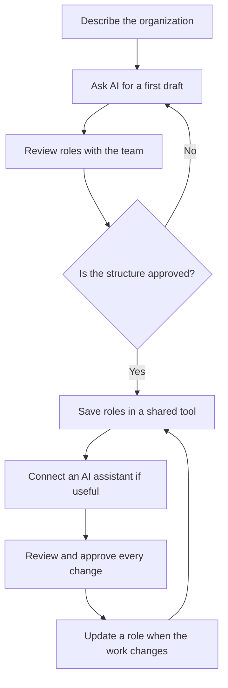

AI can generate an org chart from a description of teams, roles and relationships. The draft reflects the information shared in that conversation. To keep the structure current, store roles in a tool your team can update, then use AI to draft or change roles with your approval.

## Generating an org chart with AI can meet three different needs

The request to generate an org chart with AI can mean three things. You might want a first structure from a blank page. You might want to clarify or rewrite the roles in your current organization. Or you might want to ask questions about a structure that is already documented, then ask an assistant to change it. The right tool depends on where you are starting.

A general-purpose assistant such as ChatGPT, Claude or Mistral can suggest text, diagram code or a visual representation, depending on the features available in your account. [Mermaid Chart, for example, generates org chart diagrams from plain-language prompts](https://mermaid.ai/docs/getting-started/generate-diagram-with-ai), then lets you edit the result in its editor. Anthropic also describes [Claude Artifacts](https://support.claude.com/en/articles/17153992-what-are-artifacts-and-how-do-i-use-them) as pages, diagrams or interactive tools that you can edit in a conversation. These features give you a draft for your team to review.

## What a general-purpose assistant does well

Start by giving the assistant the context you already know. Describe the team size, areas of work, recurring responsibilities and decision relationships. Ask for a proposed set of roles, then ask it to flag open questions. An assistant can also rewrite role titles, turn notes into readable role descriptions, or prepare topics for a discussion with the team.

A specific prompt helps avoid a generic diagram. For example: “Based on this description of our cooperative, suggest a role structure for the consulting team. For each role, distinguish its purpose, decisions it owns and recurring activities. Flag responsibilities that seem to overlap, and leave uncertain reporting relationships as questions.” Only share information you are allowed to give to the assistant provider.

Mermaid recommends naming the diagram type, subject and important relationships in your prompt. Its editor can also generate a diagram from an uploaded document, including an organization description. [Mistral documents Canvas as an option for returning a Mermaid diagram](https://docs.mistral.ai/studio/workflows/interacting-with-workflows/conversational_workflows/canvas) from some workflows.

## Why a generated diagram gets outdated quickly

A general-purpose assistant works from the context you give it and the tools you connect. If you describe your team today, it can return that description in a useful format. The file keeps the state you described, even after a hire, departure or change in responsibility. Someone needs to share the new information, edit the diagram and circulate the corrected version.

A picture does not necessarily say which decisions the person makes, which activities they own or which other teams they work with. A text-based diagram is easier to edit, but its content still needs to follow the changes.

HR tracking addresses another part of the problem. An org chart generated from an HRIS can follow job titles and reporting lines that HR records there. Teams still need to track cross-functional work and responsibilities that change without an update to the employment record. Our article on the [dynamic org chart](/en/blog/dynamic-org-chart) compares these approaches and explains how to choose.

## Choosing between a draft, a diagram and a living org chart

| Need | What the AI or tool produces | What needs maintenance | When to choose it |
| --- | --- | --- | --- |
| Sketch an organization | A role list, proposed relationships or diagram | The starting facts and every later change | You are exploring an organization or planning a reorganization |
| Share a one-off structure | An image, document or editable diagram | The file and the copies you shared | You are preparing a presentation or a dated document |
| Maintain a structure | Role, member and responsibility data | The people holding the roles update their part | Your team uses the org chart in its daily work |
| Ask about and change the structure | Answers and requested changes in plain language | The connected tool’s data and approval of each change | You want to query or update an organization that is already documented |

A diagram helps clarify ideas or show the organization as it stood on a particular date. A shared role structure makes updates available to the people closest to the work. A connected assistant adds a conversational interface and reads the actual data with the account’s permissions.

## Evolving roles with AI in Rolebase

Rolebase uses AI in two ways. In a role, the app can draft its purpose, domain, accountabilities, checklist, indicators and notes from its name. You review the suggestions, edit them and save the result. Your team decides where the role belongs in the organization.

You can also connect Claude, ChatGPT or Mistral Vibe to your Rolebase account with the Model Context Protocol (MCP) connector. The assistant can then read the roles, members and other information available to your account. Ask it to describe the org chart, find vacant roles or add a role. Before a change, it describes what it is about to do and waits for your approval. Your Rolebase permissions still apply, and a change under a strict governance mode goes through a proposal.

To create a role from scratch, start with its name, then ask for a draft. If you need a template first, use this [roles and responsibilities template](/en/blog/roles-responsibilities-template). Read each field with its holder or the relevant team. Correct responsibilities that do not match the real work, clarify the decisions the role owns, and save the approved version. To change several roles, ask the assistant to name each proposed change and review them before confirming.

{/* IMAGE regen: api.py image, illustration, 1600x900. Scene: "A language-agnostic 3D editorial metaphor for an AI-assisted, living organization chart. On the left, a small soft grey paper org-chart sheet with a few empty connected role cards is being gently transformed by a glowing purple and warm orange stream into a shared, living network of rounded role nodes on the right, where three diverse casual teammates collaboratively adjust one node. Clear visual transition from static draft to maintained shared structure, single focal point, generous warm cream negative space, wide horizontal 1600x900 composition. No text, no letters, no numbers, no interface, no pyramid, no suits." */}

Review each change in the org chart before continuing. Follow the steps to [use Rolebase with an AI assistant](/en/guides/use-an-ai-assistant) and [connect an assistant through MCP](/en/docs/mcp).

## A simple way to get started

1. **Describe the current reality.** List the teams, recurring work, responsibilities people already handle and decisions that come up often. Mark what still needs confirmation. If you are starting from scratch, follow these [steps to create an org chart](/en/blog/create-org-chart).
2. **Ask for a first proposal.** Have AI suggest roles and a structure, distinguishing facts you provided from assumptions. Ask it to list unclear areas rather than sound certain when information is missing.
3. **Have people review the roles.** The people concerned check the purpose, decision domain and accountabilities. They correct wording that does not describe the real work.
4. **Save the structure in its working tool.** Choose a tool that fits how your team shares and updates roles. The diagram can then be displayed from that data. Compare [org chart software](/en/blog/best-org-chart-software) and [open source org chart tools](/en/blog/open-source-org-chart-tools) to choose.
5. **Connect an assistant if it helps.** It can find information, prepare a change or edit roles with the permissions of the connected account. Review every proposed change.
6. **Update when the work changes.** When a responsibility moves, the team responsible for that work updates the relevant role. The org chart then reflects what was recorded instead of waiting for the next image export.

The Scop EVEA cooperative mapped 140 people across three sites and more than eight competency clusters in Rolebase. [See how EVEA makes roles and skills visible](/en/client-cases/scop-evea). This case describes a shared org chart, while the guide above covers the AI assistant workflow.

{/* TODO ANECDOTE: Add a verified example of a team using an AI assistant connected to Rolebase to create or change its org chart. Name the organization, the requested change and what a person reviewed before approval. */}

## Frequently asked questions

<FaqList>

<FaqItem question="Which AI can generate an org chart?">

ChatGPT, Claude and other assistants can suggest roles and generate a diagram from a description. The result depends on the tools enabled in your account and the information you provide. To keep the org chart current afterwards, use a tool that stores roles and lets people update them.

</FaqItem>

<FaqItem question="Is there a free AI to create an org chart?">

Yes, [Mermaid extensions are free to install and use](https://mermaid.ai/products/plugins/), and they can generate and edit diagrams from a prompt. Plans and usage limits vary across general-purpose assistants. Check your assistant’s terms before sharing team information with it.

</FaqItem>

<FaqItem question="Can ChatGPT create an org chart?">

Yes. Describe the teams, roles and known relationships, then ask for a structured list or diagram. ChatGPT can also use the Rolebase connector to read or change your organization’s data once you have configured and approved the connection.

</FaqItem>

<FaqItem question="Can AI create an org chart from an existing file?">

Some AI tools accept documents as a starting point. [Mermaid describes generating a diagram from an uploaded document](https://mermaid.ai/docs/getting-started/generate-diagram-with-ai). Check names, reporting lines and responsibilities with the people concerned, since the file may be old or incomplete.

</FaqItem>

<FaqItem question="How do you keep an AI-generated org chart up to date?">

Store roles and their owners in a tool the team updates as work changes. An exported diagram is a dated snapshot. In Rolebase, teams edit their roles in the app, and a connected assistant can read them or suggest changes for approval.

</FaqItem>

</FaqList>

## Choose a tool that follows your organization

A general-purpose AI assistant helps clarify a first draft, suggest wording and prepare a discussion. A file or diagram works for a one-off need. To keep role changes visible, the team needs a structure it can update where it works. Rolebase connects roles to the org chart, helps draft their fields and can connect to an AI assistant that acts with your permissions.

[Explore Rolebase features](/en/features) and create a free account to map your team’s roles. You can also start by [connecting an AI assistant](/en/guides/use-an-ai-assistant) to an existing organization.
