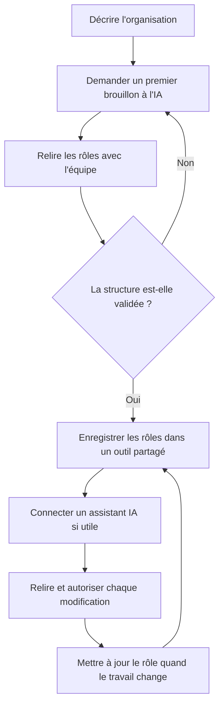

Une IA peut générer un organigramme à partir d’une description des équipes, des rôles et de leurs liens. Le brouillon reflète les informations fournies pendant la conversation. Pour garder la structure à jour, enregistrez les rôles dans un outil que l’équipe peut corriger, puis utilisez l’IA pour les rédiger ou les modifier avec votre accord.

## Générer un organigramme avec une IA peut répondre à trois besoins

La demande « organigramme IA » recouvre trois usages : obtenir une première structure, clarifier les rôles existants, ou interroger et modifier une structure déjà documentée. Le bon outil dépend de votre point de départ.

Un assistant généraliste comme ChatGPT, Claude ou Mistral peut proposer du texte, du code de diagramme ou une représentation visuelle selon les fonctions disponibles dans votre compte. Par exemple, [Mermaid Chart génère un diagramme d’organigramme depuis une description en langage courant](https://mermaid.ai/docs/getting-started/generate-diagram-with-ai), puis permet de modifier le résultat dans son éditeur. Anthropic décrit aussi [les Artifacts de Claude](https://support.claude.com/en/articles/17153992-what-are-artifacts-and-how-do-i-use-them) comme des pages, des diagrammes ou des outils interactifs qui peuvent être modifiés dans la conversation. Ces fonctions donnent un brouillon que votre équipe doit valider.

## Ce qu’un assistant généraliste fait bien

Commencez par lui donner le contexte que vous connaissez déjà. Précisez la taille de l’équipe, les domaines de travail, les responsabilités récurrentes et les liens de décision. Demandez une proposition de rôles, puis faites apparaître les questions encore ouvertes. L’assistant peut aussi reformuler les intitulés, transformer vos notes en fiches lisibles ou préparer les sujets à discuter avec l’équipe.

Une consigne précise évite le diagramme passe-partout. Par exemple : « À partir de cette description de notre coopérative, propose une structure de rôles pour le pôle conseil. Pour chaque rôle, distingue sa raison d’être, ses décisions propres et ses activités récurrentes. Signale les responsabilités qui semblent se chevaucher et laisse les rattachements incertains sous forme de questions. » Donnez uniquement les informations que vous êtes autorisé à partager avec le fournisseur de l’assistant.

Mermaid recommande de préciser le type de diagramme, le sujet et les relations importantes dans la consigne. Son éditeur peut aussi générer un diagramme depuis un document chargé. [Mistral documente Canvas comme sortie Mermaid](https://docs.mistral.ai/studio/workflows/interacting-with-workflows/conversational_workflows/canvas) dans certains workflows.

## Pourquoi un diagramme généré vieillit rapidement

Un assistant généraliste travaille à partir du contexte que vous lui fournissez et des outils auxquels vous le connectez. Si vous lui décrivez votre équipe aujourd’hui, il peut restituer cette description sous une forme pratique. Le fichier reflète l’état décrit pendant la conversation. Les changements d’équipe qui suivent demandent une mise à jour. Quelqu’un doit transmettre les nouvelles informations, modifier le diagramme, puis partager la version corrigée.

Une image ne dit pas nécessairement quelles décisions la personne prend, quelles activités elle suit ou dans quelles autres équipes elle travaille. Un diagramme en texte se modifie plus facilement, mais son contenu doit quand même suivre les changements.

Le suivi RH répond à une autre partie du problème. Un organigramme généré depuis un SIRH peut suivre les intitulés de poste et les rattachements que les ressources humaines y enregistrent. [Microsoft précise que l’actualisation des données liées dans Visio met à jour les formes existantes](https://support.microsoft.com/fr-fr/visio/create-an-organization-chart-in-visio). Les équipes doivent ajouter elles-mêmes les rôles transverses et les responsabilités qui évoluent sans changement de contrat. Pour comparer ces approches, voyez comment [un organigramme dynamique reste à jour](/fr/blog/dynamic-org-chart).

## Choisir entre un brouillon, un diagramme et un organigramme vivant

| Besoin | Ce que l’IA ou l’outil produit | Ce qu’il faut maintenir | Quand le choisir |
| --- | --- | --- | --- |
| Esquisser une organisation | Liste de rôles, propositions de liens ou diagramme | Les faits de départ et chaque changement ultérieur | Vous explorez une organisation ou préparez une réorganisation |
| Partager une structure ponctuelle | Image, document ou diagramme éditable | Le fichier et les copies partagées | Vous préparez une présentation ou un document daté |
| Tenir une structure à jour | Données de rôles, personnes et responsabilités | Chaque équipe met à jour les rôles qu’elle connaît | L’équipe se sert de l’organigramme dans son travail quotidien |
| Interroger et modifier la structure | Réponses et changements demandés en langage naturel | Les données de l’outil connecté et la validation des changements | Vous voulez consulter ou modifier une organisation déjà documentée |

Un diagramme clarifie les idées ou montre une structure à une date donnée. Une structure de rôles partagée donne accès aux mises à jour. Un assistant connecté permet de consulter et modifier les données avec les permissions du compte.

## Faire évoluer les rôles avec l’IA dans Rolebase

Rolebase propose deux usages de l’IA. Dans la fiche d’un rôle, l’application peut rédiger un premier jet de sa raison d’être, de son domaine, de ses redevabilités, de sa liste de contrôle, de ses indicateurs et de ses notes à partir de son nom. Vous relisez les propositions, vous les corrigez, puis vous les enregistrez. Votre équipe décide où le rôle prend place dans l’organisation.

Vous pouvez aussi connecter Claude, ChatGPT ou Mistral Vibe à votre compte Rolebase avec le protocole Model Context Protocol (MCP). L’assistant consulte alors les rôles, les membres et les autres informations accessibles à votre compte. Vous pouvez lui demander de décrire l’organigramme, de chercher les rôles vacants ou d’ajouter un rôle. Avant une modification, il vous décrit ce qu’il va faire et attend votre accord. Les permissions Rolebase continuent de s’appliquer, et un changement soumis à un mode de gouvernance strict passe par une proposition.

Pour créer un rôle à partir de zéro, commencez par définir son nom, puis demandez un brouillon. Si vous avez besoin d’une trame avant de commencer, partez de ce [modèle de rôles et responsabilités](/fr/blog/roles-responsibilities-template). Lisez chaque champ avec son titulaire ou l’équipe concernée. Corrigez les responsabilités qui ne correspondent pas au travail réel, précisez les décisions qui reviennent au rôle et enregistrez la version validée. Pour modifier plusieurs rôles, demandez à l’assistant de nommer précisément les changements envisagés et relisez-les avant de confirmer.

{/* IMAGE regen: api.py image, illustration, 1600x900. Scene: "A language-agnostic 3D editorial metaphor for an AI-assisted, living organization chart. On the left, a small soft grey paper org-chart sheet with a few empty connected role cards is being gently transformed by a glowing purple and warm orange stream into a shared, living network of rounded role nodes on the right, where three diverse casual teammates collaboratively adjust one node. Clear visual transition from static draft to maintained shared structure, single focal point, generous warm cream negative space, wide horizontal 1600x900 composition. No text, no letters, no numbers, no interface, no pyramid, no suits." */}

Relisez chaque changement dans l’organigramme avant de poursuivre. Suivez les étapes pour [utiliser Rolebase avec un assistant IA](/fr/guides/use-an-ai-assistant) et [connecter un assistant avec MCP](/fr/docs/mcp).

## Une méthode simple pour commencer

1. **Décrivez la réalité actuelle.** Notez les équipes, les activités récurrentes, les responsabilités déjà assumées et les décisions qui reviennent souvent. Marquez ce qui reste à confirmer. Si vous partez de zéro, suivez aussi [les étapes pour créer un organigramme](/fr/blog/create-org-chart).
2. **Demandez une première proposition.** Faites générer des rôles et une structure en distinguant les faits fournis des hypothèses. Demandez une liste des zones floues plutôt qu’une réponse assurée quand les informations manquent.
3. **Faites relire les rôles.** Les personnes concernées vérifient leur raison d’être, leur domaine de décision et leurs redevabilités. Elles corrigent les formulations qui ne décrivent pas le travail réel.
4. **Enregistrez la structure dans son outil de suivi.** Choisissez un outil adapté à la façon dont votre équipe partage et actualise les rôles. Le diagramme peut ensuite être affiché depuis ces données. Le [comparatif des logiciels d’organigramme](/fr/blog/best-org-chart-software) et celui des [outils open source](/fr/blog/open-source-org-chart-tools) vous aideront à choisir.
5. **Connectez un assistant si cela vous aide.** Il pourra chercher une information, préparer un changement ou modifier les rôles avec les permissions du compte connecté. Vérifiez chaque changement proposé.
6. **Mettez à jour au moment du changement.** Quand une responsabilité bouge, la personne ou l’équipe qui la connaît corrige le rôle concerné. L’organigramme reflète alors ce qui a été enregistré, au lieu d’attendre la prochaine exportation d’une image.

La Scop EVEA a cartographié 140 personnes sur trois sites et plus de huit pôles de compétences dans Rolebase. [Son exemple montre comment rendre les rôles et compétences visibles](/fr/client-cases/scop-evea). Ce cas décrit la cartographie partagée. Le guide ci-dessus explique comment ajouter un assistant connecté.

{/* TODO ANECDOTE: Ajouter un exemple vérifié d’une équipe qui a utilisé un assistant IA connecté pour créer ou modifier son organigramme. Préciser l’organisation, le changement demandé et ce qu’une personne a vérifié avant validation. */}

## Questions fréquentes

<FaqList>

<FaqItem question="Quelle IA peut générer un organigramme ?">

ChatGPT, Claude et d’autres assistants peuvent proposer des rôles et générer un diagramme à partir d’une description. Le résultat dépend des outils activés dans votre compte et des informations que vous fournissez. Pour un organigramme qui évolue ensuite, utilisez un outil qui conserve les rôles et permet de les mettre à jour.

</FaqItem>

<FaqItem question="Existe-t-il une IA gratuite pour créer un organigramme ?">

Oui, [les extensions Mermaid sont gratuites à installer et à utiliser](https://mermaid.ai/products/plugins/), et elles peuvent générer puis modifier des diagrammes à partir d’une consigne. Les offres et les limites des assistants généralistes varient. Vérifiez les conditions de votre assistant avant d’y transmettre des données d’équipe.

</FaqItem>

<FaqItem question="Peut-on créer un organigramme avec ChatGPT ?">

Oui. Décrivez les équipes, les rôles et les liens connus, puis demandez une liste structurée ou un diagramme. ChatGPT peut aussi utiliser le connecteur Rolebase pour consulter ou modifier les données de votre organisation, lorsque vous l’avez configuré et autorisé.

</FaqItem>

<FaqItem question="Une IA peut-elle créer un organigramme à partir d’un fichier existant ?">

Certains outils d’IA acceptent des documents comme point de départ. [Mermaid décrit la génération d’un diagramme depuis un document chargé](https://mermaid.ai/docs/getting-started/generate-diagram-with-ai). Vérifiez ensuite les noms, les liens hiérarchiques et les responsabilités avec les personnes concernées, car le fichier peut être ancien ou incomplet.

</FaqItem>

<FaqItem question="Comment garder un organigramme généré par IA à jour ?">

Enregistrez les rôles et leurs responsables dans un outil que l’équipe met à jour au fil des changements. Un diagramme exporté reste une version datée. Avec Rolebase, les équipes modifient leurs rôles dans l’application, et un assistant connecté peut les consulter ou proposer des changements à valider.

</FaqItem>

</FaqList>

## Choisir un outil qui suit votre organisation

Une IA généraliste est utile pour clarifier un premier jet, proposer des formulations et préparer une discussion. Un fichier ou un diagramme répond bien à un besoin ponctuel. Pour que les changements de rôles restent visibles, l’équipe a besoin d’une structure qu’elle peut corriger là où elle travaille. Rolebase associe les rôles à l’organigramme, aide à rédiger leurs champs et peut se connecter à un assistant IA qui agit avec vos permissions.

[Découvrez les fonctionnalités de Rolebase](/fr/features) et créez un compte gratuit pour cartographier les rôles de votre équipe. Vous pouvez aussi commencer par [connecter un assistant IA](/fr/guides/use-an-ai-assistant) à une organisation existante.
