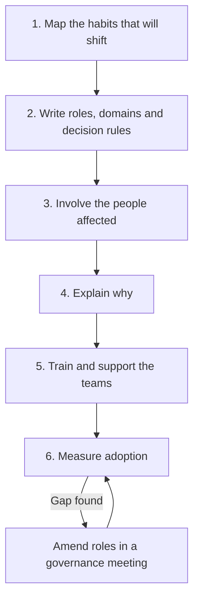
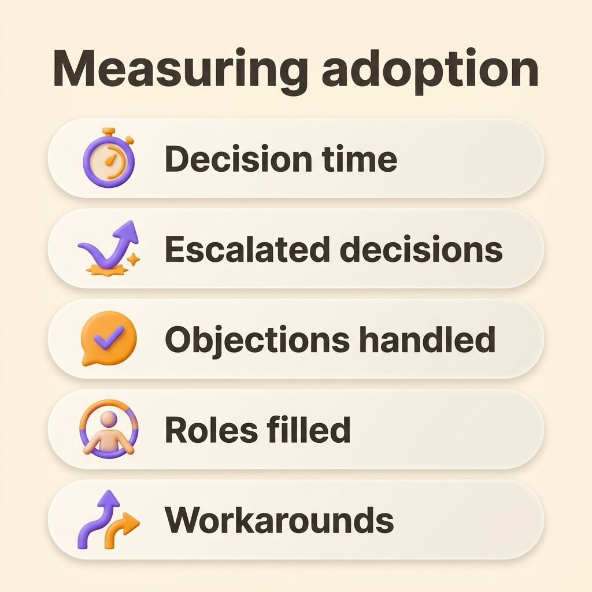

Organizational change management is the set of actions that help the people affected by a transformation understand what changes for them and work differently day to day. It runs in six steps: map the habits that will shift, write the target structure, involve the people affected, explain why, train and support the teams, then measure adoption. This guide walks through each step for an organization moving to autonomous teams, shared governance or a new split of roles.

A new org chart can easily change nothing. The presentation goes well. Three months later, decisions still go up to the same office, because nobody helped the teams use the new structure.

## What is organizational change management?

An organizational transformation has two workstreams. In the first, you produce the change: the new org chart, the roles, the decision rules, the tool. In the second, you explain the change to the people affected, involve them, train them and track where they stand until they adopt it. That second workstream is [change management](/en/glossary/conduite-du-changement). The first workstream ends on a delivery date. Change management ends when the new habits have replaced the old ones, often well after launch.

You will read everywhere that 70% of transformations fail. Mark Hughes, a researcher at the University of Brighton, traced the five most cited sources of that figure in a 2011 article in the *Journal of Change Management*. None of them rested on a measurement, so you can draw no conclusion about your own odds from it.

Surveys by Prosci, a consultancy that sells its own method, give a more useful signal. According to Prosci, 88% of practitioners who rate their change management as excellent say they met or exceeded their objectives, against 13% of those who rate it as poor. Practitioners grade their own work here, in a survey run by a firm with a commercial stake in the result. Even so, with a gap that wide, you can take one lesson from it: adoption is work in its own right.

## The Lewin and Kotter models

The three-stage model credited to the psychologist Kurt Lewin describes change as a move from one stable state to another. The organization unfreezes its habits, makes the change, then refreezes the new habits so they last. Stephen Cummings, Todd Bridgman and Kenneth Brown, management researchers in Wellington and Iowa, showed in *Human Relations* in 2016 that Lewin never built that model. It rests on a short passage in one of his last articles, which other authors expanded after his death in 1947. One useful idea still holds: before you change anything, make the habits you are about to drop visible.

John Kotter, a professor at Harvard Business School, published eight steps in the *Harvard Business Review* in 1995, drawn from more than a hundred companies he had watched attempt a transformation:

1. Establish a sense of urgency.
2. Form a guiding coalition.
3. Create a vision.
4. Communicate the vision.
5. Give others the means to act on the vision.
6. Plan for and create short-term wins.
7. Consolidate gains and produce more change.
8. Anchor new approaches in the culture.

In his 2014 book *Accelerate*, Kotter suggested running these steps in parallel rather than one after the other.

The six steps in this guide also borrow from a third approach, shared governance, where the people affected revise the roles themselves in meetings.

| Model | Core idea | What you can use | Limit |
| --- | --- | --- | --- |
| Lewin, three stages | Unfreeze, change, refreeze | List the habits that will disappear before launch | Assumes a stable end state, while a role-based organization keeps evolving |
| Kotter, eight steps | Urgency, coalition, vision, quick wins | Plan visible results in the first weeks | Built for change decided at the top, where the people affected have little say in the design |
| Shared governance | Roles revised in meetings, decisions by consent | The people affected amend the change before it applies | Takes meeting time and the habit of writing everything down |

## A six-step change management plan

The six steps overlap: you measure from the start and explain the change while you involve the people affected.

### 1. Map the habits that will shift

List what people do today that is about to change: who approves a purchase, who settles a clash between two priorities, who answers a question about a client. For each line, note who loses a habit and who picks up a new one.

Measure your starting point too. Take the last ten issues a team raised and, for each one, note the time between the moment someone flagged the problem and the decision that dealt with it. Without that number, you will have no way to tell in six months whether the change helped.

### 2. Write the target structure

A target organization described in a slide deck leaves everyone free to read it their own way. Write it down at the level where people work. Give each role a purpose, a domain it decides on alone and accountabilities, then set a decision rule for each type of topic. [A role differs from a job description](/en/blog/roles-vs-job-descriptions) through that precise decision scope. One person also often holds several roles.

Also name what is still decided at the top, such as payroll, legal or safety. Teams believe more readily in the autonomy you give them when they know where it ends.

### 3. Involve the people affected

In 1947, Lester Coch, personnel manager at the Harwood pajama factory in Virginia, and the psychologist John French compared several ways of introducing a change in work methods. One group of employees received the change without any part in its design. Another took part through representatives. Two other groups designed the new methods themselves with management. According to their 1948 article in *Human Relations*, the groups that took part directly recovered their output faster than the group that had no part in the design, with fewer departures and less conflict. The group that took part through representatives landed in between.

In practice, show the people affected a proposed structure, ask what would stop them from working with it, amend the proposal, then adopt it. A [consent decision](/en/glossary/consentement) works on that principle: a proposal passes once nobody has a reasoned objection left. Someone who amended a role knows it before it even applies.

### 4. Explain why

Leaders announcing a transformation tend to talk about agility or autonomy. Teams need the concrete problem, for example "purchases over €2,000 wait three weeks for the director's signature". Say what is decided, what is still open, what changes for each team and where to ask questions.

Repeat the explanation at every opportunity. Otherwise, someone who missed the kickoff meeting learns about the change through gossip.

### 5. Train and support the teams

People learn a new decision system by using it. Plan [governance meetings](/en/blog/governance-meeting) where the team creates and edits roles with a [facilitator](/en/glossary/facilitateur), and short check-ins where anyone can say what is getting in the way.

Look after middle managers first. They lose approval power, often before they know which roles they will hold next. Offer them those roles before you remove their old positions, or they will defend the old way of working, which makes sense from where they stand.

### 6. Measure adoption

Take the decision time you measured at the start and check it again one month after launch, then every quarter. If it has not dropped in six months, fix the project rather than launching another communication campaign.

If you are moving to horizontal management, follow [the order of work in a horizontal transition](/en/blog/horizontal-transition), which starts by writing roles before removing positions. If you are redrawing teams, [reorganize role by role](/en/blog/reorganization) before you move people.

## Resistance to change is information

Resistance to change rarely comes from bad faith. Most of the time, it points to a flaw in the project that the people affected see better than its authors. For example:

- Someone keeps getting their decisions approved by their former manager. Their new domain may be unclear, or nobody told them they could decide alone.
- A team keeps the old tracking spreadsheet running alongside the new tool. The new process is missing a step, often the one that passed on a piece of information the team used to receive and no longer gets.
- Someone objects that their new role adds work. They are often right, because the time spent coordinating was never counted anywhere.
- A manager drags their feet. They are losing power without knowing which role they will hold tomorrow.

Handle each case of resistance like an objection to a proposal. Ask the person what they are trying to protect, check whether the problem is real, then amend the role or the rule when it is. When an objection does not hold, say so and give your reasons. Write down each objection and its answer, so the next person who asks the same question finds the reason in writing.

## Moving to a role-based organization

In a job-based organization, each person has a position that covers all of their work. Their manager settles anything outside that position. In a role-based organization, the same person holds several roles, each with a precise domain. Decisions that go beyond a single role follow a written rule.

| Question | Job-based organization | Role-based organization |
| --- | --- | --- |
| Who decides on a topic? | The manager, or whoever holds the title | The role that has that topic in its domain |
| Who settles a clash between two teams? | The shared manager | A named rule, such as consent |
| How does the structure evolve? | Through a one-off reorganization | In regular governance meetings |
| Where do you find who does what? | In a chart of positions, often out of date | In a role map kept up to date |
| What happens to a badly scoped role? | It waits for the next reorganization | It gets amended at the next meeting |

The change lasts when four documents stay current and open to everyone:

- the role map with each role's domain
- the decision rules
- governance decisions with their rationale
- the history of org chart changes

When a [horizontal organization](/en/glossary/organisation-horizontale) keeps these documents in a spreadsheet three people maintain, the old hierarchy comes back by word of mouth, as everyone goes back to asking whoever knows. [Scop EVEA](/en/client-cases/scop-evea), a cooperative that grew from 60 to 140 people between 2020 and 2023, tracked its shared governance in a PowerPoint deck that had become impossible to keep current. Its teams now keep their roles in an org chart they update as the work changes.

{/* TODO ANECDOTE: exemple réel d’un passage à une organisation par rôles dans Rolebase (Lonestone ou client qui accepte d’être cité) : la résistance la plus nette rencontrée, ce qu’elle signalait, comment l’équipe l’a traitée, et si possible le délai de décision avant et après. */}

## Measuring change adoption

Measure adoption on the structure and on decisions rather than on each person's activity: teams experience a per-person dashboard as surveillance. Record the value of each [adoption indicator](/en/glossary/indicateur) before the change, so you have a baseline to compare against.

| Indicator | How to measure it | Frequency | Warning sign |
| --- | --- | --- | --- |
| Decision time | Median time from a flagged problem to the decision, over ten issues | Quarterly | No drop after two quarters |
| Decisions escalated for lack of a clear domain | Count in governance meetings | Monthly | The same domain comes up several months running |
| Objections raised and handled | Count in proposals | Quarterly | Zero objections for two quarters |
| Roles filled | Roles with an active holder, roles vacant or filled by default | Monthly | Vacant roles piling up |
| Workarounds | Old channels still in use, noted in one-on-ones | Quarterly | Approval by the former manager persists |

Read the objection count with care. Zero objections for two quarters points to silence more often than agreement, especially in a team coming out of a very hierarchical organization.

{/* IMAGE regen: api.py image, infographic, 1200x1200. Scene: "Design a reader-friendly vertical infographic with a short heading and five large rounded cards stacked from top to bottom, each with a simple distinct line icon on the left (a stopwatch, an upward arrow bouncing back, a speech bubble with a check mark, a person in a circle, a detour arrow). Exact heading: ‘Measuring adoption’. Exact five card labels, one per card, top to bottom: ‘Decision time’, ‘Escalated decisions’, ‘Objections handled’, ‘Roles filled’, ‘Workarounds’. Soft isometric editorial feel, ample spacing, legible modern clean bold sans-serif. Do not add any other text, numbers, or decorative labels." */}

## Keeping the written structure in Rolebase

[Rolebase](/en/features) keeps the written structure in the same place as the work. Each role in the interactive org chart shows its purpose, domain and accountabilities. A [proposal](/en/docs/proposals) groups changes to roles and members, goes to a vote by consent, majority or unanimity, then applies those changes to the org chart once approved. Every change goes into a history. Meetings and decisions are attached to roles.

The product is open source, free up to five active members, then [€5 per user per month](/en/pricing).

## Frequently asked questions

<FaqList>

<FaqItem question="Who owns change management?">

Leadership owns the decision to change. One or two people then hold the change management role: preparing the explanations, running the meetings, collecting objections, tracking the indicators. Write that role like any other, with a domain and accountabilities. Middle managers and meeting facilitators carry a large share of it day to day, since the questions land with them.

</FaqItem>

<FaqItem question="How long does a transition take?">

It depends on how many people are involved and what is moving. For a pilot team writing its roles and holding its first governance meetings, expect several months. At group scale, Bayer launched its model of autonomous teams in January 2024 and announced in March 2026 that it applied in every country and every division. Consider the transition done when the adoption indicators have settled, rather than on a date fixed in advance.

</FaqItem>

<FaqItem question="What is the difference between change management and project management?">

The project manager delivers the change on time and on budget: the new structure, the written roles, the configured tool. The person leading the change looks after the people who will work with it, by explaining the change to them, involving them, training them and measuring adoption. A project can ship on time while nobody changes their habits. Run both together, with different owners when the organization can afford it.

</FaqItem>

<FaqItem question="What should you do when leadership changes its mind?">

Say so quickly and explain why. Without an explanation, teams conclude they had better wait for the next reversal before changing anything. Separate what changes from what stays: the written roles and the decision rule often remain valid when the timeline or the scope moves. If the original decision was made by consent, take the change through the same process, so the people who amended it can amend it again.

</FaqItem>

<FaqItem question="How do you learn change management?">

Certification courses from firms such as Prosci teach a complete method, which helps if you run several transformations a year. For a single organizational transformation, you will learn more by doing it: start a pilot team, hold its governance meetings and write down what gets in the way.

</FaqItem>

</FaqList>

## An organizational change lasts when it is written down

The Lewin and Kotter models suggest an order for the steps. The Coch and French study shows why it pays to involve people. On the ground, the change lasts when each person knows which roles they hold, what they decide alone and where to raise an objection. Start with one team, write its roles and its decision rule, and measure decision time before and after the change.

[See how Rolebase keeps roles, decisions and meetings in one place](/en/features), then [create a free account](/signup) for a first team of up to five active members.
