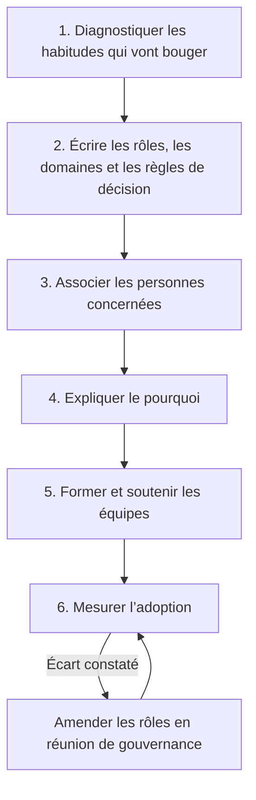
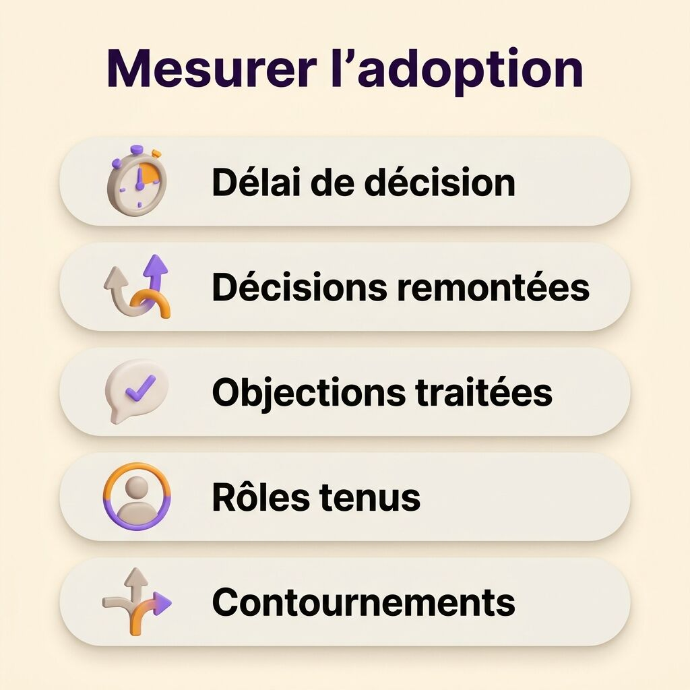

La conduite du changement regroupe les actions qui aident les personnes touchées par une transformation d’organisation à comprendre ce qui change pour elles et à travailler autrement au quotidien. Elle se mène en six étapes : diagnostiquer les habitudes qui vont bouger, écrire la structure cible, associer les personnes concernées, expliquer le pourquoi, former et soutenir les équipes, puis mesurer l’adoption. Ce guide détaille chaque étape pour une organisation qui passe aux équipes autonomes, à la gouvernance partagée ou à une nouvelle répartition des rôles.

Un nouvel organigramme peut très bien rester sans effet. La présentation se passe bien, puis trois mois plus tard les décisions remontent toujours au même bureau, parce que personne n’a aidé les équipes à se servir du nouvel organigramme.

## Qu’est-ce que la conduite du changement ?

Une transformation d’organisation comporte deux chantiers. Dans le premier, on produit le changement : le nouvel organigramme, les rôles, les règles de décision, l’outil. Dans le second, on explique le changement aux personnes concernées, on les associe, on les forme et on mesure où elles en sont, jusqu’à ce qu’elles l’adoptent. On appelle ce second chantier la [conduite du changement](/fr/glossary/conduite-du-changement). Le premier chantier se termine à une date de livraison. La conduite du changement se termine quand les nouvelles habitudes ont remplacé les anciennes, souvent bien après le lancement.

On lit partout que 70 % des transformations échouent. Mark Hughes, chercheur à l’université de Brighton, a examiné en 2011 les cinq sources les plus citées de ce chiffre dans un article du *Journal of Change Management*. Aucune ne s’appuyait sur une mesure. Vous ne pouvez donc rien en conclure sur vos chances.

Les enquêtes de Prosci, un cabinet qui vend sa propre méthode, donnent une indication plus utile. D’après Prosci, 88 % des praticiens qui jugent leur conduite du changement excellente déclarent avoir atteint ou dépassé leurs objectifs, contre 13 % de ceux qui la jugent médiocre. Les praticiens notent eux-mêmes leur travail, dans une enquête menée par un cabinet qui a un intérêt commercial au résultat. Cela dit, avec un écart pareil, vous pouvez en retenir une leçon : l’adoption demande un travail à part entière.

## Les modèles de Lewin et de Kotter

Le modèle en trois temps attribué au psychologue Kurt Lewin décrit le changement comme le passage d’un état stable à un autre. L’organisation décristallise ses habitudes, opère le changement, puis recristallise les nouvelles habitudes pour qu’elles durent. Stephen Cummings, Todd Bridgman et Kenneth Brown, chercheurs en management à Wellington et dans l’Iowa, ont montré en 2016 dans la revue *Human Relations* que Lewin n’a jamais construit ce modèle. Le modèle vient d’un court passage d’un de ses derniers articles, que d’autres auteurs ont développé après sa mort en 1947. Il en reste quand même une idée utile : avant de changer, rendez visibles les habitudes que vous allez abandonner.

John Kotter, professeur à la Harvard Business School, a publié en 1995 dans la *Harvard Business Review* huit étapes tirées de ce qu’il a observé dans plus de cent entreprises :

1. Créer un sentiment d’urgence.
2. Réunir une coalition pour mener le changement.
3. Formuler une vision.
4. Communiquer cette vision.
5. Donner aux gens les moyens d’agir.
6. Obtenir des résultats visibles à court terme.
7. Consolider les acquis pour aller plus loin.
8. Ancrer les nouvelles pratiques dans la culture.

En 2014, dans son livre *Accelerate*, Kotter a proposé de mener ces étapes en parallèle plutôt qu’à la suite.

Les six étapes de ce guide empruntent aussi à une troisième approche, la gouvernance partagée, où les personnes concernées révisent elles-mêmes les rôles en réunion.

| Modèle | Idée centrale | Apport concret | Limite |
| --- | --- | --- | --- |
| Lewin, trois temps | Décristalliser, changer, recristalliser | Lister les habitudes qui vont disparaître avant de lancer | Suppose un état final stable, alors qu’une organisation par rôles évolue en continu |
| Kotter, huit étapes | Urgence, coalition, vision, résultats rapides | Prévoir des résultats visibles dès les premières semaines | Pensé pour un changement décidé en haut, où les personnes concernées participent peu à la conception |
| Gouvernance partagée | Rôles révisés en réunion, décision par consentement | Les personnes concernées amendent le changement avant qu’il s’applique | Demande du temps de réunion et l’habitude de tout écrire |

## Le plan de conduite du changement en six étapes

Les six étapes se chevauchent : vous mesurez dès le départ et expliquez le changement pendant que vous y associez les personnes concernées.

### 1. Diagnostiquer les habitudes qui vont bouger

Listez ce que les gens font aujourd’hui et qui va changer : qui valide une dépense, qui arbitre entre deux priorités, à qui on pose une question sur un client. Pour chaque ligne, notez qui perd une habitude et qui en prend une nouvelle.

Mesurez aussi le point de départ. Prenez les dix derniers sujets remontés par une équipe et notez, pour chacun, le délai entre le moment où quelqu’un a signalé le problème et la décision qui l’a traité. Sans ce chiffre, vous ne pourrez pas dire dans six mois si le changement a servi.

### 2. Écrire la structure cible

Une organisation cible décrite dans une présentation laisse chacun l’interpréter à sa façon. Écrivez-la au niveau où les gens travaillent. Donnez à chaque rôle une raison d’être, un domaine sur lequel il décide seul et des redevabilités, puis fixez une règle de décision par type de sujet. [Un rôle se distingue d’une fiche de poste](/fr/blog/roles-vs-job-descriptions) par ce périmètre de décision précis. Une même personne tient d’ailleurs souvent plusieurs rôles.

Nommez aussi ce qui reste décidé en haut, comme la paie, le juridique ou la sécurité. Les équipes croient plus facilement à l’autonomie qu’on leur donne quand elles en connaissent les limites.

### 3. Associer les personnes concernées

En 1947, Lester Coch, responsable du personnel de l’usine de pyjamas Harwood en Virginie, et le psychologue John French ont comparé plusieurs façons de mener un changement de méthode de travail. Un groupe de salariés a reçu le changement sans participer à sa conception. Un autre y a participé par des représentants. Deux autres groupes ont conçu les nouvelles méthodes eux-mêmes avec la direction. D’après leur article publié en 1948 dans *Human Relations*, les groupes qui ont participé directement ont retrouvé leur rendement plus vite que le groupe qui n’avait pas participé, avec moins de départs et de conflits. Le groupe qui avait participé par des représentants se situait entre les deux.

En pratique, présentez aux personnes concernées une proposition de structure, demandez-leur ce qui les empêcherait de travailler avec, amendez la proposition, puis adoptez-la. La [décision par consentement](/fr/glossary/consentement) suit ce principe : une proposition passe quand plus personne n’a d’objection argumentée. Une personne qui a amendé un rôle le connaît avant même qu’il s’applique.

### 4. Expliquer le pourquoi

Une direction qui annonce une transformation parle souvent d’agilité ou d’autonomie. Les équipes ont besoin du problème concret, par exemple « les achats de plus de 2 000 euros attendent trois semaines la signature du directeur ». Dites ce qui est décidé, ce qui reste ouvert, ce qui change pour chaque équipe et où poser les questions.

Répétez l’explication à chaque occasion. Sinon, une personne absente de la réunion de lancement découvre le changement par la rumeur.

### 5. Former et soutenir les équipes

Une équipe apprend un nouveau système de décision en le pratiquant. Prévoyez des [réunions de gouvernance](/fr/blog/governance-meeting) où l’équipe crée et modifie des rôles avec un [facilitateur](/fr/glossary/facilitateur), et des points courts où chacun peut dire ce qui coince.

Occupez-vous d’abord des managers intermédiaires. Ils perdent un pouvoir de validation, souvent sans savoir encore quels rôles ils tiendront ensuite. Proposez-leur ces rôles avant de supprimer leur ancien poste, sinon ils défendront l’ancien fonctionnement, ce qui est logique de leur point de vue.

### 6. Mesurer l’adoption

Un mois après le lancement, mesurez à nouveau le délai de décision relevé au départ, puis recommencez chaque trimestre. Si ce délai n’a pas baissé en six mois, corrigez le projet plutôt que de lancer une nouvelle campagne de communication.

Si vous passez au management horizontal, suivez [l’ordre des chantiers d’une transition horizontale](/fr/blog/horizontal-transition), qui commence par écrire les rôles avant de supprimer des postes. Si vous redécoupez les équipes, [réorganisez rôle par rôle](/fr/blog/reorganization) avant de déplacer les personnes.

## Les résistances au changement sont des informations

Une résistance au changement vient rarement de la mauvaise volonté. Le plus souvent, elle signale un défaut du projet que les personnes concernées voient mieux que ses auteurs. Par exemple :

- Une personne continue de faire valider ses décisions par son ancien manager. Son nouveau domaine est peut-être flou, ou personne ne lui a dit qu’elle pouvait décider seule.
- Une équipe tient l’ancien tableau de suivi en parallèle du nouvel outil. Il manque une étape au nouveau processus, souvent la transmission d’une information que l’équipe recevait avant et ne reçoit plus.
- Quelqu’un objecte que son nouveau rôle lui ajoute du travail. Il a souvent raison, parce que le temps passé à coordonner n’a été compté nulle part.
- Un manager freine. Il perd un pouvoir sans savoir quel rôle il tiendra demain.

Traitez chaque résistance comme une objection à une proposition. Demandez à la personne ce qu’elle cherche à protéger, vérifiez si le problème est réel, puis amendez le rôle ou la règle quand il l’est. Quand une objection ne tient pas, dites-le avec vos raisons. Notez chaque objection et sa réponse : la prochaine personne qui pose la même question trouvera la raison écrite.

## Passer à une organisation par rôles

Dans une organisation par postes, chaque personne a une fonction qui couvre tout son travail. Son manager arbitre tout ce qui sort de cette fonction. Dans une organisation par rôles, la même personne tient plusieurs rôles qui ont chacun un domaine précis. Les décisions qui dépassent un rôle suivent une règle écrite.

| Question | Organisation par postes | Organisation par rôles |
| --- | --- | --- |
| Qui décide d’un sujet ? | Le manager, ou la personne qui a le titre | Le rôle qui a ce sujet dans son domaine |
| Qui arbitre entre deux équipes ? | Le manager commun | Une règle nommée, par exemple le consentement |
| Comment la structure évolue-t-elle ? | Par une réorganisation ponctuelle | En réunion de gouvernance régulière |
| Où trouver qui fait quoi ? | Dans un organigramme des postes, souvent daté | Dans une carte des rôles tenue à jour |
| Que faire d’un rôle mal découpé ? | Attendre la prochaine réorganisation | L’amender à la réunion suivante |

Le changement tient quand quatre documents restent à jour et consultables par tous :

- la carte des rôles avec leurs domaines
- les règles de décision
- les décisions de gouvernance avec leur motif
- l’historique des modifications de l’organigramme

Quand une [organisation horizontale](/fr/glossary/organisation-horizontale) laisse ces documents dans un tableur tenu par trois personnes, l’ancienne hiérarchie revient par l’oral : chacun redemande à celui qui sait. La Scop [EVEA](/fr/client-cases/scop-evea), passée de 60 à 140 personnes entre 2020 et 2023, suivait sa gouvernance partagée dans un PowerPoint devenu impossible à tenir à jour. Ses équipes décrivent maintenant leurs rôles dans un organigramme qu’elles mettent à jour au fil du travail.

{/* TODO ANECDOTE: exemple réel d’un passage à une organisation par rôles dans Rolebase (Lonestone ou client qui accepte d’être cité) : la résistance la plus nette rencontrée, ce qu’elle signalait, comment l’équipe l’a traitée, et si possible le délai de décision avant et après. */}

## Mesurer l’adoption du changement

Mesurez l’adoption sur la structure et sur les décisions, plutôt que sur l’activité de chacun : les équipes vivent un tableau de bord par personne comme de la surveillance. Relevez la valeur de chaque [indicateur d’adoption](/fr/glossary/indicateur) avant le changement, pour disposer d’un point de comparaison.

| Indicateur | Comment le mesurer | Rythme | Signal d’alerte |
| --- | --- | --- | --- |
| Délai de décision | Médiane entre un problème signalé et la décision, sur dix sujets | Trimestriel | Aucune baisse après deux trimestres |
| Décisions remontées faute de domaine clair | Comptage en réunion de gouvernance | Mensuel | Le même domaine revient plusieurs mois de suite |
| Objections posées et traitées | Comptage dans les propositions | Trimestriel | Zéro objection pendant deux trimestres |
| Rôles tenus | Rôles avec un titulaire actif, rôles vacants ou tenus par défaut | Mensuel | Des rôles vacants qui s’accumulent |
| Contournements | Anciens circuits encore utilisés, relevés en entretien | Trimestriel | Une validation par l’ancien manager qui persiste |

Lisez le compte des objections avec prudence. Zéro objection pendant deux trimestres signale plus souvent un silence qu’un accord, surtout dans une équipe qui sort d’une organisation très hiérarchique.

{/* IMAGE regen: api.py image, infographic, 1200x1200. Scene: "Design a reader-friendly vertical infographic with a short heading and five large rounded cards stacked from top to bottom, each with a simple distinct line icon on the left (a stopwatch, an upward arrow bouncing back, a speech bubble with a check mark, a person in a circle, a detour arrow). Exact heading: ‘Mesurer l’adoption’. Exact five card labels, one per card, top to bottom: ‘Délai de décision’, ‘Décisions remontées’, ‘Objections traitées’, ‘Rôles tenus’, ‘Contournements’. Soft isometric editorial feel, ample spacing, legible modern clean bold sans-serif. Do not add any other text, numbers, or decorative labels." */}

## Garder la structure écrite dans Rolebase

[Rolebase](/fr/features) garde la structure écrite au même endroit que le travail. Chaque rôle de l’organigramme interactif affiche sa raison d’être, son domaine et ses redevabilités. Une [proposition](/fr/docs/proposals) regroupe des changements de rôles et de membres, se vote au consentement, à la majorité ou à l’unanimité, puis applique ces changements à l’organigramme une fois approuvée. Chaque modification entre dans un historique. Les réunions et les décisions sont rattachées aux rôles.

Le produit est open source, gratuit jusqu’à cinq membres actifs, puis [facturé 5 € par utilisateur et par mois](/fr/pricing).

## Questions fréquentes

<FaqList>

<FaqItem question="Qui s’occupe de la conduite du changement ?">

La direction décide de changer. Une ou deux personnes tiennent ensuite le rôle de conduite du changement : préparer les explications, organiser les réunions, recueillir les objections, suivre les indicateurs. Écrivez ce rôle comme les autres, avec un domaine et des redevabilités. Les managers intermédiaires et les facilitateurs de réunion en font une grande partie au quotidien, puisque les questions arrivent chez eux.

</FaqItem>

<FaqItem question="Combien de temps dure une transition ?">

La durée dépend du nombre de personnes et de ce qui bouge. Pour une équipe pilote qui écrit ses rôles et tient ses premières réunions de gouvernance, comptez plusieurs mois. À l’échelle d’un groupe, Bayer a lancé son modèle d’équipes autonomes en janvier 2024 et a annoncé en mars 2026 qu’il s’appliquait dans tous les pays et toutes les divisions. Considérez la transition terminée quand les indicateurs d’adoption se sont stabilisés, plutôt qu’à une date fixée d’avance.

</FaqItem>

<FaqItem question="Quelle différence entre conduite du changement et gestion de projet ?">

Le chef de projet livre le changement dans les délais et le budget : la nouvelle structure, les rôles écrits, l’outil configuré. La personne qui conduit le changement s’occupe des gens qui devront travailler avec : elle leur explique le changement, les associe, les forme et mesure l’adoption. Un projet peut être livré à l’heure sans que personne ne change ses habitudes. Menez les deux ensemble, avec des responsables différents quand l’organisation en a les moyens.

</FaqItem>

<FaqItem question="Que faire quand la direction change d’avis ?">

Dites-le vite et expliquez pourquoi. Sans explication, les équipes concluent qu’il vaut mieux attendre le prochain revirement avant de changer quoi que ce soit. Séparez ce qui change de ce qui reste : les rôles écrits et la règle de décision restent souvent valables quand le calendrier ou le périmètre bouge. Si la décision initiale a été prise par consentement, repassez le changement par le même processus, pour que les personnes qui l’avaient amendé puissent l’amender à nouveau.

</FaqItem>

<FaqItem question="Comment se former à la conduite du changement ?">

Les formations certifiantes de cabinets comme Prosci enseignent une méthode complète, utile si vous menez plusieurs transformations par an. Pour une seule transformation d’organisation, vous apprendrez davantage en pratiquant : lancez une équipe pilote, tenez ses réunions de gouvernance et notez ce qui coince.

</FaqItem>

</FaqList>

## Un changement d’organisation tient quand il est écrit

Les modèles de Lewin et de Kotter proposent un ordre pour les étapes. L’étude de Coch et French montre pourquoi associer les gens. Sur le terrain, le changement dure quand chaque personne sait quels rôles elle tient, ce qu’elle décide seule et où poser une objection. Commencez par une équipe, écrivez ses rôles et sa règle de décision, mesurez le délai de décision avant et après le changement.

[Découvrez comment Rolebase garde les rôles, les décisions et les réunions au même endroit](/fr/features), puis [créez un compte gratuit](/signup) pour une première équipe de cinq membres actifs maximum.
