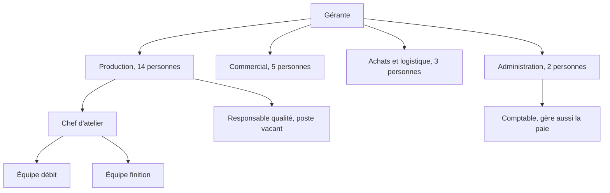

Pour créer un [organigramme](/fr/glossary/organigramme), listez les rôles dont votre entreprise a besoin, regroupez-les en équipes, rattachez chaque équipe à celle qui fixe ses priorités, placez les personnes dans les rôles, puis dessinez le résultat et faites-le relire par les responsables d’équipe. Pour faire un organigramme d’entreprise, vous passerez plus de temps à réunir des informations justes qu’à dessiner. Vous trouverez ici les six étapes en détail, un exemple commenté, les erreurs qui rendent un organigramme faux en quelques mois, et les outils pour le faire gratuitement, en ligne ou dans Word, PowerPoint et Excel.

## Les 6 étapes pour faire un organigramme

### 1. Réunissez les postes et les rattachements

Partez de la liste du personnel, que vous trouverez dans le logiciel de paie ou le registre du personnel. Pour chaque personne, notez son intitulé de poste, son responsable direct et l’équipe où elle travaille au quotidien. Demandez ensuite à chaque responsable d’équipe de relire sa partie de la liste. Les contrats donnent souvent les rattachements d’une organisation précédente, alors que le responsable sait qui travaille vraiment avec qui.

### 2. Listez les rôles avant les personnes

Un rôle est un travail dont l’entreprise a besoin : la comptabilité, la relation avec les fournisseurs, la maintenance des machines. Notez chaque travail distinct, y compris ceux que personne ne tient officiellement, comme la gestion du site web qu’une personne assure en plus de son poste. Un organigramme bâti sur les rôles reste juste quand quelqu’un part, car seul le nom dans la case change. Pour [définir les rôles et responsabilités](/fr/blog/define-roles), partez de la raison d’être de chaque rôle et de ses redevabilités.

### 3. Regroupez les rôles en équipes et donnez un seul parent à chaque équipe

Mettez dans la même équipe les rôles qui visent le même résultat, puis regroupez les équipes en services ou en directions. Quand une équipe semble dépendre de deux responsables, rattachez-la à celui qui fixe ses priorités et mentionnez l’autre lien dans la description de l’équipe. Un organigramme où une case a deux parents devient vite illisible.

### 4. Choisissez la forme de l’organigramme

La plupart des entreprises dessinent un arbre, avec la direction en haut et chaque poste sous celui dont il dépend : c’est l’[organigramme hiérarchique](/fr/blog/hierarchy-chart). Selon ce que vous voulez montrer, choisissez un autre des [types d’organigramme](/fr/blog/org-chart-types), comme l’organigramme fonctionnel, matriciel ou circulaire. Dans une association, ajoutez les instances (assemblée générale, conseil, bureau) au-dessus des [commissions et des bénévoles qui la font tourner](/fr/blog/nonprofit-org-chart).

### 5. Placez les personnes dans les rôles

Ajoutez les noms seulement maintenant. Une personne peut tenir plusieurs rôles et apparaître à plusieurs endroits. Gardez les rôles vacants sur l’organigramme, qu’ils attendent un recrutement ou que leur titulaire soit parti, pour que chacun voie quel travail reste à couvrir. Si vous ajoutez des photos, demandez d’abord son accord à chaque personne.

### 6. Dessinez, faites relire et partagez

Dessinez l’organigramme dans l’outil choisi, puis envoyez-le aux responsables d’équipe avant de le publier. Ils repèrent en quelques minutes une personne oubliée ou un rattachement inversé. Publiez ensuite l’organigramme là où l’équipe le cherche déjà, sur l’intranet ou le wiki interne. Une pièce jointe envoyée par e-mail est périmée au premier changement.

## Exemple commenté : l’organigramme d’un fabricant de meubles de 25 personnes

Prenons une entreprise de fabrication de meubles de 25 personnes, dirigée par sa gérante.

Ce dessin repose sur quatre choix :

- Les achats dépendent de la gérante plutôt que de la production. Ils servent aussi le commercial pour les meubles sur mesure, donc la gérante arbitre quand les deux services ont besoin des achats en même temps.
- Le chef d’atelier encadre les deux équipes de production. Les équipes du débit et de la finition apparaissent sous lui, ce qui montre à un nouvel ouvrier à qui poser ses questions.
- Le poste de responsable qualité reste sur l’organigramme, marqué vacant. Tant que personne n’est recruté, chacun voit que ce travail n’a pas de titulaire.
- La comptable tient deux rôles, la comptabilité et la paie. Comme ces deux rôles sont notés séparément, la gérante pourra confier la paie à quelqu’un d’autre sans redessiner le service.

Pour une start-up, une association ou une autre structure, parcourez nos [exemples d’organigramme](/fr/blog/org-chart-examples).

## Les erreurs qui rendent un organigramme faux

- Dessiner des personnes au lieu de rôles. Au premier départ, la case disparaît avec la personne. Le travail qu’elle faisait n’apparaît alors plus nulle part.
- Recopier l’organigramme officiel sans le faire relire. Les équipes ont souvent changé de rattachement depuis, si bien que l’organigramme décrit une entreprise qui n’existe plus.
- Oublier les rôles tenus sans titre. La personne qui gère le site web ou forme les nouveaux arrivants fait un travail que l’organigramme doit montrer.
- Vouloir tout faire tenir sur une page. Au-delà d’une quarantaine de cases, montrez l’organigramme général à la direction et donnez à chaque service une vue de sa propre branche.
- Confier le fichier à une seule personne. Quand elle est absente ou part, plus personne ne le met à jour.

## Créer un organigramme gratuitement : en ligne ou avec la bureautique

Deux familles d’outils couvrent la plupart des besoins : les logiciels de bureautique que vous avez déjà, et les créateurs d’organigramme en ligne, conçus pour garder un organigramme à jour.

### Avec Word, PowerPoint ou Excel

Vous pouvez dessiner un organigramme avec SmartArt dans Word, PowerPoint ou Excel. [Un organigramme sur Word](/fr/blog/org-chart-word) convient à un document que vous imprimez ou joignez au livret d’accueil, [un organigramme sur PowerPoint](/fr/blog/org-chart-powerpoint) à une présentation, et [un organigramme sur Excel](/fr/blog/org-chart-excel) à une liste des rôles que vous tenez déjà dans un tableur. Nous proposons aussi un modèle gratuit à remplir pour Word et pour PowerPoint.

<Callout type="warning" title="Un fichier d’organigramme est périmé au premier changement dans l’équipe">
Un fichier Word, PowerPoint ou Excel montre l’entreprise le jour où il a été enregistré. Chaque arrivée, départ ou nouveau rôle oblige à rouvrir le fichier, à déplacer les cases et à renvoyer la nouvelle version. Cette tâche retombe en général sur une seule personne. Au bout de quelques mois, plusieurs versions circulent et personne ne sait laquelle est la bonne. Un [organigramme dynamique](/fr/blog/dynamic-org-chart) se modifie là où les rôles sont définis, donc toute l’équipe lit la même version.
</Callout>

### Avec un créateur d’organigramme en ligne

Rolebase est un outil de Role Based Management construit autour des rôles de votre structure et de son organigramme. Chaque rôle a une raison d’être, un domaine, des indicateurs et des redevabilités, pour que chaque collaborateur sache de quoi s’occupe un poste ou une équipe. Rolebase est gratuit avec toutes ses fonctionnalités jusqu’à cinq membres actifs, sans carte bancaire.

Vous pouvez afficher votre organigramme [en cercles, en arbre hiérarchique ou en trombinoscope](/fr/docs/org-chart), et passer d’une vue à l’autre sans rien redessiner. Pour la vue trombinoscope, demandez à chacun son accord avant d’afficher sa photo. Rolebase [tient ensuite le trombinoscope d’entreprise à jour](/fr/blog/photo-directory) : une personne y apparaît quand elle reçoit un rôle et en sort quand vous l’archivez.

L’IA de Rolebase rédige un premier jet de la raison d’être, du domaine et des redevabilités d’un rôle à partir de son nom. Les managers n’ont plus qu’à le relire et l’ajuster avant d’enregistrer.

Organigramme réalisé avec Rolebase

Pour situer Rolebase parmi les autres options gratuites, regardez ce qui distingue les [outils open source pour créer un organigramme](/fr/blog/open-source-org-chart-tools), comparez les [logiciels d’organigramme](/fr/blog/best-org-chart-software) sur leur prix et leur façon de rester à jour, ou parcourez [toutes les fonctionnalités de Rolebase](/fr/features).

## Tenir l’organigramme à jour

Notez chaque changement au moment où il a lieu : une embauche, un départ, une équipe rattachée à un autre service, un rôle qu’une personne reprend. Un organigramme qu’on met à jour une fois par an ne correspond déjà plus à l’entreprise quand on l’ouvre. Prévoyez aussi une relecture chaque trimestre avec les responsables d’équipe, pour repérer les rôles vacants et les personnes qui tiennent plus de rôles qu’elles ne peuvent en assumer.

## Questions fréquentes

<FaqList>

<FaqItem question="Comment créer un organigramme facilement ?">

Partez de la liste du personnel et notez pour chaque personne son poste et son responsable direct. Regroupez les postes par équipe, puis dessinez l’arbre avec SmartArt dans Word ou PowerPoint, ou dans un créateur d’organigramme en ligne. Pour une équipe d’une vingtaine de personnes, la liste prend plus de temps que le dessin. Faites relire le résultat par les responsables d’équipe avant de le diffuser.

</FaqItem>

<FaqItem question="Quel est le meilleur outil pour créer un organigramme ?">

Cela dépend de la fréquence des changements dans votre équipe. Word, PowerPoint ou Excel suffisent pour une petite équipe dont les rôles bougent peu. Si des personnes arrivent, partent ou changent de rôle chaque mois, prenez un logiciel où l’organigramme se construit à partir des rôles, comme Rolebase. Nous avons comparé onze [logiciels d’organigramme](/fr/blog/best-org-chart-software) sur leur prix et leur façon de rester à jour.

</FaqItem>

<FaqItem question="Existe-t-il une IA gratuite pour créer un organigramme ?">

Oui. Un assistant comme ChatGPT peut proposer une structure à partir d’une description de votre entreprise. Rolebase, lui, rédige avec l’IA un premier jet de chaque rôle à partir de son nom, gratuitement jusqu’à cinq membres actifs. Relisez toujours le résultat : l’IA ne sait pas qui travaille avec qui chez vous. Pour aller plus loin, voyez comment [générer un organigramme avec l’IA](/fr/blog/ai-org-chart).

</FaqItem>

<FaqItem question="Où télécharger gratuitement un modèle d’organigramme ?">

Nous proposons un modèle gratuit à remplir pour [faire un organigramme sur Word](/fr/blog/org-chart-word) et un autre pour [faire un organigramme sur PowerPoint](/fr/blog/org-chart-powerpoint). Remplacez les intitulés par vos rôles, ajoutez ou supprimez des cases, puis enregistrez le fichier là où l’équipe le trouvera.

</FaqItem>

</FaqList>

## Créez gratuitement votre organigramme aujourd’hui

[Créez votre espace Rolebase gratuitement](/signup), ajoutez vos rôles et vos membres : l’organigramme se construit à partir d’eux. Toute l’équipe lit ensuite la même version, que vous modifiez dès qu’un rôle change.
