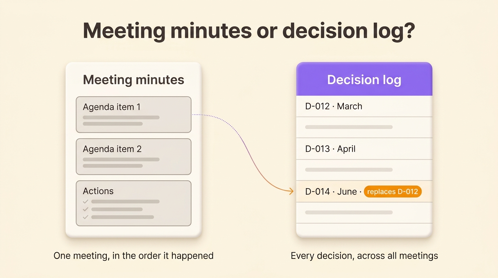
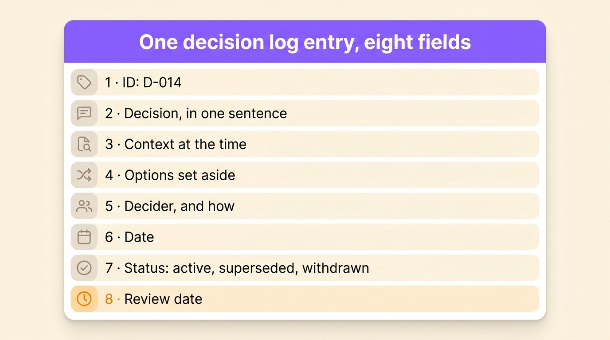
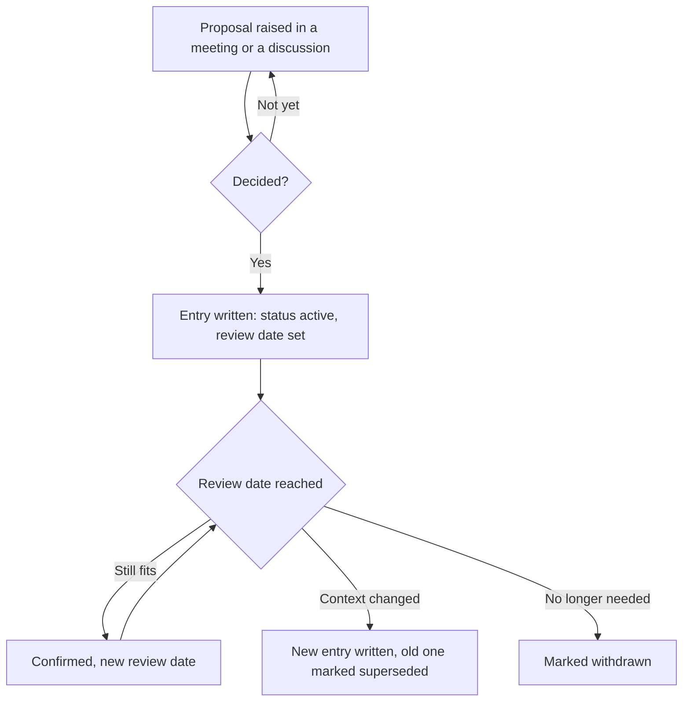

A decision log is a single list where a team writes down every decision it makes, whatever meeting or thread it came from, with the reason behind it, who made the call, the date and when to check it again. It answers the question that comes up three months later: "didn't we already decide this, and why?". This guide gives you a template to copy, a filled example, the fields that matter, and the routine that keeps the log in use after the first month. It is written for people who run self-organizing teams and want their decisions to stay findable long after the meeting where they were made.

## What is a decision log?

A decision log is a register of decisions, kept over time and across meetings, where each entry records one decision with its context and its owner. It differs from other team documents in its unit: one line per decision, never one page per meeting. You will meet it under several names. Project managers say decision register or decision record. Software teams keep architecture decision records (ADRs), one file per technical choice, stored next to the code. Governance teams speak of a governance log or a register of resolutions. Whatever the name, the aim is the same: someone who missed the meeting can find the decision and understand why it was taken.

Michael Nygard, a software architect and the author of the book *Release It!*, gave the clearest argument for the habit in his 2011 post ["Documenting Architecture Decisions"](https://www.cognitect.com/blog/2011/11/15/documenting-architecture-decisions). Without the reasoning on record, a newcomer has two options: "blindly accept the decision" or "blindly change it". Both are bad. The record gives them a third option, which is to check whether the context that justified the decision still holds.

Skipping the log costs time. In a [survey of more than 1,200 managers](https://www.mckinsey.com/capabilities/people-and-organizational-performance/our-insights/decision-making-in-the-age-of-urgency) published in 2019 by the consulting firm McKinsey, only 20 percent said their organization excels at decision making, and 61 percent said most of the time they spend on decisions is used ineffectively. Part of that time probably goes into decisions that were already made and that nobody could find.

## Decision log, meeting minutes, RAID log: three different documents

A decision log is often confused with the minutes of a meeting, because decisions get written in both. They answer different questions.

| | Meeting minutes | Decision log | RAID log |
|---|---|---|---|
| Unit | One meeting | One decision | One risk, action, issue or decision |
| Order | The meeting's agenda | Decision ID, then date | By type and status |
| Lifespan | The meeting | As long as the team exists | The project |
| Question it answers | What happened in this meeting? | What did we decide about X, and is it still valid? | What could block the project this week? |
| Who reads it | Attendees and people who were absent | Anyone, including people who join next year | The project team |

[Meeting minutes](/en/blog/meeting-minutes) remain the right place for the discussion, the actions and the attendance of one session. Only the decisions go from the minutes into the decision log, which gathers them in one place. A RAID log (risks, assumptions or actions, issues, decisions) covers one project and is usually archived when the project closes. Its lasting decisions belong in the team's decision log before that happens.

{/* IMAGE regen: api.py image, infographic, 1600x900. Scene: "Two document cards side by side on a warm cream background, titled 'Meeting minutes or decision log?'. Left card 'Meeting minutes' shows a single page with three stacked agenda blocks labelled 'Agenda item 1', 'Agenda item 2', 'Actions', and a caption under it: 'One meeting, in the order it happened'. Right card 'Decision log' shows a long list of rows from several meetings, labelled 'D-012 · March', 'D-013 · April', 'D-014 · June · replaces D-012', and a caption under it: 'Every decision, across all meetings'. A thin arrow goes from the 'Agenda item 1' block on the left to the 'D-014' row on the right. Violet #9870F0 header band on the decision log card, warm orange #FB9803 on the 'replaces D-012' label, the rest in warm neutral grey. Clean modern sans-serif labels, generous margins." */}



## What goes in a decision log entry

Eight fields cover what a reader needs a year later. Leave out any field and the reader has a question that only a person can answer.

1. An ID, a short number such as D-014. Other entries, minutes and tickets point to it, which is how a decision gets replaced without being rewritten.
2. The decision, in one sentence that states the outcome. "Purchases above €500 need the Finance role's approval" can be applied the next morning. "Budget discussion" cannot.
3. The context, in two or three sentences on the problem that triggered the decision and the facts known at the time. With this field, a reader can judge whether the decision still holds.
4. The options set aside, with the reason the team rejected each one. This field saves the next team from proposing them again as new ideas.
5. The decider, meaning the person, role or group that made the call, and how (alone after advice, consent, vote). Write a role rather than a name when you can, so the entry stays valid after the person moves on.
6. The date the decision was made, which is not always the day it was written down.
7. The status, in one word: proposed, active, superseded or withdrawn.
8. The review date, when the team will check the decision against what happened. A decision with a review date is a test the team can learn from. Without one, it tends to become a rule nobody remembers the reason for.

Some teams add the impact (who is affected) and a link to the minutes or the discussion where the decision was made. Both are useful, as long as the eight core fields come first.

{/* IMAGE regen: api.py image, infographic, 1600x900. Scene: "A single tall document card on a warm cream background, titled 'One decision log entry, eight fields'. Eight stacked rows, each with a small rounded icon and a label: '1 · ID: D-014', '2 · Decision, in one sentence', '3 · Context at the time', '4 · Options set aside', '5 · Decider, and how', '6 · Date', '7 · Status: active, superseded, withdrawn', '8 · Review date'. Violet #9870F0 header band on the card, a small clock icon in warm orange #FB9803 on the review date row, the other rows in warm neutral grey. Clean modern sans-serif labels, generous margins." */}



## Decision log template

Copy this block into a wiki page, a shared document or a meeting tool. Each new decision gets one copy of it.

```
ID: D-
Decision (one sentence, the outcome):
Context (the problem and what we knew):
Options set aside, and why:
Decided by (role or group), and how:
Date decided:
Status: proposed / active / superseded by D- / withdrawn
Review date:
Link to the meeting or discussion:
```

In a spreadsheet, use one row per decision and these column headers, in this order:

```
ID | Decision | Context | Options set aside | Decided by | How | Date | Status | Review date | Link
```

Freeze the first row, sort by ID, and add a filter on the Status column so the active decisions show by default. A spreadsheet works well up to a few dozen entries. Past that, people stop scrolling, so you need search.

## A filled decision log example

Here is the log of a fictional twelve-person product team, four months in. The names and figures are invented for the example.

| ID | Decision | Decided by | Date | Status | Review |
|---|---|---|---|---|---|
| D-011 | Every customer call is recorded in the CRM within 24 hours | Sales role, after advice from Support | 3 March | Active | 1 September |
| D-012 | Releases ship every Thursday | Product circle, by consent | 10 March | Superseded by D-014 | |
| D-013 | Purchases above €500 need the Finance role's approval | Finance role | 2 April | Active | 2 October |
| D-014 | Releases ship every second Tuesday, after the QA role signs off | Product circle, by consent | 16 June | Active | 16 December |

Under D-014, the context field reads: "Thursday releases left Friday as the only day to fix problems, and two of the last six releases broke the export over a weekend. Daily releases were set aside because the QA role has one person." Anyone reading this line in November knows why the rhythm changed, and what would justify changing it again: a second person in QA, for example.

Look at D-012. It stays in the log after June, marked as superseded with the number of the entry that replaced it. Nygard recommends the same for architecture records: you "keep the old one around", so the reader can still see that the decision once existed.

## How to keep a decision log, step by step

Most decision logs are well filled for a month and then forgotten. The template is rarely the problem. These habits keep a log going:

- Keep one log per team or per circle, in the tool where the team already works. A log stored in a folder nobody opens stops being read within a few weeks.
- Give the log an owner. The facilitator or the secretary of the meeting writes the entry before the meeting ends. An entry left for the next day is written from memory, when it gets written at all.
- Read the decision aloud. Before moving to the next agenda item, the note-taker reads it as written and the group confirms it. It takes two minutes and saves an argument later about what was decided.
- Put the discussion in the minutes. The log gets the result, the reason and the options set aside.
- Keep the old entry when a decision changes. The new decision gets a new ID, and the old entry switches to "superseded by D-0xx".
- Put the review dates on the agenda. Once a month, the facilitator lists the entries whose review date has passed. Each one is either confirmed, changed by a new decision, or withdrawn.

The life of an entry follows this path:



## Which decisions belong in the log

If you log everything, the decisions that matter get lost. Small rules still belong in it, because they cause the most arguments. A decision earns a line when it meets at least one of these tests:

- It binds people other than the one who made it.
- It will come back: a budget rule, a release rhythm, a hiring criterion.
- It would cost time or money to undo.
- Someone outside the meeting will ask "who decided this?".

A choice that stays inside one person's job, such as the order in which they process their tickets, stays out. In a role-based organization, that line is already drawn by the role's domain, which lists what the role decides alone. With a [decision-making framework](/en/blog/decision-making-frameworks) that names who decides, such as DACI, RAPID or consent, you know what to write in the "decided by" field. The log records the decision itself.

Changes to roles and to the way the team works are the decisions most worth logging, because they shape all the others. In sociocracy and Holacracy, they are taken by [consent in a governance meeting](/en/blog/consent-decision), and each one becomes a log entry.

{/* TODO ANECDOTE: a Rolebase client or the Rolebase team itself, describing a decision found again in the log months later (what the question was, how long the search took, what the log avoided). */}

## Where to keep your decision log

| Tool | Works well for | Limits |
|---|---|---|
| Spreadsheet (Excel, Google Sheets) | A single team, up to a few dozen decisions, filters by status | No link to the meeting, every update is manual, search stops at the file |
| Wiki (Confluence, Notion) | Teams that already document everything there, entries linked to pages | Entries spread over pages unless someone keeps the index up to date |
| Project tool (Jira, Asana) | Decisions tied to a single project | Decisions get archived with the project, while the rule they set is still in force |
| Governance tool (Rolebase) | Decisions attached to the role that made them, written during the meeting | Built for teams that organize by roles |

The test for any of them is the same: can someone who joined last week find the current rule on purchases in under a minute? If the answer is no, the log needs a better home or a better index.

## Keeping a decision log in Rolebase

In Rolebase, each decision belongs to the role that made it. Every role has a Decisions tab that lists its decisions, newest first. You [create a decision](/en/docs/decisions) from that tab, from a discussion, or from a meeting in progress with the "Decision" button, so the entry is written while people are still in the room. A decision has a title, a rich-text description and its role, and Rolebase records who created it and when. You can mark it private, which limits it to the role's participants. Public decisions appear in the organization's news feed, and the global search finds them alongside members, roles, discussions and tasks.

When a [proposal](/en/docs/proposals) is approved, Rolebase applies its org chart changes and records the decision in the role with the same title and description. The approved proposal and the log entry therefore always match. Organization owners can export decisions with the rest of the organization's data in XLSX or JSON.

Rolebase has no dedicated field for the review date or the status. Write them in the first line of the description, in the template's format, and archive a decision that has been withdrawn.

## Frequently asked questions

<FaqList>

<FaqItem question="What is a decision log in project management?">

In project management, a decision log is the register where the project records each significant decision: what was decided, by whom, when, why, and which alternatives were rejected. It sits next to the risk and issue registers, and often inside a RAID log. When the project closes, move the decisions that still apply, such as a supplier choice or a technical standard, to the team's permanent log so they stay visible.

</FaqItem>

<FaqItem question="What is the difference between a decision log and a decision register?">

Both terms name the same document: a list of decisions with their context, decider, date and status. "Register" is more common in formal project methods and in public bodies, "log" in product and software teams. Pick one name and use it everywhere, so people search for the right word.

</FaqItem>

<FaqItem question="What is the difference between an action log and a decision log?">

An action log lists tasks: who does what, by when, and whether it is done. A decision log lists choices: what was decided and why. A decision often creates actions, so link the two. An action is closed once it is done, while a decision stays active until it is replaced or withdrawn.

</FaqItem>

<FaqItem question="Who should maintain the decision log?">

Give the job to one role, usually the meeting's facilitator or secretary, who writes each entry before the meeting ends. The decider checks the wording. Everyone can read the log. With a named owner, entries get written the same day. When everyone is in charge, the log tends to stop after a few weeks.

</FaqItem>

<FaqItem question="What is an architecture decision record (ADR)?">

An ADR is a decision log entry for a software architecture choice, stored as a short text file next to the code. Michael Nygard proposed the format in 2011 with five sections: title, context, decision, status and consequences. Its statuses (proposed, accepted, deprecated, superseded) work just as well for a team's non-technical decisions.

</FaqItem>

</FaqList>

## Start with the next meeting

Copy the template and open a log with the decisions taken at your next meeting, then add the three decisions your team argues about most often, with what you remember of the reasons. Set a review date on each. After two months, the log will hold the rules your team actually works by, along with the reasons behind them.

To keep the log attached to the roles that make the decisions, written during the meeting and searchable by everyone, [create a free Rolebase account](/signup): the free plan covers up to five active members. You can also check [everything Rolebase covers](/en/features), from the org chart to meetings and tasks.
