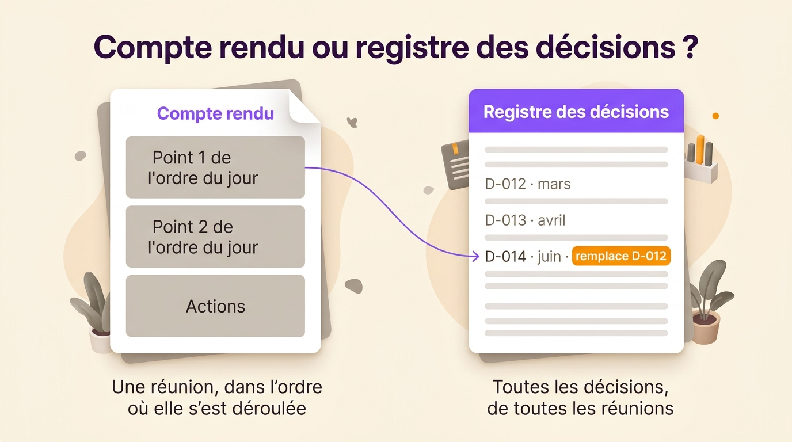
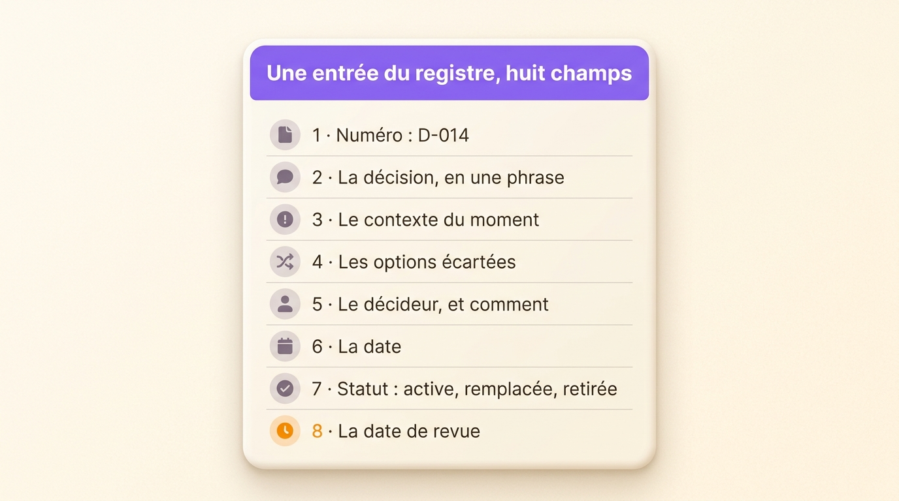
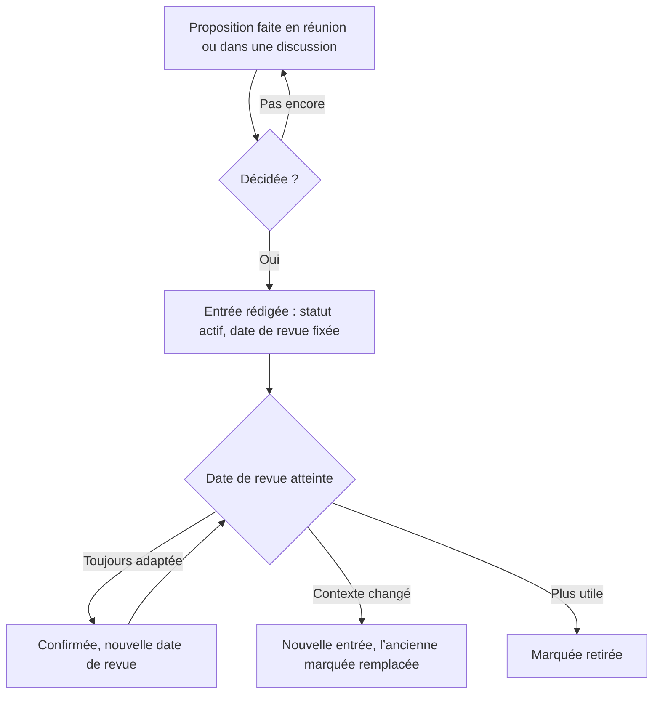

Un registre des décisions est une liste unique où une équipe note chaque décision qu’elle prend, quelle que soit la réunion ou la discussion d’où elle sort, avec sa raison, la personne ou le groupe qui a tranché, sa date et le moment où la réexaminer. Il répond à la question qui revient trois mois plus tard : « on n’avait pas déjà décidé ça, et pourquoi ? ». Vous trouverez ici un modèle à copier, un exemple rempli, les champs qui comptent et la routine qui fait durer le registre au-delà du premier mois. L’article s’adresse aux personnes qui animent des équipes autonomes et veulent retrouver leurs décisions longtemps après la réunion où elles ont été prises.

## Qu’est-ce qu’un registre des décisions ?

Un registre des décisions consigne, dans la durée et d’une réunion à l’autre, une décision par entrée avec son contexte et son responsable. Il se distingue des autres documents d’équipe par son unité : une ligne par décision, jamais une page par réunion. Il porte plusieurs noms. Les chefs de projet parlent de journal des décisions ou de *decision log*. Les équipes logicielles tiennent des *architecture decision records* (ADR), un fichier par choix technique rangé à côté du code. Les associations et les instances statutaires tiennent un registre des délibérations. Quel que soit le nom, le but est le même : une personne absente de la réunion retrouve la décision et comprend pourquoi elle a été prise.

Michael Nygard, architecte logiciel américain et auteur du livre *Release It!*, a donné l’argument le plus net en faveur de cette habitude dans son billet de 2011, [« Documenting Architecture Decisions »](https://www.cognitect.com/blog/2011/11/15/documenting-architecture-decisions). Sans la raison écrite, un nouvel arrivant n’a que deux choix : accepter la décision à l’aveugle, ou la changer à l’aveugle. Les deux sont mauvais. Le registre lui en donne un troisième, vérifier si le contexte qui justifiait la décision tient toujours.

Sans registre, l’équipe perd du temps. Dans une [enquête auprès de plus de 1 200 managers](https://www.mckinsey.com/capabilities/people-and-organizational-performance/our-insights/decision-making-in-the-age-of-urgency) publiée en 2019 par le cabinet de conseil McKinsey, 20 % seulement estiment que leur organisation excelle dans la prise de décision. Ils sont 61 % à juger que l’essentiel du temps qu’ils y consacrent est mal employé. Une partie de ce temps part sans doute dans des décisions déjà prises que personne n’a su retrouver.

## Registre des décisions, compte rendu, journal RAID : trois documents différents

On confond souvent le registre des décisions avec le compte rendu de réunion, puisque les décisions s’écrivent dans les deux. Les deux documents répondent pourtant à des questions différentes.

| | Compte rendu | Registre des décisions | Journal RAID |
|---|---|---|---|
| Unité | Une réunion | Une décision | Un risque, une action, un problème ou une décision |
| Classement | L’ordre du jour de la réunion | Numéro de décision, puis date | Par type et par statut |
| Durée de vie | La réunion | Celle de l’équipe | Le projet |
| Question posée | Que s’est-il passé dans cette réunion ? | Qu’a-t-on décidé sur tel sujet, et est-ce toujours valable ? | Qu’est-ce qui peut bloquer le projet cette semaine ? |
| Lecteurs | Les participants et les absents | Tout le monde, y compris ceux qui arriveront l’an prochain | L’équipe projet |

Le [compte rendu de réunion](/fr/blog/meeting-minutes) reste l’endroit où noter la discussion, les actions et les présents d’une séance. Seules les décisions passent du compte rendu au registre, qui les réunit au même endroit. Le journal RAID (risques, actions ou hypothèses, problèmes, décisions) couvre un seul projet et s’archive en général à sa clôture. Ses décisions durables doivent rejoindre le registre de l’équipe avant cette date.

{/* IMAGE regen: api.py image, infographic, 1600x900. Scene: "Deux fiches document côte à côte sur un fond crème chaud, sous le titre « Compte rendu ou registre des décisions ? ». La fiche de gauche, « Compte rendu », montre une seule page avec trois blocs empilés étiquetés « Point 1 de l’ordre du jour », « Point 2 de l’ordre du jour », « Actions », et dessous la légende « Une réunion, dans l’ordre où elle s’est déroulée ». La fiche de droite, « Registre des décisions », montre une longue liste de lignes issues de plusieurs réunions, étiquetées « D-012 · mars », « D-013 · avril », « D-014 · juin · remplace D-012 », et dessous la légende « Toutes les décisions, de toutes les réunions ». Une fine flèche relie le bloc « Point 1 de l’ordre du jour » à la ligne « D-014 ». Bandeau d’en-tête violet #9870F0 sur la fiche du registre, orange chaud #FB9803 sur l’étiquette « remplace D-012 », le reste en gris chaud neutre. Libellés en sans-serif moderne et net, marges généreuses." */}



## Les champs d’une entrée du registre

Huit champs couvrent ce dont un lecteur aura besoin un an plus tard. Il suffit d’en retirer un pour que le lecteur bute sur une question à laquelle seule une personne peut répondre.

1. Un numéro court, comme D-014. Les autres entrées, les comptes rendus et les tickets y renvoient. Grâce à ce numéro, on remplace une décision sans la réécrire.
2. La décision, en une phrase qui dit le résultat. « Tout achat au-delà de 500 € passe par le rôle Finance » s’applique dès le lendemain. « Discussion sur le budget » ne s’applique pas.
3. Le contexte, en deux ou trois phrases : le problème qui a déclenché la décision et ce que l’on savait alors. Avec ce champ, le lecteur peut juger si la décision tient encore.
4. Les options écartées et la raison de leur rejet. L’équipe suivante évite ainsi de les reproposer comme des idées neuves.
5. Le décideur, c’est-à-dire la personne, le rôle ou le groupe qui a tranché, et la manière (seul après avis, consentement, vote). Écrivez un rôle plutôt qu’un nom quand c’est possible, pour que l’entrée reste valable après le départ de la personne.
6. La date à laquelle la décision a été prise, qui n’est pas toujours celle où elle a été notée.
7. Le statut, en un mot : proposée, active, remplacée ou retirée.
8. La date de revue, le jour où l’équipe confronte la décision à ce qui s’est passé. Avec une date de revue, la décision devient un test dont l’équipe tire une leçon. Sans date de revue, elle finit souvent en règle dont plus personne ne connaît la raison.

Certaines équipes ajoutent l’impact (qui est concerné) et un lien vers le compte rendu ou la discussion d’origine. Les deux servent, à condition de venir après les huit champs de base.

{/* IMAGE regen: api.py image, infographic, 1600x900. Scene: "Une seule grande fiche document sur un fond crème chaud, sous le titre « Une entrée du registre, huit champs ». Huit lignes empilées, chacune avec une petite icône arrondie et un libellé : « 1 · Numéro : D-014 », « 2 · La décision, en une phrase », « 3 · Le contexte du moment », « 4 · Les options écartées », « 5 · Le décideur, et comment », « 6 · La date », « 7 · Statut : active, remplacée, retirée », « 8 · La date de revue ». Bandeau d’en-tête violet #9870F0 sur la fiche, une petite icône d’horloge orange chaud #FB9803 sur la ligne de la date de revue, les autres lignes en gris chaud neutre. Libellés en sans-serif moderne et net, marges généreuses." */}



## Modèle de registre des décisions

Copiez ce bloc dans une page de wiki, un document partagé ou un outil de réunion. Chaque nouvelle décision en reçoit une copie.

```
Numéro : D-
Décision (une phrase, le résultat) :
Contexte (le problème, ce que l’on savait) :
Options écartées, et pourquoi :
Décidé par (rôle ou groupe), et comment :
Date de la décision :
Statut : proposée / active / remplacée par D- / retirée
Date de revue :
Lien vers la réunion ou la discussion :
```

Dans un tableur, prévoyez une ligne par décision et ces en-têtes de colonnes, dans cet ordre :

```
Numéro | Décision | Contexte | Options écartées | Décidé par | Mode de décision | Date | Statut | Date de revue | Lien
```

Figez la première ligne, triez par numéro et ajoutez un filtre sur la colonne Statut pour afficher les décisions actives par défaut. Un tableur suffit jusqu’à quelques dizaines d’entrées. Au-delà, les gens arrêtent de faire défiler la liste, donc il vous faut une recherche.

## Un exemple de registre rempli

Voici le registre d’une équipe produit fictive de douze personnes, au bout de quatre mois. Les noms et les chiffres sont inventés pour l’exemple.

| Numéro | Décision | Décidé par | Date | Statut | Revue |
|---|---|---|---|---|---|
| D-011 | Chaque appel client est saisi dans le CRM sous 24 heures | Rôle Ventes, après avis du Support | 3 mars | Active | 1er septembre |
| D-012 | Les mises en production ont lieu chaque jeudi | Cercle Produit, par consentement | 10 mars | Remplacée par D-014 | |
| D-013 | Tout achat au-delà de 500 € passe par le rôle Finance | Rôle Finance | 2 avril | Active | 2 octobre |
| D-014 | Les mises en production ont lieu un mardi sur deux, après validation du rôle Qualité | Cercle Produit, par consentement | 16 juin | Active | 16 décembre |

Dans le champ contexte de D-014, on lit : « Avec une mise en production le jeudi, il ne restait que le vendredi pour corriger, et deux des six dernières versions ont cassé l’export pendant un week-end. La mise en production quotidienne a été écartée parce que le rôle Qualité ne compte qu’une personne. » En novembre, n’importe qui comprend en lisant cette ligne pourquoi le rythme a changé, et ce qui justifierait de le changer à nouveau, par exemple l’arrivée d’une deuxième personne au rôle Qualité.

D-012 reste dans le registre après juin, marquée comme remplacée, avec le numéro de l’entrée qui lui succède. Nygard recommande la même chose pour les décisions d’architecture : garder l’ancienne entrée, pour que le lecteur y voie encore que cette décision a existé.

## Tenir le registre, étape par étape

La plupart des registres sont bien remplis pendant un mois, puis oubliés. Le modèle y est rarement pour quelque chose. Ces habitudes font tenir un registre :

- Tenez un seul registre par équipe ou par cercle, dans l’outil où l’équipe travaille déjà. Un registre rangé dans un dossier que personne n’ouvre cesse d’être lu en quelques semaines.
- Confiez le registre à un responsable. L’animateur ou le secrétaire de la réunion rédige l’entrée avant la fin de la séance. Une entrée remise au lendemain s’écrit de mémoire, quand elle finit par s’écrire.
- Lisez la décision à voix haute. Avant de passer au point suivant, la personne qui prend les notes la lit telle qu’elle l’a écrite, puis le groupe la confirme. Ça prend deux minutes et ça évite plus tard une dispute sur ce qui avait été décidé.
- Notez la discussion dans le compte rendu. Le registre reçoit le résultat, la raison et les options écartées.
- Gardez l’ancienne entrée quand une décision change. La nouvelle décision reçoit un nouveau numéro, tandis que l’ancienne entrée passe à « remplacée par D-0xx ».
- Inscrivez les dates de revue à l’ordre du jour. Une fois par mois, l’animateur liste les entrées dont la date de revue est passée. Chacune est confirmée, remplacée par une nouvelle décision ou retirée.

Une entrée suit ce parcours :



## Les décisions qui ont leur place au registre

Si vous notez tout, les décisions importantes se perdent. Les petites règles y ont pourtant leur place, parce qu’elles provoquent le plus de disputes. Une décision mérite une ligne quand elle remplit au moins une de ces conditions :

- elle engage d’autres personnes que son auteur
- elle reviendra, comme une règle de budget, un rythme de mise en production ou un critère d’embauche
- la défaire coûterait du temps ou de l’argent
- quelqu’un d’absent à la réunion demandera « qui a décidé ça ? ».

Un choix qui reste dans le travail d’une seule personne, comme l’ordre dans lequel elle traite ses tickets, reste en dehors du registre. Dans une organisation par rôles, le domaine du rôle trace déjà cette limite, puisqu’il liste ce que le rôle décide seul. Avec une [méthode de prise de décision](/fr/blog/decision-making-frameworks) qui désigne le décideur, comme DACI, RAPID ou le consentement, vous savez quoi écrire dans le champ « décidé par ». Le registre garde la décision elle-même.

Les changements de rôles et de fonctionnement sont les décisions qu’il vaut le plus la peine de noter, parce qu’ils encadrent toutes les autres. En sociocratie et en holacratie, chacun de ces changements se décide [par consentement en réunion de gouvernance](/fr/blog/consent-decision), puis devient une entrée du registre.

{/* TODO ANECDOTE: un client Rolebase ou l’équipe Rolebase elle-même, qui raconte une décision retrouvée dans le registre des mois plus tard (la question posée, le temps de recherche, ce que le registre a évité). */}

## Où tenir votre registre des décisions

| Outil | Adapté à | Limites |
|---|---|---|
| Tableur (Excel, Google Sheets) | Une seule équipe, quelques dizaines de décisions, filtres par statut | Aucun lien avec la réunion, chaque mise à jour se fait à la main, la recherche s’arrête au fichier |
| Wiki (Confluence, Notion) | Les équipes qui y documentent déjà tout, entrées reliées aux pages | Les entrées se dispersent entre les pages si personne ne tient l’index à jour |
| Outil de gestion de projet (Jira, Asana) | Les décisions propres à un projet | Les décisions s’archivent avec le projet alors que la règle qu’elles fixent s’applique encore |
| Outil de gouvernance (Rolebase) | Les décisions rattachées au rôle qui les a prises, saisies pendant la réunion | Conçu pour les équipes organisées par rôles |

Le test vaut pour chacun : une personne arrivée la semaine dernière retrouve-t-elle en moins d’une minute la règle en vigueur sur les achats ? Si la réponse est non, le registre a besoin d’un meilleur endroit ou d’un meilleur index.

## Tenir le registre des décisions dans Rolebase

Dans Rolebase, chaque décision appartient au rôle qui l’a prise. Chaque rôle a un onglet Décisions qui liste ses décisions, de la plus récente à la plus ancienne. Vous [créez une décision](/fr/docs/decisions) depuis cet onglet, depuis une discussion ou pendant une réunion avec le bouton « Décision », si bien que l’entrée s’écrit pendant que tout le monde est encore là. Une décision a un titre, une description en texte riche et son rôle. Rolebase enregistre aussi qui l’a créée et quand. Vous pouvez la rendre privée, pour la réserver aux participants du rôle. Les décisions publiques apparaissent dans le fil d’actualité de l’organisation. La recherche globale les trouve aussi, au même titre que les membres, les rôles, les discussions et les tâches.

Quand une [proposition](/fr/docs/proposals) est approuvée, Rolebase applique ses modifications d’organigramme et enregistre la décision dans le rôle, avec le même titre et la même description. La proposition approuvée et l’entrée du registre concordent donc toujours. Les propriétaires de l’organisation peuvent exporter les décisions avec le reste des données, en XLSX ou en JSON.

Rolebase n’a pas de champ dédié à la date de revue ni au statut. Écrivez-les sur la première ligne de la description, au format du modèle, et archivez une décision retirée.

## Questions fréquentes

<FaqList>

<FaqItem question="Qu’est-ce qu’un registre des décisions en gestion de projet ?">

En gestion de projet, le registre des décisions consigne chaque décision importante du projet : ce qui a été décidé, par qui, quand, pourquoi, et quelles options ont été écartées. Il se tient à côté du registre des risques et du suivi des problèmes, souvent dans un journal RAID. À la clôture du projet, transférez les décisions qui s’appliquent encore, comme le choix d’un fournisseur ou une norme technique, dans le registre permanent de l’équipe pour qu’elles restent visibles.

</FaqItem>

<FaqItem question="Quelle différence entre un registre des décisions et un compte rendu de réunion ?">

Le compte rendu raconte une réunion : les présents, la discussion point par point, les actions. Le registre ne garde que les décisions, toutes réunions confondues, avec leur raison, leur décideur, leur statut et leur date de revue. Le compte rendu se lit une fois, peu après la réunion. On consulte le registre des mois plus tard, quand la question revient.

</FaqItem>

<FaqItem question="Quelle différence entre un suivi des actions et un registre des décisions ?">

Le suivi des actions liste des tâches : qui fait quoi, pour quand, et si c’est fait. Le registre des décisions liste des choix : ce qui a été décidé et pourquoi. Une décision crée souvent des actions, reliez donc les deux. Une action se clôt une fois faite, alors qu’une décision reste active jusqu’à ce qu’on la remplace ou qu’on la retire.

</FaqItem>

<FaqItem question="Qui doit tenir le registre des décisions ?">

Confiez-le à un rôle, en général l’animateur ou le secrétaire de la réunion, qui rédige chaque entrée avant la fin de la séance. Le décideur relit la formulation. Tout le monde peut lire le registre. Avec un responsable nommé, les entrées s’écrivent le jour même. Quand tout le monde en est chargé, le registre s’arrête souvent au bout de quelques semaines.

</FaqItem>

<FaqItem question="Qu’est-ce qu’un ADR (architecture decision record) ?">

Un ADR est une entrée de registre des décisions consacrée à un choix d’architecture logicielle, sous la forme d’un court fichier texte rangé avec le code. Michael Nygard a proposé le format en 2011 avec cinq sections : titre, contexte, décision, statut et conséquences. Ses statuts (proposée, acceptée, obsolète, remplacée) conviennent aussi bien aux décisions non techniques d’une équipe.

</FaqItem>

</FaqList>

## Commencez à la prochaine réunion

Copiez le modèle et ouvrez un registre avec les décisions de votre prochaine réunion, puis ajoutez les trois décisions dont votre équipe débat le plus souvent, avec ce que vous vous rappelez de leurs raisons. Fixez une date de revue à chacune. Au bout de deux mois, le registre contiendra les règles selon lesquelles votre équipe travaille vraiment, avec les raisons qui les justifient.

Pour garder le registre attaché aux rôles qui prennent les décisions, saisi pendant la réunion et consultable par tous, [créez un compte Rolebase gratuit](/signup) : l’offre gratuite couvre jusqu’à cinq membres actifs. Vous pouvez aussi parcourir [l’ensemble des fonctionnalités de Rolebase](/fr/features), de l’organigramme aux réunions et aux tâches.
