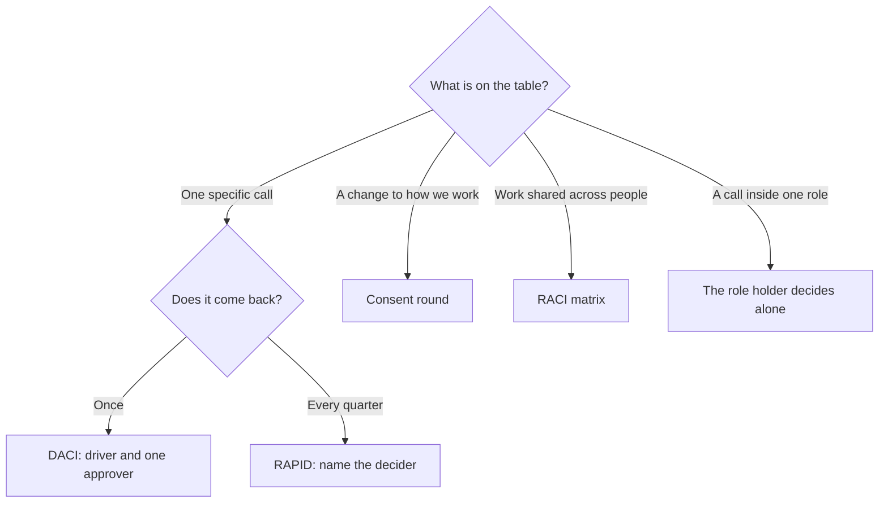
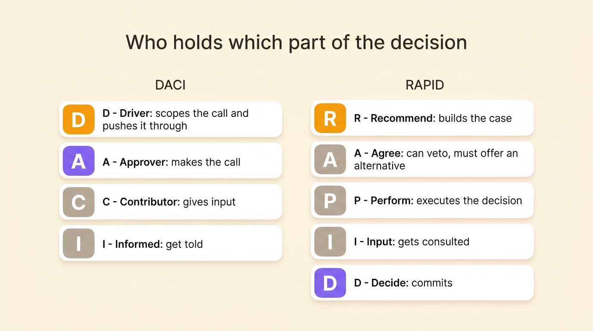
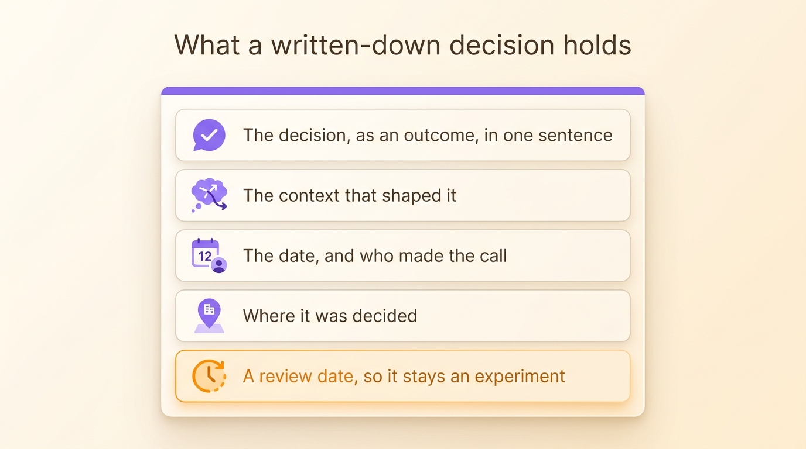

A decision-making framework is a short list of named parts that says who plays which role in one decision: who moves it forward, who says yes, who gets asked, who gets told. Four of them cover most of what a growing team needs. They get mixed up constantly because their letters overlap. DACI names a driver and a single approver for one call. RAPID, from Bain, adds a decider and veto holders for calls that come back every quarter. RACI maps tasks rather than decisions. Consent hands the call to the group unless someone objects. This article compares them on the question each one answers, then shows where the answer has to live so it still holds six months later.

## What a decision-making framework settles

Paul Rogers and Marcia Blenko, two partners at Bain, named the recurring problem in the *Harvard Business Review* of January 2006, in "Who Has the D? How Clear Decision Roles Enhance Organizational Performance". Teams burn time in four repeated fights: global against local, head office against a business unit, one function against another, insiders against outside partners. Each fight is a missing decision role. Somebody in it does not know whether they own the call or only hold an opinion about it. The meeting absorbs the difference.

A framework settles exactly that, and nothing else. It assigns the parts of one decision to named people before the discussion starts. An owner exists, a recommender exists, the people to ask are listed. The fight about who decides never opens. The framework does not improve the decision itself. It makes the decision possible, then leaves.

That narrow scope is why teams drop frameworks after a quarter. Three things stay open once the letters are assigned:

- The answer lives in a slide or an email, and nobody finds it again.
- The same question comes back next month, and the roles get named from scratch.
- Nobody wrote what the decider was allowed to decide, so every edge case restarts the argument.

Role domains and decision records deal with those. Start with the four frameworks and what each one actually answers.

## DACI: one driver, one approver

DACI is a decision framework usually credited to Intuit, where product teams developed it in the 1980s. It names four parts on a single decision: a **Driver** who moves the decision along, an **Approver** who makes the call, **Contributors** who feed it, and **Informed** who get told. Atlassian documented it for its own teams in its Team Playbook, where it is the standard play for high-impact decisions that cross a team boundary.

The Driver scopes the question, gathers the people who know, collects their input and pushes the decision to a finish. The Driver does not decide. A driver who also approves has no one to check the work. A decision that never needed checking did not need a framework.

The Approver is one person. Two approvers recreate the stall the framework exists to end, because each assumes the other signed off. One approver, named in advance, is the whole mechanism.

Contributors have a voice, and no vote. They are the engineers, the lawyers, the support lead who has seen this fail before. The decision is better when they speak early. It is slower when their input becomes a requirement on the way to yes.

Informed get told, in one direction, once the decision is made.

Take a concrete call: should we delay the launch by two weeks? The product manager drives, scopes the impact with engineering, collects the numbers on open defects and pipeline deals, and brings back a recommendation with dates. The CEO approves. The engineering lead and the support lead contribute. Sales stays informed, and learns the date before a prospect does. The framework cost one paragraph. The decision has a person attached to every part of it.

Where DACI breaks is where every letter framework breaks: two approvers, a driver who decides quietly without the approver, or a contributor list that grows until it takes over the meeting. Keep the parts to four or five named people and the format holds.

## RAPID: who recommends, who decides

RAPID is Bain's own tool, a registered trademark of the firm, and the framework Rogers and Blenko were describing in their article. Five parts: **Recommend**, **Agree**, **Perform**, **Input**, **Decide**. The letters are a mnemonic, not an order of steps. Bain says so plainly, because the D is where the process lands, not where it starts.

The letter assignments:

- **R** drives the process and builds the recommendation, on the decider's trust and the stakeholders' credibility.
- **A** holds a veto, granted sparingly to legal or regulatory roles, and a veto comes with the duty to offer an alternative or escalate to the D.
- **P** executes the decision once it is made.
- **I** gives input that the R must weigh.
- **D** commits the organization, ideally alone.

Where DACI covers a one-off call inside a team, RAPID justifies its setup cost on decisions that recur: investment approvals, pricing changes, which features make a release. Naming a decider once for a class of decisions means the same argument does not restart every quarter. The framework is slower to stand up and much cheaper to run.

The practical difference between the two is the A. DACI's approver is the decider. RAPID's Agree role is a brake that legal or compliance holds, and the decider stays the D. A team that hands its A to three departments has rebuilt the bottleneck in new letters.

## RACI is a task framework, not a decision framework

RACI dates back to consulting practice from the 1950s, and the Project Management Institute lists it as one form of responsibility assignment matrix, the table that connects a project's work breakdown to the people who deliver it. **Responsible** does the work, **Accountable** answers for the result, **Consulted** gives input before it ships, **Informed** hears about it afterwards. The [full template and worked examples](/en/blog/raci-matrix) live in a separate article.

The trap is the letter A. RACI's Accountable and DACI's Approver sit in the same cell shape and answer different questions. RACI says who answers for a deliverable. It stays silent on who decides the questions inside that deliverable. Those questions are the ones that stall teams: whether the deliverable is worth doing, what it costs, who changes it. Two departments disagree about a piece of work. The matrix names an accountable person. The disagreement remains intact, because the matrix was built to track handoffs.

| | DACI | RACI |
|---|---|---|
| Question it answers | Who makes this call? | Who does which task? |
| Unit it covers | One decision | A project or a work breakdown |
| What A means | Approver, decides | Accountable, answers for a result |
| How long it lasts | The decision | The project |

A RACI tells a team how work moves. A decision framework tells it how a call gets made. Most projects need the first. Most stalled projects are missing the second.

## Consent and the advice process: deciding without a single decider

DACI and RAPID both keep a decider, one person who commits everyone else. Consent and the advice process spread the decision itself. A self-managed team runs on one of them.

Consent gives the call to the group. A proposal passes unless somebody raises a reasoned objection, an argument that the proposal would harm the work the group committed to. A preference is not an objection. The [step-by-step consent process](/en/blog/consent-decision) and the objection criteria are covered in a dedicated article. The rounds run inside a [governance meeting](/en/blog/governance-meeting).

The advice process goes further: anyone may decide anything, after seeking advice from everyone affected and from the relevant experts. Advice must be sought and weighed. It does not bind. Dennis Bakke, who ran the energy company AES, described the practice in *Joy at Work* in 2005, and Frederic Laloux, a former McKinsey partner, documented it in *Reinventing Organizations* in 2014 as the default for self-managing companies. AES had roughly 40,000 employees at its peak. Skipping the advice round was one of the few things you could be fired for.

Consent asks whether an objection remains. The advice process asks whether advice was sought. Consent keeps the decision in the group's hands, the advice process hands it to whoever is closest to the problem, and both answer a question DACI and RAPID never ask: whether the decision needs a single decider at all.

## Which framework for which question

Each framework earns its keep on a different kind of question. Start from what is on the table.

| Framework | Question it answers | Who decides | Where it fits | Speed once set up |
|---|---|---|---|---|
| DACI | Who moves and who approves this call? | One Approver | One-off, high-impact calls inside a team | Fast, four or five named people |
| RAPID | Who commits the organization? | One Decider, with Agree vetoes | Recurring, cross-functional decisions | Slower to set up, cheap to run |
| RACI | Who does which task? | Nobody, it maps execution | Projects with handoffs | Fast |
| Consent | Does anyone object? | The group | Changes to roles and policies | Twenty minutes in a small circle |
| Advice process | Did you seek advice? | Anyone, after asking | Distributed teams with few managers | Slow the first time, fast after |

The frameworks combine rather than compete. A team can run its roadmap calls in RAPID, its project work in a RACI, and its role changes in a consent round. The good versions of each name the same fact from a different angle.

{/* IMAGE regen: api.py image, infographic, 1600x900. Scene: "Two side-by-side stacked letter-card columns on a warm cream background, titled 'Who holds which part of the decision'. Left column header 'DACI' with four rounded letter cards: 'D · Driver: scopes the call and pushes it through', 'A · Approver: makes the call', 'C · Contributor: gives input', 'I · Informed: get told'. Right column header 'RAPID' with five rounded letter cards: 'R · Recommend: builds the case', 'A · Agree: can veto, must offer an alternative', 'P · Perform: executes the decision', 'I · Input: gets consulted', 'D · Decide: commits'. Violet #9870F0 highlights the A card on the left and the D card on the right, warm orange #FB9803 accents the Driver and Recommend cards, other cards in warm neutral grey. Clean sans-serif labels, generous margins." */}

## Decision rights: write them into roles

A framework names the decider for one decision, once. The team that only ever decides case by case re-opens the same question every month. The meeting is where it goes to die.

The durable answer is the **domain** of a role: the asset or process one role decides on alone, written next to its purpose and its accountabilities. Each recurring decision your frameworks keep assigning should land in one. The purchase approvals become a Finance domain, the pricing calls become a Pricing role, the go-live dates become the Launch role's to call. Then the answer to "who decides this" exists before the question comes up. [Nobody has to send it up the hierarchy](/en/glossary/domaine).

The rule of thumb for when to add one: [create a domain the day a decision stalls because nobody knows who calls it](/en/blog/define-roles). A domain created by anticipation describes an org chart nobody works inside. One created after a real stall describes the org chart the team actually has.

Amending a domain belongs to governance, meaning the process that changes how the team works. In sociocracy and Holacracy that runs as a consent round triggered by a tension somebody felt, inside a governance meeting, not as a manager's edit. The difference matters: a domain amended by the people who hold the roles is one they can defend. A domain edited silently is one nobody has reason to respect.

That is also what [accountability means in a role](/en/blog/accountability-vs-responsibility): answering for a result, with the room to decide what delivering it takes.

## Recording decisions so they stay findable

The last piece is the one every framework leaves out. A decision that lives in a slide deck or a chat thread is a decision the team will make again. What a record needs:

1. The decision, as an outcome, in a sentence. "We cap purchases at €500 per month per role" beats "budget discussion".
2. The context that shaped it, in a short paragraph.
3. The date and the person who made the call.
4. Where it was decided, so the record carries its own authority.
5. A review date, so a decision made under uncertainty becomes an experiment rather than a rule.

{/* IMAGE regen: api.py image, infographic, 1600x900. Scene: "A single document card on a warm cream background, titled 'What a written-down decision holds', showing five stacked rows with small icons: 'The decision, as an outcome, in one sentence', 'The context that shaped it', 'The date, and who made the call', 'Where it was decided', 'A review date, so it stays an experiment'. A small clock icon on the review-date row in warm orange #FB9803, a violet #9870F0 header band on the card, the other rows in warm neutral grey. Clean sans-serif labels, generous margins." */}

In Rolebase, a decision attaches to the role that made it. You create one from a discussion, or during a meeting, where it lands in the agenda and shows up in the step's record. Every role carries a Decisions tab with its history, a decision can stay private to the role's participants, and the whole log is searchable. A proposal that passes writes its decision and applies the org chart changes it carried in the same step, so the vote and the reorganisation never drift apart. The screen-by-screen detail is in the documentation on [decisions](/en/docs/decisions).

Rolebase has no DACI or RAPID template. The frameworks do not need one. What the tool carries is the part they leave open: the decision, written down where the role lives, findable when the question comes back. For teams that want the voting part too, we compared eight [collaborative decision-making tools](/en/blog/top-decision-making-software) on exactly that.

## Frequently asked questions

<FaqList>

<FaqItem question="What does the acronym DACI stand for?">

Driver, Approver, Contributors, Informed. The Driver scopes the decision and moves it along, the Approver makes the call, Contributors give input without a vote, and Informed get told once the decision is made. The framework is usually credited to Intuit in the 1980s and covers one decision at a time, with a single named Approver.

</FaqItem>

<FaqItem question="What is the RAPID decision-making model?">

RAPID is a decision framework from Bain & Company, a registered trademark of the firm, popularised by Paul Rogers and Marcia Blenko in the *Harvard Business Review* of January 2006. Five roles: Recommend builds the case, Agree holds a veto and owes an alternative, Perform executes, Input gets consulted, Decide commits the organization. The letters are a mnemonic, not the order of steps. It fits recurring, high-stakes decisions better than one-off calls.

</FaqItem>

<FaqItem question="What is the difference between RACI and DACI?">

RACI answers who does which task: Responsible does the work, Accountable answers for the result, Consulted gives input, Informed gets told. DACI answers who makes a call: Driver moves it, Approver decides, Contributors feed it, Informed get told. The two A's differ. RACI's Accountable person answers for a deliverable. DACI's Approver commits the decision. Most stalled projects have a RACI and no decision framework.

</FaqItem>

<FaqItem question="How do you document a decision?">

Write the decision as an outcome in one sentence, then the context that shaped it, the date, the person who made the call, where it was decided, and a review date. Attach the record to the role that made it rather than to the project that happened to trigger it, so it stays findable when the question returns. A decision recorded with a review date is an experiment. One recorded without it hardens into a rule nobody remembers the reason for.

</FaqItem>

<FaqItem question="Can you provide an example of a decision framework?">

Take "should we delay the launch by two weeks". In DACI: the product manager drives, scopes the impact with engineering, collects the defect numbers and the pipeline deals at risk, and brings back a recommendation. The CEO approves. The engineering lead and the support lead contribute. Sales stays informed and learns the date before a prospect does. In RAPID, the same call would name a Decider, a Recommender, legal as an Agree veto if contracts are affected, and the teams who Perform. In a consent round, the group would adopt the delay unless someone showed a harm to work it committed to.

</FaqItem>

</FaqList>

## Where to start

Take the decision that stalls the most often in your team, the one that keeps its own seat in your meetings. Name the parts in one paragraph, with one approver or one decider, and run the next occurrence on it. The arguments that break out while you write the paragraph are the point: they are the disagreement about who decides, said out loud at last.

Then look at the decisions that came back three times. Their answer belongs in a role domain, written next to the purpose it serves, amended in governance when it stops fitting. [Create a free account on Rolebase](/signup) and map both: the roles with their domains, and the decision log attached to each. You can check [everything the platform covers](/en/features). The free plan fits five active members.