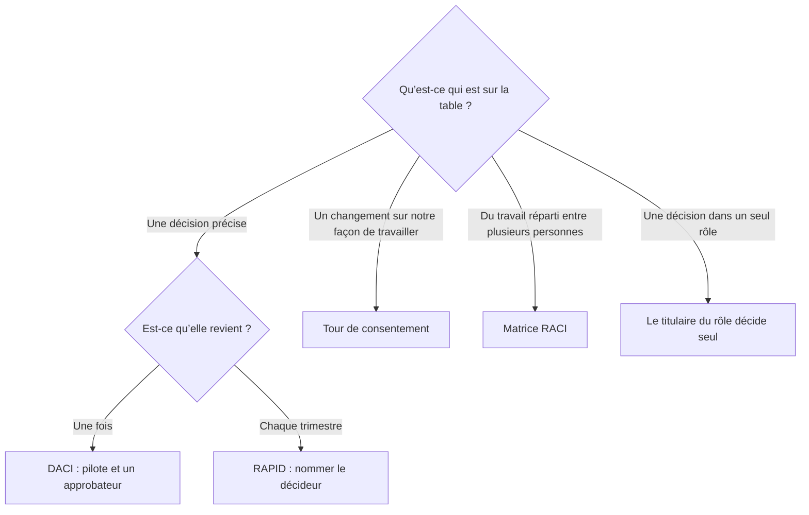
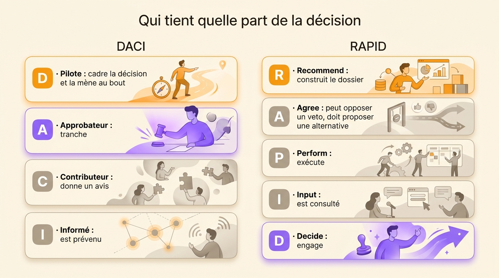

Une méthode de décision est une courte liste de rôles nommés qui dit qui joue quelle part dans une décision : qui la fait avancer, qui dit oui, qui est consulté, qui est informé. Quatre d’entre elles couvrent l’essentiel de ce qu’une équipe qui grandit rencontre. On les confond sans cesse parce que leurs lettres se ressemblent. DACI nomme un pilote et un seul approbateur pour une décision unique. RAPID, signé Bain, ajoute un décideur et des porteurs de veto pour les décisions qui reviennent chaque trimestre. RACI répartit des tâches, pas des décisions. Le consentement donne la décision au groupe tant que personne ne s’y oppose. Cet article les compare sur la question que chacune tranche, puis montre où la réponse doit vivre pour tenir encore six mois plus tard.

## Ce qu’une méthode de décision règle

Paul Rogers et Marcia Blenko, deux associés de Bain, ont nommé le problème récurrent dans la *Harvard Business Review* de janvier 2006, dans « Who Has the D? How Clear Decision Roles Enhance Organizational Performance ». Les équipes perdent leur temps dans quatre disputes qui reviennent : le global contre le local, la direction contre une filiale, une fonction contre une autre, les internes contre les partenaires extérieurs. Chaque dispute cache un rôle de décision manquant. Une des personnes en jeu ignore si elle possède la décision ou si elle n’y porte qu’un avis. La réunion encaisse la différence.

Une méthode règle exactement cela, et rien d’autre. Elle distribue les rôles d’une décision à des personnes nommées avant que la discussion commence. Un propriétaire existe, un recommandeur existe, les personnes à consulter sont listées. La dispute sur qui décide ne s’ouvre même pas. La méthode n’améliore pas la décision elle-même. Elle la rend possible, puis s’efface.

Ce périmètre si étroit explique pourquoi des équipes abandonnent leurs méthodes au bout d’un trimestre. Trois choses restent ouvertes une fois les lettres distribuées :

- La réponse vit dans une diapositive ou un courriel, et personne ne la retrouve.
- La même question revient le mois suivant, et les rôles se nomment depuis zéro.
- Personne n’a écrit ce que le décideur avait le droit de décider, donc chaque cas limite relance l’argument.

Les domaines de rôles et l’enregistrement des décisions s’occupent de ces trois points. Commencez par les quatre méthodes et ce que chacune répond vraiment.

## DACI : un pilote, un approbateur

DACI est une méthode de décision généralement attribuée à Intuit, où des équipes produit l’ont développée dans les années 1980. Elle nomme quatre rôles sur une décision unique : un **pilote** qui la fait avancer, un **approbateur** qui tranche, des **contributeurs** qui l’alimentent et des **informés** qu’on prévient. Atlassian l’a documentée pour ses propres équipes dans son Team Playbook, où elle est la méthode standard pour les décisions à fort impact qui traversent une frontière d’équipe.

Le pilote cadre la question, rassemble les gens qui savent, collecte leurs contributions et pousse la décision jusqu’au bout. Le pilote ne décide pas. Un pilote qui approuve aussi n’a personne pour vérifier son travail. Une décision qui ne demandait aucune vérification n’avait pas besoin d’une méthode.

L’approbateur est une seule personne. Deux approbateurs recréent le blocage que la méthode existe pour éviter, chacun supposant que l’autre a signé. Un approbateur, nommé à l’avance, c’est tout le mécanisme.

Les contributeurs ont une voix, sans vote. Ce sont les ingénieurs, les juristes, la responsable support qui a déjà vu ça échouer. La décision est meilleure quand ils parlent tôt. Elle est plus lente quand leur avis devient un passage obligé vers le oui.

Les informés sont prévenus, dans un seul sens, une fois la décision prise.

Prenons une décision concrète : faut-il décaler le lancement de deux semaines ? La cheffe produit pilote, cadre l’impact avec l’équipe technique, collecte les chiffres des défauts ouverts et des deals en jeu, et rapporte une recommandation avec des dates. La CEO approuve. La responsable technique et la responsable support contribuent. Les ventes restent informées, et apprennent la date avant un prospect. La méthode a coûté un paragraphe. La décision a une personne attachée à chacune de ses parts.

Là où DACI casse, c’est là où toute méthode à lettres casse : deux approbateurs, un pilote qui décide discrètement sans l’approbateur, ou une liste de contributeurs qui gonfle jusqu’à occuper la réunion. Gardez les rôles à quatre ou cinq personnes nommées et le format tient.

## RAPID : qui recommande, qui décide

RAPID est l’outil de Bain, marque déposée du cabinet, et la méthode que Rogers et Blenko décrivaient dans leur article. Cinq rôles : **Recommend**, **Agree**, **Perform**, **Input**, **Decide**. Les lettres forment un moyen mnémotechnique, pas un ordre d’étapes. Bain l’écrit noir sur blanc, parce que le D est là où le processus atterrit, pas là où il commence.

La distribution des lettres :

- **R** pilote le processus et construit la recommandation, sur la confiance du décideur et la crédibilité des parties prenantes.
- **A** tient un veto, attribué avec parcimonie aux rôles juridiques ou réglementaires, et un veto oblige à proposer une alternative ou à remonter vers le D.
- **P** exécute la décision une fois prise.
- **I** donne un avis que le R doit peser.
- **D** engage l’organisation, idéalement seul.

Là où DACI couvre une décision unique dans une équipe, RAPID justifie son coût d’installation sur des décisions qui reviennent : les validations d’investissement, les changements de tarifs, les fonctionnalités qui font une release. Nommer un décideur une fois pour toute une famille de décisions empêche le même argument de repartir chaque trimestre. La méthode est plus lente à monter et bien plus légère à faire tourner.

La différence pratique entre les deux tient au A. L’approbateur de DACI est le décideur. Le rôle Agree de RAPID est un frein que tient la juridique ou la conformité, et le décideur reste le D. Une équipe qui distribue son A à trois directions a reconstruit le goulot d’étranglement avec des lettres neuves.

## RACI est une méthode de tâches, pas de décisions

RACI remonte aux pratiques de conseil des années 1950, et le Project Management Institute la liste comme une forme de matrice d’attribution des responsabilités, le tableau qui relie la décomposition du travail d’un projet aux personnes qui le livrent. **Responsible** réalise, **Accountable** répond du résultat, **Consulted** donne un avis avant la livraison, **Informed** est prévenu ensuite. Le [modèle complet et trois exemples détaillés](/fr/blog/raci-matrix) vivent dans un article séparé.

Le piège est la lettre A. L’Accountable de RACI et l’Approbateur de DACI occupent la même forme de case et répondent à des questions différentes. RACI dit qui répond d’un livrable. Elle ne dit rien des questions à l’intérieur de ce livrable. Ce sont elles qui bloquent les équipes : si le livrable vaut le coup, combien il coûte, qui peut le modifier. Deux directions s’opposent sur un morceau de travail. La matrice nomme un responsable. L’opposition reste intacte, parce que la matrice a été construite pour suivre les passages de relais.

| | DACI | RACI |
|---|---|---|
| Question à laquelle elle répond | Qui prend cette décision ? | Qui fait quelle tâche ? |
| Unité couverte | Une décision | Un projet ou une décomposition du travail |
| Ce que veut le A | Approbateur, il tranche | Accountable, il répond d’un résultat |
| Durée de vie | La décision | Le projet |

Une RACI dit à une équipe comment le travail circule. Une méthode de décision lui dit comment un choix se prend. La plupart des projets ont besoin de la première. La plupart des projets bloqués n’ont pas la seconde.

## Le consentement et le processus de conseil : décider sans décideur unique

DACI et RAPID gardent chacun un décideur, une personne qui engage tout le monde. Le consentement et le processus de conseil répartissent la décision elle-même. Une équipe auto-organisée vit sur l’une des deux.

Le consentement donne la décision au groupe. Une proposition passe tant que personne ne lève une objection motivée, un argument qui montre que la proposition nuirait au travail auquel le groupe s’est engagé. Une préférence n’est pas une objection. Le [déroulé complet de la décision par consentement](/fr/blog/consent-decision) et les critères d’objection sont détaillés dans un article dédié. Les tours se déroulent dans une [réunion de gouvernance](/fr/blog/governance-meeting).

Le processus de conseil va plus loin : chacun peut décider de tout, après avoir pris conseil auprès de toutes les personnes concernées et des experts compétents. Le conseil se prend et se pèse, sans lier celui qui décide. Dennis Bakke, qui dirigeait la société d’énergie AES, a décrit la pratique dans *Joy at Work* en 2005, et Frederic Laloux, ancien associé de McKinsey, l’a documentée dans *Reinventing Organizations* en 2014 comme régime par défaut des entreprises auto-gérées. AES comptait environ 40 000 salariés au plus fort de son développement. Passer outre le tour de conseil comptait parmi les rares fautes graves.

Le consentement demande s’il reste une objection. Le processus de conseil demande si le conseil a été pris. Le consentement garde la décision dans les mains du groupe, le processus de conseil la donne à celui qui est le plus proche du problème, et tous deux répondent à une question que DACI et RAPID ne posent jamais : si la décision a besoin d’un décideur unique.

## Quelle méthode pour quelle question

Chaque méthode mérite sa place sur une question différente. Partez de ce qui est sur la table.

| Méthode | Question à laquelle elle répond | Qui décide | Où elle s’installe | Vitesse une fois en place |
|---|---|---|---|---|
| DACI | Qui pilote et qui approuve cette décision ? | Un approbateur unique | Décisions uniques à fort impact dans une équipe | Rapide, quatre ou cinq personnes nommées |
| RAPID | Qui engage l’organisation ? | Un décideur unique, avec des vetos Agree | Décisions récurrentes entre fonctions | Installation plus lente, coût de fonctionnement faible |
| RACI | Qui fait quelle tâche ? | Personne, elle cartographie l’exécution | Projets avec des relais | Rapide |
| Consentement | Quelqu’un s’oppose-t-il ? | Le groupe | Changements sur les rôles et les règles | Vingt minutes dans un petit cercle |
| Processus de conseil | Le conseil a-t-il été pris ? | Chacun, après avoir demandé | Équipes distribuées avec peu de managers | Lent la première fois, rapide ensuite |

Les méthodes se combinent au lieu de se concurrencer. Une équipe peut tenir ses décisions de roadmap en RAPID, son travail de projet en RACI et ses changements de rôles en tour de consentement. Les bonnes versions de chacune nomment le même fait sous un angle différent.

{/* IMAGE regen: api.py image, infographic, 1600x900. Scene: "Deux colonnes de cartes empilées côte à côte sur fond crème chaud, titrées « Qui tient quelle part de la décision ». Colonne de gauche intitulée « DACI » avec quatre cartes arrondies : « D · Pilote : cadre la décision et la mène au bout », « A · Approbateur : tranche », « C · Contributeur : donne un avis », « I · Informé : est prévenu ». Colonne de droite intitulée « RAPID » avec cinq cartes arrondies : « R · Recommend : construit le dossier », « A · Agree : peut opposer un veto, doit proposer une alternative », « P · Perform : exécute », « I · Input : est consulté », « D · Decide : engage ». Le violet #9870F0 met en avant la carte A à gauche et la carte D à droite, l’orange chaud #FB9803 accentue les cartes Pilote et Recommend, les autres en gris chaud neutre. Typographie sans-serif propre, marges généreuses." */}

## Les droits de décision s’écrivent dans les rôles

Une méthode nomme le décideur d’une décision, une fois. L’équipe qui ne tranche qu’au cas par cas rouvre la même question chaque mois. La réunion est l’endroit où elle va mourir.

La réponse durable est le **domaine** d’un rôle : l’actif ou le processus qu’un seul rôle décide seul, écrit à côté de sa raison d’être et de ses redevabilités. Chaque décision récurrente que vos méthodes continuent d’attribuer au cas par cas devrait atterrir dans un domaine. Les validations d’achat deviennent un domaine Finance, les décisions de tarifs deviennent un rôle Tarification, les dates de mise en production relèvent du rôle Lancement. Alors la réponse à « qui décide ça » existe avant que la question se pose. [Nul n’a besoin de la remonter dans la hiérarchie](/fr/glossary/domaine).

La règle empirique pour en ajouter un : [créez un domaine le jour où une décision bloque parce que personne ne sait qui la tranche](/fr/blog/define-roles). Un domaine créé par anticipation décrit un organigramme dans lequel personne ne travaille. Un domaine créé après un vrai blocage décrit celui que l’équipe a réellement.

Modifier un domaine relève de la gouvernance, c’est-à-dire du processus qui change la façon de travailler. En sociocratie et en holacratie, cela prend la forme d’un tour de consentement déclenché par une tension que quelqu’un a ressentie, dans une réunion de gouvernance, plutôt que d’une retouche de manager. La différence compte : un domaine amendé par les personnes qui tiennent les rôles est un domaine qu’elles peuvent défendre. Un domaine retouché en silence est un domaine que personne n’a de raison de respecter.

C’est aussi ce que [signifie être redevable dans un rôle](/fr/blog/accountability-vs-responsibility) : répondre d’un résultat, avec la marge de décision qu’il faut pour y arriver.

## Enregistrer les décisions pour qu’elles restent trouvables

La dernière pièce est celle que toutes les méthodes laissent de côté. Une décision qui vit dans une présentation ou dans un fil de discussion est une décision que l’équipe prendra à nouveau. Ce qu’il faut à une trace :

1. La décision, comme un résultat, en une phrase. « Nous plafonnons les achats à 500 € par mois et par rôle » vaut mieux que « discussion budget ».
2. Le contexte qui l’a façonnée, en un court paragraphe.
3. La date et la personne qui a tranché.
4. L’endroit où la décision a été prise, pour que la trace porte sa propre autorité.
5. Une date de relecture, pour qu’une décision prise dans l’incertain devienne une expérience plutôt qu’une règle.

{/* IMAGE regen: api.py image, infographic, 1600x900. Scene: "Une carte de document unique sur fond crème chaud, titrée « Ce que contient une décision écrite », avec cinq lignes empilées et de petites icônes : « La décision, comme un résultat, en une phrase », « Le contexte qui l’a façonnée », « La date, et la personne qui a tranché », « L’endroit où elle a été prise », « Une date de relecture, pour qu’elle reste une expérience ». Une petite horloge sur la ligne de relecture en orange chaud #FB9803, un bandeau d’en-tête violet #9870F0 sur la carte, les autres lignes en gris chaud neutre. Typographie sans-serif propre, marges généreuses." */}

Dans Rolebase, une décision s’attache au rôle qui l’a prise. Vous en créez une depuis une discussion, ou pendant une réunion, où elle entre à l’ordre du jour et apparaît dans le relevé de l’étape. Chaque rôle porte un onglet Décisions avec son historique, une décision peut rester privée pour les participants du rôle, et tout l’historique passe par la recherche. Une proposition qui passe écrit sa décision et applique les changements d’organigramme qu’elle portait, dans la même étape, pour que le vote et la réorganisation ne s’écartèlent jamais. Le détail écran par écran vit dans la documentation sur les [décisions](/fr/docs/decisions).

Rolebase n’a pas de gabarit DACI ni RAPID. Les méthodes n’en ont pas besoin. Ce que l’outil porte, c’est la part que les méthodes laissent ouverte : la décision, écrite là où vit le rôle, retrouvable quand la question revient. Pour les équipes qui veulent aussi la partie vote, nous avons comparé huit [outils de décision collaborative](/fr/blog/top-decision-making-software) exactement sur ce point.

## Questions fréquentes

<FaqList>

<FaqItem question="Que veulent dire les lettres de DACI ?">

Driver (pilote), Approver (approbateur), Contributors (contributeurs), Informed (informés). Le pilote cadre la décision et la fait avancer, l’approbateur tranche, les contributeurs donnent un avis sans vote, et les informés sont prévenus une fois la décision prise. La méthode est généralement attribuée à Intuit dans les années 1980 et couvre une décision à la fois, avec un approbateur unique nommé.

</FaqItem>

<FaqItem question="Qu’est-ce que le modèle de décision RAPID ?">

RAPID est une méthode de décision de Bain & Company, marque déposée du cabinet, popularisée par Paul Rogers et Marcia Blenko dans la *Harvard Business Review* de janvier 2006. Cinq rôles : Recommend construit le dossier, Agree tient un veto et doit une alternative, Perform exécute, Input est consulté, Decide engage l’organisation. Les lettres forment un moyen mnémotechnique, pas un ordre d’étapes. Elle convient mieux aux décisions récurrentes à fort impact qu’aux coups ponctuels.

</FaqItem>

<FaqItem question="Quelle est la différence entre RACI et DACI ?">

RACI répond à la question de qui fait quelle tâche : Responsible réalise, Accountable répond du résultat, Consulted donne un avis, Informed est prévenu. DACI répond à la question de qui prend la décision : le pilote la fait avancer, l’approbateur tranche, les contributeurs l’alimentent, les informés sont prévenus. Les deux A diffèrent. L’Accountable de RACI répond d’un livrable, l’Approbateur de DACI engage la décision. La plupart des projets bloqués ont une RACI et aucune méthode de décision.

</FaqItem>

<FaqItem question="Comment documenter une décision ?">

Écrivez la décision comme un résultat en une phrase, puis le contexte qui l’a façonnée, la date, la personne qui a tranché, l’endroit où elle a été prise et une date de relecture. Attachez la trace au rôle qui l’a prise plutôt qu’au projet qui l’a déclenchée, pour qu’elle reste trouvable quand la question revient. Une décision enregistrée avec une date de relecture est une expérience. Une décision enregistrée sans elle devient une règle dont personne ne se souvient de la raison.

</FaqItem>

<FaqItem question="Peut-on avoir un exemple de méthode de décision ?">

Prenons « faut-il décaler le lancement de deux semaines ». En DACI : la cheffe produit pilote, cadre l’impact avec l’équipe technique, collecte les chiffres des défauts ouverts et des deals en jeu, et rapporte une recommandation. La CEO approuve. La responsable technique et la responsable support contribuent. Les ventes restent informées et apprennent la date avant un prospect. En RAPID, la même décision nommerait un décideur, un recommandeur, la juridique en veto Agree si des contrats sont touchés, et les équipes qui Perform. En tour de consentement, le groupe adopterait le décalage tant que personne ne démontre un préjudice au travail auquel il s’est engagé.

</FaqItem>

</FaqList>

## Par où commencer

Prenez la décision qui bloque le plus souvent dans votre équipe, celle qui garde sa propre chaise dans vos réunions. Nommez les rôles en un paragraphe, avec un approbateur ou un décideur unique, et jouez la prochaine occurrence dessus. Les disputes qui éclatent pendant que vous écrivez le paragraphe sont l’essentiel : c’est le désaccord sur qui décide, dit enfin à voix haute.

Puis regardez les décisions qui sont revenues trois fois. Leur réponse vit dans un domaine de rôle, écrit à côté de la raison d’être qu’il sert, amendé en gouvernance quand il ne va plus. [Créez un compte gratuit sur Rolebase](/signup) et cartographiez les deux : les rôles avec leurs domaines, et le journal des décisions attaché à chacun. Vous pouvez consulter [tout ce que la plateforme propose](/fr/features). Le plan gratuit couvre cinq membres actifs.