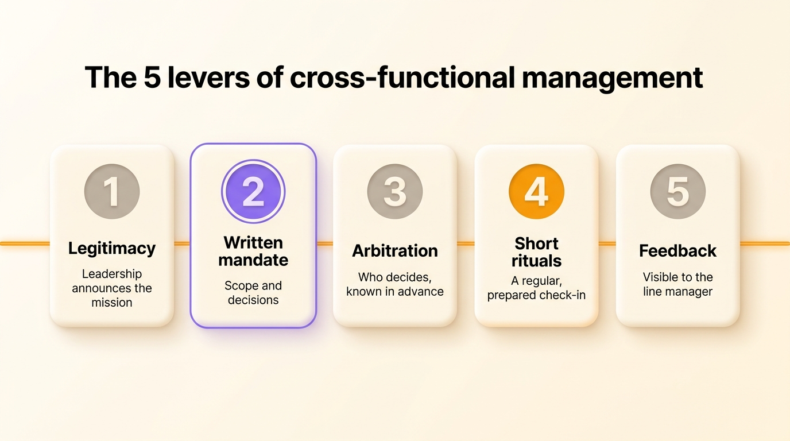
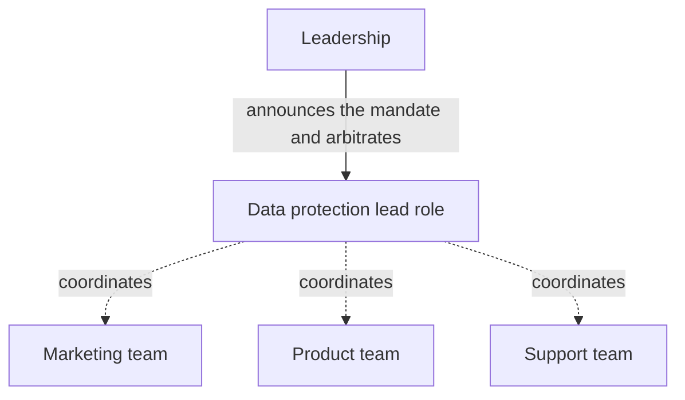
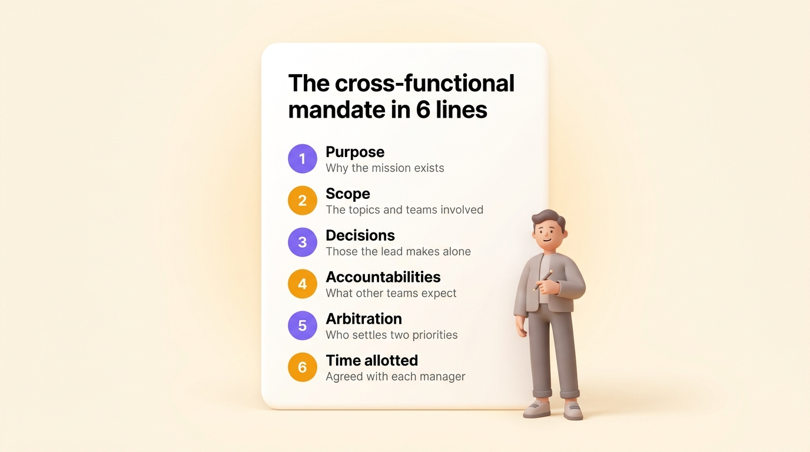

Cross-functional management means leading a project, a process or a topic that runs across several teams, with no reporting line over the people who contribute to it. A project lead, a quality manager and a data protection lead all work this way. Most advice for cross-functional managers is about soft skills: listen, persuade, build relationships. Those skills help, but a cross-functional manager succeeds mainly when the mandate is written down, with its scope, the decisions the manager makes alone and what others can expect from them. This article defines cross-functional management, explains why it keeps spreading, walks through five levers and three traps, then shows how to write that mandate.

## What cross-functional management is

Cross-functional management is a way of managing where one person answers for a result that depends on several teams, while being the line manager of none of the contributors. Each contributor keeps their own manager, goals and home team. The cross-functional manager coordinates their work on one topic: a redesign project, the quality program, GDPR compliance, a community of practice.

Academic literature calls the same situation lateral leadership, and calls the skill itself influence without authority. Matrix management is often used as a synonym, although it describes a whole organization where each person has two reporting lines.

| | Line management | Cross-functional management |
| --- | --- | --- |
| Scope | One team | A topic that runs across several teams |
| Source of authority | The position and the reporting line | A mandate and recognized expertise |
| Means of action | Set goals, run reviews, weigh in on pay | Negotiate time and priorities with the contributors' managers |
| Duration | Permanent | The length of the project, or permanent for a process |
| Common failure | Every decision goes up to the manager | The lead works with no mandate |

Cross-functional management also differs from [participative management](/en/blog/participative-management), which is about a manager and their own team, and how much decision power the manager shares with it. Cross-functional management is about coordination between teams.

## Why cross-functional management keeps spreading

Three changes create more cross-functional work.

- Companies run more of their work as projects, which nearly always need people from several departments.
- Large organizations adopt a [matrix structure](/en/blog/matrix-organizational-structure), where each person belongs to both a discipline and a product or project.
- More topics are too broad for one team: information security, data protection, quality, sustainability.

Gallup, the American polling firm, measured this in 2018: 84% of US employees were matrixed to some degree, and 17% worked every day with people who reported to other managers.

Jay Galbraith, an American organization theorist, explained in 1973, in *Designing Complex Organizations*, where cross-functional work comes from. When a topic involves two departments, the hierarchy sends it up to the first shared boss, who decides and sends the decision back down. That boss is soon overloaded once shared topics become frequent. Organizations then create lateral relations: direct contacts, liaison roles, task forces, and integrating roles that coordinate without commanding. The cross-functional manager is one of these integrators. The main [types of organizational structure](/en/blog/organizational-structures) differ largely in how much room they give these lateral relations.

## Without a reporting line, cooperation comes from exchange

A line manager sets the team's goals, runs performance reviews and weighs in on raises. A cross-functional manager has none of these means. The people they need already have a manager, goals and a full week.

Allan Cohen, a management professor at Babson College, and David Bradford, who taught at the Stanford Graduate School of Business, described in 1989 in the journal *Organizational Dynamics* how to get cooperation from people you have no authority over. Their model rests on reciprocity. A person is more willing to help someone who brings them something useful in return: information, a hand on a project, visibility with leadership, or recognition. So a cross-functional manager needs to know what matters to each contributor and to that contributor's manager.

Of course, exchange has limits. It depends on the relationship between two people, so it has to be rebuilt whenever one of them changes jobs. It also cannot settle the most common conflict, the one where the project and the home team both want the same day of work.

Behnam Tabrizi, who teaches at Stanford University, studied 95 cross-functional teams in 25 large corporations. He concluded in 2015 in *Harvard Business Review* that nearly 75% of them were dysfunctional: they failed on at least three of five criteria, namely budget, schedule, specifications, customer expectations and alignment with company goals. Tabrizi puts these failures down to unclear governance, poorly assigned accountability and goals that were too vague. He blames how the project is set up rather than the lead's people skills.

## The five levers of cross-functional management

Five levers give a cross-functional manager the structure that most of the teams Tabrizi studied were missing.

### Legitimacy

A cross-functional manager's legitimacy comes first from leadership, which announces the mission itself, in front of the teams involved and their managers, and says what it expects. Legitimacy also comes from the manager's expertise, which contributors recognize once the manager has been useful to them in the first weeks. A lead who announces their own mission by email starts at a disadvantage.

### A written mandate

The mandate says in a few lines why the mission exists, what it covers, which decisions the lead makes alone and what others can expect from them. A spoken mandate changes a little each time someone repeats it. A written mandate can be reread when people disagree, and handed over when the lead changes.

### An arbitration rule

Sooner or later a contributor gets two requests for the same day, one from the project and one from their team. Decide in advance who settles that case, and agree with each manager on how much time their team gives to the topic. Half a day a month in writing works better than a promise of availability.

### Short rituals

A regular, short, prepared check-in is enough for most cross-functional topics: an agenda known before the meeting, decisions written down, each action assigned to one person. Other exchanges go in writing. Each extra meeting takes time away from the home teams.

### Feedback

A cross-functional manager reviews nobody, so the work done for the project can go unnoticed at the annual review. Give each contributor specific feedback on what they brought and pass it on to their manager too. This makes the contribution visible where raises are decided. The feedback you give is a form of [peer feedback](/en/blog/peer-feedback).

{/* IMAGE regen: api.py image, infographic, 1600x900. English-only visual because it carries English text, the FR version uses ./cinq-leviers.jpg. Regenerate if the labels or the order of the five levers change. Scene: "a clean front-facing infographic on the warm cream background. At the top, a bold modern clean sans-serif title reading exactly: 'The 5 levers of cross-functional management'. Below the title, five soft rounded cards aligned in one horizontal row, evenly spaced, each with a large numeral in a circle at the top, a bold sans-serif label, and one short line of smaller text underneath. Cards 1, 3 and 5 have a warm grey numeral circle, card 2 has a purple #9870F0 numeral circle and a thin purple outline because it is the key lever, card 4 has an orange #FB9803 numeral circle. Card 1: numeral '1', label 'Legitimacy', line 'Leadership announces the mission'. Card 2: numeral '2', label 'Written mandate', line 'Scope and decisions'. Card 3: numeral '3', label 'Arbitration', line 'Who decides, known in advance'. Card 4: numeral '4', label 'Short rituals', line 'A regular, prepared check-in'. Card 5: numeral '5', label 'Feedback', line 'Visible to the line manager'. Under the row of cards, one thin horizontal orange thread runs across all five cards and links them. No other text anywhere in the image." */}

## The three traps of cross-functional management

### Vague authority

A lead with no mandate discovers their scope one refusal at a time. They ask, they hear that the topic is none of their business, and they go back to leadership for every disagreement. After a few months they spend more time negotiating their place than moving the topic forward.

### Conflicting demands

The contributor gets two incompatible requests, one from their manager and one from the cross-functional lead. Robert Kahn, a psychologist at the University of Michigan, described this situation in 1964 as role conflict, in *Organizational Stress*, and linked it to more tension and lower job satisfaction. According to the 2018 Gallup study, matrixed employees are less clear than others about what is expected of them. With no arbitration rule, each contributor settles the conflict alone, usually in favor of the manager who signs their review.

### Meeting overload

A lead who can decide nothing calls meetings to get everyone's agreement. Each new cross-functional topic then gets its own committee, which leads to [meeting overload](/en/blog/meeting-overload). A mandate that names the decisions the lead makes alone removes a good share of those meetings.

## Write the cross-functional mandate as a role

A cross-functional manager's mandate has the same form as a [role](/en/glossary/role): a purpose, a [domain](/en/glossary/domaine) where the person decides alone, and [accountabilities](/en/glossary/redevabilite) that others rely on. Here is the mandate of a data protection lead who works with the marketing, product and support teams.

| Line of the mandate | Example for a data protection lead |
| --- | --- |
| Purpose | Customers' personal data is processed in line with GDPR |
| Scope | The record of processing activities and access or erasure requests, in every team |
| Decisions made alone | The template of the record, the internal deadline for answering requests, postponing a new processing activity until it is in the record |
| Accountabilities | Update the record every quarter, answer requests within the legal one-month deadline, train every new hire |
| Arbitration | The CEO decides when a GDPR deadline and a team priority conflict |
| Time allotted | Half a day per month and per team, agreed with each manager |

With a role written this way, the contributor knows what the lead can ask of them, their manager knows how much time the mission takes from the team, and the lead knows how far their decisions go. The role stays in place when the project ends or when the person changes, which sets it apart from a [RACI matrix](/en/blog/raci-matrix) tied to a single project.

A person usually holds several roles under a single job title. The data protection lead keeps a legal counsel role in their home team, alongside the cross-functional role. A role describes the work as it is actually done and can be handed over without changing the job title, while a [job description serves the contract and hiring](/en/blog/roles-vs-job-descriptions). For each line of the mandate, apply the rules used to [define a role](/en/blog/define-roles) with its purpose, domain and accountabilities.

{/* IMAGE regen: api.py image, infographic, 1600x900. English-only visual because it carries English text, the FR version uses ./mandat-transversal.jpg. Regenerate if the six lines of the mandate change. Scene: "a clean front-facing infographic on the warm cream background showing one large soft rounded white document card, centered, slightly tilted, like a one-page template. At the top of the card, a bold modern clean sans-serif title reading exactly: 'The cross-functional mandate in 6 lines'. Below, six stacked rows, each row made of a small numbered round bullet, a bold sans-serif label and one short line of smaller grey text. Rows 1, 3 and 5 have a purple #9870F0 bullet, rows 2, 4 and 6 an orange #FB9803 bullet. Row 1: label 'Purpose', line 'Why the mission exists'. Row 2: label 'Scope', line 'The topics and teams involved'. Row 3: label 'Decisions', line 'Those the lead makes alone'. Row 4: label 'Accountabilities', line 'What other teams expect'. Row 5: label 'Arbitration', line 'Who settles two priorities'. Row 6: label 'Time allotted', line 'Agreed with each manager'. To the right of the card, one small soft 3D human figure holds a pen, in a friendly posture. No other text anywhere in the image." */}

### The cross-functional mandate in Rolebase

In [Rolebase](/en/features), a cross-functional mandate is a role like any other. You create it in the org chart with its purpose, domain and accountabilities, then you add the person who holds it. They keep their roles in their own team, so the org chart shows those roles and the cross-functional mandate together. You can then [invite that role into the teams involved](/en/docs/circles-and-roles), which gives the person a place in those teams' meetings and decisions. Meetings have a shared agenda and minutes. You can attach tasks and discussions to the role. Rolebase is open source, free up to five active members, then €5 per user per month.

The cooperative [EVEA](/en/client-cases/scop-evea) grew from 60 to 140 people between 2020 and 2023. It tracked its organization in a PowerPoint, which became too complex with more than eight skill centers and cross-functional missions. It replaced that PowerPoint with a dynamic org chart in Rolebase.

{/* TODO ANECDOTE: a client example of a cross-functional role created in Rolebase (its name, the teams it is invited into, what changed in arbitration) would anchor this section. */}

## Frequently asked questions

<FaqList>

<FaqItem question="What is cross-functional management?">

Cross-functional management is leading work that depends on several teams without being the line manager of the people involved. The cross-functional manager answers for the result of a project, a process or a topic, and coordinates contributors who each keep their own manager and goals.

</FaqItem>

<FaqItem question="How do you manage people who do not report to you?">

Start with a mandate that leadership announces and that the contributors' managers know. Agree with each manager on how much time their team gives, and on who decides when the project and the team want the same day. Then find out what matters to each contributor, bring it to them when you can, and tell their manager what they contributed.

</FaqItem>

<FaqItem question="What are the five levers of cross-functional management?">

The five levers of cross-functional management are legitimacy announced by leadership, a written mandate, an arbitration rule known in advance, short coordination rituals, and regular feedback to contributors and their managers. The written mandate matters most: it says what the legitimacy covers, which decisions need no arbitration and what the meetings are about.

</FaqItem>

<FaqItem question="What is the difference between cross-functional management and matrix management?">

Matrix management describes a whole organization where each person has two reporting lines, usually a discipline and a product. Cross-functional management describes the position of one person who coordinates across teams with no reporting line at all. A matrix creates many cross-functional situations, but a company with a plain functional structure has them too, on every project that involves two departments.

</FaqItem>

<FaqItem question="What are the drawbacks of cross-functional management?">

Cross-functional management puts contributors between two sources of requests, which blurs their priorities. It adds coordination meetings. It wears out the lead when the mandate stays spoken, because they have to renegotiate their place at each disagreement. These three drawbacks shrink a lot once the mandate, the arbitration rule and the time allotted are written and known to the managers.

</FaqItem>

</FaqList>

## Start by writing one mandate

A cross-functional manager who succeeds rarely has more charisma than another. They have a mandate that leadership announced, that the managers know and that anyone can reread.

Take one cross-functional mission that is stalling in your organization and write its mandate in six lines: purpose, scope, decisions made alone, accountabilities, arbitration and time allotted. Have leadership and the managers involved review it, then store it where every team can find it.

[See Rolebase features](/en/features) or create your organization. Rolebase is free up to five active members.
