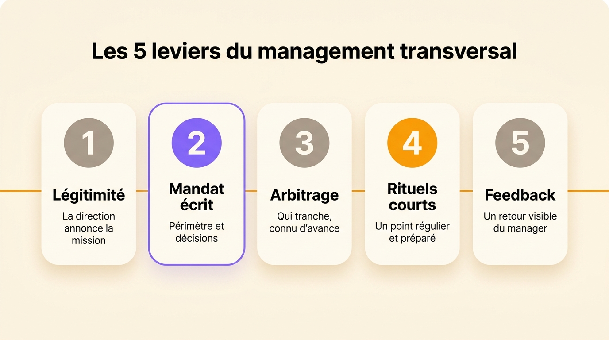
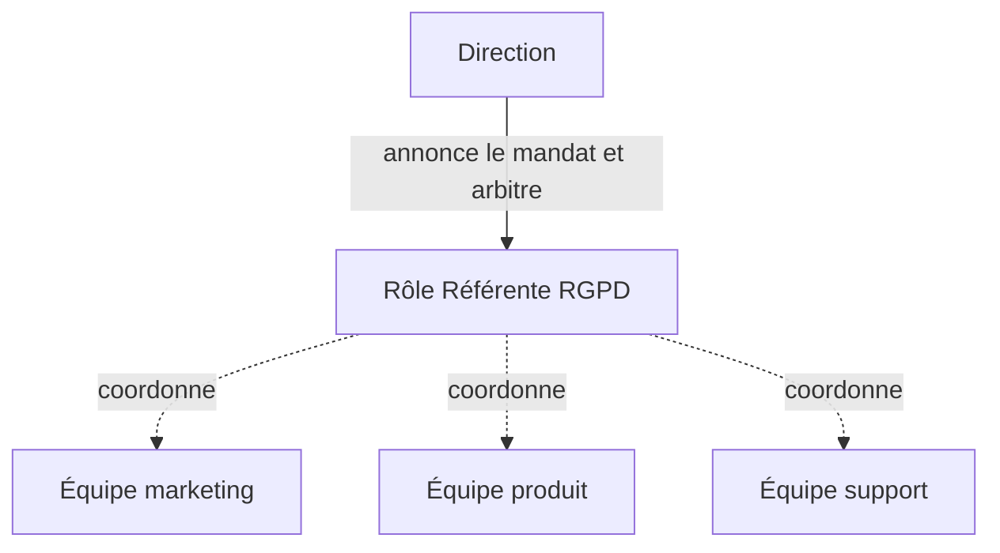
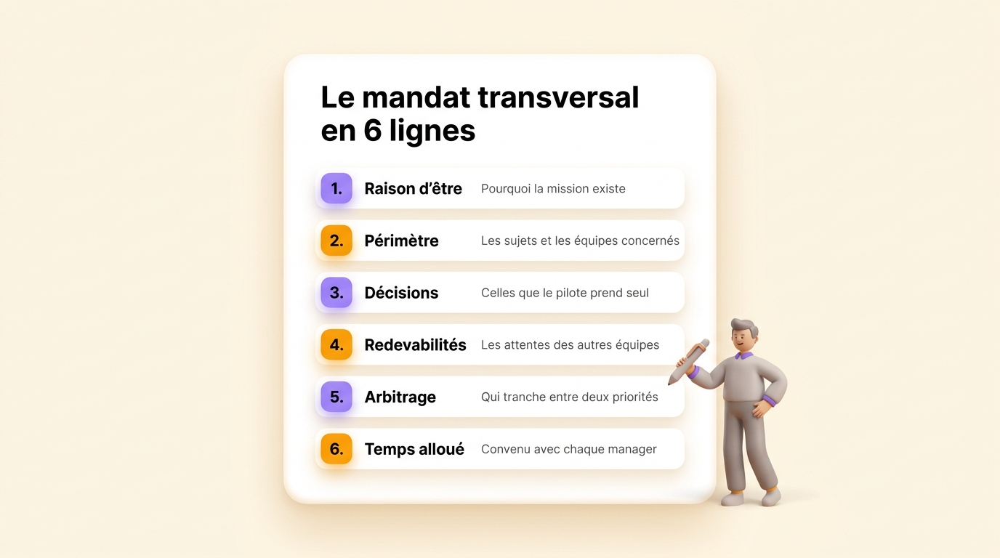

Le management transversal consiste à piloter un projet, un processus ou un sujet qui traverse plusieurs équipes, sans autorité hiérarchique sur les personnes qui y contribuent. Une cheffe de projet, un responsable qualité ou une référente RGPD travaillent ainsi. On conseille souvent aux managers transversaux de soigner leur posture : écouter, convaincre, entretenir la relation. Ces qualités aident, mais un manager transversal réussit surtout quand son mandat est écrit, avec son périmètre, les décisions qu’il prend seul et ce que les autres peuvent attendre de lui. Cet article donne la définition du management transversal, explique pourquoi il se répand, détaille cinq leviers et trois pièges, puis montre comment écrire ce mandat.

## Définition du management transversal

Le management transversal est une façon de manager où une personne répond d’un résultat qui dépend de plusieurs équipes, alors qu’elle n’est le supérieur hiérarchique d’aucun des contributeurs. Chaque contributeur garde son manager, ses objectifs et son équipe d’origine. Le manager transversal coordonne leur travail sur un sujet précis : un projet de refonte, la démarche qualité, la conformité RGPD, une communauté de pratique.

On parle aussi de management transverse, de management fonctionnel ou de management non hiérarchique pour désigner la même situation. Le terme anglais le plus proche est *cross-functional management*. Les auteurs américains parlent aussi d’*influence without authority*, l’influence sans autorité, pour la compétence du manager lui-même.

| | Management hiérarchique | Management transversal |
| --- | --- | --- |
| Périmètre | Une équipe | Un sujet qui traverse plusieurs équipes |
| Source d’autorité | Le poste et le lien de subordination | Un mandat et une expertise reconnue |
| Moyens d’action | Fixer les objectifs, évaluer, peser sur la rémunération | Négocier du temps et des priorités avec les managers des contributeurs |
| Durée | Permanente | Celle du projet, ou permanente pour un processus |
| Problème courant | Toutes les décisions remontent au manager | Le pilote travaille sans mandat |

Le management transversal se distingue aussi du [management participatif](/fr/blog/participative-management), qui concerne la relation entre un manager et sa propre équipe et le pouvoir de décision qu’il partage avec elle. Le management transversal porte sur la coordination entre les équipes.

## Pourquoi le management transversal se répand

Trois évolutions multiplient les situations transversales.

- Les entreprises travaillent de plus en plus par projets, qui mobilisent presque toujours des personnes de plusieurs services.
- Les grandes organisations adoptent une [structure matricielle](/fr/blog/matrix-organizational-structure), où chaque personne dépend à la fois d’un métier et d’un produit ou d’un projet.
- Les sujets qu’aucune équipe ne peut traiter seule se multiplient : la sécurité informatique, la protection des données, la qualité, la responsabilité sociale.

Gallup, l’institut de sondage américain, a mesuré l’ampleur du phénomène en 2018 : 84 % des salariés américains travaillaient alors en situation matricielle à un degré ou à un autre, et 17 % collaboraient chaque jour avec des personnes rattachées à d’autres managers.

Le théoricien américain des organisations Jay Galbraith avait expliqué dès 1973, dans *Designing Complex Organizations*, d’où viennent ces situations transversales. Quand un sujet concerne deux services, la hiérarchie le fait remonter jusqu’au premier chef commun, qui tranche puis redescend la décision. Ce chef est vite débordé quand les sujets communs deviennent nombreux. Les organisations créent alors des relations latérales : des contacts directs, des postes de liaison, des groupes de travail et des rôles d’intégrateur chargés de coordonner sans commander. Le manager transversal est l’un de ces intégrateurs. Les [principaux types de structure d’entreprise](/fr/blog/organizational-structures) se distinguent d’ailleurs en bonne partie par la place qu’ils donnent à ces relations latérales.

## Sans lien hiérarchique, la coopération s’obtient par l’échange

Un manager hiérarchique fixe les objectifs de son équipe, mène les entretiens annuels et pèse sur les augmentations. Un manager transversal n’a aucun de ces moyens. Les personnes dont il a besoin ont déjà un manager, des objectifs et une semaine remplie.

Allan Cohen, professeur de management au Babson College, et David Bradford, qui enseignait à la Stanford Graduate School of Business, ont décrit en 1989 dans la revue *Organizational Dynamics* comment on obtient la coopération de personnes sur lesquelles on n’a aucune autorité. Leur modèle repose sur la réciprocité. Une personne aide plus volontiers celle qui lui apporte quelque chose d’utile en retour : une information, un coup de main sur un dossier, de la visibilité auprès de la direction ou de la reconnaissance. Le manager transversal doit donc savoir ce qui compte pour chaque contributeur et pour son manager.

Bien sûr, l’échange a ses limites. Il dépend de la relation entre deux personnes, donc tout est à reconstruire quand l’une d’elles change de poste. Il ne règle pas non plus le conflit le plus fréquent, celui où le projet et l’équipe d’origine réclament la même journée de travail.

Behnam Tabrizi, qui enseigne à l’université Stanford, a étudié 95 équipes transversales dans 25 grandes entreprises. Il conclut en 2015 dans la *Harvard Business Review* que près de 75 % d’entre elles dysfonctionnent : elles échouent sur au moins trois critères parmi cinq, le budget, le calendrier, le cahier des charges, les attentes des clients et l’alignement avec les objectifs de l’entreprise. Tabrizi attribue ces échecs à une gouvernance floue, à des responsabilités mal réparties et à des objectifs trop vagues. Il met donc en cause le cadre du projet plutôt que le talent relationnel du pilote.

## Les cinq leviers du management transversal

Cinq leviers donnent au manager transversal le cadre qui manquait à la plupart des équipes étudiées par Tabrizi.

### La légitimité

La légitimité d’un manager transversal vient d’abord de la direction, qui annonce elle-même la mission devant les équipes concernées et leurs managers, en disant ce qu’elle attend. La légitimité vient ensuite de l’expertise du pilote, que les contributeurs reconnaissent quand il leur rend service dès les premières semaines. Un pilote qui annonce lui-même sa mission par un simple courriel part avec un handicap.

### Un mandat écrit

Le mandat dit en quelques lignes pourquoi la mission existe, sur quel périmètre elle porte, quelles décisions le pilote prend seul et ce que les autres peuvent attendre de lui. Un mandat oral se déforme à chaque fois qu’on le répète. Un mandat écrit, on peut le relire en cas de désaccord et le transmettre quand le pilote change.

### Une règle d’arbitrage

Un contributeur reçoit tôt ou tard deux demandes pour la même journée, l’une du projet et l’autre de son équipe. Décidez d’avance qui tranche dans ce cas, et convenez avec chaque manager du temps que son équipe consacre au sujet. Une demi-journée par mois notée par écrit vaut mieux qu’une promesse de disponibilité.

### Des rituels courts

Un point régulier, court et préparé suffit à la plupart des sujets transversaux : un ordre du jour connu avant la réunion, les décisions notées, les actions attribuées à une personne. Les autres échanges passent par écrit. Chaque réunion supplémentaire prend du temps aux équipes d’origine.

### Le feedback

Comme le manager transversal n’évalue personne, le travail fourni pour son projet peut passer inaperçu lors de l’entretien annuel. Donnez à chaque contributeur un retour précis sur ce qu’il a apporté et transmettez-le aussi à son manager. Vous rendez ainsi la contribution visible là où se décident les augmentations. Ce retour est une forme de [feedback entre pairs](/fr/blog/peer-feedback).

{/* IMAGE regen: api.py image, infographic, 1600x900. Visuel propre au FR car il porte du texte français, la version EN utilise ./five-levers.jpg. Régénérer si les libellés ou l'ordre des cinq leviers changent. Scene: "a clean front-facing infographic on the warm cream background. At the top, a bold modern clean sans-serif title reading exactly: 'Les 5 leviers du management transversal'. Below the title, five soft rounded cards aligned in one horizontal row, evenly spaced, each with a large numeral in a circle at the top, a bold sans-serif label, and one short line of smaller text underneath. Cards 1, 3 and 5 have a warm grey numeral circle, card 2 has a purple #9870F0 numeral circle and a thin purple outline because it is the key lever, card 4 has an orange #FB9803 numeral circle. Card 1: numeral '1', label 'Légitimité', line 'La direction annonce la mission'. Card 2: numeral '2', label 'Mandat écrit', line 'Périmètre et décisions'. Card 3: numeral '3', label 'Arbitrage', line 'Qui tranche, connu d’avance'. Card 4: numeral '4', label 'Rituels courts', line 'Un point régulier et préparé'. Card 5: numeral '5', label 'Feedback', line 'Un retour visible du manager'. Under the row of cards, one thin horizontal orange thread runs across all five cards and links them. No other text anywhere in the image." */}

## Les trois pièges du management transversal

### L’autorité floue

Le pilote sans mandat découvre son périmètre au fil des refus. Il demande, on lui répond que ce sujet ne le regarde pas, et il remonte à la direction pour chaque désaccord. Au bout de quelques mois, il passe plus de temps à négocier sa place qu’à faire avancer le sujet.

### La double injonction

Le contributeur reçoit deux demandes incompatibles, l’une de son manager et l’autre du pilote transversal. Robert Kahn, psychologue à l’université du Michigan, a décrit cette situation en 1964 sous le nom de conflit de rôle, dans *Organizational Stress*. Il la relie à plus de tension et à moins de satisfaction au travail. Selon l’étude Gallup de 2018, les salariés en situation matricielle savent moins bien que les autres ce qu’on attend d’eux. Sans règle d’arbitrage, chaque contributeur règle le conflit seul, le plus souvent en faveur du manager qui signe son évaluation.

### La réunionite

Un pilote qui ne peut rien décider convoque des réunions pour obtenir l’accord de tout le monde. On crée alors un comité pour chaque nouveau sujet transversal, ce qui mène à la [réunionite](/fr/blog/meeting-overload). Un mandat qui nomme les décisions que le pilote prend seul évite une bonne partie de ces réunions.

## Écrire le mandat transversal comme un rôle

Le mandat d’un manager transversal a la même forme qu’un [rôle](/fr/glossary/role) : une raison d’être, un [domaine](/fr/glossary/domaine) où la personne décide seule et des [redevabilités](/fr/glossary/redevabilite) sur lesquelles les autres comptent. Voici le mandat d’une référente RGPD qui travaille avec les équipes marketing, produit et support.

| Ligne du mandat | Exemple pour une référente RGPD |
| --- | --- |
| Raison d’être | Les données personnelles des clients sont traitées conformément au RGPD |
| Périmètre | Le registre des traitements et les demandes d’accès ou de suppression, dans toutes les équipes |
| Décisions prises seule | Le modèle du registre, le délai interne de réponse aux demandes, le report d’un nouveau traitement tant qu’il manque au registre |
| Redevabilités | Mettre le registre à jour chaque trimestre, répondre aux demandes dans le délai légal d’un mois, former chaque nouvel arrivant |
| Arbitrage | Le directeur général tranche quand une échéance RGPD et une priorité d’équipe se contredisent |
| Temps alloué | Une demi-journée par mois et par équipe, convenue avec chaque manager |

Avec un rôle écrit de cette façon, le contributeur sait ce que la référente peut lui demander, son manager sait combien de temps la mission prend à son équipe, et la référente sait jusqu’où elle décide. Le rôle reste en place quand le projet se termine ou quand la personne change, ce qui le distingue d’une [matrice RACI](/fr/blog/raci-matrix) attachée à un seul projet.

Une personne tient en général plusieurs rôles pour un seul intitulé de poste. La référente RGPD garde ainsi son rôle de juriste dans son équipe d’origine, en plus de son rôle transversal. Un rôle décrit le travail tel qu’il se fait et peut passer à quelqu’un d’autre sans changer l’intitulé de poste, alors qu’une [fiche de poste sert au contrat et au recrutement](/fr/blog/roles-vs-job-descriptions). Pour chaque ligne du mandat, appliquez les règles qui servent à [définir un rôle](/fr/blog/define-roles) avec sa raison d’être, son domaine et ses redevabilités.

{/* IMAGE regen: api.py image, infographic, 1600x900. Visuel propre au FR car il porte du texte français, la version EN utilise ./mandate-template.jpg. Régénérer si les six lignes du mandat changent. Scene: "a clean front-facing infographic on the warm cream background showing one large soft rounded white document card, centered, slightly tilted, like a one-page template. At the top of the card, a bold modern clean sans-serif title reading exactly: 'Le mandat transversal en 6 lignes'. Below, six stacked rows, each row made of a small numbered round bullet, a bold sans-serif label and one short line of smaller grey text. Rows 1, 3 and 5 have a purple #9870F0 bullet, rows 2, 4 and 6 an orange #FB9803 bullet. Row 1: label 'Raison d’être', line 'Pourquoi la mission existe'. Row 2: label 'Périmètre', line 'Les sujets et les équipes concernés'. Row 3: label 'Décisions', line 'Celles que le pilote prend seul'. Row 4: label 'Redevabilités', line 'Les attentes des autres équipes'. Row 5: label 'Arbitrage', line 'Qui tranche entre deux priorités'. Row 6: label 'Temps alloué', line 'Convenu avec chaque manager'. To the right of the card, one small soft 3D human figure holds a pen, in a friendly posture. No other text anywhere in the image." */}

### Le mandat transversal dans Rolebase

Dans [Rolebase](/fr/features), un mandat transversal est un rôle comme les autres. Vous le créez dans l’organigramme avec sa raison d’être, son domaine et ses redevabilités, puis vous y ajoutez la personne qui le tient. Elle garde ses rôles dans son équipe, donc l’organigramme montre à la fois ces rôles et son mandat transversal. Vous pouvez ensuite [inviter ce rôle dans les équipes concernées](/fr/docs/circles-and-roles), ce qui donne à la personne une place dans leurs réunions et leurs décisions. Les réunions ont un ordre du jour partagé et un compte rendu. Vous pouvez rattacher les tâches et les discussions au rôle. Rolebase est open source, gratuit jusqu’à cinq membres actifs, puis facturé 5 € par utilisateur et par mois.

La Scop [EVEA](/fr/client-cases/scop-evea) est passée de 60 à 140 personnes entre 2020 et 2023. Elle suivait son organisation dans un PowerPoint, devenu trop complexe avec plus de huit pôles de compétences et des missions transverses. Elle l’a remplacé par un organigramme dynamique dans Rolebase.

{/* TODO ANECDOTE: un exemple client d’un rôle transversal créé dans Rolebase (son nom, les équipes où il est invité, ce qui a changé dans les arbitrages) ancrerait cette section. */}

## Questions fréquentes

<FaqList>

<FaqItem question="Quelles sont les 5 clés du management transversal ?">

Les cinq clés du management transversal sont une légitimité annoncée par la direction, un mandat écrit, une règle d’arbitrage connue d’avance, des rituels de coordination courts et un retour régulier aux contributeurs et à leurs managers. Le mandat écrit compte le plus : il dit sur quoi porte la légitimité, quelles décisions se prennent sans arbitrage et de quoi parlent les réunions.

</FaqItem>

<FaqItem question="C’est quoi travailler en transverse ?">

Travailler en transverse, c’est contribuer à un projet ou à un sujet avec des personnes d’autres équipes, sous la coordination de quelqu’un qui n’est pas votre supérieur hiérarchique. Vous gardez votre manager et vos objectifs, tout en consacrant une part de votre temps au sujet commun. Demandez dès le départ combien de temps la mission vous prend et qui arbitre quand elle entre en concurrence avec le travail de votre équipe.

</FaqItem>

<FaqItem question="Quels sont les 4 types de management ?">

Les quatre types de management enseignés en France sont le directif, le persuasif, le participatif et le délégatif. Ils viennent du leadership situationnel de Paul Hersey et Kenneth Blanchard, deux chercheurs américains en comportement des organisations, qui font varier le style selon l’autonomie et la compétence de la personne sur la tâche. Le management transversal reste en dehors de cette liste, puisqu’il décrit une position sans lien hiérarchique plutôt qu’un style. Un manager transversal s’appuie surtout sur les styles persuasif et participatif, faute de pouvoir imposer.

</FaqItem>

<FaqItem question="Quels sont les 3 niveaux de management ?">

Les trois niveaux de management sont le stratégique, le tactique et l’opérationnel. La direction fixe les orientations, les managers intermédiaires les traduisent en plans et en moyens, et les managers de proximité organisent le travail quotidien. Le management transversal traverse ces trois niveaux : un pilote de projet peut coordonner un directeur, une cheffe d’équipe et un technicien sur le même sujet.

</FaqItem>

<FaqItem question="Quelle est la différence entre management transversal et management hiérarchique ?">

Le manager hiérarchique dirige une équipe dont il fixe les objectifs et évalue les membres. Le manager transversal répond d’un résultat qui dépend de plusieurs équipes, sans pouvoir sur leurs membres. L’autorité du manager hiérarchique vient de son poste, alors que celle du manager transversal vient d’un mandat et de son expertise. Les deux coexistent dans la plupart des entreprises, où une même personne peut être manager hiérarchique de son équipe et manager transversal d’un projet.

</FaqItem>

<FaqItem question="Quels sont les inconvénients du management transversal ?">

Le management transversal place les contributeurs entre deux sources de demandes, ce qui brouille leurs priorités. Il ajoute des réunions de coordination. Il fatigue le pilote, qui doit renégocier sa place à chaque désaccord quand son mandat reste oral. Ces trois inconvénients diminuent nettement quand le mandat, la règle d’arbitrage et le temps alloué sont écrits et connus des managers.

</FaqItem>

<FaqItem question="Comment dit-on management transversal en anglais ?">

Le terme anglais le plus courant est *cross-functional management*. On rencontre aussi *matrix management* quand l’organisation entière est matricielle, et *influence without authority* pour désigner la compétence du manager lui-même. L’expression *transversal management* existe, mais les anglophones l’emploient rarement.

</FaqItem>

</FaqList>

## Commencez par écrire un mandat

Un manager transversal qui réussit a rarement plus de charisme qu’un autre. Il a un mandat que la direction a annoncé, que les managers connaissent et que chacun peut relire.

Prenez une mission transversale qui patine dans votre organisation et écrivez son mandat en six lignes : la raison d’être, le périmètre, les décisions prises seul, les redevabilités, l’arbitrage et le temps alloué. Faites-le relire par la direction et par les managers concernés, puis rangez-le là où toutes les équipes le retrouveront.

[Découvrez les fonctionnalités de Rolebase](/fr/features) ou créez votre organisation. Rolebase est gratuit jusqu’à cinq membres actifs.
