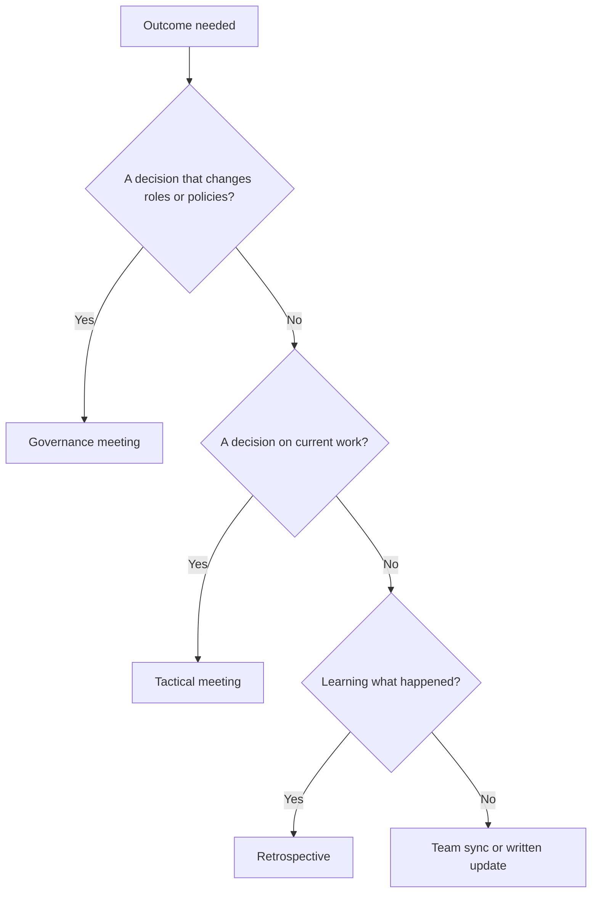

A meeting agenda template is a reusable outline that lists each item of a meeting with who brings it, how long it takes and the outcome it needs: a decision, an answer or a shared view. For most meetings it runs in five parts: a check-in, a review of last time's actions, two or three topics, a round of new actions with an owner and a date, and a short closing. You can copy a simple template that fits any meeting and one template per meeting type (team sync, tactical, governance, retrospective, board), or download a free Word version.

A meeting without an agenda drifts. Someone raises whatever is on their mind, the loudest voice steers the conversation, and everyone leaves with a vague feeling that something was decided. A written agenda fixes most of that in five minutes of preparation.

## An Agenda Works When Every Item Names Its Outcome

Steven Rogelberg, an organizational psychologist at the University of North Carolina at Charlotte, has studied thousands of meetings. He found that an agenda on its own does almost nothing. What separates useful meetings from painful ones is how each item is written. Put "pricing" on the agenda and you get twenty minutes of talk. Put "decide between the two pricing page variants" and the item is done in eight.

So every item on your agenda carries three pieces of information:

- **The topic**, in a few words
- **Who brings it**
- **The outcome needed**: a decision, an answer to a question, or a shared view

Teams usually skip the outcome, even though it matters most. Once it is written, attendees know whether to come with data or with an opinion. The facilitator also knows when the item is finished. And you can see which items belong in this meeting at all: an item needing deep debate moves to a longer session, while an item people only need to hear about can go out as a written update.

## The Four Ps That Build an Agenda

Before listing items, answer four questions about the meeting itself. Teams running their meetings in Rolebase fill these in once, then build the agenda from them.

| P | Question | Example |
| --- | --- | --- |
| Purpose | Why does this meeting exist? | Keep the sprint on track |
| Product | What exists after the meeting that did not exist before? | Owned actions, made decisions |
| People | Who needs to be there for those outcomes? | The people who can decide or commit |
| Process | In what order do we work through the items? | Check-in, topics, actions, closing |

If you cannot write the product, the meeting probably has none, so cancelling it costs less than holding it. With that test alone, a good share of recurring meetings leave the calendar.

Many versions of the method add a fifth P, preparation: what attendees read or bring before the meeting. Write it in the invitation, next to the agenda, so everyone has read the documents before they arrive.

## Meeting Agenda Templates to Copy

Each meeting type needs its own template. A daily sync runs on three lines, while a board agenda has to meet legal requirements. You can copy all six templates as plain text into a doc, a wiki or a meeting tool.

| Meeting type | Typical length | Core items | What the meeting produces |
| --- | --- | --- | --- |
| Any meeting (simple template) | 30 to 60 min | Check-in, last actions, topics, new actions | Decisions and owned actions |
| Team sync | 30 min | Check-in, two or three questions, actions | Answers and owned actions |
| Tactical meeting | 60 min | Checklists, metrics, progress updates, triage | Next actions and requests between roles |
| Governance meeting | 90 min | Agenda building, proposals, objection round | Adopted changes to roles and policies |
| Retrospective | 50 min | Observations, theme vote, root causes | One owned improvement |
| Board meeting | 60 to 120 min | Previous minutes, reports, votes | Recorded votes and approved reports |

### Simple meeting agenda template (any meeting)

Use this template for a business meeting, a project kickoff, a client meeting or any session with no fixed format. Fill in the purpose and the product first, then pick the topics that lead to them.

```
Meeting: <title>
Date:        Time:        Location or link:
Facilitator:        Note-taker:
Attendees:

PURPOSE: <why this meeting exists>
PRODUCT: <what exists afterwards: a decision, a plan, owned actions>

1. Welcome and check-in (5 min) | facilitator
2. Actions from last time (5 min) | all | each one done or rescheduled
3. Topic written as a question (15 min) | name | a decision
4. Topic written as a question (15 min) | name | an answer or a shared view
5. New actions (5 min) | all | an owner and a date per action
6. Closing round (5 min) | all
```

### Team sync

Use this template for a weekly team meeting of about 30 minutes. Open with a check-in, give two or three topics real time, then close with a round of actions so each one leaves with an owner. Pick the check-in question from a list of [icebreaker questions for meetings](/en/blog/meeting-icebreakers).

```
Team sync | <team name>
Date:        Attendees:

PURPOSE: keep everyone aligned on the week

1. Check-in (5 min) | facilitator | everyone present and focused
2. Question to answer (10 min) | name | a decision or an answer
3. Question to answer (10 min) | name | a shared view
4. Actions and blockers (5 min) | all | an owner and a date per action
```

Write each topic as a question the session answers, as Rogelberg recommends. With a question, attendees know what to bring and the facilitator knows when the item is done.

### Tactical meeting (role-based teams)

Teams running Holacracy or sociocracy separate the tactical round from governance. The tactical meeting keeps the operational work moving with an agenda that always follows the same steps. We explain [how to run each step of a tactical meeting](/en/blog/tactical-meeting) in a separate article.

```
Tactical meeting | <team or role name>
Date:        Facilitator:        Secretary:

1. Check-in round (2 min each)
2. Checklist review (5 min) | all | recurring actions verified
3. Metrics review (5 min) | all | shared view of the numbers
4. Progress updates (5 min) | all | one sentence per project
5. Agenda building (2 min) | all | list of items, one line each
6. Triage items | all | a request or a next action per item
7. Closing round (2 min) | all
```

### Governance meeting

A governance meeting changes the structure itself: roles, accountabilities, policies. Each item arrives as a tension and ends in an adopted change or an explicit dismissal.

```
Governance meeting | <team or role name>
Date:        Facilitator:        Secretary:

1. Check-in round | opening comments, no responses
2. Agenda building | short labels, no explanation
3. Triage of items | elections first on request, then facilitator's order
4. Processing each item, six steps: present proposal, clarifying questions,
   reactions, amendments, objection round, integration
5. Recording adopted changes
6. Closing round
```

The six processing steps come from article 5.4.5 of the Holacracy Constitution. We explain [what the facilitator does at each step of a governance meeting](/en/blog/governance-meeting) in a separate article.

### Retrospective

In a retrospective, the team looks back on the last cycle to improve the next one. Timeboxes matter here more than anywhere else, because debriefing a whole sprint can eat an afternoon.

```
Retrospective | <team name>
Date:        Facilitator:

PURPOSE: improve how we work, one concrete change per session

1. Set the stage (5 min) | facilitator
2. Gather observations (15 min) | all | what worked, what did not
3. Pick the theme (5 min) | all | one theme by vote
4. Find root causes and actions (20 min) | all | one owned action
5. Close (5 min) | all
```

### Board meeting

Directors, and sometimes regulators, expect a board agenda to follow a predictable structure. Send it with the papers a week ahead. Put the approvals at the start, while everyone is still focused.

```
Board meeting | <organisation>
Date:        Chair:        Secretary:

1. Call to order and attendance
2. Approval of previous minutes
3. Financial report | treasurer | accepted report
4. Executive report | director | shared view of progress
5. Decisions | chair | recorded votes
6. Any other business
7. Date of next meeting
```

{/* DOWNLOAD regen: python3 src/content/blog/meeting-minutes/generate-meeting-templates.py */}
<Button label="Download the Word agenda template" href="/downloads/meeting-agenda-template.docx" variant="primary" />

The Word file adds a header with the meeting, the date, the purpose, the attendees and the duration. Use it with a [meeting minutes template](/en/blog/meeting-minutes): you write the minutes far faster when the agenda already follows their outline.



## Running the Meeting From Its Agenda

During the meeting, show the agenda on screen so everyone sees which item you are on and what remains. When a side topic comes up, point at the agenda and offer to park the topic or swap it for a planned one.

Capture actions as they emerge. Each item ends with either a decision or an owned action. Name one person per action, add a date, and turn down actions owned by a whole team. If you take minutes afterwards, they simply follow the order of the agenda.

Stop at the scheduled time. An unfinished item rolls to the next agenda, which sounds harsh and works well. Meetings that systematically overrun train attendees to dread them.

Rolebase structures every meeting around a collaborative agenda, where each topic holds its own discussion, decisions and tasks. The agenda, the record and the actions stay attached to the same place, so nothing gets retyped after the meeting.


## Four Mistakes That Empty an Agenda of Its Value

**Items without outcomes.** This is the most common mistake. Read through your last agenda and count the items carrying a stated outcome. Most teams find zero.

**Agendas sent during the meeting.** Nobody can prepare from a document they discover at the first minute. Send it at least a day ahead so people can add items and bring data.

**A full page of items.** Ten items in thirty minutes means three minutes each. Two or three topics with real time work better than ten rushed ones. Move the rest to the next meeting or to writing.

**Reusing last week's agenda untouched.** Recurring agendas collect zombie items that outlasted their purpose. Start each edition from the template, then add only what still needs an outcome.

## Frequently asked questions

<FaqList>

<FaqItem question="How do I write a meeting agenda?">

Start with the purpose of the meeting and what it should produce. List two or three topics, each written as a question, with the person who brings it, a time slot and the outcome needed. Put decisions early, while attention is high. Keep an action round for the end. Send the agenda at least a day ahead so attendees can add items. Once the meeting starts, a few habits [keep a meeting productive](/en/blog/productive-meetings).

</FaqItem>

<FaqItem question="What is a typical agenda for a meeting?">

A typical agenda runs in five parts: a check-in, a review of last time's actions, two or three topics, a round of new actions with an owner and a date each, and a short closing. The simple meeting agenda template follows that order and fits a 30 to 60 minute meeting.

</FaqItem>

<FaqItem question="What are the 5 P's of a meeting agenda?">

Purpose, product, people and process make the four Ps: why the meeting exists, what it produces, who needs to attend and in what order the items run. The fifth P changes from one author to another. Most choose preparation, meaning what attendees read or bring beforehand. A few choose pitfalls, the risks that could derail the meeting.

</FaqItem>

<FaqItem question="Is there a meeting agenda template in Word?">

Word has agenda templates in its template gallery. You can also download ours [as a Word file](/downloads/meeting-agenda-template.docx). It holds a header for the meeting, the date, the purpose, the attendees and the duration, then a table of items with the time slot, the person who brings each one and the outcome needed.

</FaqItem>

</FaqList>

## Build Your Next Agenda in Five Minutes

Pick the template matching your next meeting, replace the placeholders, and send it with the outcomes visible. The first session run this way usually feels tighter than months of free-form discussion. Every action leaves the room with a name and a date.

To go further, Rolebase lets you create meeting templates per role, attach discussions and tasks directly to agenda items, and keep every decision linked to the role it concerns. Try it free with up to five active members, or explore the full [feature set](/en/features).
