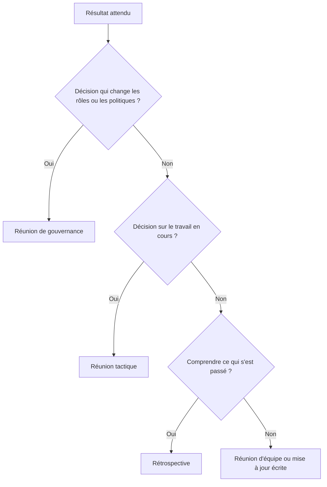

Un modèle d’ordre du jour est un plan réutilisable qui liste chaque point d’une réunion avec la personne qui l’apporte, sa durée et le résultat attendu : une décision, une réponse ou une vision partagée. Pour la plupart des réunions, il tient en cinq parties : un tour de check-in, le point sur les actions précédentes, deux ou trois sujets, un tour des nouvelles actions avec un responsable et une date, puis une courte clôture. Vous pouvez copier un modèle simple pour n’importe quelle réunion et un modèle par type de réunion (équipe, tactique, gouvernance, rétrospective, conseil d’administration), ou télécharger une version Word gratuite.

Une réunion sans ordre du jour part dans tous les sens. Chacun aborde ce qu’il a en tête, la voix la plus forte mène la conversation, et tout le monde repart avec l’impression floue d’avoir décidé quelque chose. Un ordre du jour écrit règle l’essentiel de ce problème en cinq minutes de préparation.

## Un point fonctionne quand il annonce son résultat

Steven Rogelberg, psychologue du travail à l’université de Caroline du Nord à Charlotte, a étudié des milliers de réunions. Il constate qu’un ordre du jour ne fait presque rien par lui-même. La façon dont chaque point est écrit distingue une réunion utile d’une réunion pénible. Inscrivez « tarifs » à l’ordre du jour et vous discuterez vingt minutes. Inscrivez « trancher entre les deux versions de la page tarifs » et le point se règle en huit.

Chaque point porte donc trois informations :

- **Le sujet**, en quelques mots
- **Qui l’amène**
- **Le résultat attendu** : une décision, une réponse à une question ou une vision partagée

Les équipes oublient souvent le résultat, alors qu’il compte plus que le reste. Une fois le résultat écrit, les participants savent s’ils doivent venir avec des données ou avec une opinion. La personne qui anime sait aussi quand le point est terminé. Et vous voyez quels points ont leur place dans cette réunion : un sujet qui demande un vrai débat passe à une séance plus longue, alors qu’une simple information part dans un message écrit.

## Les quatre P qui construisent un ordre du jour

Avant de lister les points, répondez à quatre questions sur la réunion elle-même. Les équipes qui tiennent leurs réunions dans Rolebase y répondent une fois, puis construisent l’ordre du jour à partir de ces réponses.

| P | Question | Exemple |
| --- | --- | --- |
| Purpose (l’objet) | Pourquoi cette réunion existe-t-elle ? | Garder le sprint sur les rails |
| Product (le produit) | Qu’existe-t-il après la réunion qui n’existait pas avant ? | Des actions attribuées, des décisions prises |
| People (les personnes) | Qui doit être là pour ces résultats ? | Celles et ceux qui décident ou s’engagent |
| Process (le déroulé) | Dans quel ordre traite-t-on les points ? | Tour de check-in, sujets, actions, clôture |

Si vous ne pouvez pas écrire le produit, la réunion n’en a probablement aucun, donc l’annuler coûte moins cher que la tenir. Avec ce seul test, une bonne part des réunions récurrentes disparaît des agendas.

Beaucoup de versions de la méthode ajoutent un cinquième P, la préparation : ce que les participants lisent ou apportent avant la réunion. Écrivez-le dans l’invitation, à côté de l’ordre du jour, pour que chacun ait lu les documents avant d’arriver.

## Des modèles d’ordre du jour à copier

Chaque type de réunion demande son propre modèle. Un point quotidien tient sur trois lignes, alors qu’un ordre du jour de conseil doit respecter des obligations légales. Vous pouvez copier les six modèles en texte brut dans un document, un wiki ou un outil de réunion.

| Type de réunion | Durée courante | Points principaux | Résultat attendu |
| --- | --- | --- | --- |
| Toute réunion (modèle simple) | 30 à 60 min | Check-in, actions précédentes, sujets, nouvelles actions | Des décisions et des actions attribuées |
| Réunion d’équipe | 30 min | Check-in, deux ou trois questions, actions | Des réponses et des actions attribuées |
| Réunion tactique | 60 min | Checklists, indicateurs, avancement, traitement des points | Des prochaines actions et des demandes entre rôles |
| Réunion de gouvernance | 90 min | Construction de l’ordre du jour, propositions, tour d’objections | Des changements adoptés sur les rôles et les politiques |
| Rétrospective | 50 min | Observations, vote du thème, causes | Une amélioration attribuée |
| Conseil d’administration | 60 à 120 min | Compte rendu précédent, rapports, votes | Des votes enregistrés et des rapports approuvés |

### Modèle d’ordre du jour simple (toute réunion)

Utilisez ce modèle pour une réunion de travail, un lancement de projet, un rendez-vous client ou toute séance sans format imposé. Remplissez d’abord l’objet et le produit, puis choisissez les sujets qui y mènent.

```
Réunion : <titre>
Date :        Horaire :        Lieu ou lien :
Facilitateur :        Prise de notes :
Participants :

OBJET : <pourquoi cette réunion existe>
PRODUIT : <ce qui existera après : une décision, un plan, des actions attribuées>

1. Accueil et check-in (5 min) | facilitateur
2. Actions de la dernière fois (5 min) | tous | chacune faite ou replanifiée
3. Sujet écrit sous forme de question (15 min) | nom | une décision
4. Sujet écrit sous forme de question (15 min) | nom | une réponse ou une vision partagée
5. Nouvelles actions (5 min) | tous | un responsable et une date par action
6. Tour de clôture (5 min) | tous
```

### Réunion d’équipe

Ce modèle convient à un point hebdomadaire d’une trentaine de minutes. Ouvrez par un check-in, prenez le temps de traiter deux ou trois sujets, puis terminez par un tour des actions pour que chacune reparte avec un responsable. Choisissez la question du check-in dans une liste de [questions d’ice breaker pour la réunion](/fr/blog/meeting-icebreakers).

```
Réunion d’équipe | <équipe>
Date :        Participants :

OBJET : garder tout le monde aligné sur la semaine

1. Check-in (5 min) | facilitateur | tous présents et concentrés
2. Question à laquelle répondre (10 min) | nom | une décision ou une réponse
3. Question à laquelle répondre (10 min) | nom | une vision partagée
4. Actions et blocages (5 min) | tous | un responsable et une date par action
```

Écrivez chaque sujet sous forme de question à laquelle la séance répond, comme le recommande Rogelberg. Avec une question, les participants savent quoi préparer et la personne qui anime sait quand le point est terminé.

### Réunion tactique (équipes par rôles)

Les équipes qui pratiquent l’holacratie ou la sociocratie séparent le tactique de la gouvernance. La réunion tactique fait avancer le travail opérationnel avec un ordre du jour qui suit toujours les mêmes étapes. Nous expliquons [comment mener chaque étape d’une réunion tactique](/fr/blog/tactical-meeting) dans un article à part.

```
Réunion tactique | <équipe ou rôle>
Date :        Facilitateur :        Secrétaire :

1. Tour de check-in (2 min chacun)
2. Revue des checklists (5 min) | tous | actions récurrentes vérifiées
3. Revue des indicateurs (5 min) | tous | vision partagée des chiffres
4. Points d’avancement (5 min) | tous | une phrase par projet
5. Construction de l’ordre du jour (2 min) | tous | liste des points, une ligne chacun
6. Traitement des points | tous | une demande ou une prochaine action par point
7. Tour de clôture (2 min) | tous
```

### Réunion de gouvernance

Une réunion de gouvernance change la structure elle-même : rôles, responsabilités, politiques. Chaque point arrive sous forme de tension et se termine par un changement adopté ou un rejet explicite.

```
Réunion de gouvernance | <équipe ou rôle>
Date :        Facilitateur :        Secrétaire :

1. Tour de check-in | commentaires d’ouverture, sans réponse
2. Construction de l’ordre du jour | libellés courts, sans explication
3. Tri des points | élections d’abord sur demande, puis ordre du facilitateur
4. Traitement de chaque point, six étapes : présentation de la proposition,
   questions de clarification, réactions, amendements, tour d’objections, intégration
5. Enregistrement des changements adoptés
6. Tour de clôture
```

Les six étapes de traitement viennent de l’article 5.4.5 de la Constitution Holacracy. Nous expliquons [ce que fait le facilitateur à chaque étape d’une réunion de gouvernance](/fr/blog/governance-meeting) dans un article à part.

### Rétrospective

Dans une rétrospective, l’équipe revient sur le dernier cycle pour améliorer le suivant. Les durées de chaque étape comptent ici plus qu’ailleurs, car débriefer un sprint entier peut manger un après-midi.

```
Rétrospective | <équipe>
Date :        Facilitateur :

OBJET : progresser sur notre façon de travailler, un changement concret par séance

1. Poser le cadre (5 min) | facilitateur
2. Recueillir les observations (15 min) | tous | ce qui a marché, ce qui a coincé
3. Choisir le thème (5 min) | tous | un thème par vote
4. Chercher les causes et les actions (20 min) | tous | une action attribuée
5. Clôture (5 min) | tous
```

### Conseil d’administration

Les administrateurs, et parfois les autorités de contrôle, attendent d’un ordre du jour de conseil une structure stable. Envoyez-le avec les documents une semaine avant. Placez les approbations en début de séance, quand tout le monde est encore concentré.

```
Conseil d’administration | <organisation>
Date :        Président :        Secrétaire :

1. Ouverture et présents
2. Approbation du compte rendu précédent
3. Rapport financier | trésorier | rapport accepté
4. Rapport de direction | directeur | vision partagée de l’avancement
5. Décisions | président | votes enregistrés
6. Questions diverses
7. Date de la prochaine séance
```

{/* DOWNLOAD regen : python3 src/content/blog/meeting-minutes/generate-meeting-templates.py */}
<Button label="Télécharger l’ordre du jour Word" href="/downloads/ordre-du-jour-reunion-modele.docx" variant="primary" />

Le fichier Word ajoute un en-tête avec la réunion, la date, l’objet, les participants et la durée. Utilisez-le avec un [modèle de compte rendu de réunion](/fr/blog/meeting-minutes) : vous rédigez le compte rendu bien plus vite quand l’ordre du jour suit déjà son plan.



## Dérouler la réunion depuis son ordre du jour

Pendant la réunion, affichez l’ordre du jour à l’écran pour que tout le monde voie à quel point vous en êtes et ce qui reste. Quand un sujet annexe apparaît, montrez l’ordre du jour et proposez de mettre le sujet de côté ou de l’échanger contre un point prévu.

Notez les actions au fil de l’eau. Chaque point se termine par une décision ou une action attribuée. Nommez une personne par action, ajoutez une date, et refusez les actions portées par toute une équipe. Si vous rédigez ensuite un compte rendu, il suit simplement le plan de l’ordre du jour.

Arrêtez-vous à l’heure prévue. Un point inachevé passe à l’ordre du jour suivant, ce qui paraît strict et fonctionne très bien. Quand les réunions débordent à chaque fois, les participants finissent par les redouter.

Rolebase structure chaque réunion autour d’un ordre du jour collaboratif, où chaque sujet porte sa discussion, ses décisions et ses tâches. L’ordre du jour, le compte rendu et les actions restent attachés au même endroit, donc rien ne se retape après la réunion.


## Quatre erreurs qui vident un ordre du jour de sa valeur

**Des points sans résultat attendu.** C’est l’erreur la plus fréquente. Relisez votre dernier ordre du jour et comptez les points qui annoncent un résultat. La plupart des équipes trouvent zéro.

**Un ordre du jour envoyé pendant la réunion.** Personne ne peut se préparer sur un document découvert à la première minute. Envoyez-le au moins la veille pour que chacun ajoute ses points et apporte ses données.

**Une page entière de points.** Dix points en trente minutes, cela fait trois minutes chacun. Deux ou trois sujets traités à fond valent mieux que dix sujets expédiés. Le reste passe à la prochaine séance ou à l’écrit.

**Reprendre l’ordre du jour de la semaine dernière sans y toucher.** Les ordres du jour récurrents accumulent des points zombies qui n’ont plus rien à produire. Repartez du modèle à chaque édition, puis n’ajoutez que ce qui demande encore un résultat.

## Questions fréquentes

<FaqList>

<FaqItem question="Comment faire l’ordre du jour d’une réunion ?">

Partez de l’objet de la réunion et de ce qu’elle doit produire. Listez deux ou trois sujets, chacun écrit sous forme de question, avec la personne qui l’apporte, une durée et le résultat attendu. Placez les décisions tôt, pendant que l’attention est haute. Gardez un tour des actions pour la fin. Envoyez l’ordre du jour au moins la veille pour que chacun puisse ajouter ses points. Une fois la réunion lancée, quelques habitudes suffisent à [rendre une réunion productive](/fr/blog/productive-meetings).

</FaqItem>

<FaqItem question="Que mettre dans l’ordre du jour d’une réunion ?">

Un ordre du jour courant tient en cinq parties : un tour de check-in, le point sur les actions précédentes, deux ou trois sujets, un tour des nouvelles actions avec un responsable et une date chacune, puis une courte clôture. Le modèle d’ordre du jour simple suit cet ordre et convient à une réunion de 30 à 60 minutes.

</FaqItem>

<FaqItem question="Quels sont les 5 P d’un ordre du jour ?">

Purpose (l’objet), product (le produit), people (les personnes) et process (le déroulé) forment les quatre P : pourquoi la réunion existe, ce qu’elle produit, qui doit y assister et dans quel ordre passent les points. Le cinquième P change d’un auteur à l’autre. La plupart retiennent la préparation, c’est-à-dire ce que les participants lisent ou apportent avant la réunion. Quelques-uns retiennent les pitfalls, les écueils qui risquent de faire dérailler la réunion.

</FaqItem>

<FaqItem question="Où trouver un modèle d’ordre du jour gratuit ?">

Vous pouvez copier les modèles de cette page en texte brut ou télécharger notre [ordre du jour au format Word](/downloads/ordre-du-jour-reunion-modele.docx). Le fichier contient un en-tête pour la réunion, la date, l’objet, les participants et la durée, puis un tableau des points avec la durée, la personne qui propose chaque point et le résultat attendu.

</FaqItem>

</FaqList>

## Construire votre prochain ordre du jour en cinq minutes

Choisissez le modèle qui correspond à votre prochaine réunion, remplacez les espaces réservés et envoyez-le avec les résultats attendus visibles. La première séance menée ainsi paraît en général plus efficace que des mois de discussion libre. Chaque action sort de la salle avec un nom et une date.

Pour aller plus loin, Rolebase vous permet de créer des modèles de réunion par rôle, d’attacher discussions et tâches directement aux points de l’ordre du jour, et de garder chaque décision liée au rôle qu’elle concerne. Essayez gratuitement avec jusqu’à cinq membres actifs, ou explorez [toutes les fonctionnalités](/fr/features).
