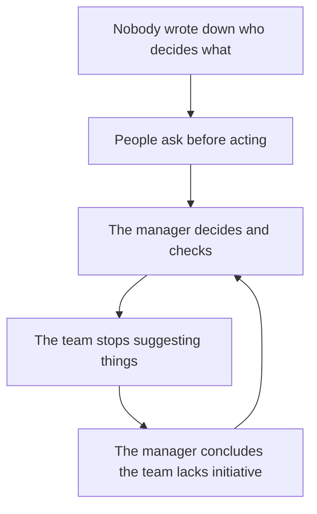
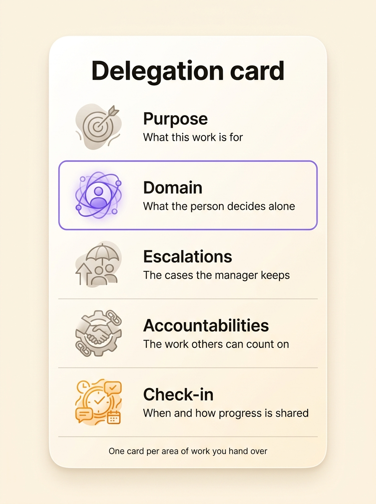
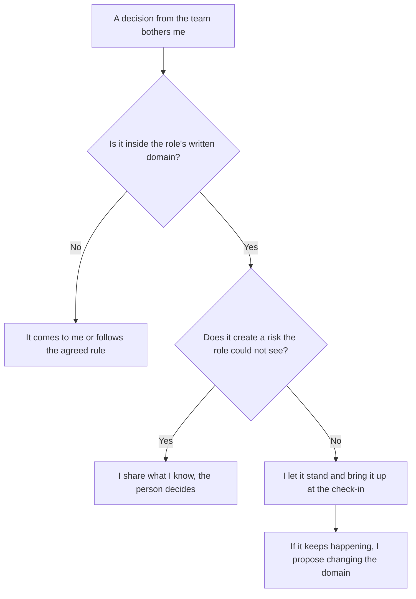

The most reliable way to deal with a micromanaging boss is to agree, in writing, on what you decide alone, which cases still go to them, and when you report progress. Micromanagement means a manager closely controls work the team can do on its own: they approve every email, rewrite slides, and ask for status twice a day. People tend to blame a toxic boss or an anxious personality. In most teams the cause is more ordinary: nobody wrote down who decides what, so the manager checks everything to make sure nothing slips. This article covers how to recognise micromanagement, why it happens, what it costs, how to raise it with your boss, and what to put in writing on both sides.

## Signs you are being micromanaged

A demanding manager sets high goals and judges the outcome. A micromanager watches how you get there. You can see the difference in an ordinary week, when your boss:

- asks to be copied on every email, including the ones that have nothing to do with them
- reworks finished deliverables to change the wording rather than the substance
- wants to approve decisions where the amount or the risk is trivial
- asks for updates more often than the work actually moves
- hands over the method along with the task
- expects you to wait for their answer before acting, even on work you know well

The sign that matters most is having to wait for your boss's go-ahead before acting, because it describes the team as much as the manager. After a few months people stop suggesting things. The manager notices, decides the team lacks initiative, and checks even more.

## Why bosses micromanage: three structural causes

Most advice targets the manager's personality, their perfectionism or their need for control. Those traits are real. They do a poor job of explaining why the same boss gives you free rein on one topic and checks every comma on another. Three causes rooted in how the team is organised explain it better.

### Nobody wrote down who decides what

When nothing says who decides on a quote, a supplier or the content of a newsletter, every decision belongs to the manager by default. They never need to take control back, because they never handed it over. You don't know whether you are allowed to decide, so you ask. The manager answers, so the next question goes to them too.

### The manager answers for results they never clearly delegated

Your boss reports to their own boss on the whole team's work. If they don't know exactly what they handed over, to whom and with how much room, checking everything looks like the only way to guarantee the result. They check to make up for delegation that stayed vague. With a written [accountability](/en/glossary/redevabilite), the manager knows what to expect from a role without watching over it.

### Checking in is the only way they hear about progress

Without a fixed slot where the team shares progress, the manager goes looking for the information in every conversation. You hear each "where are you on this?" as distrust, when your boss often asks because they have no other way to know. Small teams make this worse. A manager with three direct reports has time to look at every task, so a [narrow span of control](/en/blog/span-of-control) is enough to build the habit.

The three causes feed each other:

## Micromanaging boss or toxic boss?

Micromanagement is a tiring way of working, but one you can fix. Other behaviours target the person: humiliating someone in public, isolating them, taking their work away, overloading them on purpose, shouting. When those behaviours repeat and harm your health or working conditions, many countries treat them as workplace bullying or harassment. Take that to HR, an employee representative or an employment lawyer, because writing down roles will not change it.

To tell the two apart, look at what the boss goes after. A micromanager corrects a deliverable, a method, a deadline. A toxic boss goes after you as a person, in front of others or in private. The rest of this article deals with micromanagement.

## What micromanagement costs a team

In 2014 the staffing firm Accountemps surveyed more than 450 office workers in the United States. 59% said they had worked for a micromanager at some point. Among them, 68% said it hurt their morale and 55% said it hurt their productivity. Harry Chambers, an American consultant, wrote the book *My Way or the Highway* on the subject in 2004. In his survey, 69% of respondents had considered changing jobs because of micromanagement and 36% actually had.

Those figures are self-reported and a little old. The mechanism behind them has been documented for longer. In 1979 the sociologist Robert Karasek published in *Administrative Science Quarterly* a model that crosses workload with decision latitude, meaning how much say people have over their own work. Workers with high demands and little latitude reported far more exhaustion, anxiety and trouble sleeping than the others. At the same workload, more latitude reduced those effects. Micromanagement removes latitude without lightening the load, which puts the team in the most draining corner of the model.

Managers pay too. Every decision they keep comes back to them as a question, a review or a reminder. They spend their days on other people's work and push their own into the evening.

## How to deal with a micromanaging boss

Come with a proposal about one specific area, something your boss can accept or adjust. Prepare it in five steps.

1. Pick one topic, the one where you know the work well and where the checking slows you down most. Bring a dated example.
2. Talk about the scope rather than the person. "Up to what amount can I sign quotes on my own?" calls for a number, while "You're always looking over my shoulder" puts your boss on the defensive.
3. Offer something in return: a fixed weekly check-in, two or three numbers that show progress, and a list of the cases where you'll tell them before you act.
4. Agree on a trial period, a month for instance, and a date to review it.
5. Write down what you agreed and share it, even in a plain document.

A boss who micromanages because they lack information often takes the deal, since they get the information without having to chase it. If they still refuse to hand over anything after a trial that went well, the problem lies with the person more than with how the work is organised. Raise it with the next level up or with HR, with the written agreement and the review in hand.

## The five things to write down

Micromanagement fades once the answer to "who decides?" lives somewhere other than in the manager's head. For each area of work you hand over or take on, write down five things.

1. The purpose says what the work is for, so the person can make trade-offs without asking.
2. The domain lists what the person decides alone, with numbers where they exist: an amount, a deadline, a type of client.
3. The escalations are the cases where the manager keeps the decision or wants to be consulted first.
4. The accountabilities describe the ongoing work others can count on, each one starting with an action verb.
5. The check-in sets when and how progress is shared, for example a weekly meeting with two or three numbers.

Take a communications officer whose boss reviews every LinkedIn post. Her written domain can say she publishes on the company's accounts on her own, except for financial results and posts that name a client. Her boss now reviews only those two cases, so she publishes the other posts without waiting.

Every question a micromanager usually asks now has a written answer:

| The manager asks | The written answer |
| --- | --- |
| "Did you run this by me?" | The domain says what needs no approval |
| "Where are you on this?" | The weekly check-in and its numbers |
| "Why did you do it that way?" | The purpose gives the criterion for choosing |
| "Tell me before you sign" | The list of escalations |
| "Who's handling this?" | The accountabilities of each role |

{/* IMAGE regen: api.py image, infographic, 900x1200. EN-specific visual because it carries English text, the FR version uses ./delegation-card-fr.jpg. Regenerate if the five things to write down change. Last data sync: 2026-10-23. Scene: "A clean front-facing infographic laid out as one tall rounded card centred on the warm cream background, like a printable template. At the top of the card, a bold modern clean sans-serif title reading exactly: 'Delegation card'. Below the title, five horizontal rows separated by thin warm grey lines. Row 1: a small rounded icon on the left, then a bold sans-serif label reading exactly 'Purpose', and below it one line of smaller text reading exactly 'What this work is for'. Row 2: a small rounded icon on the left, then a bold sans-serif label reading exactly 'Domain', and below it one line of smaller text reading exactly 'What the person decides alone'. Row 3: a small rounded icon on the left, then a bold sans-serif label reading exactly 'Escalations', and below it one line of smaller text reading exactly 'The cases the manager keeps'. Row 4: a small rounded icon on the left, then a bold sans-serif label reading exactly 'Accountabilities', and below it one line of smaller text reading exactly 'The work others can count on'. Row 5: a small rounded icon on the left, then a bold sans-serif label reading exactly 'Check-in', and below it one line of smaller text reading exactly 'When and how progress is shared'. Row 2 has a purple #9870F0 icon and a thin purple outline because it is the key row, row 5 has an orange #FB9803 icon, the other icons are warm grey. At the bottom of the card, one small line of text reading exactly: 'One card per area of work you hand over'. No other text anywhere in the image." */}

Together, these five things make up what shared governance calls a role. You can [define a role with its purpose, domain and accountabilities](/en/blog/define-roles) one piece at a time. When a decision reaches beyond a single role, the team can make it through [consent decision-making](/en/blog/consent-decision) instead of sending it back to the manager.

## If you are the micromanager

The American management consultants William Oncken and Donald Wass published a well-known *Harvard Business Review* article in 1974, "Management Time: Who's Got the Monkey?". They describe a manager who walks out of every hallway conversation with one more problem on their shoulders, because they said "let me think about it". More than fifty years later the same scene plays out in chat apps.

If you recognise yourself, start small.

- List the questions people asked you last week. Each question that keeps coming back is a decision to write into a role.
- Hand over a whole domain rather than a task, so the person also decides what comes next.
- Write down your exceptions before you start, so you know in advance which surprises are yours to handle.
- Replace the reminders with the fixed check-in.
- When you dislike a decision, first check whether it falls outside the written domain.

When the manager overturns a decision made inside the domain, the whole team learns that the written agreement does not count. If the domain was badly drawn, change it for next time and leave the decision in place.

## Writing your team's decision rights in Rolebase

Rolebase is an open-source team governance platform. Each role in the org chart carries its purpose, domain, accountabilities, a checklist and indicators. The team's meetings pull the checklist and indicators in directly. Decisions are recorded in the role that made them and show up in the news feed, so the manager gets the information without asking for it. Tasks and threads are attached to roles too, which lets everyone see who holds what. Three [governance modes](/en/docs/governance-modes) set who can change the structure, from Free mode, where anyone edits everything, to Strict mode, where every change goes through a proposal.

{/* TODO ANECDOTE: a Rolebase customer where a manager stopped approving one type of decision after writing it into a role's domain, with what changed (number of approvals, turnaround time). Nothing in the repo provides it. */}

You can [organise your team's roles, meetings and decisions](/en/features) for free with up to five active members.

<FaqList>

<FaqItem question="What is micromanagement?">
  Micromanagement is a management style where a manager closely controls work the team can do on its own: approvals for everything, edits to form rather than substance, repeated status requests, and a method imposed along with the task. It usually comes from decision rights nobody wrote down, which leave every decision to the manager by default.
</FaqItem>

<FaqItem question="How do you deal with a micromanaging boss?">
  Pick one area where you know the work well and ask for a written scope: what you decide alone, the cases where you tell them first, and a fixed check-in to share progress. Offer it as a one-month trial, then review it together. With the check-in, a boss who micromanages for lack of information gets the updates they were chasing.
</FaqItem>

<FaqItem question="Is my boss micromanaging or toxic?">
  Look at what they go after. A micromanager corrects the work: a deliverable, a method, a deadline. A toxic boss goes after the person, through humiliation, isolation or deliberate overload. Micromanagement can be fixed by writing down who decides what. With a toxic boss, go to HR, an employee representative or an employment lawyer.
</FaqItem>

<FaqItem question="How do I get more autonomy at work?">
  Ask for a written scope on one specific topic, offer a regular check-in in return, and agree on a date to review how it went. Autonomy lasts longer when it is written down than when it rests on the goodwill of the moment.
</FaqItem>

<FaqItem question="How do I stop micromanaging my team?">
  List the questions people ask you each week and turn every recurring one into a decision written into a role. Write down the exceptions you keep, then replace reminders with a fixed check-in. When a decision made inside the domain bothers you, leave it in place and change the domain for next time.
</FaqItem>

</FaqList>

## Write down who decides what

A change of personality rarely fixes micromanagement. It fades once the answer to "who decides?" exists in writing, for one specific area, with its exceptions and its check-in. Start with a single topic this week, whether you are the boss or the person being managed. To keep those decision rights current across the team, [Rolebase brings roles, decisions and meetings into one tool](/en/features).
