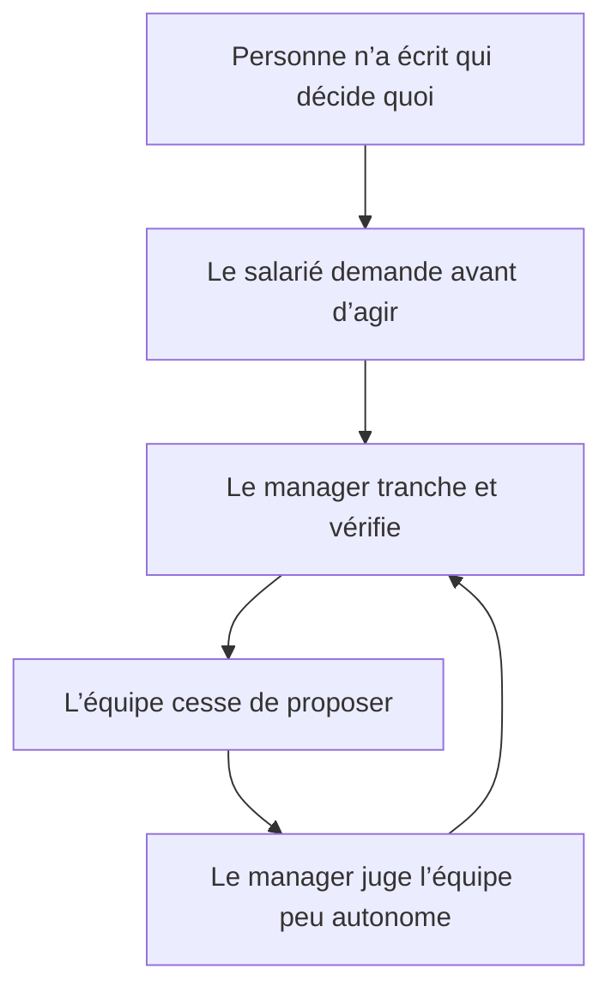
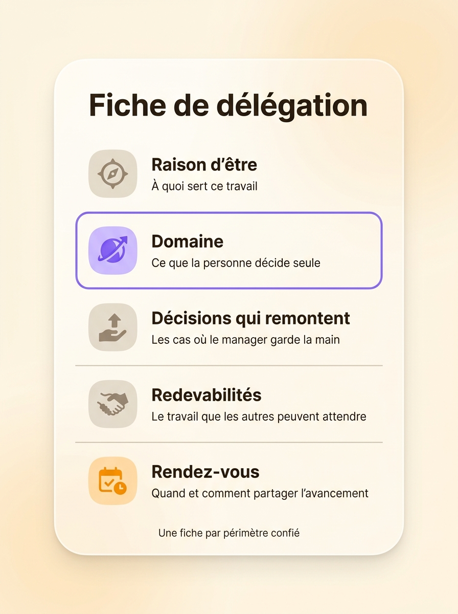
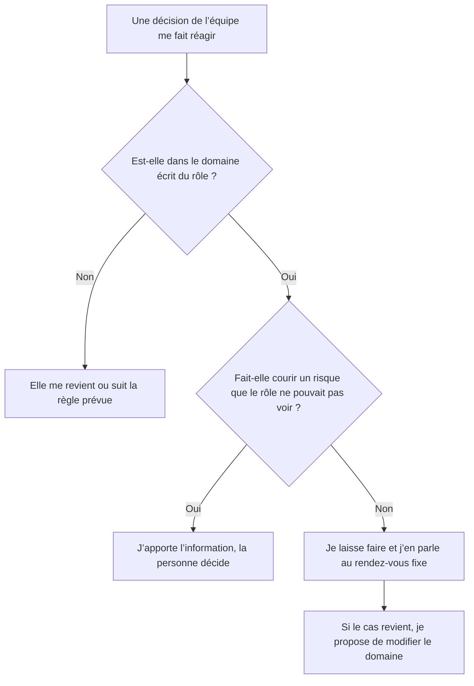

Le micromanagement, c’est un manager qui contrôle de près un travail que son équipe sait faire seule : il valide chaque e-mail, reprend les présentations, demande où en est un dossier deux fois par jour. On le met souvent sur le compte d’un manager toxique ou d’un caractère anxieux. Dans la plupart des équipes, la cause est plus banale : personne n’a écrit qui décide quoi, alors le manager repasse derrière tout le monde pour ne rien laisser filer. Pour retrouver de l’autonomie au travail, écrivez sur un périmètre précis ce que la personne décide seule, les cas qui remontent au manager et le moment où l’avancement se partage. Cet article explique comment reconnaître le micromanagement, ce qu’il coûte et comment en parler, côté salarié comme côté manager.

## Reconnaître le micromanagement

Un manager exigeant fixe des objectifs élevés et juge le résultat. Un micromanager surveille la façon d’y arriver. La différence se voit dans une semaine ordinaire, quand le manager :

- demande à être en copie de tous les e-mails, y compris ceux qui ne le concernent pas
- reprend un livrable terminé pour en changer la forme plutôt que le fond
- veut valider des décisions dont le montant ou le risque est minime
- réclame des points d’avancement plus souvent que le travail n’avance
- donne la méthode en même temps que la tâche
- exige son feu vert avant chaque action, même sur un sujet que l’équipe maîtrise

Le signe qui compte le plus est cette attente du feu vert avant d’agir, parce qu’elle décrit l’équipe autant que le manager. Au bout de quelques mois, les gens arrêtent de proposer. Le manager le constate, en conclut que son équipe manque d’initiative, et contrôle davantage.

## Pourquoi un manager micromanage : trois causes structurelles

Les conseils habituels visent la personnalité du manager, son perfectionnisme ou son besoin de contrôle. Ces traits existent. Ils expliquent mal pourquoi le même manager laisse toute liberté sur un sujet et repasse derrière chaque virgule sur un autre. Trois causes liées à l’organisation l’expliquent mieux.

### Le périmètre de décision n’est écrit nulle part

Quand rien ne dit qui décide d’un devis, d’un prestataire ou du contenu d’une newsletter, chaque décision appartient par défaut au manager. Il n’a pas besoin de reprendre la main, puisqu’il ne l’a jamais lâchée. Le salarié ignore s’il a le droit de trancher, alors il demande. Le manager répond, si bien que la question suivante lui revient aussi.

### Le manager répond d’un résultat sans savoir ce qu’il a confié

Le manager rend des comptes à son propre responsable sur le travail de toute l’équipe. S’il ne sait pas précisément ce qu’il a confié, à qui et avec quelle marge, il ne voit qu’un moyen de garantir le résultat : tout vérifier. Il contrôle pour compenser une délégation restée floue. Avec une [redevabilité](/fr/glossary/redevabilite) écrite, le manager sait ce qu’il peut attendre d’un rôle sans le surveiller.

### Le contrôle reste le seul moyen de savoir où en est le travail

Sans rendez-vous fixe où l’équipe partage son avancement, le manager va chercher l’information lui-même, dans chaque conversation. L’équipe entend chaque « tu en es où ? » comme de la méfiance, alors que le manager pose souvent la question faute d’autre moyen de savoir. Dans une petite équipe, c’est pire. Un manager qui n’a que trois collaborateurs directs a le temps de regarder chaque tâche, si bien qu’un [éventail de subordination étroit](/fr/blog/span-of-control) suffit à installer l’habitude.

Les trois causes s’entretiennent l’une l’autre :

## Manager toxique ou périmètre jamais écrit ?

Le micromanagement est une façon de travailler, pénible mais corrigeable. D’autres comportements visent la personne : humilier quelqu’un en public, l’isoler, lui retirer son travail, le surcharger délibérément, crier. Quand ces agissements se répètent et dégradent la santé ou les conditions de travail, le Code du travail les qualifie de harcèlement moral (article L1152-1). Adressez-vous alors aux représentants du personnel, à la médecine du travail ou à un avocat, car écrire des rôles n’y changera rien.

Pour séparer les deux situations, regardez sur quoi porte l’intervention. Le micromanager corrige un livrable, une méthode, un calendrier. Le manager toxique s’en prend à la personne elle-même, devant les autres ou en privé. La suite de l’article traite du micromanagement.

## Le coût du micromanagement pour l’équipe

En 2014, le cabinet de recrutement Accountemps a interrogé plus de 450 salariés de bureau aux États-Unis. 59 % disaient avoir déjà travaillé pour un micromanager. Parmi eux, 68 % estimaient que leur moral en avait souffert et 55 % leur productivité. Harry Chambers, consultant américain, a consacré au sujet le livre *My Way or the Highway* en 2004. Dans son enquête, 69 % des salariés interrogés avaient envisagé de changer d’emploi à cause du micromanagement et 36 % l’avaient fait.

Ces chiffres sont déclaratifs et datent un peu. Le mécanisme, lui, est documenté depuis plus longtemps. Le sociologue Robert Karasek a publié en 1979, dans l’*Administrative Science Quarterly*, son modèle qui croise la charge de travail et la marge de décision. Les salariés qui cumulent une forte charge et une faible marge déclarent nettement plus d’épuisement, d’anxiété et de troubles du sommeil que les autres. À charge égale, une marge de décision plus large réduit ces effets. Le micromanagement retire la marge sans alléger la charge, et place donc l’équipe dans la situation la plus usante du modèle.

Le manager paie aussi. Chaque décision qu’il garde lui revient sous forme de question, de relecture ou de relance. Il passe ses journées sur le travail des autres et repousse le sien au soir.

## Les cinq choses à écrire pour arrêter le micromanagement

Le micromanagement recule quand la réponse à « qui décide ? » existe ailleurs que dans la tête du manager. Pour chaque périmètre confié, écrivez cinq choses.

1. La raison d’être dit à quoi sert ce travail, pour que la personne puisse arbitrer sans demander.
2. Le domaine liste ce que la personne décide seule, avec des limites chiffrées quand elles existent : un montant, un délai, un type de client.
3. Les décisions qui remontent sont les cas où le manager garde la main ou veut être consulté avant.
4. Les redevabilités décrivent le travail continu que les autres peuvent attendre, chacune avec un verbe d’action.
5. Le rendez-vous précise quand et comment l’avancement se partage, par exemple un point hebdomadaire avec deux ou trois indicateurs.

Prenez une chargée de communication qui fait relire chaque publication LinkedIn à sa responsable. Son domaine écrit peut dire qu’elle publie seule sur les réseaux de l’entreprise, sauf pour les annonces de résultats et les sujets qui nomment un client. Sa responsable ne relit plus que ces deux cas. La chargée met donc en ligne les autres publications sans attendre.

Chaque question habituelle du micromanager a alors une réponse écrite :

| Question du manager | Réponse écrite |
| --- | --- |
| « Tu as validé avec moi ? » | Le domaine dit ce qui se décide sans validation |
| « Tu en es où ? » | Le rendez-vous fixe et ses indicateurs |
| « Pourquoi tu as fait comme ça ? » | La raison d’être donne le critère de choix |
| « Préviens-moi avant de signer » | La liste des décisions qui remontent |
| « Qui s’occupe de ça ? » | Les redevabilités de chaque rôle |

{/* IMAGE regen: api.py image, infographic, 900x1200. Visuel propre au FR car il porte du texte français, la version EN utilise ./delegation-card-en.jpg. Régénérer si les cinq éléments à écrire changent. Last data sync: 2026-10-23. Scene: "A clean front-facing infographic laid out as one tall rounded card centred on the warm cream background, like a printable template. At the top of the card, a bold modern clean sans-serif title reading exactly: 'Fiche de délégation'. Below the title, five horizontal rows separated by thin warm grey lines. Row 1: a small rounded icon on the left, then a bold sans-serif label reading exactly 'Raison d’être', and below it one line of smaller text reading exactly 'À quoi sert ce travail'. Row 2: a small rounded icon on the left, then a bold sans-serif label reading exactly 'Domaine', and below it one line of smaller text reading exactly 'Ce que la personne décide seule'. Row 3: a small rounded icon on the left, then a bold sans-serif label reading exactly 'Décisions qui remontent', and below it one line of smaller text reading exactly 'Les cas où le manager garde la main'. Row 4: a small rounded icon on the left, then a bold sans-serif label reading exactly 'Redevabilités', and below it one line of smaller text reading exactly 'Le travail que les autres peuvent attendre'. Row 5: a small rounded icon on the left, then a bold sans-serif label reading exactly 'Rendez-vous', and below it one line of smaller text reading exactly 'Quand et comment partager l’avancement'. Row 2 has a purple #9870F0 icon and a thin purple outline because it is the key row, row 5 has an orange #FB9803 icon, the other icons are warm grey. At the bottom of the card, one small line of text reading exactly: 'Une fiche par périmètre confié'. No other text anywhere in the image." */}

Ces cinq éléments forment ce que la gouvernance partagée appelle un rôle. Vous pouvez [définir un rôle avec sa raison d’être, son domaine et ses redevabilités](/fr/blog/define-roles) élément par élément. Quand une décision dépasse un seul rôle, l’équipe peut la prendre [par consentement](/fr/blog/consent-decision) plutôt que de la renvoyer au manager.

## Comment parler du micromanagement à son manager

Arrivez avec une proposition sur un périmètre précis, que votre manager peut accepter ou ajuster. Préparez-la en cinq étapes.

1. Choisissez un seul sujet, celui où vous maîtrisez le travail et où le contrôle vous ralentit le plus. Venez avec un exemple daté.
2. Parlez du périmètre plutôt que de la personne. « Sur les devis, jusqu’à quel montant je peux signer seul ? » appelle un chiffre, alors que « Tu me surveilles en permanence » met votre manager sur la défensive.
3. Proposez ce que vous donnez en échange : un point hebdomadaire, deux ou trois indicateurs, la liste des cas où vous prévenez avant d’agir.
4. Fixez une période d’essai, un mois par exemple, et la date du bilan.
5. Écrivez ce qui a été convenu et partagez-le, même dans un simple document.

Un manager qui contrôle par manque d’information accepte souvent ce marché, puisqu’il obtient l’information sans avoir à la demander. S’il refuse de lâcher le moindre périmètre après un essai réussi, le blocage tient à la personne plus qu’à l’organisation. Parlez-en alors au niveau au-dessus ou aux ressources humaines, avec l’accord écrit et le bilan en main.

## Les premiers pas côté manager

Deux consultants en management américains, William Oncken et Donald Wass, ont publié en 1974 dans la *Harvard Business Review* un article resté célèbre, « Management Time: Who’s Got the Monkey? ». Ils y décrivent un manager qui sort de chaque conversation de couloir avec un problème de plus sur les épaules, parce qu’il a répondu « laisse-moi y réfléchir ». Plus de cinquante ans plus tard, la scène se répète dans les messageries.

Si vous vous reconnaissez dans le micromanager, commencez petit.

- Listez les questions qu’on vous a posées la semaine dernière. Chaque question qui revient correspond à une décision à écrire dans un rôle.
- Confiez un domaine entier plutôt qu’une tâche, pour que la personne décide aussi de la suite.
- Écrivez les exceptions avant de commencer, pour savoir d’avance quels imprévus vous reviennent.
- Remplacez les relances par le rendez-vous fixe.
- Quand une décision vous déplaît, vérifiez d’abord si elle sort du domaine écrit.

Quand le manager défait une décision prise dans le domaine, toute l’équipe comprend que l’écrit ne compte pas. Si le domaine était mal taillé, modifiez-le pour la suite et laissez la décision en place.

## Écrire les périmètres de l’équipe dans Rolebase

Rolebase est une plateforme open source de gouvernance d’équipe. Chaque rôle de l’organigramme porte sa raison d’être, son domaine, ses redevabilités, une checklist et des indicateurs. Les réunions de l’équipe reprennent directement la checklist et les indicateurs. Les décisions s’enregistrent dans le rôle qui les a prises et apparaissent dans le fil d’actualité, donc le manager reçoit l’information sans la réclamer. Les tâches et les discussions se rattachent aussi à un rôle, si bien que chacun voit qui porte quoi. Trois [modes de gouvernance](/fr/docs/governance-modes) règlent qui peut modifier la structure, du mode Libre, où chacun édite tout, au mode Strict, où chaque changement passe par une proposition.

{/* TODO ANECDOTE: un client Rolebase dont un manager a cessé de valider un type de décision après l’avoir écrit dans le domaine d’un rôle, avec ce qui a changé (nombre de validations, délai). Rien dans le dépôt n’en porte. */}

Vous pouvez [organiser les rôles, les réunions et les décisions de votre équipe](/fr/features) gratuitement jusqu’à cinq membres actifs.

<FaqList>

<FaqItem question="Qu’est-ce que le micromanagement ?">
  Le micromanagement est une façon de manager qui consiste à contrôler de près un travail que l’équipe sait faire seule : validations systématiques, relectures de forme, demandes d’avancement répétées, méthode imposée avec la tâche. Il vient le plus souvent d’un périmètre de décision jamais écrit, qui laisse chaque décision au manager par défaut.
</FaqItem>

<FaqItem question="Comment savoir si mon manager est toxique ou s’il micromanage ?">
  Regardez sur quoi porte son intervention. Un micromanager corrige le travail : un livrable, une méthode, un calendrier. Un manager toxique s’en prend à la personne, par des humiliations, de l’isolement ou une surcharge délibérée. Le micromanagement se règle en écrivant qui décide quoi. Face à un manager toxique, adressez-vous aux représentants du personnel, à la médecine du travail ou à un avocat.
</FaqItem>

<FaqItem question="Comment gagner en autonomie au travail ?">
  Demandez un périmètre écrit sur un sujet précis : ce que vous décidez seul, les cas où vous prévenez avant, et un rendez-vous fixe pour partager l’avancement. Proposez-le pour un mois d’essai, puis faites le bilan avec votre manager. L’autonomie tient mieux quand elle est écrite que quand elle repose sur la confiance du moment.
</FaqItem>

<FaqItem question="Le micromanagement est-il du harcèlement moral ?">
  Le contrôle du travail fait partie du pouvoir de direction de l’employeur, donc le micromanagement n’est pas du harcèlement en soi. Il peut le devenir quand des agissements répétés dégradent les conditions de travail, la santé ou la dignité du salarié, au sens de l’article L1152-1 du Code du travail.
</FaqItem>

<FaqItem question="Comment arrêter de micromanager son équipe ?">
  Listez les questions qu’on vous pose chaque semaine et transformez chaque question récurrente en décision écrite dans un rôle. Écrivez aussi les exceptions que vous gardez, puis remplacez les relances par un point fixe. Quand une décision prise dans le domaine vous déplaît, laissez-la en place et modifiez le domaine pour la suite.
</FaqItem>

</FaqList>

## Écrire qui décide quoi

Le micromanagement se corrige rarement en changeant de caractère. Il recule quand la réponse à « qui décide ? » existe par écrit, sur un périmètre précis, avec ses exceptions et son rendez-vous. Commencez par un seul sujet cette semaine, que vous soyez le manager ou la personne managée. Pour tenir ces périmètres à jour à l’échelle de l’équipe, [Rolebase rassemble rôles, décisions et réunions dans un même outil](/fr/features).
