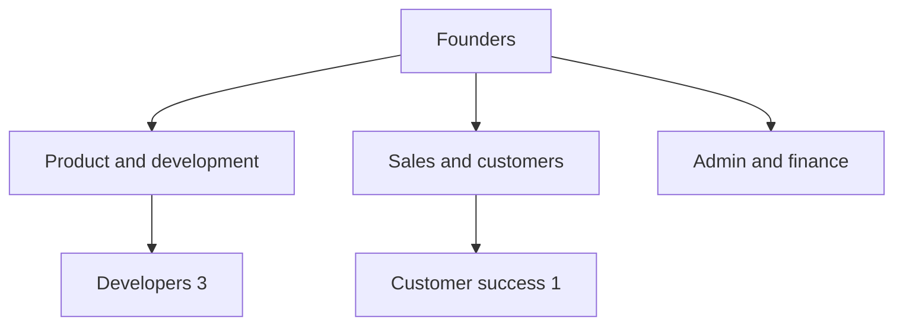
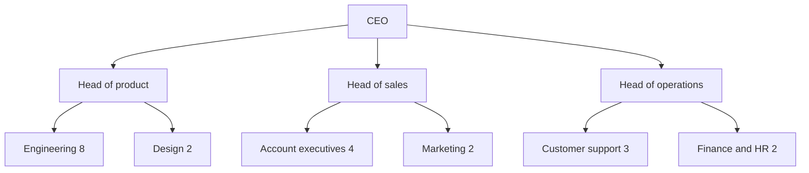
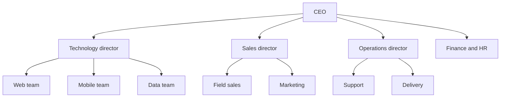
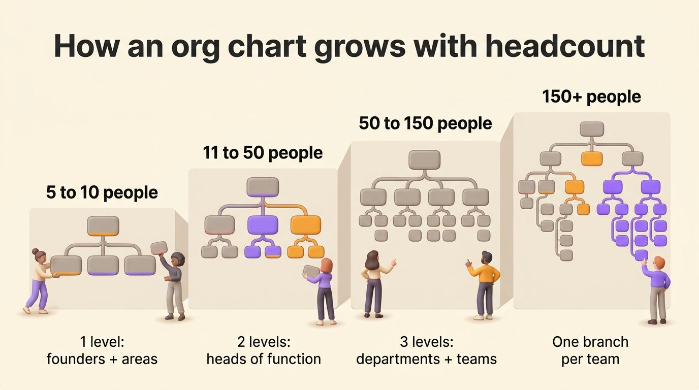
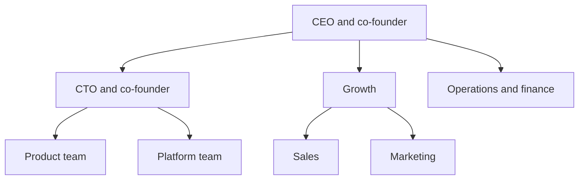
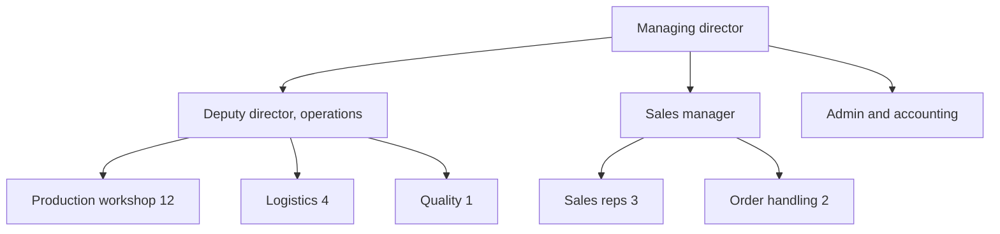
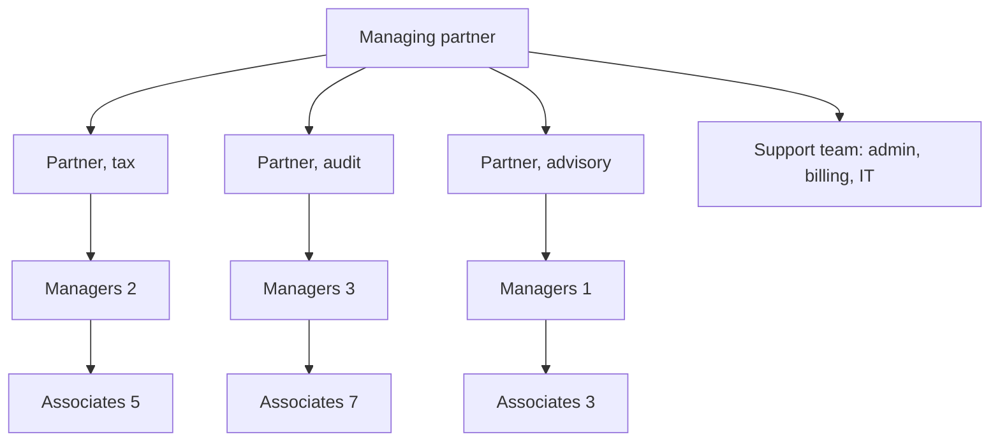
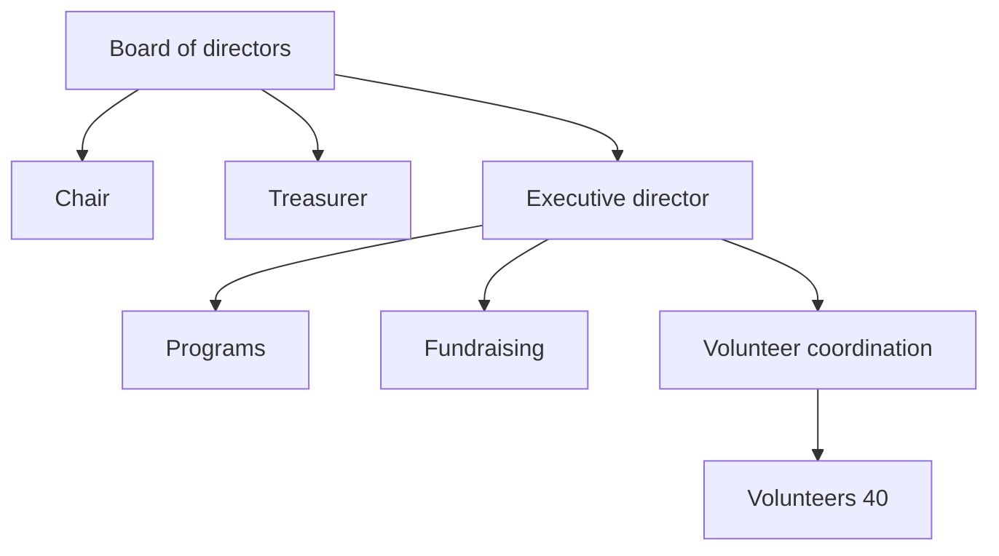
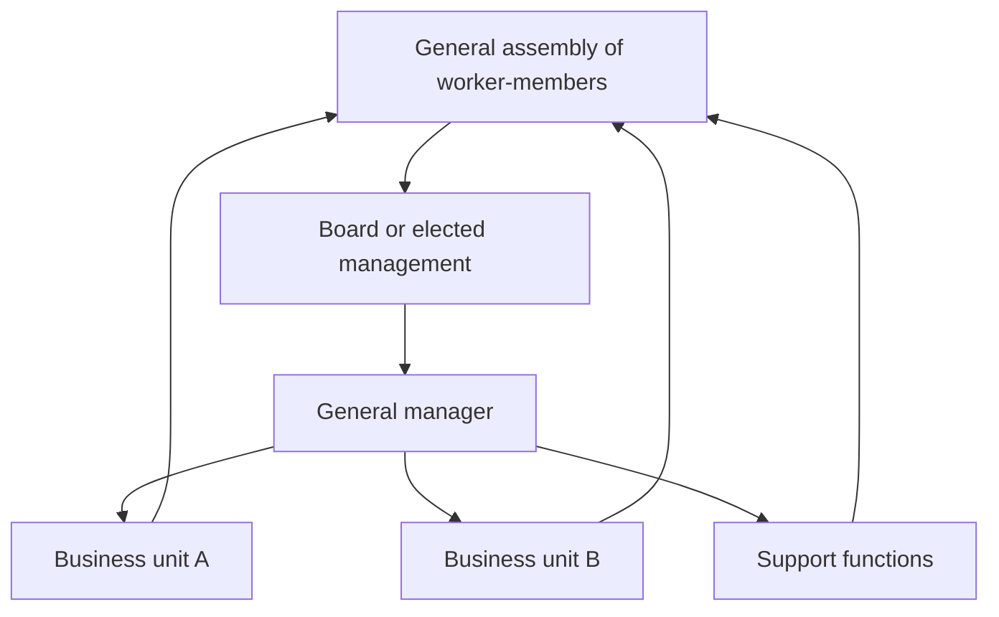

An org chart example is only useful if it looks like your organization. The shape of your chart depends on two facts: how many people you are, and what kind of organization you run. A startup of eight people needs a single level under its founders. A company of forty people adds heads of function. Past a hundred people, a layer of departments sits between leadership and the teams. The sector then adds its own layer: the partners of a professional firm, the board of a nonprofit, the members who elect the leadership of a cooperative. This article gives four examples by size and six by sector, including two Rolebase customers, then the steps to adapt the closest one to your organization.

The forms an org chart can take, such as hierarchical, functional, matrix or circles, are a separate question, covered in our comparison of [the six types of org charts](/en/blog/org-chart-types). This article starts from concrete organizations.

## How an org chart is structured

Every [org chart](/en/glossary/organigramme) is made of three things:

- boxes, one per position or role
- lines, which connect each box to the one it reports to, or to the team it belongs to
- levels, the rows of boxes between the top of the organization and the people who do the work

The top of the chart is whoever holds final authority: a founder, a CEO, a managing partner, a board. Leadership sits right under it, then the teams. A simple company chart stops there.

The examples below follow one convention. Each box is a role rather than a person, because a role shows what work is done and who it reports to, while a name only shows who holds it today. When several people do the same work, the box carries a count, like "Account executives (4)", rather than four identical boxes.

## Org chart examples by company size

### A team of 5 to 10 people

At this size, everyone reports to the founders and the chart has a single level. The chart is there to show who owns each area, since one person often covers two or three.

In a team this small, the same person often appears in two boxes. A founder who handles both sales and finance holds two roles. Draw both to see which one a hire would take over.

### A company of 11 to 50 people

The founders can no longer manage everyone directly. Three to five heads of function appear, each with a team under them, which gives the chart a second level.

Lonestone, a product studio of 35 people, sits in this range and chose to organize by roles rather than by layers. Its chart appears among the sector examples, under shared governance.

### A company of 50 to 150 people

A department layer appears between leadership and the teams. Each department has a director, with a lead for each team under them. Support functions like finance or HR often report straight to the top.

The chart still fits on one screen, but only if each box stands for a team. List the members inside their team's box, or in a separate view of each branch.

### An organization of more than 150 people

Past 150 people, nobody reads the whole chart at once. Leadership needs the top two or three levels, while each team needs its own branch with the levels above it. Build one set of roles and show it at several zoom levels, rather than drawing several charts that drift apart after each change.

The same organization also stops being a single tree. Cross-functional groups appear (a works council, project teams, committees) and draw people from several departments. A tree has no line for them, so give them their own boxes outside the reporting lines.

{/* IMAGE regen: api.py image, infographic, 1600x900. Scene: "A horizontal infographic in four columns of growing height, like four steps, read left to right. Each column shows a small org chart drawn with rounded boxes and connecting lines, with more levels from left to right. Column 1 title: '5 to 10 people'. Its chart: one top box and 3 boxes under it. Caption under it: '1 level: founders + areas'. Column 2 title: '11 to 50 people'. Its chart: one top box, 3 boxes, then small boxes under each. Caption: '2 levels: heads of function'. Column 3 title: '50 to 150 people'. Its chart: one top box, 4 boxes, then 2 to 3 small boxes under each. Caption: '3 levels: departments + teams'. Column 4 title: '150+ people'. Its chart: a large tree with one branch highlighted in purple. Caption: 'One branch per team'. Main title at the top: 'How an org chart grows with headcount'. Modern clean bold sans-serif for titles."
    Infographic only: regenerate if the size thresholds in the article change. Last data sync: 2026-11-03. */}

## Org chart examples by sector

### A startup

A startup's chart follows its product more than its departments. The founders split the areas between them. The first hires then join a product team, a growth team or the operations team.

The startup chart often changes from one quarter to the next. A team splits, a founder hands an area to a new hire, a role nobody held gets a name. Keep it in a tool your team can edit, because a slide made at the last funding round will show the wrong team by the next round.

### A small and mid-sized business

A small or mid-sized business in manufacturing or services usually organizes by function: production or delivery, sales, purchasing, and administration. The owner or managing director sits on top, often with a deputy who covers operations.

This is the [hierarchical org chart](/en/blog/hierarchy-chart), the one most people picture. Add one detail the generic version leaves out: who replaces whom. In a company of thirty people, the person who approves orders when the sales manager is away matters more than a fourth level of boxes.

### A professional services firm

Law firms, accounting firms and consultancies organize around their partners, who usually head one practice each, such as tax or audit. The partners own the firm and run it together, managers or senior associates lead the client engagements, and associates do most of the client work. Support staff often form a single team that serves everyone.

A professional firm's real structure is often a matrix: an associate belongs to a practice and works on engagements led by managers from another one. Build the tree from the practices, and list engagements as roles people hold in addition to their practice. That way an associate staffed on two engagements shows up in both.

### A nonprofit

A nonprofit has two charts stacked on top of each other. The governance chart shows the members, the board of directors and its officers (chair, treasurer, secretary). The operating chart shows the executive director, the staff, the volunteers and the committees.

The line that matters most connects the board to the executive director, who manages everyone else. You can see both layers drawn in detail [for a volunteer-run nonprofit, a staffed one and one in shared governance](/en/blog/nonprofit-org-chart).

### A worker cooperative

In a worker cooperative, the employees own the company. Its chart has a line that a regular business chart lacks: the members, who are also the employees, elect the leadership. Under the cooperative principles of the [International Cooperative Alliance](https://ica.coop/en/cooperatives/cooperative-identity), members of a primary cooperative have equal voting rights, one member one vote, whatever capital they hold.

Scop EVEA, a French worker cooperative in environmental consulting, grew from 60 to 140 people between 2020 and 2023, on three sites in Nantes, Lyon and Troyes. Its skills were spread across more than eight competency clusters, with cross-functional missions on top, while the cooperative still tracked all of it in a PowerPoint. EVEA then [moved to a dynamic org chart](/en/client-cases/scop-evea) that maps its business, support and governance entities, with each of the 140 people and their roles. When one consultant holds a role in life cycle assessment, sits as a staff representative and takes part in a methodology working group, the chart shows all three.

### A company in shared governance

A company in shared governance replaces most management levels with circles: teams that decide how they organize their own work, each with a lead role that represents it to the circle above. The chart shows roles with their purpose and accountabilities, and secondary roles (recruiting, internal tools, events) appear next to the client work.

Lonestone, a product studio of 35 people that builds SaaS products, apps and websites for clients, runs this way. Its roles used to be stored in Notion tables where newcomers struggled to find their way around. Since the roles moved to Rolebase, candidates look at the org chart during recruitment to see where they would fit, and newcomers use it to learn the scope of each colleague and team. Lonestone's co-founders explain [how they moved the studio's roles out of Notion](/en/client-cases/lonestone).

## A modern org chart built from roles

A modern org chart keeps the boxes and lines, but each box is a role with three things written in it: its purpose, its accountabilities, and the people who fill it. The same roles can then be shown as a tree, as nested circles or as a photo directory, without drawing three charts.

The example below is interactive. Click a role to open it, drag to move around, and zoom with Ctrl or ⌘ and the scroll wheel.

<OrgChartView demo="demo" height="480px" showAllNodes={false} />

Each circle stands for a team and contains the roles that describe its work. A person who holds roles in two circles appears in both, which a tree with one box per person cannot show.

## The examples side by side

| Organization | Typical levels | What the chart must show | Common mistake |
|---|---|---|---|
| Team of 5 to 10 | 1 | Who owns each area | One box per person, which hides double roles |
| Company of 11 to 50 | 2 | Heads of function and their teams | Copying the chart of a larger company |
| Company of 50 to 150 | 3 | Departments, team leads, support functions | Names in every box, so the chart no longer fits |
| 150+ people | 4 or more | One branch per team, cross-functional groups | A single chart for everyone |
| Startup | 1 to 2 | Areas split between founders | A slide made at the last funding round |
| Small or mid-sized business | 2 to 3 | Functions and who replaces whom | Leaving out deputies and backups |
| Professional firm | 3 to 4 | Partners, practices, engagements | Ignoring the engagements people work on |
| Nonprofit | 2 layers | Board, executive director, volunteers | Showing only one of the two layers |
| Worker cooperative | 2 layers | Members who elect the leadership, the teams | Drawing it like a regular company |
| Shared governance | Circles | Roles with purpose and accountabilities | Titles that say nothing about the work |

## How to adapt an example to your organization

1. Pick the example closest to your headcount first, then the one closest to your sector. The number of levels depends on your headcount, while your sector adds a layer on top of them.
2. List your roles before your people. Write down every distinct job, including the ones nobody officially holds.
3. Write one line per role saying what it is for. A box titled "Operations" says little, while "Ships every order within 48 hours" tells everyone what to ask that role.
4. Put people in the roles, and let a person appear in several. Keep empty roles on the chart so everyone sees which work is uncovered.
5. Share the chart where your team already looks, and update it when the organization changes rather than once a year.

To draw the chart itself, in Word, PowerPoint or a dedicated tool, follow the steps to [create an org chart](/en/blog/create-org-chart).

## Frequently asked questions

<FaqList>

<FaqItem question="What does an org chart look like?">

An org chart is a diagram of boxes and lines. Each box is a position or a role, each line connects it to the one it reports to, and the rows of boxes show the levels of the organization, with leadership at the top. A team of ten people usually has one level under its founders, a company of a hundred people three. Some org charts use nested circles instead of a tree, with each team drawn as a circle that contains its roles.

</FaqItem>

<FaqItem question="How should an org chart be structured?">

Start from the top authority (a founder, a CEO, a board), then add one level per layer of management, and stop at the teams. Use one box per role rather than per person, and give every box a single parent. Add what your sector requires on top: the board of a nonprofit, the partners of a professional firm, the general assembly of a cooperative.

</FaqItem>

<FaqItem question="What is a simple org chart for a small business?">

A small business of five to ten people needs a single level: the owner or the founders at the top, and one box for each area of work under them, such as sales, production and admin. When one person covers two areas, show them in both boxes. That chart takes a few minutes to draw and shows who to ask for what.

</FaqItem>

<FaqItem question="Is a company org chart confidential?">

Most companies share their org chart with all employees, since newcomers and colleagues use it to find who does what. Some publish it, fully or partly, to show candidates and clients how the company works. Confidentiality usually covers personal details such as phone numbers or salaries, rather than the structure itself. In Rolebase, you can share a public page of the chart with or without members.

</FaqItem>

</FaqList>

## Start from the example closest to yours

Take the example that matches your headcount, then add the layer your sector needs, and fill in roles before names. That chart will be more accurate than any template you download.

In Rolebase, the [org chart is built from your roles](/en/features), so you can show it as a tree, as circles or as a photo directory, and it updates when a role changes. The free plan covers every feature for up to five active members. Past that, the [paid plans](/en/pricing) charge a flat price per user. [Create a free account](/signup) to build your first one.
