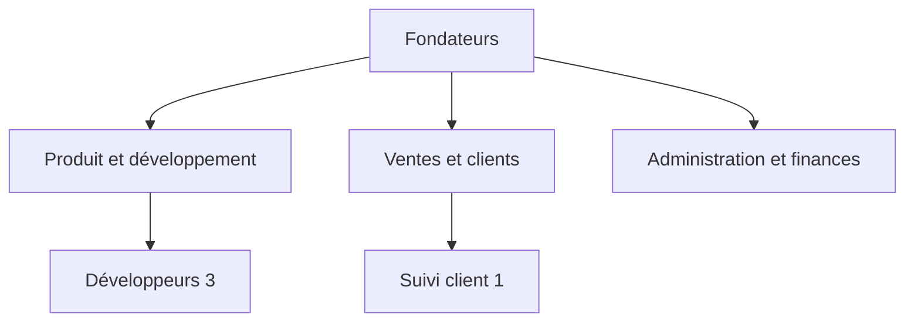
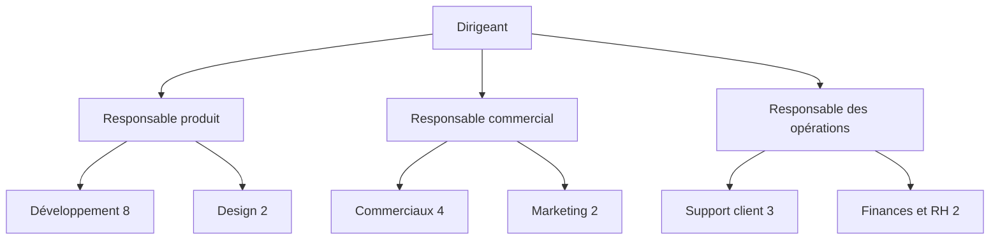
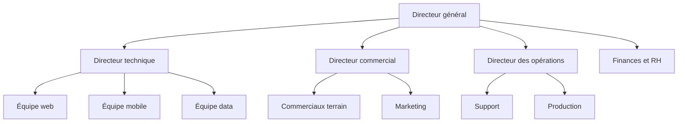
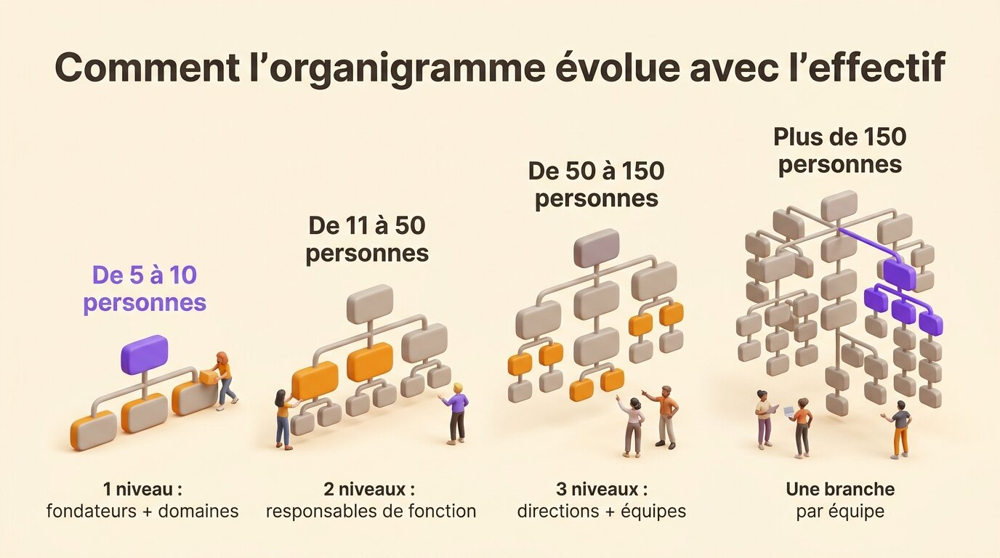
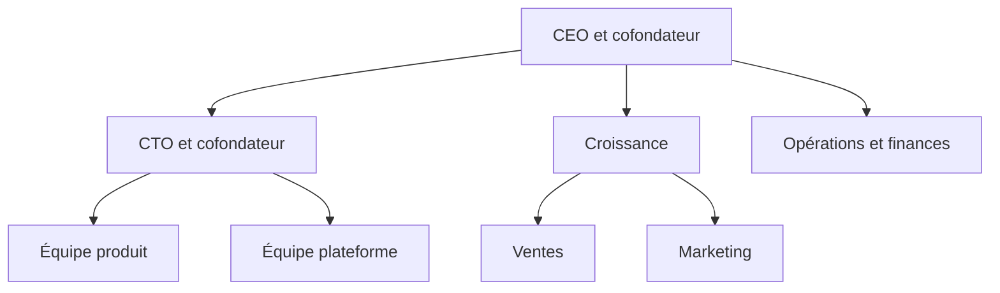
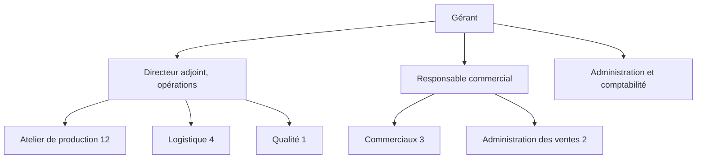
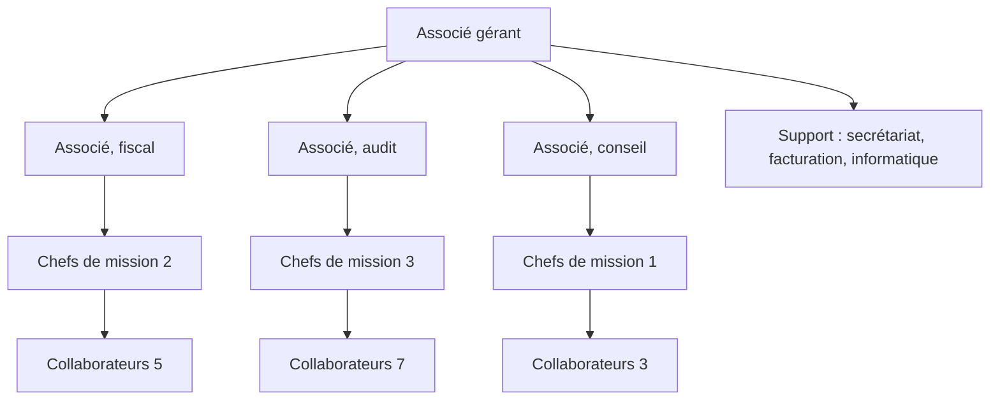
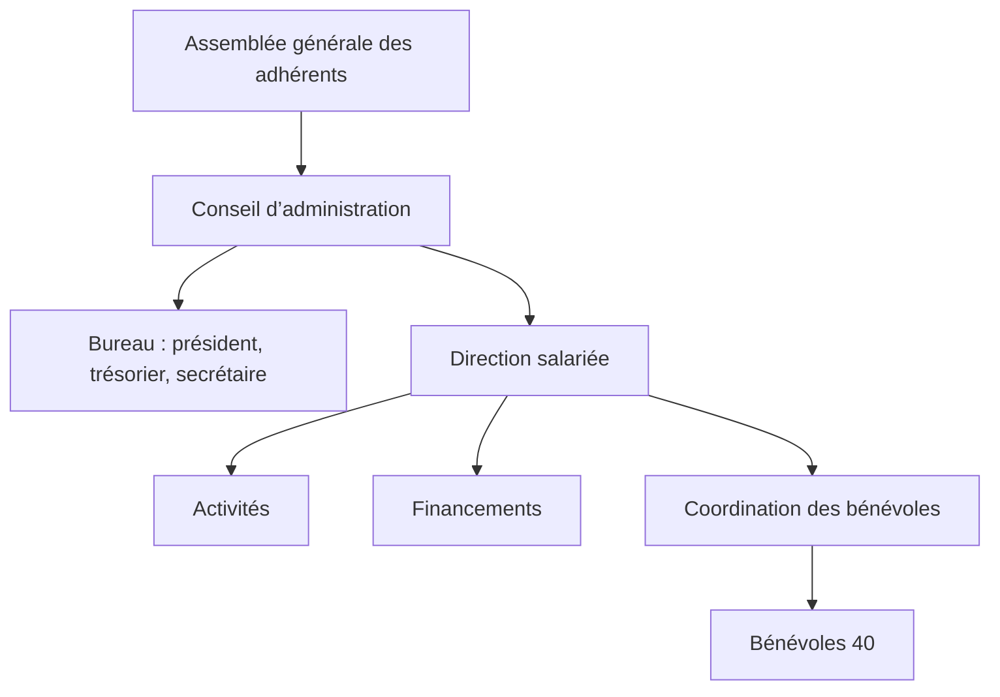
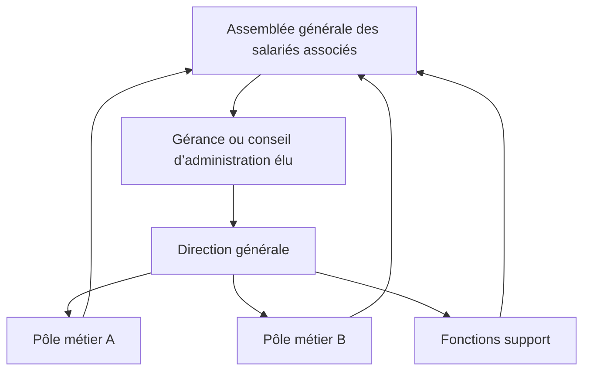

Un exemple d’organigramme ne sert que s’il ressemble à votre organisation. La forme de votre organigramme dépend de deux critères : votre effectif et le type de structure que vous dirigez. Une startup de huit personnes a besoin d’un seul niveau sous ses fondateurs. Une entreprise de quarante personnes ajoute des responsables de fonction. Au-delà d’une centaine de personnes, un niveau de directions s’intercale entre le dirigeant et les équipes. Le secteur ajoute ensuite sa propre couche : les associés d’un cabinet, le conseil d’administration d’une association, l’assemblée des salariés associés d’une SCOP. Cet article donne quatre exemples par taille et six par secteur, dont deux clients Rolebase, puis la méthode pour adapter le plus proche à votre organisation.

Les formes que peut prendre un organigramme (hiérarchique, fonctionnel, matriciel, en cercles) sont une autre question, traitée dans notre comparatif des [six types d’organigramme](/fr/blog/org-chart-types). Cet article part d’organisations concrètes.

## Comment est structuré un organigramme

Tout [organigramme](/fr/glossary/organigramme) se compose de trois éléments :

- des cases, une par poste ou par rôle
- des liens, qui relient chaque case à celle dont elle dépend, ou à l’équipe dont elle fait partie
- des niveaux, les rangées de cases entre le sommet de l’organisation et les personnes qui font le travail

Le sommet est occupé par l’autorité finale : un fondateur, un dirigeant, un associé gérant, un conseil d’administration. La direction se place juste en dessous, puis les équipes. Un organigramme d’entreprise simple s’arrête là.

Les exemples ci-dessous suivent une convention. Chaque case est un rôle plutôt qu’une personne : un rôle montre quel travail est fait et à qui il rend compte, alors qu’un nom montre seulement qui l’occupe aujourd’hui. Quand plusieurs personnes font le même travail, la case porte un nombre, comme « Commerciaux 4 », plutôt que quatre cases identiques.

## Exemples d’organigramme par taille d’entreprise

### Une équipe de 5 à 10 personnes

À cette taille, tout le monde dépend des fondateurs et l’organigramme compte un seul niveau. Il sert surtout à montrer qui tient chaque domaine, puisqu’une même personne en couvre souvent deux ou trois.

Dans une équipe aussi petite, la même personne apparaît souvent dans deux cases. Un fondateur qui gère à la fois les ventes et les finances tient deux rôles. Dessinez-les tous les deux pour voir lequel une recrue pourrait reprendre.

### Une entreprise de 11 à 50 salariés

Les fondateurs ne peuvent plus encadrer tout le monde directement. Trois à cinq responsables de fonction apparaissent, chacun avec son équipe, ce qui ajoute un deuxième niveau à l’organigramme.

À cette taille, une instance s’ajoute aussi hors de la ligne hiérarchique. Le comité social et économique devient obligatoire dès que l’entreprise atteint 11 salariés pendant 12 mois consécutifs, d’après la [fiche de l’administration sur le CSE](https://entreprendre.service-public.gouv.fr/vosdroits/F34474). Placez-le à côté de l’arbre, avec les élus qui le composent, plutôt que sous un responsable.

Lonestone, un studio produit de 35 personnes, se situe dans cette tranche et a choisi de s’organiser par rôles plutôt que par niveaux. Son organigramme figure parmi les exemples par secteur, avec la gouvernance partagée.

### Une PME de 50 à 150 salariés

Un niveau de directions apparaît entre le dirigeant et les équipes. Chaque direction a son directeur, avec un responsable pour chaque équipe. Les fonctions support comme la finance ou les RH dépendent souvent directement du sommet.

L’organigramme tient encore sur un écran, à condition que chaque case représente une équipe. Listez les membres dans la case de leur équipe, ou dans une vue séparée par branche.

### Une organisation de plus de 150 personnes

Au-delà de 150 personnes, plus personne ne lit l’organigramme en entier. La direction a besoin des deux ou trois premiers niveaux, alors que chaque équipe a besoin de sa propre branche avec les niveaux au-dessus. Construisez un seul jeu de rôles et affichez-le à plusieurs niveaux de zoom, plutôt que de dessiner plusieurs organigrammes qui divergent après chaque changement.

L’organisation cesse aussi d’être un simple arbre. Des groupes transverses apparaissent (le CSE, des équipes projet, des comités) et réunissent des personnes de plusieurs directions. Un arbre n’a pas de lien pour eux, alors donnez-leur leurs propres cases en dehors des lignes hiérarchiques.

{/* IMAGE regen: api.py image, infographic, 1600x900. Scene: "A horizontal infographic in four columns of growing height, like four steps, read left to right. Each column shows a small org chart drawn with rounded boxes and connecting lines, with more levels from left to right. Column 1 title: 'De 5 à 10 personnes'. Its chart: one top box and 3 boxes under it. Caption under it: '1 niveau : fondateurs + domaines'. Column 2 title: 'De 11 à 50 personnes'. Its chart: one top box, 3 boxes, then small boxes under each. Caption: '2 niveaux : responsables de fonction'. Column 3 title: 'De 50 à 150 personnes'. Its chart: one top box, 4 boxes, then 2 to 3 small boxes under each. Caption: '3 niveaux : directions + équipes'. Column 4 title: 'Plus de 150 personnes'. Its chart: a large tree with one branch highlighted in purple. Caption: 'Une branche par équipe'. Main title at the top: 'Comment l’organigramme évolue avec l’effectif'. Modern clean bold sans-serif for titles."
    Infographic only: regenerate if the size thresholds in the article change. Last data sync: 2026-11-03. */}

## Exemples d’organigramme par secteur

### Une startup

L’organigramme d’une startup s’organise autour du produit plus que par grandes fonctions. Les fondateurs se partagent les domaines. Les premières recrues rejoignent ensuite une équipe produit, une équipe croissance ou les opérations.

L’organigramme d’une startup change souvent d’un trimestre à l’autre. Une équipe se scinde, un fondateur confie un domaine à une recrue, un rôle que personne ne tenait reçoit un nom. Tenez-le dans un outil que l’équipe peut modifier : une diapositive faite pour la dernière levée de fonds montrera la mauvaise équipe dès la suivante.

### Une PME industrielle ou de services

Une PME de production ou de services s’organise le plus souvent par fonction : production ou réalisation, commerce, achats, administration. Le gérant ou le directeur général est au sommet, souvent avec un adjoint qui couvre les opérations.

La plupart des gens pensent à ce modèle, l’[organigramme hiérarchique](/fr/blog/hierarchy-chart), quand on leur parle d’organigramme. Ajoutez-y un détail que la version générique oublie : qui remplace qui. Dans une PME de trente personnes, le nom de celui qui valide les commandes en l’absence du responsable commercial compte plus qu’un quatrième niveau de cases.

### Un cabinet d’avocats ou d’expertise comptable

Les cabinets d’avocats, d’expertise comptable et de conseil s’organisent autour de leurs associés, qui dirigent en général chacun un pôle, comme le fiscal ou l’audit. Les associés détiennent le cabinet et le dirigent ensemble, les managers ou chefs de mission pilotent les dossiers clients, et les collaborateurs font l’essentiel de la production. L’équipe support (secrétariat, facturation, informatique) sert souvent tout le monde.

Dans la réalité, un cabinet fonctionne souvent en matrice : un collaborateur appartient à un pôle et travaille sur des dossiers pilotés par des chefs de mission d’un autre pôle. Construisez l’arbre par pôles, et ajoutez les missions comme des rôles que les personnes tiennent en plus de leur pôle. Un collaborateur affecté à deux missions apparaît alors dans les deux.

### Une association

Une association a deux organigrammes superposés. Celui de la gouvernance montre les adhérents réunis en assemblée générale, le conseil d’administration et le bureau (président, trésorier, secrétaire). Celui du fonctionnement montre la direction salariée quand elle existe, les salariés, les bénévoles et les commissions.

Le lien qui compte le plus relie le conseil à la direction salariée, qui encadre tous les autres. Vous trouverez les deux couches détaillées [pour une association entièrement bénévole, une association employeuse et une association en gouvernance partagée](/fr/blog/nonprofit-org-chart).

### Une SCOP

Dans une SCOP, les salariés détiennent l’entreprise. Son organigramme a un lien qu’une entreprise classique n’a pas : les salariés associés élisent la direction. D’après la [fiche de l’administration sur le fonctionnement des SCOP](https://entreprendre.service-public.gouv.fr/vosdroits/F31328), les salariés associés détiennent au moins 51 % du capital et 65 % des droits de vote, et chaque associé a une voix quel que soit son apport.

La Scop EVEA, un bureau d’études en conseil environnemental, est passée de 60 à 140 personnes entre 2020 et 2023, sur trois sites à Nantes, Lyon et Troyes. Ses compétences étaient réparties dans plus de huit pôles, avec des missions transverses en plus, alors que la coopérative suivait encore le tout dans un PowerPoint. EVEA a ensuite [adopté un organigramme dynamique](/fr/client-cases/scop-evea) qui cartographie ses entités métier, support et gouvernance, avec chacune des 140 personnes et ses rôles. Quand une consultante tient un rôle en analyse de cycle de vie, siège comme représentante du personnel et participe au groupe de travail méthodologie, l’organigramme montre les trois.

### Une entreprise en gouvernance partagée

Une entreprise en gouvernance partagée remplace la plupart des niveaux de management par des cercles : des équipes qui décident de l’organisation de leur propre travail, chacune avec un rôle de leader qui la représente auprès du cercle au-dessus. L’organigramme montre des rôles avec leur raison d’être et leurs redevabilités, et les rôles secondaires (recrutement, outils internes, événements) apparaissent à côté du travail client.

Lonestone, un studio produit de 35 personnes qui conçoit des SaaS, des applications et des sites pour ses clients, fonctionne ainsi. Ses rôles étaient rangés dans des tables Notion où les nouveaux arrivants avaient du mal à se repérer. Depuis que les rôles sont passés dans Rolebase, les candidats regardent l’organigramme pendant le recrutement pour voir où ils trouveraient leur place, et les nouveaux arrivants s’en servent pour apprendre le périmètre de chaque collègue et de chaque équipe. Les cofondateurs de Lonestone racontent [comment ils ont sorti de Notion les rôles du studio](/fr/client-cases/lonestone).

## Un organigramme moderne construit à partir des rôles

Un organigramme moderne garde les cases et les liens, mais chaque case est un rôle qui porte trois informations : sa raison d’être, ses redevabilités et les personnes qui le tiennent. Les mêmes rôles s’affichent alors en arbre, en cercles imbriqués ou en trombinoscope, sans dessiner trois organigrammes.

L’exemple ci-dessous est interactif. Cliquez sur un rôle pour l’ouvrir, faites glisser pour vous déplacer, et zoomez avec Ctrl ou ⌘ et la molette.

<OrgChartView demo="demo" height="480px" showAllNodes={false} />

Chaque cercle représente une équipe et contient les rôles qui décrivent son travail. Une personne qui tient des rôles dans deux cercles apparaît dans les deux, ce qu’un arbre avec une case par personne ne peut pas montrer.

## Les exemples côte à côte

| Organisation | Niveaux habituels | L’organigramme doit montrer | Erreur fréquente |
|---|---|---|---|
| Équipe de 5 à 10 | 1 | Qui tient chaque domaine | Une case par personne, qui cache les doubles rôles |
| Entreprise de 11 à 50 | 2 | Les responsables de fonction et leurs équipes, le CSE | Copier l’organigramme d’une entreprise plus grande |
| PME de 50 à 150 | 3 | Les directions, les responsables d’équipe, les fonctions support | Des noms dans chaque case, si bien que l’organigramme ne tient plus sur l’écran |
| Plus de 150 personnes | 4 ou plus | Une branche par équipe, les groupes transverses | Un seul organigramme pour tout le monde |
| Startup | 1 à 2 | Les domaines répartis entre fondateurs | La diapositive de la dernière levée de fonds |
| PME industrielle ou de services | 2 à 3 | Les fonctions et qui remplace qui | Oublier les adjoints et les suppléants |
| Cabinet | 3 à 4 | Les associés, les pôles, les missions | Ignorer les missions sur lesquelles travaillent les collaborateurs |
| Association | 2 couches | Le conseil, la direction salariée, les bénévoles | Ne montrer qu’une des deux couches |
| SCOP | 2 couches | Les salariés associés qui élisent la direction, les équipes | La dessiner comme une entreprise classique |
| Gouvernance partagée | Cercles | Les rôles, leur raison d’être et leurs redevabilités | Des intitulés qui ne disent rien du travail |

## Comment adapter un exemple à votre organisation

1. Choisissez d’abord l’exemple le plus proche de votre effectif, puis celui de votre secteur. Le nombre de niveaux dépend de votre effectif, alors que votre secteur ajoute une couche par-dessus.
2. Listez les rôles avant les personnes. Notez chaque travail distinct, y compris ceux que personne ne tient officiellement.
3. Écrivez une ligne par rôle pour dire à quoi il sert. Une case « Opérations » dit peu de chose, alors que « Expédie chaque commande sous 48 heures » dit à chacun ce qu’il peut demander à ce rôle.
4. Placez les personnes dans les rôles, et laissez une même personne apparaître dans plusieurs. Gardez les rôles vacants sur l’organigramme pour que chacun voie quel travail reste sans titulaire.
5. Partagez l’organigramme là où l’équipe regarde déjà, et mettez-le à jour quand l’organisation change plutôt qu’une fois par an.

Pour le dessin lui-même, dans Word, PowerPoint ou un outil dédié, suivez notre méthode pour [créer un organigramme](/fr/blog/create-org-chart).

## Questions fréquentes

<FaqList>

<FaqItem question="Comment est structuré un organigramme ?">

Un organigramme part de l’autorité finale (un fondateur, un dirigeant, un conseil d’administration), ajoute un niveau par couche de management et s’arrête aux équipes. Chaque case est un poste ou un rôle, relié à celui dont il dépend. Une équipe de dix personnes compte en général un niveau sous ses fondateurs, une PME d’une centaine de personnes trois. Certains organigrammes utilisent des cercles imbriqués plutôt qu’un arbre, chaque équipe formant un cercle qui contient ses rôles.

</FaqItem>

<FaqItem question="Quel est un exemple d’organigramme d’entreprise simple ?">

Une petite entreprise de cinq à dix personnes a besoin d’un seul niveau : le gérant ou les fondateurs en haut, et une case par domaine de travail en dessous, comme les ventes, la production et l’administration. Quand une personne couvre deux domaines, faites-la apparaître dans les deux cases. Cet organigramme se dessine en quelques minutes et montre à qui s’adresser pour chaque sujet.

</FaqItem>

<FaqItem question="Quels sont les 4 types d’organigramme ?">

On cite le plus souvent l’organigramme hiérarchique, le fonctionnel, le matriciel et l’horizontal. On y ajoute parfois l’organigramme circulaire, qui imbrique les équipes les unes dans les autres, et le trombinoscope. Choisissez la forme d’après la question que vos équipes posent le plus souvent, comme « qui dépend de qui ? » ou « qui est qui ? ».

</FaqItem>

<FaqItem question="Un organigramme d’entreprise est-il confidentiel ?">

La plupart des entreprises partagent leur organigramme avec tous les salariés, puisque les nouveaux arrivants et les collègues s’en servent pour savoir qui fait quoi. Certaines le publient, en entier ou en partie, pour montrer aux candidats et aux clients comment elles fonctionnent. La confidentialité porte en général sur les données personnelles, comme les numéros de téléphone ou les salaires, plutôt que sur la structure. Dans Rolebase, vous pouvez partager une page publique de l’organigramme, avec ou sans les membres.

</FaqItem>

</FaqList>

## Partez de l’exemple le plus proche du vôtre

Prenez l’exemple qui correspond à votre effectif, ajoutez la couche que demande votre secteur, et remplissez les rôles avant les noms. Cet organigramme sera plus juste que n’importe quel modèle téléchargé.

Dans Rolebase, l’[organigramme se construit à partir de vos rôles](/fr/features) : vous l’affichez en arbre, en cercles ou en trombinoscope, et il se met à jour quand un rôle change. L’offre gratuite donne accès à toutes les fonctionnalités jusqu’à cinq membres actifs. Au-delà, les [offres payantes](/fr/pricing) sont facturées à un tarif fixe par utilisateur. [Créez un compte gratuit](/signup) pour construire le vôtre.
