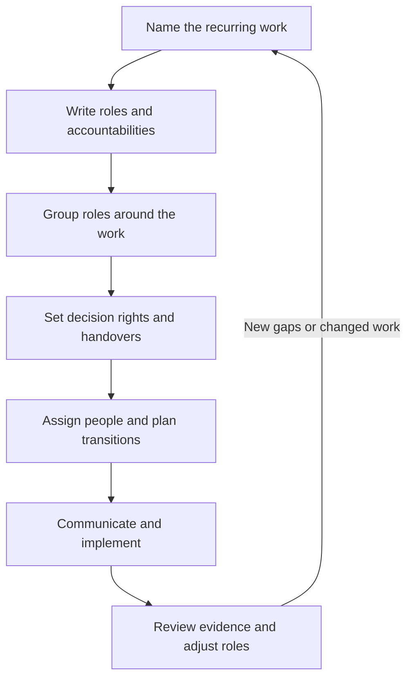
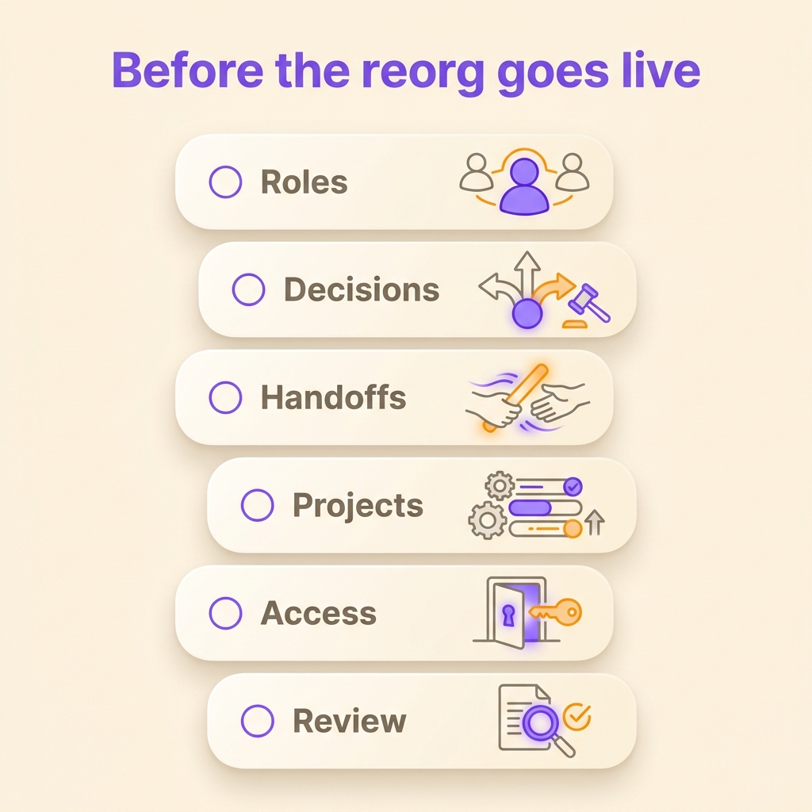

A company announces a new org chart on Monday. By Friday, decisions still wait for the same executive, two teams both think they own the customer handoff, and one recurring task has no owner. The org chart changed, while the old decision bottlenecks and unowned handoffs remained.

A company reorganization changes how the organization groups work and assigns responsibility. It succeeds when those changes also clarify who decides, what each role is accountable for, and how work passes between teams. This guide walks through a practical role-by-role process, from diagnosing the problem to checking whether the new structure works.

## What is a company reorganization?

A company reorganization is a planned change to how an organization groups work, assigns authority and coordinates people to meet its goals. It can change reporting lines, teams, roles, decision rights or the way units work together. In everyday use, “reorganization” and “restructuring” often overlap. Some management research uses *restructuring* for a change to the company’s basic design, such as moving from functional departments to product divisions, and *reconfiguration* for changing units within the same design. Strategy professor Stéphane J. G. Girod and Oxford professor Richard Whittington describe that distinction in a [study of large U.S. corporations from 1985 to 2004](https://doi.org/10.1002/smj.2543), published in 2017. The terms vary by source, so explain the actual change rather than relying on the label. Girod and Samina Karim, a professor of entrepreneurship and innovation at Northeastern University, outline the same choice in their [guide to when companies should restructure or reconfigure](https://hbr.org/2017/03/restructure-or-reconfigure).

The org chart shows how a company groups work. Decision rights and coordination show how those groups work together.

## When does an organization need to reorganize?

Growth alone rarely justifies a new structure. Watch for recurring problems the current structure struggles to solve:

- Decisions travel through several managers even when the people closest to the work have the information.
- Two teams own overlapping outcomes, while another recurring outcome has no clear owner.
- Customer or project handovers depend on personal memory and repeated follow-up.
- A manager has become the default approver for routine decisions across several teams.
- Teams optimize their own goals while work that crosses departments keeps stalling.
- People cannot tell who has authority to change a process, resolve a conflict or commit resources.

One missed deadline or a difficult team relationship usually calls for a smaller fix. A company-wide reorganization adds uncertainty when the problem is local. First ask whether the cause sits in reporting lines, an unclear role, a decision rule or a broken process.

## Choose the kind of reorganization the work needs

Companies usually reorganize around functions, products or customers, geography, projects, or a combination of those principles. A functional structure groups similar expertise. A product or customer structure gives each business area a closer set of capabilities. A matrix keeps more than one organizing line and therefore needs an explicit way to settle conflicts between them. Autonomous teams can make more local decisions, provided the boundaries between teams remain clear.

Each organization needs a structure that fits the work it coordinates and where decision-making information lives. One product and shared specialist work may suit functional groups. Distinct markets may call for product or regional divisions. Teams with shared specialists need a written rule for priority conflicts.

| Design choice | Groups work by | Decision question to settle | Common risk |
| --- | --- | --- | --- |
| Functional | Expertise, such as finance or engineering | Who resolves a conflict between functions? | Cross-functional decisions queue at the top |
| Product or customer | Products, services or customer groups | Which decisions stay with the unit, and which stay shared? | Functions or tools get duplicated |
| Geographic | Regions or locations | Which local choices can differ from company-wide rules? | Teams repeat work or drift apart |
| Matrix | Two or more dimensions, such as function and product | What happens when the lines disagree? | One person carries an unresolved conflict |
| Role-based teams | Recurring responsibilities and decision domains | Where does each role’s authority begin and end? | Informal power fills gaps in unwritten roles |

## How to reorganize a company in seven steps

### 1. Diagnose the problem before drawing a new chart

Describe the problem in observable terms. “We need to be more agile” is too broad to guide a design. “Pricing changes wait for three approvals although the product team owns the customer data” identifies a process and a decision to examine.

Review the current structure alongside actual work. Ask the people who do and receive the work where requests stall, where responsibilities overlap, and which decisions repeatedly move upward. The University of California, Berkeley recommends defining the problem, checking how current jobs and structures serve the goals, and gathering staff input before choosing a new model in its [procedure for gathering employee input on a reorganization](https://hr.berkeley.edu/hr-network/central-guide-managing-hr/managing-hr/managing-successfully/reorganizations/steps).

Set a small number of success measures before making changes. You might track how many recurring decisions require escalation, how often a handover returns for missing context, or whether a specific customer response gets an accountable owner. Use measures connected to the original problem rather than a large dashboard of activity.

### 2. Inventory roles and accountabilities before people

Write down the recurring work the company must perform. For each role, name its purpose, its decision domain where one exists, and the ongoing accountabilities other roles can expect from it. Then identify the person or people holding each role.

This order matters. Starting with names and titles can turn the design into a negotiation over boxes before the company has established what work the boxes need to cover. Starting from responsibilities lets you find duplicate ownership, uncovered work and decisions that no role can make. Separate a role’s purpose, domain and accountabilities with [a clear approach to defining roles](/en/blog/define-roles).

The role map, employment terms, pay, job grades and legal duties each describe a different part of work. A person can hold several roles, and roles can change as the work changes.

### 3. Agree what the new structure must make easier

Turn the diagnosis into design principles. Examples include keeping customer decisions close to customer information, giving each recurring outcome one accountable role, or making a team’s authority clear when work crosses a function.

Make the trade-offs explicit. A structure that gives teams more independence also needs a way to coordinate shared work. A structure that centralizes specialist expertise needs a quick route for business units to get decisions. A design should state what becomes easier and what new coordination it requires.

### 4. Design the role map and decision rights

Group the roles into teams or functions that match the work. For each group, write down its purpose and the work it owns. Then name the boundaries: what a role decides alone, when it consults another role, and when a wider decision is needed.

Pay close attention to work between groups. A product launch may need product, sales, support and finance. Name who owns the handover, what information must travel with it and who decides when priorities conflict. [Project handovers between teams](/en/blog/project-handovers) go more smoothly when the receiving team gets the context, owner and decisions with the task.

Sketch the new structure and test it against real situations from the diagnosis. Follow a customer request, a budget decision and a cross-team delivery through the proposed roles. If each path ends with “ask the executive team,” the design has moved the boxes without moving authority.

### 5. Assign people and plan the transition

Match people to roles using the skills, capacity and knowledge the work requires. Explain how assignments were made and identify training or support that people need. A role map does not settle employment changes by itself. If the reorganization changes reporting, location, pay, hours or contractual duties, involve the appropriate HR, employee-representative and legal processes for the jurisdictions involved.

Plan handovers before the new chart takes effect. For each role that changes hands, record active work, open decisions, relevant contacts, access to systems, deadlines and dependencies. Make explicit which responsibilities end, which move and who owns any gap during the transition. That avoids the common situation where the outgoing team assumes the incoming team has everything it needs.

### 6. Communicate the change and invite real questions

Along with the chart and launch date, employees need the reason for the change, what it is designed to improve, what is decided, what remains open and when they can expect the next update. Tell each team how the change affects its work and where people can ask questions.

Communication should continue in both directions. Berkeley’s guidance includes regular staff information, individual conversations where roles change significantly, feedback during implementation and updates as the plan develops. A broadcast message can announce a decision, but it cannot answer every person’s question about their own work. Listen for concerns that expose a missing accountability or an unrealistic handover, and make clear how the organization will respond.

For decisions that need participation, define who has a voice and how the group will decide. A consent process helps a team assess a structural proposal by testing whether a reasoned objection remains. Use it alongside legal consultation and the employer’s responsibilities.

### 7. Review the structure and keep adjusting it

After implementation, check the measures you set at the start. Are the decisions that used to stall now made by the intended role? Do handovers arrive with the information the next team needs? Did the change create a new bottleneck or leave work without an owner?

For a significant change, schedule reviews around 30, 60 and 90 days after launch. Check the original measures, resolve new gaps and update roles as the work changes. A regular review gives teams a way to correct a boundary problem before it grows into another company-wide reorganization.

## What tends to fall through the cracks?

A reorganization also needs to account for the work that connects teams and reporting lines. Use this checklist before implementation:

- Every recurring outcome has a named role that owns it.
- Overlapping accountabilities have a clear decision rule.
- Each important decision has an owner and a defined scope.
- Cross-team handovers include context, next actions, open questions and a receiving owner.
- Ongoing projects, customer commitments, tools and access have a named destination.
- People know what changes for them and where unresolved questions go.
- The company has a way to record and revisit structural decisions.
- Measures test the original problem without turning into surveillance of individuals.

{/* IMAGE regen: api.py image, infographic, 1200x1200. Scene: "Design a reader-friendly six-item checklist infographic in a clean vertical layout, with six large rounded cards and simple distinct line icons. Exact heading: ‘Before the reorg goes live’. Exact six labels, one per card: ‘Roles’, ‘Decisions’, ‘Handoffs’, ‘Projects’, ‘Access’, ‘Review’. Use a small empty checkbox beside every label. Soft isometric editorial feel, ample spacing, warm cream background, violet/orange highlights, legible bold sans-serif. Do not add any other text, numbers, symbols that resemble text, or decorative labels." */}

## How do you get buy-in for a reorganization?

People are more likely to support a change when they can understand the problem, influence decisions that affect their work and see how the organization handles concerns. Involve the people with direct knowledge before the design hardens. Give them concrete questions to answer, such as which decisions currently wait, where a handover loses information, or what work the proposal leaves uncovered.

Participation works when everyone knows which decisions belong to role holders, which need input from affected teams and which require formal approval. If leaders have already settled a decision, say so plainly and explain the constraints. Clear language preserves trust.

## How to manage a reorganization in Rolebase

Rolebase maps an organization through roles, their accountabilities and their place in the org chart. When a structural change needs a group decision, a proposal can carry changes to roles and members while keeping them separate from the live org chart. Approved proposals apply their prepared changes. Rolebase records each change and its author in the history, where eligible changes can be undone. Archiving a role keeps its attached information.

The exact editing rights depend on the organization’s governance mode. A proposal can help teams prepare a design and vote on it, alongside employee consultation, HR processes and legal review. Learn how to [prepare org chart changes through a proposal](/en/docs/proposals) before a live transition.

{/* TODO ANECDOTE: Add a real Rolebase, Lonestone or customer reorganization example here if the owner confirms the organization may be named. Include which roles changed, how many people were involved, whether a proposal decided the change, and how long the transition took. */}

## Frequently asked questions

<FaqList>

<FaqItem question="What are the steps of a company reorganization?">
Start by defining the problem and how you will measure improvement. Inventory recurring work, roles and decision rights, then design the structure around them. Assign people, plan handovers, communicate the change, implement it and review the results so you can correct gaps.
</FaqItem>

<FaqItem question="How long does a company reorganization take?">
There is no reliable duration for every reorganization. A focused change to one team differs from a company-wide redesign that affects reporting lines, employment terms, systems or several jurisdictions. Estimate the work from its scope, consultation requirements, dependencies and transition plan, then communicate what could change the schedule.
</FaqItem>

<FaqItem question="What is the difference between reorganization and restructuring?">
The terms often mean the same thing in everyday business use. Some management research uses restructuring for a change to the company’s basic design and reconfiguration for changes to units within that design. Define the changes you plan to make so employees and leaders understand the decision.
</FaqItem>

<FaqItem question="How do you communicate a reorganization to employees?">
Explain the reason for the change, what is decided, what remains open, how each team’s work will change and when the next update will arrive. Give employees a named place to ask questions, hold two-way conversations and share how the organization will act on feedback.
</FaqItem>

</FaqList>

## Start with the work, then draw the chart

A useful company reorganization starts with the problem the current structure creates. Map the recurring work and decisions, name the roles that own them, and design the connections between teams before assigning people. Then plan handovers, explain the change and check whether the new structure solves the original problem.

Rolebase lets teams map roles, accountabilities and the org chart in one place, then prepare structural changes through proposals when the organization wants a group decision. [Explore Rolebase’s features](/en/features) and try it with a team of up to five active members.
