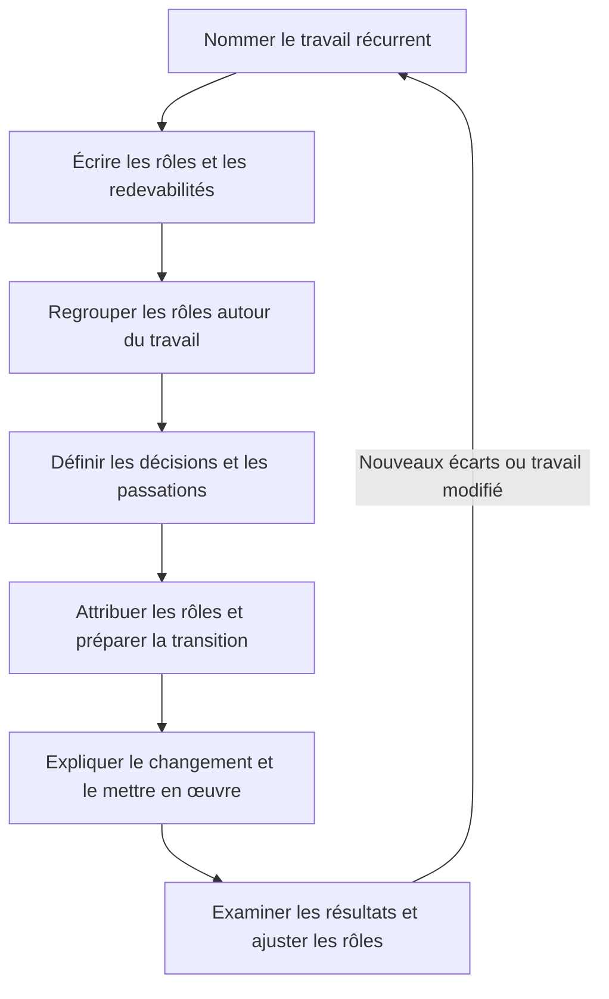
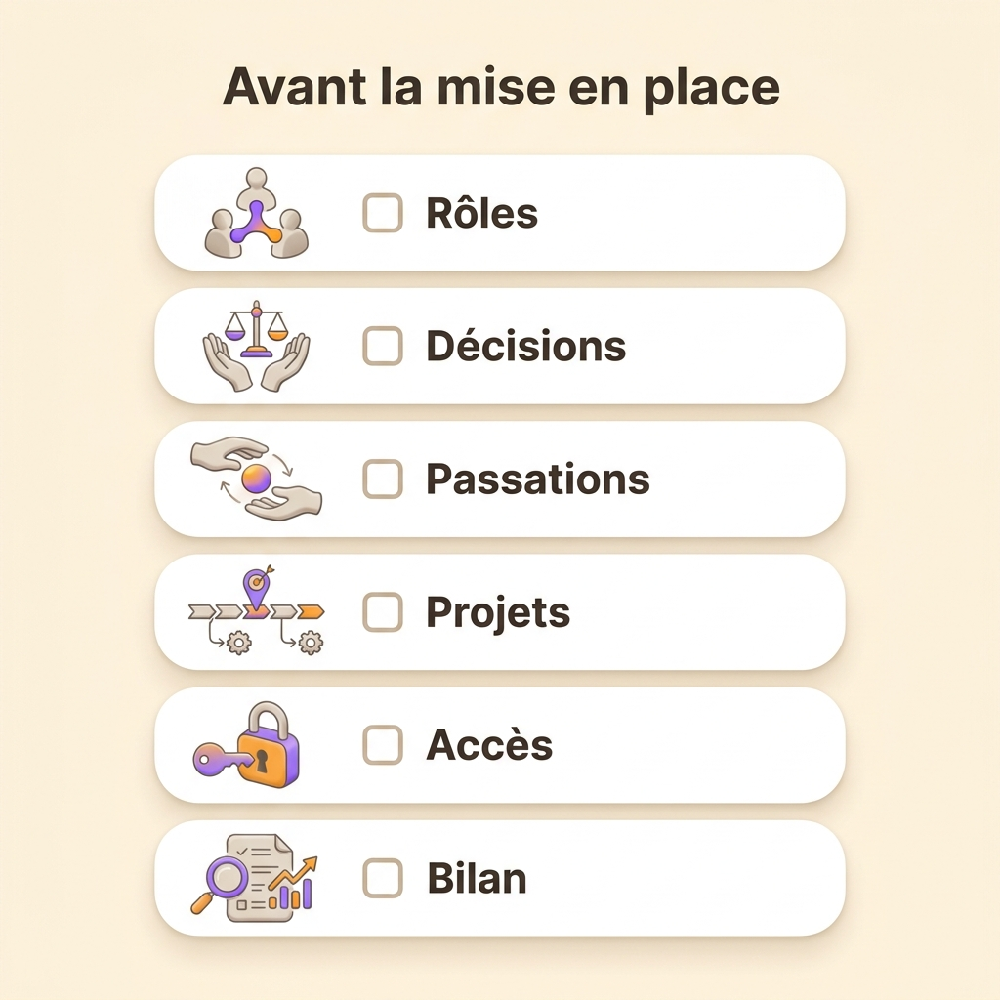

Lundi, l’entreprise annonce son nouvel organigramme. Vendredi, les décisions attendent toujours le dirigeant, deux équipes pensent gérer la passation client et une activité récurrente reste sans responsable. L’organigramme a changé, mais les blocages et les responsabilités sans titulaire restent.

Une réorganisation d’entreprise modifie la façon dont l’organisation regroupe le travail et répartit les responsabilités. Elle réussit quand elle clarifie aussi qui décide, ce dont chaque rôle répond et comment le travail passe d’une équipe à l’autre. Voici une méthode par rôles, du diagnostic au bilan de la nouvelle structure.

## Qu’est-ce qu’une réorganisation d’entreprise ?

Une réorganisation d’entreprise est un changement planifié dans la façon de regrouper le travail, de répartir l’autorité et de coordonner les personnes pour atteindre les objectifs de l’organisation. Elle peut modifier les rattachements, les équipes, les rôles, les droits de décision ou la coopération entre services. Dans l’usage courant, « réorganisation » et « restructuration » se recoupent souvent. Certains travaux de gestion emploient *restructuration* pour un changement du modèle général, comme le passage de directions fonctionnelles à des divisions par produit, et *reconfiguration* pour un changement d’unités à l’intérieur du même modèle. Le chercheur en stratégie Stéphane J. G. Girod et le professeur d’Oxford Richard Whittington décrivent cette distinction dans une [étude publiée en 2017 sur de grandes entreprises américaines entre 1985 et 2004](https://doi.org/10.1002/smj.2543). Girod et Samina Karim, professeure d’entrepreneuriat et d’innovation à Northeastern University, présentent le même choix dans leur [guide sur la restructuration et la reconfiguration](https://hbr.org/2017/03/restructure-or-reconfigure) pour la Harvard Business Review. Les termes varient selon les sources. Décrivez donc le changement réel plutôt que de vous reposer sur une étiquette.

L’organigramme montre comment l’entreprise regroupe le travail. Les droits de décision et la coordination précisent comment les équipes travaillent ensemble.

## Quand faut-il réorganiser une entreprise ?

La croissance seule justifie rarement une nouvelle structure. Repérez les problèmes récurrents que la structure actuelle peine à résoudre :

- Une décision passe par plusieurs managers alors que les personnes proches du travail détiennent déjà l’information utile.
- Deux équipes portent des responsabilités qui se chevauchent, tandis qu’une autre activité récurrente n’a aucun responsable clairement désigné.
- Les passations clients ou projets reposent sur la mémoire d’une personne et des relances répétées.
- Un manager devient l’approbateur par défaut de décisions courantes dans plusieurs équipes.
- Chaque équipe atteint ses propres objectifs, mais les activités qui traversent les services restent bloquées.
- Les personnes ignorent qui peut modifier un processus, résoudre un désaccord ou engager des ressources.

Un délai manqué ou une relation difficile entre deux équipes demande souvent une correction ciblée. Une réorganisation générale ajoute de l’incertitude quand le problème reste local. Cherchez d’abord la cause : rattachements, rôle mal défini, règle de décision ou processus qui coince. Pour un dirigeant qui reçoit chaque escalade pendant la croissance, clarifier les rôles dès le départ peut éviter une refonte générale.

## Choisir la structure adaptée au travail

Les entreprises s’organisent souvent par fonction, par produit ou clientèle, par zone géographique, par projet ou en combinant plusieurs principes. Une structure fonctionnelle rassemble des compétences proches. Une structure par produit ou par clientèle place davantage de moyens auprès de chaque activité. Une matrice conserve plusieurs lignes d’organisation et exige donc une règle claire pour trancher les désaccords entre elles. Des équipes autonomes prennent davantage de décisions locales, à condition que les frontières entre leurs responsabilités restent lisibles.

Chaque entreprise a besoin d’une structure adaptée au travail à coordonner et à l’endroit où se trouve l’information utile pour décider. Une entreprise avec un seul produit et des spécialistes partagés peut préférer des services fonctionnels. Des marchés distincts peuvent justifier des divisions par produit ou région. Les équipes qui se partagent des spécialistes ont besoin d’une règle pour arbitrer les priorités.

| Choix d’organisation | Le travail est regroupé par | Question de décision à régler | Risque fréquent |
| --- | --- | --- | --- |
| Fonctionnelle | Compétence, comme la finance ou la technique | Qui tranche un désaccord entre services ? | Les décisions transversales attendent en haut |
| Produit ou clientèle | Produit, service ou clientèle | Quelles décisions restent à l’équipe, lesquelles restent communes ? | Les outils ou les compétences sont dupliqués |
| Géographique | Région ou lieu de travail | Quelles règles locales peuvent différer des règles communes ? | Les équipes répètent le travail ou s’éloignent les unes des autres |
| Matricielle | Plusieurs axes, par exemple métier et produit | Que faire quand les axes ne s’accordent pas ? | Une personne porte un conflit qui n’a pas été tranché |
| Équipes par rôles | Responsabilités récurrentes et domaines de décision | Où commencent et où s’arrêtent les droits de chaque rôle ? | Le pouvoir informel comble les rôles mal définis |

## Réorganiser une entreprise en sept étapes

### 1. Diagnostiquer le problème avant de dessiner un organigramme

Décrivez le problème à partir de faits observables. « Nous devons gagner en agilité » ne guide pas une nouvelle structure. « Les changements de prix attendent trois validations alors que l’équipe produit détient les données clients » désigne un processus et une décision à examiner.

Comparez la structure au travail réel. Demandez aux personnes concernées où les demandes s’arrêtent, où les responsabilités se chevauchent et quelles décisions remontent régulièrement. L’université de Californie à Berkeley recommande de définir le problème et de recueillir l’avis du personnel avant de choisir un modèle dans son [guide sur la préparation d’une réorganisation](https://hr.berkeley.edu/hr-network/central-guide-managing-hr/managing-hr/managing-successfully/reorganizations/steps).

Fixez quelques critères de réussite liés au problème initial, comme le nombre de décisions qui nécessitent une escalade ou de passations reprises faute de contexte.

### 2. Inventorier les rôles et les redevabilités avant les personnes

Listez le travail récurrent que l’entreprise doit accomplir. Pour chaque rôle, précisez sa raison d’être, son domaine de décision lorsqu’il en a un et les redevabilités que les autres peuvent attendre de lui. Indiquez ensuite la ou les personnes qui tiennent chaque rôle.

Cet ordre replace le travail au centre, avant les titres. Partir des redevabilités révèle les doublons, les activités sans propriétaire et les décisions sans rôle pour les prendre. La [méthode pour définir les rôles](/fr/blog/define-roles) précise leur raison d’être, leur domaine et leurs redevabilités.

La carte des rôles, les contrats, les salaires et les obligations légales décrivent des aspects distincts du travail. Une personne peut tenir plusieurs rôles, dont le contenu évolue avec le travail.

### 3. Dire ce que la nouvelle structure doit faciliter

Transformez le diagnostic en principes de conception : rapprocher les décisions des informations clients, confier chaque résultat récurrent à un rôle ou clarifier l’autorité quand le travail traverse un service.

Écrivez les compromis. Les équipes plus autonomes ont besoin de coordonner le travail partagé. Les spécialistes centralisés ont besoin d’un moyen rapide de répondre aux unités opérationnelles.

### 4. Concevoir les rôles et les droits de décision

Regroupez les rôles en équipes qui correspondent au travail. Précisez la raison d’être de chaque groupe et les limites de décision : ce qu’un rôle décide seul, quand il consulte et quand une décision collective s’impose.

Pour chaque activité entre équipes, désignez la personne responsable de la passation, les informations à transmettre et la règle d’arbitrage. Les [passations de projets entre équipes](/fr/blog/project-handovers) se déroulent mieux quand la tâche arrive avec son contexte et la trace des décisions déjà prises.

Testez le schéma sur des situations réelles. Suivez une demande client, une décision budgétaire et une livraison entre équipes. Si chaque parcours finit par « demander à la direction », l’autorité n’a pas bougé.

### 5. Attribuer les rôles et préparer la transition

Attribuez les rôles selon les compétences, la disponibilité et les connaissances nécessaires. Expliquez les critères et repérez les besoins de formation. Si le changement touche les rattachements, le lieu de travail, le salaire, les horaires ou les fonctions contractuelles, faites intervenir les processus RH, les représentants du personnel et les conseils juridiques adaptés.

Avant la mise en place du nouvel organigramme, préparez chaque passation. Consignez le travail en cours, les décisions ouvertes, les contacts, les accès, les échéances et les dépendances. Dites quelles responsabilités changent de main et qui prend en charge les éventuels écarts.

### 6. Expliquer le changement et permettre aux équipes de réagir

En plus de l’organigramme et de la date de lancement, les équipes ont besoin de connaître la raison du changement, les améliorations attendues, les décisions prises, les sujets encore ouverts et la date de la prochaine information. Précisez à chaque équipe ce qui changera dans son travail et où poser ses questions.

La communication doit fonctionner dans les deux sens. Berkeley recommande d’informer régulièrement le personnel, de proposer un échange individuel quand un poste évolue fortement et de recueillir les avis pendant la mise en œuvre. Un message collectif annonce une décision, mais ne répond pas aux questions de chacun. Écoutez les remarques qui révèlent une redevabilité manquante ou une passation difficile, puis dites comment l’organisation y répondra.

Pour les décisions participatives, précisez qui contribue et comment le groupe tranche. Une décision par consentement aide l’équipe à examiner une proposition de structure en recherchant une objection argumentée. Elle complète les démarches légales et les responsabilités de l’employeur.

### 7. Évaluer la structure et continuer à l’ajuster

Après la mise en œuvre, reprenez les critères de départ. Les décisions bloquées sont-elles prises par le rôle prévu ? Les passations contiennent-elles le contexte nécessaire ? Le changement a-t-il créé un nouveau goulot ou laissé une activité sans responsable ?

Pour un changement important, programmez des bilans 30, 60 et 90 jours après le lancement. Reprenez les critères de départ, corrigez les nouveaux écarts et ajustez les rôles au travail réel. Ces rendez-vous aident l’équipe à traiter un problème de périmètre avant qu’il ne provoque une nouvelle réorganisation générale.

## Que risque-t-on d’oublier pendant une réorganisation ?

Une réorganisation couvre aussi le travail qui relie les équipes et leurs rattachements. Passez cette liste en revue avant la mise en œuvre :

- Chaque résultat récurrent revient à un rôle clairement désigné.
- Les responsabilités qui se chevauchent ont une règle de décision.
- Chaque décision importante a un responsable et un périmètre défini.
- Les passations entre équipes comprennent le contexte, les prochaines actions, les questions en suspens et le nom de la personne qui reprend le travail.
- Les projets en cours, les engagements clients, les outils et les accès ont une destination précise.
- Les personnes savent ce qui change pour elles et où adresser leurs questions sans réponse.
- L’entreprise peut retrouver et réexaminer les décisions sur la structure.
- Les mesures évaluent le problème initial sans surveiller l’activité individuelle.

{/* IMAGE regen: api.py image, infographic, 1200x1200. Scene: "Design a reader-friendly six-item checklist infographic in a clean vertical layout, with six large rounded cards and simple distinct line icons. Exact heading: ‘Avant la mise en place’. Exact six labels, one per card: ‘Rôles’, ‘Décisions’, ‘Passations’, ‘Projets’, ‘Accès’, ‘Bilan’. Use a small empty checkbox beside every label. Soft isometric editorial feel, ample spacing, warm cream background, violet/orange highlights, legible bold sans-serif. Do not add any other text, numbers, symbols that resemble text, or decorative labels." */}

## Comment obtenir l’adhésion des équipes ?

Les personnes soutiennent plus facilement un changement quand elles comprennent le problème, peuvent peser sur les décisions qui touchent leur travail et voient comment l’organisation traite leurs questions. Sollicitez les personnes qui connaissent le travail avant de figer le schéma. Demandez-leur où les décisions attendent, à quel moment une passation perd des informations ou quelle activité reste sans responsable dans la proposition.

La participation fonctionne quand chacun sait quelles décisions reviennent aux rôles, lesquelles demandent l’avis des équipes concernées et lesquelles exigent une validation formelle. Si la direction a déjà tranché un sujet, dites-le clairement et expliquez les contraintes. Une communication claire préserve la confiance.

## Piloter une réorganisation dans Rolebase

Rolebase organise les équipes autour de rôles, de leurs redevabilités et de leur place dans l’organigramme. Quand une modification de structure nécessite une décision collective, une proposition réunit les changements de rôles et de membres, séparément de l’organigramme en place. L’approbation applique les changements préparés. Rolebase inscrit chaque modification et son auteur dans l’historique, où les changements concernés peuvent être annulés. L’archivage d’un rôle conserve les informations qui y sont rattachées.

Les droits de modification dépendent du mode de gouvernance de l’organisation. Une proposition aide l’équipe à préparer un schéma et à voter, en complément de la consultation des salariés, des processus RH et de la vérification juridique. Découvrez comment [préparer les changements d’organigramme dans une proposition](/fr/docs/proposals) avant une transition réelle.

{/* TODO ANECDOTE: Ajouter ici un exemple de réorganisation réelle menée dans Rolebase, chez Lonestone ou chez un client, si le propriétaire confirme que l’organisation peut être nommée. Préciser les rôles modifiés, le nombre de personnes, l’usage d’une proposition et la durée de la transition. */}

## Questions fréquentes

<FaqList>

<FaqItem question="Quelles sont les étapes d’une réorganisation d’entreprise ?">
Commencez par définir le problème et les critères qui montreront une amélioration. Inventoriez le travail récurrent, les rôles et les droits de décision, puis concevez la structure autour de ces éléments. Attribuez les rôles, préparez les passations, expliquez le changement et mettez-le en œuvre. Examinez ensuite les résultats pour corriger les écarts.
</FaqItem>

<FaqItem question="Combien de temps dure une réorganisation d’entreprise ?">
Il n’existe pas de durée valable pour toutes les réorganisations. Le changement ciblé d’une équipe diffère d’une refonte générale qui modifie les rattachements, les contrats, les systèmes ou les activités dans plusieurs pays. Évaluez la charge selon le périmètre, les consultations requises, les dépendances et le plan de transition, puis expliquez ce qui pourrait modifier le calendrier.
</FaqItem>

<FaqItem question="Quelle différence entre réorganisation et restructuration ?">
Dans l’usage courant, les deux termes désignent souvent la même chose. Certains travaux de gestion réservent « restructuration » à une modification du modèle général de l’entreprise et parlent de « reconfiguration » pour le changement d’unités à l’intérieur de ce modèle. Décrivez les changements prévus pour que les équipes et la direction comprennent la décision.
</FaqItem>

<FaqItem question="Comment annoncer une réorganisation aux salariés ?">
Expliquez la raison du changement, ce qui est décidé, ce qui reste à définir, l’effet sur le travail de chaque équipe et la date de la prochaine information. Indiquez à qui poser les questions, organisez des échanges dans les deux sens et dites comment l’entreprise traitera les retours.
</FaqItem>

</FaqList>

## Partir du travail, puis dessiner l’organigramme

Une réorganisation utile commence par le problème créé par la structure actuelle. Cartographiez le travail récurrent et les décisions, nommez les rôles qui en répondent, puis définissez les relations entre équipes avant d’attribuer les rôles aux personnes. Préparez ensuite les passations, expliquez le changement et vérifiez que le nouveau modèle résout bien le problème de départ.

Rolebase permet de cartographier les rôles, leurs redevabilités et l’organigramme au même endroit, puis de préparer des changements structurels par proposition quand une décision collective est souhaitée. [Découvrez les fonctionnalités de Rolebase](/fr/features) et essayez l’outil avec une équipe jusqu’à cinq membres actifs.
