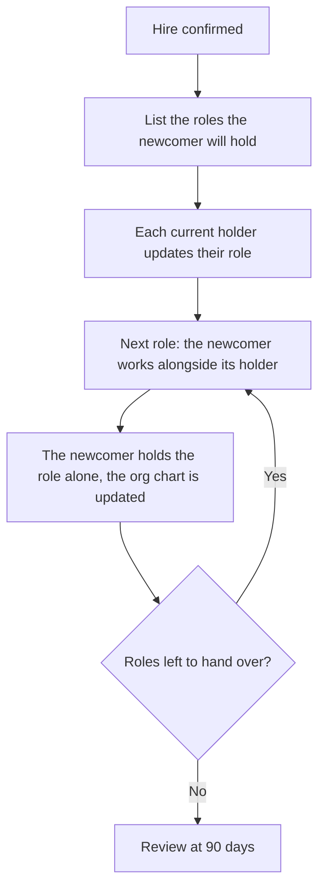
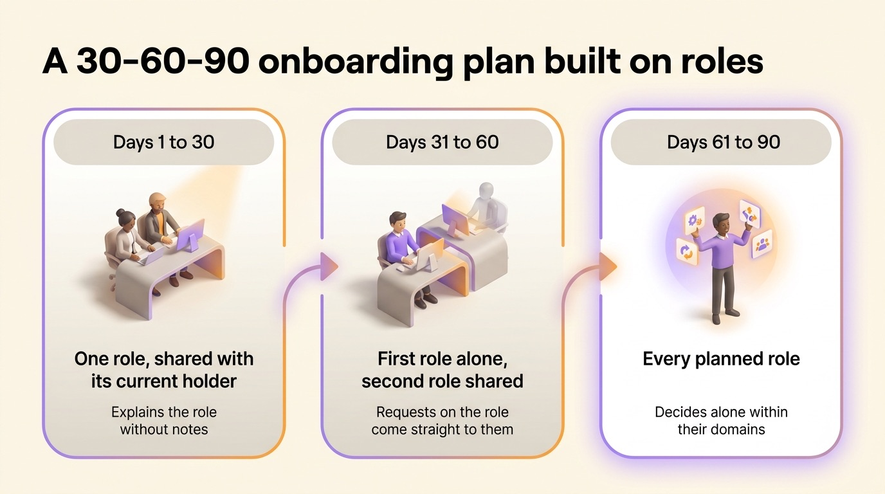
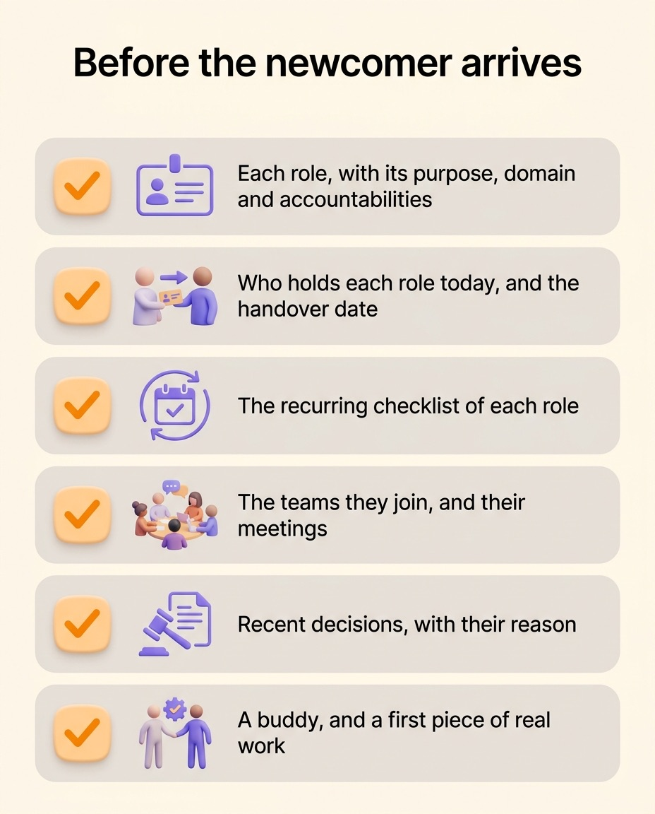

Onboarding a new employee means turning a hire into someone who knows what they are accountable for, who they work with and how decisions get made. The laptop, the accounts and the welcome lunch are the easy part. Most onboarding fails later, when the person understands the org chart and still cannot tell what colleagues expect from them. A role-based onboarding process fixes that by handing over roles, each with a written purpose and accountabilities, instead of a job title and a checklist. This article covers what to write before the person arrives, a 30-60-90 plan built on roles, who should own the process and how to tell whether it worked.

## What onboarding has to deliver

In Gallup's surveys, only 12% of employees strongly agree that their organization does a great job of onboarding new employees, a result that has barely moved in years. In the same research, 29% of new hires say onboarding left them fully prepared and supported to excel in their role.

The problem lies in the expectations more than in the welcome. In a Gallup survey from November 2024, just under half of US employees strongly agreed that they know what is expected of them at work, down from 56% in January 2020. A new hire is usually even less sure of what is expected of them, since everything they know about the job comes from an ad and a few interviews.

Talya Bauer, a management professor at Portland State University, split onboarding into four levels in a 2010 report for the SHRM Foundation:

- compliance, which covers the contract, the policies and the legal forms
- clarification, where the new hire learns what the job is and what is expected of them
- culture, the norms of the company, written and unwritten
- connection, the relationships a person needs to get work done

Most programs handle compliance well and connection fairly well. Clarification usually gets a job description and a meeting with the manager. Yet a new hire can work on their own after a month only if clarification went well. With written roles, clarification becomes a set of texts you hand over.

## A job title leaves a newcomer guessing their accountabilities

Nadia starts as a Customer Success Manager on a Monday. By Wednesday she has access to her tools, has met twelve people and has read the onboarding deck. Then a client emails to ask for a discount on their renewal. Can she grant it? Should she forward the email to sales? Who decides on discounts, and up to what amount?

None of what she received answers that. Her job title says where she sits in the org chart. Her job description lists "manages client relationships" and "contributes to retention", but neither line says which decisions are hers.

So she does what most newcomers do. She asks around, gets three different answers and picks the most cautious one. Most new hires spend their first three months this way: for each gray zone of the job, they find the boundary by trial and error, because nobody wrote it down.

A job description belongs to the employment contract. A role describes a piece of work: why it exists, what it decides alone and what other roles expect from it. Those three answers are what a newcomer looks for in their first week. They are also the main [difference between a role and a job description](/en/blog/roles-vs-job-descriptions).

## Onboarding as a role handover

In a team organized by roles, a hire takes over roles a colleague holds, roles that sat vacant, or roles the team created for them. Onboarding then works like a handover, so it goes wrong in the same places as a [project handover between teams](/en/blog/project-handovers): context stays in the previous holder's head, past decisions were never recorded, and people consider onboarding finished on the newcomer's first day.

A role handover runs in four steps:

1. List the roles the newcomer will hold, and who holds each one today.
2. Ask each current holder to reread their role and update its purpose, its domain, its accountabilities and its recurring checklist.
3. Hand the roles over one at a time. The current holder first does the work alongside the newcomer, then the newcomer takes the lead while the former holder stays available.
4. Update the org chart on the day a role actually changes hands.

Start with the role the rest of the team depends on most. A newcomer who holds it early gets feedback from colleagues within days. That feedback teaches them more about how the company works than any welcome session.

## A 30-60-90 plan built on roles

The 30-60-90 day plan is an onboarding classic. The usual version lists what the newcomer should learn by each date. A plan built on roles lists the roles they hold at each stage instead.

| Period | Roles held | What the newcomer does | Sign that it worked |
| --- | --- | --- | --- |
| Days 1 to 30 | One role, shared with its current holder | Reads every role they will hold, does the first one alongside its holder, joins the meetings of their teams | Explains the purpose and accountabilities of their first role without notes |
| Days 31 to 60 | The first role alone, the second one shared | Runs the recurring work of the first role, suggests the first changes to its text | Colleagues send requests on that role straight to them |
| Days 61 to 90 | Every planned role | Holds all their roles and proposes changes in a governance meeting when the work has drifted from the text | Decides alone within their domains, and asks about the rest |

Judge each stage by the sign that it worked. A goal like "learn the CRM by day 30" is met once the person has attended a training session. "Holds the Renewals role by day 60" means they handle renewals themselves, which tells you whether they can do the work.

{/* IMAGE regen: api.py image, infographic, 1600x900. Scene: "A horizontal infographic titled 'A 30-60-90 onboarding plan built on roles' in a modern clean bold sans-serif at the top. Below, a timeline with three rounded columns connected by a soft arrow from left to right. Column 1 header 'Days 1 to 30', a small icon of two people side by side at one desk, label 'One role, shared with its current holder', small caption 'Explains the role without notes'. Column 2 header 'Days 31 to 60', icon of one person at a desk with a second desk shared next to it, label 'First role alone, second role shared', caption 'Requests on the role come straight to them'. Column 3 header 'Days 61 to 90', icon of one person confidently holding several small role cards, label 'Every planned role', caption 'Decides alone within their domains'. Generous white space, columns in warm grey with purple and orange icons, the third column slightly highlighted in purple." */}

## Who owns the onboarding

By default, onboarding belongs to HR. HR is well placed for compliance and for the welcome, but it rarely knows the content of the roles a newcomer is about to take over. Clarification has to come from the people who do the work.

Give the process to a role instead, described like any other with a [purpose, a domain and accountabilities](/en/blog/roles-responsibilities-template). An Onboarding role can have the purpose "new joiners who ship something real in their first two weeks". Its domain covers the onboarding checklist and the first-week schedule. Its accountabilities are running the first-day session, pairing each joiner with a buddy and collecting feedback at thirty days. Whoever holds that role answers for the result, whatever their job title.

Buurtzorg, the Dutch home care organization, works this way with around 14,000 employees. Its nursing teams share a handful of roles on top of care itself, including a mentor role that handles onboarding. The roles rotate between team members, so onboarding passes from one person to another over time.

The other onboarding tasks are easy to assign. The current holder of each role runs its handover. The manager, when there is one, checks that the plan is realistic. HR keeps the contract, the payroll and the legal forms.

## What to document before the person arrives

Write the newcomer's roles and their context down before day one. The newcomer reads them in their first week, when they have the most time and no habits yet.

1. Each role they will hold, with an up-to-date purpose, domain and accountabilities. A role whose text no longer matches the work misleads more than a missing one.
2. Who holds each role today, and the date they hand it over.
3. The recurring checklist of each role, such as a weekly report or a monthly review.
4. The teams the newcomer joins, with their meetings and how often they happen.
5. The recent decisions that changed how these roles work, each with its reason.
6. The buddy's name, and the first piece of real work the newcomer will deliver.

If writing the roles takes the whole week before the arrival, you have found the real problem: the team was working without up-to-date roles long before the hire. To [define roles and responsibilities](/en/blog/define-roles), follow a simple format and avoid a few common mistakes.

{/* IMAGE regen: api.py image, infographic, 1200x1500. Scene: "A vertical checklist infographic titled 'Before the newcomer arrives' in a modern clean bold sans-serif at the top. Below, six rounded rows, each with a soft checkbox on the left, a simple icon and a short label. Row 1: icon of a role card with three lines, label 'Each role, with its purpose, domain and accountabilities'. Row 2: icon of two people passing a card, label 'Who holds each role today, and the handover date'. Row 3: icon of a small recurring calendar, label 'The recurring checklist of each role'. Row 4: icon of a group around a table, label 'The teams they join, and their meetings'. Row 5: icon of a gavel next to a note, label 'Recent decisions, with their reason'. Row 6: icon of two people side by side, label 'A buddy, and a first piece of real work'. Generous white space, rows in warm grey with purple icons and orange checkmarks." */}

## Measuring whether it worked

Time to productivity is hard to measure, so everyone estimates it their own way. Three checks at 30, 60 and 90 days give a clearer reading:

1. Ask the newcomer to explain, without notes, the purpose of each role they hold. If the answer is vague, reread the role's text too: it is often unclear itself.
2. Ask colleagues whether requests on those roles now go straight to the newcomer or still reach the former holder.
3. Count the changes the newcomer has proposed to their roles. Zero at day 90 usually means they do not read them, or do not feel allowed to change them.

At the 90-day check, add the first question of Gallup's engagement survey, "I know what is expected of me at work", on a scale of 1 to 5. A 4 or a 5 means clarification did its job.

## How Rolebase supports role-based onboarding

Rolebase covers clarification and leaves contracts, IT accounts and paperwork to your HR tools. Every role in its org chart carries a purpose, a domain, accountabilities, a checklist and indicators, so a team that keeps its roles up to date already has everything the newcomer needs to read before day one.

- A member's profile lists the roles they hold, so a newcomer sees at a glance what is theirs and what belongs to a colleague.
- Once you [invite a new member](/en/docs/members) by email and assign them to roles, the org chart shows the change right away.
- Meetings, tasks, discussions and decisions stay attached to the role they concern, so the next holder inherits the role's history along with it.
- The vacant roles list shows the work nobody holds yet, which often settles what a new hire should take on first.

Lonestone, a product studio of 35 people, [moved its roles out of Notion tables into Rolebase](/en/client-cases/lonestone), partly because newcomers struggled to find their way around those tables. Its newcomers now use the org chart to learn the scope of each colleague and each team. "After just one week, it's as if they had been with the company for years," says Pierrick Bignet, one of its co-founders.

{/* TODO ANECDOTE: describe how a Lonestone newcomer's first week runs with the org chart (which roles they read first, who hands them over, how long until they hold one alone). */}

## Frequently asked questions

<FaqList>

<FaqItem question="What is the process of onboarding?">

Onboarding is the process that turns a new hire into a productive member of the team. It covers four levels: compliance (contract and policies), clarification (what the job is and what is expected), culture (how the company works) and connection (the relationships the person needs). A role-based process handles clarification by handing over written roles, one at a time, from their current holders.

</FaqItem>

<FaqItem question="How long should onboarding a new employee take?">

Plan at least 90 days for the role handover. Full performance comes later, since Gallup estimates that new employees take around twelve months to reach their full potential in a role. The newcomer shares a first role from day one, during the paperwork and the introductions, and holds every planned role by day 90.

</FaqItem>

<FaqItem question="Who is responsible for onboarding new staff?">

HR owns compliance: the contract, the payroll and the legal forms. The content of the job comes from the people who do it. Give the process to an Onboarding role held by a named person. The current holder of each role hands it over to the newcomer.

</FaqItem>

<FaqItem question="What is the difference between onboarding and orientation?">

Orientation is a single event, usually on the first day: the welcome, the tour, the policies. Onboarding lasts months and ends when the person holds their roles alone. Orientation is one step of onboarding.

</FaqItem>

<FaqItem question="What should an employee onboarding checklist include?">

Before day one, write down each role the newcomer will hold with its purpose, domain and accountabilities, who holds each role today and when they hand it over, the recurring checklist of each role, the teams and meetings they join, the recent decisions that shaped their roles, and the name of their buddy.

</FaqItem>

</FaqList>

## Start with the next hire

Before your next hire arrives, open the roles they will take over and read them as if you were new. Wherever a sentence would leave you asking who decides, rewrite it: the next onboarding improves before the newcomer even arrives. Rolebase keeps those roles in an [org chart your whole team can read](/en/features), with every purpose, domain and accountability written down. You can [map your team's roles for free](/signup) with up to 5 active members.
