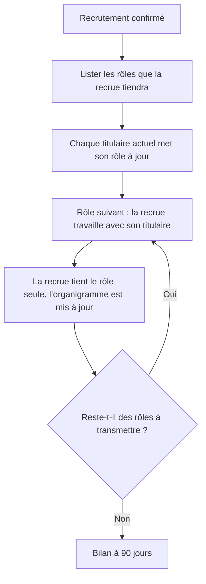
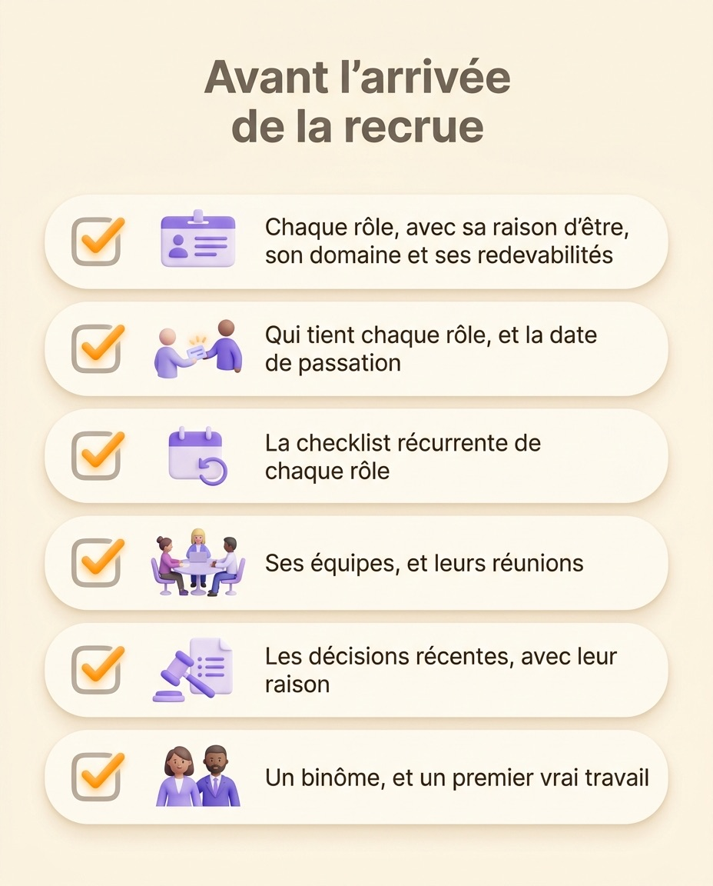

Intégrer un nouveau salarié, c’est faire d’une recrue quelqu’un qui sait de quoi il est redevable, avec qui il travaille et comment les décisions se prennent. L’ordinateur, les accès et le déjeuner d’accueil, c’est le plus simple. La plupart des intégrations échouent plus tard, quand la personne comprend l’organigramme sans savoir ce que ses collègues attendent d’elle. Une intégration construite sur les rôles règle ce problème : on transmet des rôles, chacun avec sa raison d’être et ses redevabilités écrites, là où la plupart des entreprises transmettent un intitulé de poste et une checklist. Cet article détaille quoi écrire avant l’arrivée, un plan 30-60-90 jours construit sur les rôles, qui doit piloter l’intégration et comment vérifier qu’elle a marché.

## À quoi doit servir une intégration

Dans les enquêtes de Gallup, seuls 12 % des salariés sont tout à fait d’accord pour dire que leur organisation intègre bien ses recrues, un chiffre qui bouge à peine depuis des années. Dans ces mêmes enquêtes, 29 % des recrues disent que leur intégration les a pleinement préparées et soutenues pour réussir dans leur poste.

Le problème tient aux attentes plus qu’à l’accueil. Dans une enquête Gallup de novembre 2024, un peu moins de la moitié des salariés américains étaient tout à fait d’accord avec la phrase « je sais ce qu’on attend de moi au travail », contre 56 % en janvier 2020. Une recrue sait en général encore moins ce qu’on attend d’elle, puisqu’elle ne connaît du poste qu’une annonce et quelques entretiens.

Talya Bauer, professeure de management à l’université d’État de Portland, a découpé l’intégration en quatre niveaux dans un rapport de 2010 pour la SHRM Foundation :

- la conformité, avec le contrat, le règlement et les formalités légales
- la clarification, où la recrue apprend en quoi consiste son travail et ce qu’on attend d’elle
- la culture, c’est-à-dire les normes de l’entreprise, écrites ou non
- la connexion, les relations dont la personne a besoin pour avancer

La plupart des programmes traitent bien la conformité et assez bien la connexion. La clarification se résume souvent à une fiche de poste et un rendez-vous avec le manager. Pourtant, une recrue ne travaille en autonomie au bout d’un mois que si la clarification a réussi. Avec des rôles écrits, la clarification devient un ensemble de textes à transmettre.

## Un intitulé de poste laisse la recrue deviner ses redevabilités

Nadia commence un lundi comme Customer Success Manager. Le mercredi, elle a ses accès, a rencontré douze personnes et a lu le livret d’accueil. Puis un client lui écrit pour demander une remise sur son renouvellement. Peut-elle l’accorder ? Doit-elle transférer le mail aux commerciaux ? Qui décide des remises, et jusqu’à quel montant ?

Rien de ce qu’elle a reçu ne répond à ces questions. Son intitulé de poste dit où elle se situe dans l’organigramme. Sa fiche de poste indique « gère la relation client » et « contribue à la fidélisation », mais aucune de ces lignes ne dit quelles décisions lui reviennent.

Elle fait donc comme la plupart des nouveaux arrivants. Elle demande autour d’elle, obtient trois réponses différentes et choisit la plus prudente. La plupart des recrues passent ainsi leurs trois premiers mois : pour chaque zone grise du poste, elles trouvent la limite à tâtons, parce que personne ne l’a écrite.

Une fiche de poste relève du contrat de travail. Un rôle décrit un travail : pourquoi il existe, ce qu’il décide seul et ce que les autres rôles attendent de lui. Ces trois réponses sont ce que cherche une recrue pendant sa première semaine. Elles font aussi la principale [différence entre un rôle et une fiche de poste](/fr/blog/roles-vs-job-descriptions).

## L’intégration, une passation de rôles

Dans une équipe organisée par rôles, une recrue reprend des rôles qu’un collègue tient, des rôles restés vacants ou des rôles créés pour elle. L’intégration devient alors une passation, qui coince aux mêmes endroits qu’une [passation de projet entre équipes](/fr/blog/project-handovers) : le contexte reste dans la tête de l’ancien titulaire, les décisions passées n’ont jamais été notées, et l’intégration passe pour terminée le jour où la recrue arrive.

Une passation de rôles se déroule en quatre étapes :

1. Listez les rôles que la recrue tiendra, et qui tient chacun d’eux aujourd’hui.
2. Demandez à chaque titulaire actuel de relire son rôle et de mettre à jour sa raison d’être, son domaine, ses redevabilités et sa checklist récurrente.
3. Transmettez les rôles un par un. Le titulaire actuel fait d’abord le travail avec la recrue, puis la recrue prend la main pendant que l’ancien titulaire reste disponible.
4. Mettez l’organigramme à jour le jour où un rôle change vraiment de mains.

Commencez par le rôle dont le reste de l’équipe dépend le plus. Une recrue qui le tient tôt reçoit des retours de ses collègues en quelques jours. Ces retours lui en apprennent plus sur le fonctionnement de l’entreprise qu’une session d’accueil.

## Un plan 30-60-90 jours construit sur les rôles

Le plan 30-60-90 jours est un classique de l’intégration. La version habituelle liste ce que la recrue doit apprendre à chaque échéance. Un plan construit sur les rôles liste plutôt les rôles qu’elle tient à chaque étape.

| Période | Rôles tenus | Le travail de la recrue | Le signe que ça a marché |
| --- | --- | --- | --- |
| Jours 1 à 30 | Un rôle, partagé avec son titulaire actuel | Lit tous les rôles qu’elle tiendra, fait le premier avec son titulaire, rejoint les réunions de ses équipes | Explique la raison d’être et les redevabilités de son premier rôle sans notes |
| Jours 31 à 60 | Le premier rôle seule, le deuxième partagé | Mène le travail récurrent du premier rôle, propose les premières modifications de son texte | Les collègues lui adressent directement les demandes sur ce rôle |
| Jours 61 à 90 | Tous les rôles prévus | Tient tous ses rôles et propose des modifications en réunion de gouvernance quand le travail s’écarte du texte | Décide seule dans ses domaines, et demande pour le reste |

Jugez chaque étape au signe que ça a marché. Un objectif comme « maîtriser le CRM à J+30 » est atteint dès que la personne a suivi une formation. « Tient le rôle Renouvellements à J+60 » veut dire qu’elle traite elle-même les renouvellements, ce qui vous dit si elle sait faire le travail.

{/* IMAGE regen: api.py image, infographic, 1600x900. Scene: "Une infographie horizontale titrée « Un plan 30-60-90 jours construit sur les rôles » en sans-serif moderne, gras et net, en haut. En dessous, une frise avec trois colonnes arrondies reliées par une flèche douce de gauche à droite. Colonne 1, en-tête « Jours 1 à 30 », petite icône de deux personnes côte à côte au même bureau, libellé « Un rôle, partagé avec son titulaire », légende « Explique le rôle sans notes ». Colonne 2, en-tête « Jours 31 à 60 », icône d’une personne à un bureau avec un second bureau partagé à côté, libellé « Premier rôle seule, deuxième partagé », légende « Les demandes sur le rôle lui arrivent directement ». Colonne 3, en-tête « Jours 61 à 90 », icône d’une personne sereine qui tient plusieurs petites cartes de rôle, libellé « Tous les rôles prévus », légende « Décide seule dans ses domaines ». Beaucoup d’espace, colonnes en gris chaud avec icônes violettes et orange, la troisième colonne légèrement mise en avant en violet." */}

## Qui pilote l’intégration

Par défaut, l’intégration revient aux RH. Les RH sont bien placées pour la conformité et l’accueil, mais elles connaissent rarement le contenu des rôles qu’une recrue va reprendre. La clarification doit venir des personnes qui font le travail.

Confiez plutôt le processus à un rôle, décrit comme les autres avec une [raison d’être, un domaine et des redevabilités](/fr/blog/roles-responsibilities-template). Un rôle Intégration peut avoir pour raison d’être « des nouveaux arrivants qui livrent un vrai travail en quinze jours ». Son domaine couvre la checklist d’intégration et le programme de la première semaine. Ses redevabilités sont d’animer la session du premier jour, d’associer chaque arrivant à un binôme et de recueillir un retour à trente jours. La personne qui tient ce rôle répond du résultat, quel que soit son intitulé de poste.

Buurtzorg, l’organisation néerlandaise de soins à domicile, fonctionne ainsi avec environ 14 000 salariés. Ses équipes d’infirmiers se partagent quelques rôles en plus du soin, dont celui de mentor, qui s’occupe de l’intégration. Les rôles tournent entre les membres de l’équipe, si bien que l’intégration passe d’une personne à l’autre au fil du temps.

Les autres tâches de l’intégration se répartissent facilement. Le titulaire actuel de chaque rôle en mène la passation. Le manager, quand il y en a un, vérifie que le plan est réaliste. Les RH gardent le contrat, la paie et les formalités.

## Les documents à préparer avant l’arrivée

Écrivez les rôles de la recrue et leur contexte avant le premier jour. Elle les lit pendant sa première semaine, quand elle a le plus de temps et pas encore d’habitudes.

1. Chaque rôle qu’elle tiendra, avec une raison d’être, un domaine et des redevabilités à jour. Un rôle dont le texte ne correspond plus au travail induit plus en erreur qu’un rôle absent.
2. Qui tient chaque rôle aujourd’hui, et la date de la passation.
3. La checklist récurrente de chaque rôle, comme un compte rendu hebdomadaire ou un bilan mensuel.
4. Les équipes qu’elle rejoint, avec leurs réunions et leur fréquence.
5. Les décisions récentes qui ont changé le fonctionnement de ces rôles, chacune avec sa raison.
6. Le nom de son binôme, et le premier vrai travail qu’elle livrera.

Si écrire les rôles prend toute la semaine qui précède l’arrivée, vous avez trouvé le vrai problème : l’équipe travaillait sans rôles à jour bien avant le recrutement. Pour [définir les rôles d’une équipe](/fr/blog/define-roles), suivez un format simple et évitez quelques erreurs courantes.

{/* IMAGE regen: api.py image, infographic, 1200x1500. Scene: "Une infographie verticale en forme de checklist titrée « Avant l’arrivée de la recrue » en sans-serif moderne, gras et net, en haut. En dessous, six lignes arrondies, chacune avec une case à cocher douce à gauche, une icône simple et un libellé court. Ligne 1 : icône d’une carte de rôle à trois lignes, libellé « Chaque rôle, avec sa raison d’être, son domaine et ses redevabilités ». Ligne 2 : icône de deux personnes qui se passent une carte, libellé « Qui tient chaque rôle, et la date de passation ». Ligne 3 : icône d’un petit calendrier récurrent, libellé « La checklist récurrente de chaque rôle ». Ligne 4 : icône d’un groupe autour d’une table, libellé « Ses équipes, et leurs réunions ». Ligne 5 : icône d’un marteau de décision à côté d’une note, libellé « Les décisions récentes, avec leur raison ». Ligne 6 : icône de deux personnes côte à côte, libellé « Un binôme, et un premier vrai travail ». Beaucoup d’espace, lignes en gris chaud avec icônes violettes et coches orange." */}

## Vérifier que l’intégration a marché

Le délai avant pleine productivité se mesure mal, si bien que chacun l’estime à sa façon. Trois vérifications à 30, 60 et 90 jours donnent une idée plus nette :

1. Demandez à la recrue d’expliquer sans notes la raison d’être de chacun de ses rôles. Si la réponse est floue, relisez aussi le texte du rôle : il manque souvent de clarté lui-même.
2. Demandez aux collègues si les demandes sur ces rôles vont maintenant directement à la recrue, ou passent encore par l’ancien titulaire.
3. Comptez les modifications que la recrue a proposées sur ses rôles. Zéro à 90 jours veut souvent dire qu’elle ne les lit pas, ou qu’elle ne se sent pas autorisée à les changer.

Au bilan des 90 jours, ajoutez la première question de l’enquête d’engagement de Gallup, « je sais ce qu’on attend de moi au travail », notée de 1 à 5. Un 4 ou un 5 indique que la clarification a fait son travail.

## Comment Rolebase aide à intégrer par les rôles

Rolebase couvre la clarification et laisse les contrats, les accès informatiques et les formalités à vos outils RH. Chaque rôle de son organigramme porte une raison d’être, un domaine, des redevabilités, une checklist et des indicateurs. Une équipe qui tient ses rôles à jour a donc déjà tout ce que la recrue doit lire avant le premier jour.

- La fiche d’un membre liste les rôles qu’il tient, si bien qu’une recrue voit d’un coup d’œil ce qui lui revient et ce qui revient à un collègue.
- Dès que vous [invitez un nouveau membre](/fr/docs/members) par e-mail et l’affectez à ses rôles, l’organigramme affiche le changement.
- Les réunions, les tâches, les discussions et les décisions restent rattachées au rôle qu’elles concernent : le titulaire suivant hérite ainsi de l’historique du rôle.
- La liste des rôles vacants montre le travail que personne ne tient encore, ce qui tranche souvent la question de ce qu’une recrue doit reprendre en premier.

Lonestone, un studio produit de 35 personnes, a [quitté ses tableaux Notion pour gérer ses rôles dans Rolebase](/fr/client-cases/lonestone), en partie parce que les nouveaux arrivants se repéraient mal dans ces tableaux. Ses recrues utilisent désormais l’organigramme pour découvrir le périmètre de chaque collègue et de chaque équipe. « Au bout d’une semaine, c’est comme s’ils avaient été dans l’entreprise depuis des années », raconte Pierrick Bignet, l’un de ses cofondateurs.

{/* TODO ANECDOTE: décrire la première semaine d’une recrue chez Lonestone avec l’organigramme (quels rôles elle lit en premier, qui les lui transmet, combien de temps avant d’en tenir un seule). */}

## Questions fréquentes

<FaqList>

<FaqItem question="En quoi consiste le processus d’intégration ?">

L’intégration fait d’une recrue un membre autonome de l’équipe. Elle couvre quatre niveaux : la conformité (contrat et règlement), la clarification (en quoi consiste le travail et ce qu’on attend de la personne), la culture (le fonctionnement de l’entreprise) et la connexion (les relations dont la personne a besoin). Une intégration par les rôles traite la clarification en faisant transmettre des rôles écrits, un par un, par leurs titulaires actuels.

</FaqItem>

<FaqItem question="Combien de temps doit durer l’intégration d’un nouveau salarié ?">

Prévoyez au moins 90 jours pour la passation des rôles. La pleine performance vient plus tard, puisque Gallup estime qu’un nouveau salarié met environ douze mois à atteindre son plein potentiel dans un poste. La recrue partage un premier rôle dès le premier jour, pendant les formalités et les présentations, puis tient tous les rôles prévus au 90e jour.

</FaqItem>

<FaqItem question="Qui est responsable de l’intégration des nouveaux salariés ?">

Les RH s’occupent de la conformité : le contrat, la paie et les formalités. Le contenu du travail vient de ceux qui le font. Confiez le processus à un rôle Intégration tenu par une personne nommée. Le titulaire actuel de chaque rôle en mène la passation.

</FaqItem>

<FaqItem question="Quelle différence entre accueil et intégration ?">

L’accueil est un moment unique, en général le premier jour : la bienvenue, la visite, le règlement. L’intégration dure des mois et se termine quand la personne tient ses rôles seule. L’accueil est une étape de l’intégration.

</FaqItem>

<FaqItem question="Que doit contenir une checklist d’intégration ?">

Avant le premier jour, écrivez chaque rôle que la recrue tiendra avec sa raison d’être, son domaine et ses redevabilités, qui tient chaque rôle aujourd’hui et quand il le transmet, la checklist récurrente de chaque rôle, les équipes et réunions qu’elle rejoint, les décisions récentes qui ont changé ses rôles et le nom de son binôme.

</FaqItem>

</FaqList>

## Commencez par la prochaine recrue

Avant l’arrivée de votre prochaine recrue, ouvrez les rôles qu’elle va reprendre et lisez-les comme si vous débarquiez. Si, en lisant une phrase, vous vous demandez qui décide, réécrivez-la : la prochaine intégration s’améliore avant même l’arrivée de la recrue. Rolebase garde ces rôles dans un [organigramme lisible par toute l’équipe](/fr/features), avec chaque raison d’être, chaque domaine et chaque redevabilité par écrit. Vous pouvez [cartographier les rôles de votre équipe gratuitement](/signup) jusqu’à 5 membres actifs.
