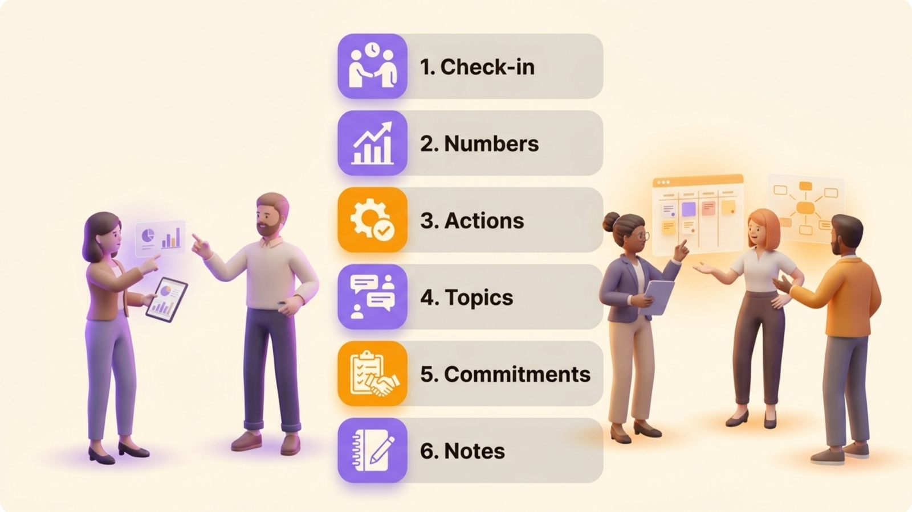
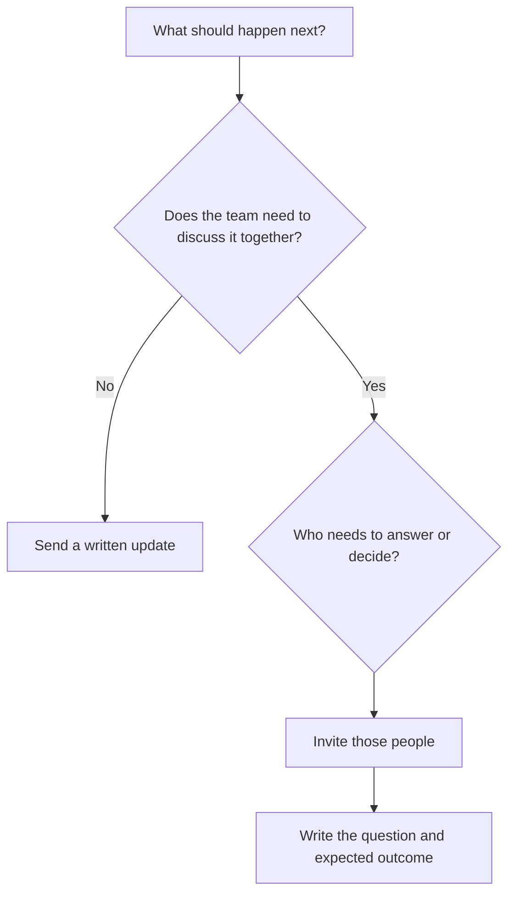
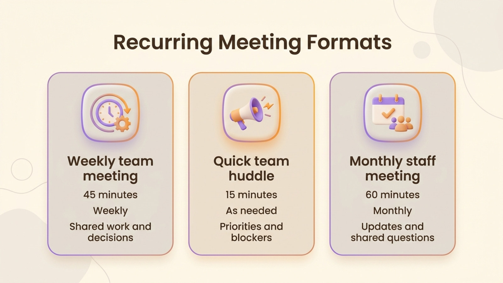

A staff meeting is a recurring meeting for the people who need to coordinate a department or team. It works when people need to solve a shared problem, make a decision or ask one another for help. Teams can share announcements and status updates in writing, saving the room for work that needs discussion. This page gives you a copyable **staff meeting agenda**, examples for three different meeting lengths and a way to keep the conversation focused on work that benefits from being together.

“Staff meeting” and “team meeting” often mean the same thing in everyday use. Choose the label that fits the group’s purpose. A department-wide meeting may include announcements or training, while a small weekly team meeting is usually better spent on blockers, decisions and commitments. Pick the format by asking who needs to contribute and what should be different when the meeting ends.

## What is a staff meeting for?

A staff meeting coordinates work that crosses people’s responsibilities. The group can clarify a priority, resolve a dependency, compare a shared measure or agree who will take the next step. The meeting should produce something the participants can use after they leave, such as a decision, a resolved blocker or an assigned action.

Use another channel for information that people only need to read. The Massachusetts Institute of Technology’s human-resources team recommends making the desired outcome, priority, time, owner and process visible for each item in its [meeting-agenda guidance](https://hr.mit.edu/learning-topics/meetings/articles/agendas). Physicians Wendy Henderson and Elizabeth Baltaro and nurse Cheryl H. Barker make a similar distinction in the American Academy of Family Physicians’ [advice for planning staff meetings](https://www.aafp.org/fpm/2025/0100/better-staff-meetings): a meeting helps when people need two-way communication or group discussion, while one-way updates can go out electronically.

Use this distinction to decide what belongs on the agenda. A sales number can be sent in advance. A sudden change in the number may deserve a discussion if the team needs to choose a response. A question about who owns the customer handoff belongs in the room when the people responsible for both sides can settle it.

## How often should you hold a staff meeting?

There is no universal weekly, monthly or daily cadence that suits every team. Meet often enough to handle shared work before delays build up, and keep the interval long enough for participants to have something new to discuss. A team in a fast-moving project may need a brief check-in more often than a stable department. A team that mostly works independently may need a written update and a less frequent meeting.

Start with the work, not the calendar. If people leave each meeting with no decision, action or useful exchange, test a longer interval or cancel the slot for a few weeks. If the same blocker waits until the next meeting, shorten the interval or make it easier to raise the issue asynchronously. Review the cadence after a few cycles rather than treating the invitation as permanent.

{/* TODO ANECDOTE: Add the measured average duration of Rolebase meetings and the share that end with a recorded decision or task, with the measurement period. Open owner question f837dd16-70d4-49b5-bbb9-91ef18aa12e3 already asks for these figures. */}

Duration follows the same rule. Book the time your agenda needs, then stop when that time ends. A 15-minute check-in suits a narrow question or a quick round of dependencies. A 45-minute weekly staff meeting can hold a short check-in, a few updates and two or three real discussion items. A monthly all-staff meeting may need more room for shared context and questions. Treat these durations as starting points. Choose a time that fits the group and the decisions it needs to make.

## A staff meeting agenda template to copy

Use this template for a weekly team meeting. Replace each question with a real topic, name who brings it, and state what the group should produce. Move routine updates into the pre-read, then use meeting time for exceptions and shared decisions. For an opening question, choose from these [check-in questions for a weekly meeting](/en/blog/meeting-icebreakers).

```text
Weekly staff meeting | [team]
Date and time: [date, time and time zone]
Facilitator: [name or role]
Notes: [name or role]
Purpose: [what the team needs to coordinate]

1. Check-in | 5 min | facilitator | what needs attention today?
2. Shared indicators | 5 min | [owner] | which change needs a response?
3. Open actions | 5 min | action owners | what is blocked or overdue?
4. Team topics | 20 min | [topic owner] | what question needs an answer?
5. Commitments | 5 min | facilitator | who will do what, by when?
6. Close | 5 min | everyone | what should carry into the next meeting?
```

The timing above is a 45-minute example. Adjust it to your group. Give each discussion item a question rather than a label such as “launch” or “hiring”. “Which launch date can we commit to?” tells participants what to prepare and lets the facilitator see when the item has an answer.

{/* IMAGE regen: api.py image, infographic, 1600x900. Scene: "A clear editorial infographic showing a six-part weekly team meeting agenda as a vertical sequence of six roomy numbered cards, with distinct simple icons and short, perfectly legible labels: 'Check-in', 'Numbers', 'Actions', 'Topics', 'Commitments', 'Notes'. Use a clean modern bold sans-serif. Show a small collaborative team around the sequence, warm cream background, warm grey cards, purple highlights on discussion and orange highlights on owners and next steps. No extra text. Landscape 16:9." Regenerate if the six agenda steps change. Last data sync: 2026-10-30. */}


The template separates reporting from discussion. People can update a checklist or a measure before the call, then bring only exceptions to the group. The agenda also leaves space for actions at the end, so a useful conversation does not disappear into someone’s notes.

## Three staff meeting formats

These three formats give you starting points. Adapt the example durations to your team.



| Format | Example duration and cadence | Who attends | What the agenda covers |
| --- | --- | --- | --- |
| Weekly team meeting | 45 minutes, weekly | People who share delivery or decisions | Check-in, exceptions in indicators, blockers, two or three questions, actions |
| Quick team huddle | 15 minutes, when the work needs frequent coordination | People whose tasks depend on one another | Immediate priorities, dependencies, requests for help, next check |
| Monthly staff meeting | 60 minutes, monthly | A department or the whole organization | New information, shared measures, questions, one or two topics for group discussion |

{/* IMAGE regen: api.py image, infographic, 1600x900. Scene: "A clear editorial comparison infographic with three side-by-side rounded cards for recurring meeting formats, legible exact labels and bold modern sans-serif. Card one: 'Weekly team meeting', '45 minutes', 'Weekly', 'Shared work and decisions'. Card two: 'Quick team huddle', '15 minutes', 'As needed', 'Priorities and blockers'. Card three: 'Monthly staff meeting', '60 minutes', 'Monthly', 'Updates and shared questions'. Each card has a small simple icon and subtle distinction in purple and orange accents. Warm cream background, generous whitespace, warm grey text, no extra text, landscape 16:9." Regenerate if the meeting formats or example durations change. Last data sync: 2026-10-30. */}


A quick huddle should stay quick. If a complicated issue appears, name the people who need to work on it and book a separate session. In a monthly meeting, discuss the most important question before announcements take over the time. For other meeting formats, use the [meeting agenda templates](/en/blog/meeting-agenda-template).

Copy and adapt either shorter agenda:

```text
15-minute huddle
1. Priorities and dependencies | 5 min
2. One blocker to resolve | 7 min
3. Owner and next check | 3 min

60-minute monthly staff meeting
1. Opening and purpose | 5 min
2. Shared updates and indicators | 15 min
3. One team question | 25 min
4. Questions from staff | 10 min
5. Decisions and actions | 5 min
```

## A filled-in example for a fictional product team

{/* TODO ANECDOTE: Replace this fictional agenda with a real weekly team meeting at Lonestone or another client who agrees to be named, including its cadence, duration, step order, facilitator and how the format changed. Open owner question 28f5279a-3c59-4708-9ab1-50969c1069a3 already requests these details. */}

The following fictional example shows how a five-person product team could use a 45-minute weekly meeting to coordinate a release. Maya facilitates, Leon takes notes and Priya brings the release question.

```text
Product team weekly | 45 minutes
Purpose: agree what is needed to ship the new onboarding flow

1. Check-in (5 min)
   Each person names one priority or blocker for the week.

2. Indicator (5 min)
   Priya reports that the test has fewer completed sign-ups than the team expected.
   The group parks the cause as a discussion item instead of guessing from the number.

3. Open actions (5 min)
   Leon has the copy review. He says the legal review is still waiting on one answer.
   Maya agrees to ask the legal contact and return with a date tomorrow.

4. Decision: what should the team change in the test? (20 min)
   Priya shares the results and asks whether to simplify the first screen.
   The team agrees to test a shorter form with the same required information.

5. Commitments (5 min)
   Priya updates the test. Leon checks the revised copy by Thursday.
   Maya confirms the legal answer by tomorrow.

6. Close (5 min)
   The team records the test change and brings the outcome to next week’s meeting.
```

The team uses the meeting to discuss exceptions rather than narrate every task. It brings the unexpected result and the unresolved dependency because those need other people’s input. Every follow-up has one owner and a date. If the test result only needed to be shared, Priya could send it in writing and remove the meeting item.

Capture the decision, its reason and its owner in the notes.

## Which staff meeting topics deserve the time?

A topic belongs in the meeting when the participants need to respond to one another. It can be a decision, a dependency, a problem with more than one possible cause or an issue that affects several roles. Write it as a question and identify the person who brings the facts.

These questions need the group to work out an answer together:

- Which of two deadlines should take priority when the same people own both?
- What is blocking a handoff between two teams, and who can remove the blocker?
- Which response should the team give to a customer issue that changes the plan?
- What should change after an indicator moves outside the expected range?
- Which work can pause so the team can handle an urgent commitment?
- What decision needs input from people with different responsibilities?
- What should the team try after the same problem has appeared more than once?

Send these updates in writing when nobody needs to discuss them together:

- A completed task with no effect on anyone else’s work
- A stable performance measure with no change that calls for a response
- A routine announcement with no decision or discussion attached
- A detailed project update that people can read before the meeting
- A question one person can answer without a group discussion

The [American Academy of Family Physicians’ staff-meeting guidance](https://www.aafp.org/fpm/2025/0100/better-staff-meetings) also recommends electronic updates when staff need information without a discussion. If a topic concerns two people, invite them to handle it together instead of bringing in the whole department.

## How to run a staff meeting without letting it drift

Name a facilitator and someone to capture notes. The facilitator keeps the group on the question, watches the time and makes sure quieter participants have room to contribute. The note-taker captures the outcome rather than transcribing every sentence. Rotating these responsibilities can prevent the same person from carrying the meeting process every week.

Share the agenda before the meeting. Atlassian’s advice on [effective team meeting agendas](https://www.atlassian.com/blog/teamwork/team-meeting-agenda) recommends tailoring the agenda to the meeting, prioritizing items and giving participants enough context to prepare. Keep a place where people can add topics, but ask them to explain the question and the outcome they need. “Customer feedback” is a topic. “Which part of onboarding should we change after these three customers got stuck?” is a question the team can answer.

During the meeting, follow the agenda and make changes in view of the group. If a new urgent topic appears, decide whether it replaces a lower-priority item or needs its own meeting. Save side conversations for a separate discussion when they do not help answer the current question. A facilitator can ask the topic owner to restate the decision or next action when discussion becomes circular.

Record decisions and commitments as they happen. Each action needs one owner and a date. “The team will review this” leaves the next step unclear. “Jordan will compare the two options by Friday” gives the group something to check. End by reading back the actions and naming which items carry over.

Begin the next meeting by reviewing the previous meeting’s actions before turning to new updates. If the same item carries over several times, ask whether the owner needs help, whether the deadline still matters or whether the group has avoided a decision.

## Five habits that make staff meetings feel empty

1. **Reading every status update aloud.** Share the information before the meeting and discuss changes or exceptions together.
2. **Inviting people by default.** Ask who needs to contribute to each outcome. Send the notes to people who only need to stay informed.
3. **Writing vague topics.** Replace “budget” with the question the team needs to answer and the outcome it needs.
4. **Letting one item use the whole slot.** Give the item a time allowance, then agree to schedule a deeper session if the issue needs more work.
5. **Leaving actions without owners.** Give each commitment one person or role and a date. Check it at the next meeting.

A meeting can still be useful when the team needs more information before deciding. It should at least clarify what is unknown, who will find out and when the group will revisit it. Otherwise, the team has spent shared time without changing what it knows or does.

## Run recurring staff meetings in Rolebase

Rolebase is an open-source platform for teams that want roles, meetings and decisions in one place. A meeting belongs to a role, and its template gives the group a repeatable sequence of steps. Available step types include a speaking round, checklist, indicators, tasks and discussions. Teams can reorder, add or remove steps to fit their meeting.

A team can schedule a meeting to recur, connect meetings to Google Calendar or Office 365, or share an iCal feed with a calendar app. During the meeting, participants can review work and record notes. When the meeting ends, Rolebase stores a summary with notes and outcomes from the steps, tasks created or updated and decisions made in discussions. Explore the [Rolebase meeting features](/en/features) for the exact workflow.

Keep each meeting’s recurring structure, notes and follow-up together so people can find what happened and continue the work. You can [create a free Rolebase account](/signup) for up to five active members.

## Frequently asked questions

<FaqList>

<FaqItem question="What is the purpose of a staff meeting?">

A staff meeting lets a team coordinate work that needs discussion across people, such as resolving a blocker, making a shared decision or agreeing on priorities. Send one-way updates in writing and use the meeting for questions that need people to respond to one another.

</FaqItem>

<FaqItem question="How often should staff meetings be held?">

Choose the cadence based on how quickly shared work changes and how often people need to coordinate. A weekly meeting is one common starting point, but a team may need a shorter huddle, a monthly meeting or written updates instead. Review whether the meeting produces decisions, useful discussion or owned actions.

</FaqItem>

<FaqItem question="What should be included in a staff meeting agenda?">

Include the meeting’s purpose, date, facilitator, topic owner, time allowance and the outcome each item needs. A weekly agenda can cover a brief check-in, important exceptions, open actions, a few discussion questions and a closing review of decisions and next steps.

</FaqItem>

<FaqItem question="What is another word for a staff meeting?">

A team meeting, department meeting, staff huddle or weekly team point may describe a similar gathering. Choose the name that tells participants who is invited and what work the meeting covers.

</FaqItem>

<FaqItem question="What is the difference between a staff meeting and a tactical meeting?">

A staff meeting is a broad term for a team or department meeting, with a format chosen by the group. A Holacracy tactical meeting follows a defined process for moving current work forward, while a staff meeting can use a flexible agenda.

</FaqItem>

</FaqList>

## Give the next meeting a clear outcome

Choose one recurring meeting and rewrite its agenda items as questions. Move routine updates into a written note, invite the people who can answer the questions, then end by recording each decision and action with an owner and a date. If a team needs a stable meeting template, recurring schedule and follow-up beside its roles, [explore Rolebase’s meeting features](/en/features) or [start free](/signup) with up to five active members.
