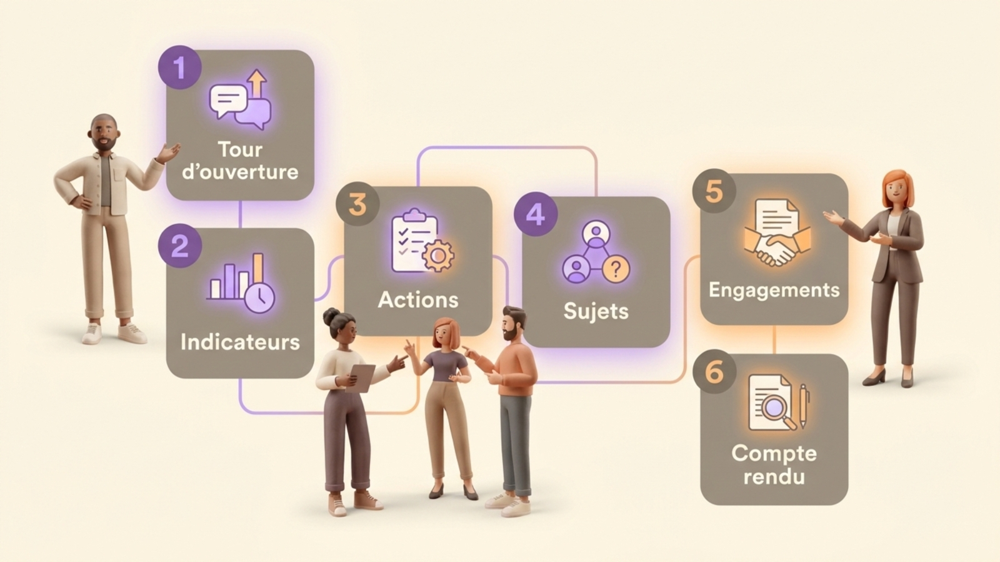
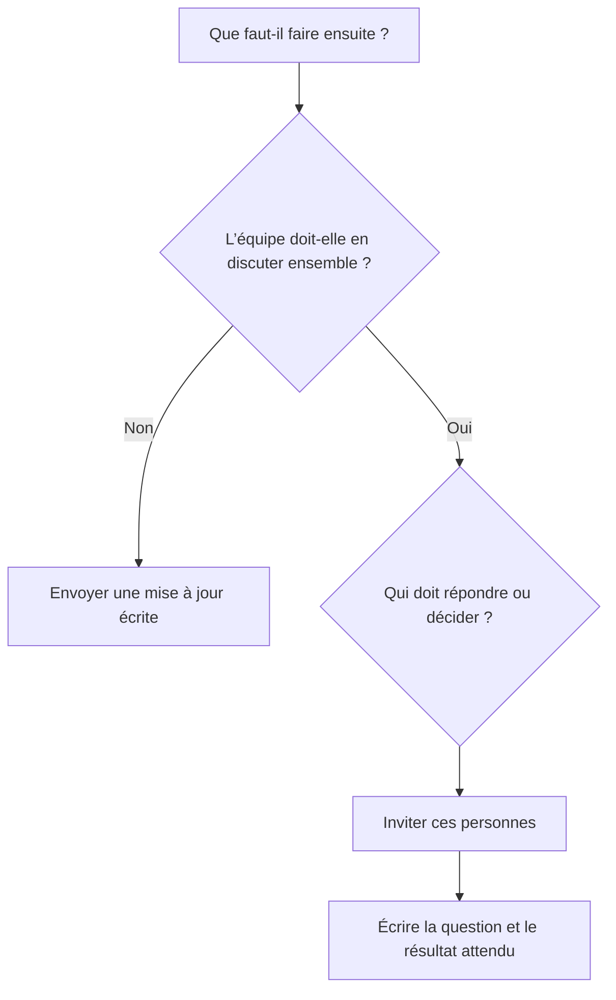
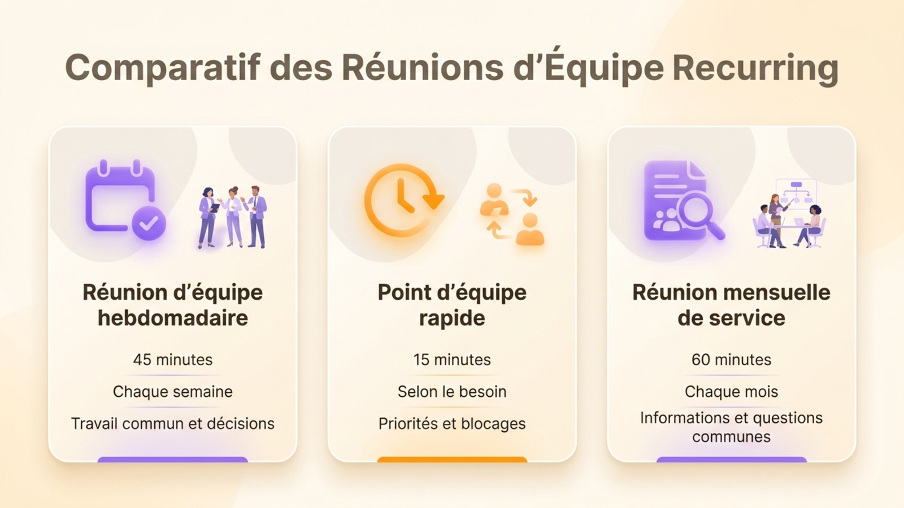

Une **réunion d’équipe** sert à coordonner le travail de personnes qui dépendent les unes des autres. Elle est utile quand l’équipe doit résoudre un blocage, prendre une décision commune ou demander de l’aide. Envoyez les annonces et les comptes rendus d’activité par écrit, puis gardez la réunion pour le travail qui demande une discussion. Voici un **ordre du jour de réunion d’équipe** à copier, trois exemples de formats et une méthode pour garder la séance centrée sur le travail collectif.

L’expression « réunion d’équipe » peut aussi désigner une réunion de service ou un point hebdomadaire. Choisissez le nom qui correspond au groupe invité et au résultat attendu. Une réunion de service peut traiter une annonce qui concerne tout le monde, tandis qu’un point d’équipe court gagne à se concentrer sur les blocages, les décisions et les engagements. Choisissez le format en vous demandant qui doit contribuer et ce qui doit avoir changé à la fin.

## À quoi sert une réunion d’équipe ?

Une réunion d’équipe coordonne le travail qui traverse les responsabilités de plusieurs personnes. Le groupe peut clarifier une priorité, résoudre une dépendance, comparer un indicateur commun ou décider qui prend la suite. La séance doit produire quelque chose dont les participants se serviront ensuite, par exemple une décision, un blocage levé ou une action attribuée.

Le service des ressources humaines du Massachusetts Institute of Technology recommande de rendre visibles le résultat attendu, la priorité, la durée, la personne responsable et le déroulé de chaque point dans ses [conseils pour préparer un ordre du jour](https://hr.mit.edu/learning-topics/meetings/articles/agendas). La médecin Wendy Henderson, l’infirmière Cheryl H. Barker et la médecin Elizabeth Baltaro font une distinction proche dans les [conseils de l’American Academy of Family Physicians pour les réunions d’équipe](https://www.aafp.org/fpm/2025/0100/better-staff-meetings) : une réunion sert les échanges dans les deux sens et la discussion collective, tandis qu’une information à sens unique peut être envoyée par voie électronique.

Cette différence aide à choisir les sujets. L’équipe peut recevoir les chiffres de vente par écrit. Si leur évolution impose de choisir une réponse, le sujet mérite du temps en réunion. Une question sur la répartition d’un passage de relais entre deux équipes se traite avec les personnes responsables des deux côtés, qui peuvent décider ensemble.

## À quelle fréquence se réunir ?

Aucune fréquence ne convient à toutes les équipes. Réunissez-vous assez souvent pour traiter le travail commun avant que les retards s’accumulent, et espacez les séances pour que les participants aient de nouveaux éléments à partager. Une équipe engagée dans un projet qui évolue vite peut avoir besoin d’un bref point régulier. Une équipe dont les membres travaillent de façon autonome peut privilégier l’écrit et se réunir moins souvent.

Partez du travail, pas de l’habitude. Si personne ne repart avec une décision, une action ou un échange utile, essayez d’espacer les séances ou de suspendre le créneau pendant quelques semaines. Si un même blocage attend la réunion suivante, raccourcissez l’intervalle ou ouvrez un canal pour le signaler entre deux séances. Après quelques cycles, vérifiez si le rythme aide vraiment l’équipe.

{/* TODO ANECDOTE : Ajouter la durée moyenne mesurée des réunions Rolebase et la part de celles qui se terminent par une décision ou une tâche enregistrée, avec la période observée. La question ouverte f837dd16-70d4-49b5-bbb9-91ef18aa12e3 demande déjà ces chiffres. */}

La durée se décide de la même façon. Réservez le temps nécessaire à l’ordre du jour et terminez à l’heure. Un point de 15 minutes convient à une question précise ou à un tour rapide sur les dépendances. Une réunion hebdomadaire de 45 minutes peut accueillir un tour d’ouverture, quelques indicateurs et deux ou trois sujets qui demandent une vraie discussion. Une réunion mensuelle de service peut demander plus de temps pour partager des informations et répondre aux questions. Adaptez ces exemples au groupe et aux décisions à prendre.

## Un modèle d’ordre du jour à copier

Ce modèle convient à une réunion d’équipe hebdomadaire. Remplacez chaque question par un sujet réel, nommez la personne qui l’amène et précisez le résultat voulu. Envoyez les nouvelles de routine avant la séance, puis réservez la réunion aux exceptions et aux décisions communes. Pour le tour d’ouverture, piochez une [question de check-in pour la réunion hebdomadaire](/fr/blog/meeting-icebreakers).

```text
Réunion d’équipe hebdomadaire | [équipe]
Date et heure : [date, heure et fuseau horaire]
Animation : [nom ou rôle]
Compte rendu : [nom ou rôle]
Objet : [ce que l’équipe doit coordonner]

1. Tour d’ouverture | 5 min | animation | qu’est-ce qui demande notre attention ?
2. Indicateurs partagés | 5 min | [responsable] | quelle évolution appelle une réponse ?
3. Actions en cours | 5 min | responsables | qu’est-ce qui bloque ou reste en retard ?
4. Sujets de l’équipe | 20 min | [personne qui porte le sujet] | quelle question faut-il trancher ?
5. Engagements | 5 min | animation | qui fait quoi, et pour quand ?
6. Clôture | 5 min | tout le monde | que faut-il reprendre la prochaine fois ?
```

Le minutage donne un exemple de séance de 45 minutes. Ajustez-le à votre équipe. Écrivez chaque sujet sous forme de question plutôt que de noter un mot comme « lancement » ou « recrutement ». « Quelle date de lancement pouvons-nous tenir ? » indique aux participants ce qu’ils doivent préparer et permet à la personne qui anime de voir quand la question a reçu une réponse.

{/* IMAGE regen: api.py image, infographic, 1600x900. Scene: "A clear editorial infographic showing a six-part weekly team meeting agenda as a vertical sequence of six roomy numbered cards, with distinct simple icons and short, perfectly legible French labels: 'Tour d’ouverture', 'Indicateurs', 'Actions', 'Sujets', 'Engagements', 'Compte rendu'. Use a clean modern bold sans-serif. Show a small collaborative team around the sequence, warm cream background, warm grey cards, purple highlights on discussion and orange highlights on owners and next steps. No extra text. Landscape 16:9." Regenerate if the six agenda steps change. Last data sync: 2026-10-30. */}


Ce modèle sépare les informations de la discussion. Les membres peuvent mettre à jour une liste ou un chiffre avant la séance, puis amener au groupe les exceptions. La dernière étape réserve un temps aux actions, pour que les échanges utiles ne se perdent pas dans des notes personnelles.

## Trois formats de réunion d’équipe

Le tableau propose trois points de départ. Adaptez ces durées d’exemple à votre équipe.



| Format | Exemple de durée et de fréquence | Participants | Contenu de l’ordre du jour |
| --- | --- | --- | --- |
| Réunion d’équipe hebdomadaire | 45 minutes, chaque semaine | Personnes qui partagent le travail ou les décisions | Tour d’ouverture, exceptions dans les indicateurs, blocages, deux ou trois questions, actions |
| Point d’équipe rapide | 15 minutes, quand le travail exige une coordination fréquente | Personnes dont les tâches dépendent les unes des autres | Priorités immédiates, dépendances, demandes d’aide, prochain point |
| Réunion mensuelle de service | 60 minutes, une fois par mois | Un service ou toute l’organisation | Informations nouvelles, chiffres communs, questions, un ou deux sujets à discuter |

{/* IMAGE regen: api.py image, infographic, 1600x900. Scene: "A clear editorial comparison infographic with three side-by-side rounded cards for recurring meeting formats, legible exact French labels and bold modern sans-serif. Card one: 'Réunion d’équipe hebdomadaire', '45 minutes', 'Chaque semaine', 'Travail commun et décisions'. Card two: 'Point d’équipe rapide', '15 minutes', 'Selon le besoin', 'Priorités et blocages'. Card three: 'Réunion mensuelle de service', '60 minutes', 'Chaque mois', 'Informations et questions communes'. Each card has a small simple icon and subtle distinction in purple and orange accents. Warm cream background, generous whitespace, warm grey text, no extra text, landscape 16:9." Regenerate si les formats ou les durées d’exemple changent. Dernière mise à jour des données : 2026-10-30. */}


Un point rapide doit rester rapide. Si un problème complexe apparaît, nommez les personnes qui doivent y travailler et prévoyez une séance dédiée. Pendant une réunion mensuelle, traitez la question importante avant que les annonces ne prennent toute la place. Le [modèle d’ordre du jour avec des exemples par type de réunion](/fr/blog/meeting-agenda-template) donne d’autres formats à reprendre.

Copiez et adaptez l’un de ces ordres du jour plus courts :

```text
Point d’équipe de 15 minutes
1. Priorités et dépendances | 5 min
2. Un blocage à résoudre | 7 min
3. Responsable et prochain point | 3 min

Réunion mensuelle de service de 60 minutes
1. Ouverture et objet | 5 min
2. Informations et indicateurs partagés | 15 min
3. Une question d’équipe | 25 min
4. Questions des participants | 10 min
5. Décisions et actions | 5 min
```

## Un exemple rempli pour une équipe produit fictive

{/* TODO ANECDOTE: Remplacer cet ordre du jour fictif par celui d’une réunion d’équipe hebdomadaire réelle de Lonestone ou d’un autre client qui accepte d’être cité, avec sa fréquence, sa durée, l’ordre des étapes, l’animation et l’évolution du format. La question ouverte 28f5279a-3c59-4708-9ab1-50969c1069a3 demande déjà ces détails. */}

L’exemple suivant est fictif. Il montre comment une équipe produit de cinq personnes pourrait utiliser une réunion de 45 minutes pour coordonner une livraison. Maya anime la séance, Léon prend les notes et Priya apporte la question sur la mise en ligne.

```text
Réunion hebdomadaire de l’équipe produit | 45 minutes
Objet : s’accorder sur ce qu’il faut pour livrer le nouveau parcours d’inscription

1. Tour d’ouverture (5 min)
   Chacun nomme une priorité ou un blocage pour la semaine.

2. Indicateur (5 min)
   Priya signale que le test produit moins d’inscriptions terminées qu’attendu.
   L’équipe ajoute la recherche de la cause aux sujets à traiter au lieu de la deviner.

3. Actions en cours (5 min)
   Léon relit le texte, mais attend une réponse pour la validation juridique.
   Maya contacte la personne concernée et revient avec une date demain.

4. Décision : que changer dans le test ? (20 min)
   Priya présente les résultats et demande si l’équipe doit simplifier le premier écran.
   L’équipe décide d’essayer un formulaire plus court avec les mêmes informations requises.

5. Engagements (5 min)
   Priya modifie le test. Léon relit le texte avant jeudi.
   Maya confirme la réponse juridique demain.

6. Clôture (5 min)
   L’équipe note le changement et reprend le résultat à la réunion suivante.
```

L’équipe discute des exceptions au lieu de raconter l’avancement de chaque tâche. Elle apporte le résultat inattendu et la dépendance non résolue, car ces deux sujets demandent l’avis d’autres personnes. Chaque suite porte un nom et une date. Si le chiffre du test avait seulement besoin d’être communiqué, Priya aurait pu l’envoyer par écrit et retirer ce point de la réunion.

Notez la décision, sa raison et la personne chargée de la suite dans le compte rendu.

## Quels sujets méritent une réunion ?

Un sujet mérite le temps du groupe quand les participants doivent se répondre. Il peut s’agir d’une décision, d’une dépendance, d’un problème qui a plusieurs causes possibles ou d’une question qui concerne plusieurs rôles. Formulez-le comme une question et nommez la personne qui apporte les faits.

Ces questions demandent au groupe de construire une réponse ensemble :

- Quelle échéance passe en premier quand les mêmes personnes portent deux livraisons ?
- Qu’est-ce qui bloque le passage de relais entre deux équipes, et qui peut le débloquer ?
- Quelle réponse donner à un problème client qui change le plan de travail ?
- Que faut-il faire quand un indicateur sort de la plage habituelle ?
- Quel travail peut attendre pendant que l’équipe tient un engagement urgent ?
- Quelle décision demande l’avis de personnes aux responsabilités différentes ?
- Que faut-il essayer quand le même problème revient plusieurs fois ?

Envoyez ces nouvelles par écrit quand personne n’a besoin d’en discuter ensemble :

- Une tâche terminée qui ne change le travail de personne d’autre
- Un indicateur stable, sans évolution qui appelle une réponse
- Une annonce de routine qui n’entraîne aucune décision
- Un état détaillé du projet que chacun peut lire avant la réunion
- Une question à laquelle une seule personne peut répondre

Les médecins Wendy Henderson et Elizabeth Baltaro et l’infirmière Cheryl H. Barker, dans leurs [conseils sur les réunions d’équipe](https://www.aafp.org/fpm/2025/0100/better-staff-meetings) publiés par l’American Academy of Family Physicians, recommandent eux aussi les mises à jour électroniques quand le personnel a seulement besoin d’accéder à une information. Si un sujet concerne deux personnes, invitez-les à le traiter ensemble plutôt que de réunir tout le service.

## Comment animer une réunion d’équipe

Nommez une personne pour animer et une autre pour prendre les notes. La personne qui anime garde le groupe sur la question, surveille le temps et fait une place aux personnes qui parlent moins. La personne qui note garde le résultat et laisse de côté la transcription de chaque phrase. Vous pouvez faire tourner ces responsabilités pour que la même personne ne porte pas chaque semaine toute l’organisation de la réunion.

Envoyez l’ordre du jour avant la séance. Dans ses conseils sur [l’ordre du jour d’une réunion d’équipe](https://www.atlassian.com/blog/teamwork/team-meeting-agenda), Atlassian recommande d’adapter le modèle à la réunion, de choisir les priorités et de donner aux participants de quoi se préparer. Laissez un espace pour ajouter des sujets, mais demandez à chacun d’expliquer la question et le résultat attendu. « Retour client » nomme un thème. « Quelle partie du parcours faut-il changer après que trois clients se sont arrêtés ? » pose une question à laquelle l’équipe peut répondre.

Pendant la séance, suivez l’ordre du jour et décidez ensemble des changements. Si un nouveau sujet urgent arrive, choisissez s’il remplace un point moins prioritaire ou s’il exige une autre réunion. Mettez de côté les apartés qui n’aident pas à répondre à la question actuelle. Quand la discussion tourne en rond, la personne qui anime peut demander au porteur du sujet de reformuler la décision ou l’action attendue.

Notez les décisions et les engagements au fur et à mesure. Chaque action a un responsable unique et une date. « L’équipe va regarder » laisse la suite dans le flou. « Jordan compare les deux options d’ici vendredi » donne au groupe un résultat à vérifier. Terminez en relisant les actions et en nommant les sujets reportés.

La réunion suivante commence par les actions de la précédente, plutôt que par un nouveau tour où chacun raconte sa semaine. Quand le même sujet revient plusieurs fois, demandez si la personne responsable a besoin d’aide, si la date reste utile ou si le groupe peut prendre une décision.

## Cinq habitudes qui vident une réunion de son intérêt

1. **Lire chaque mise à jour à voix haute.** Envoyez les informations avant la séance et discutez ensemble des changements ou des exceptions.
2. **Inviter tout le monde par défaut.** Demandez qui doit contribuer à chaque résultat. Envoyez le compte rendu aux personnes qui ont seulement besoin de l’information.
3. **Écrire des thèmes vagues.** Remplacez « budget » par la question à laquelle le groupe doit répondre et le résultat attendu.
4. **Laisser un sujet prendre toute la séance.** Donnez-lui une durée, puis prévoyez une discussion plus longue si le problème exige du travail supplémentaire.
5. **Laisser les actions sans responsable.** Attribuez chaque engagement à une personne ou à un rôle et fixez une date. Faites le point à la réunion suivante.

Une réunion reste utile quand l’équipe doit obtenir des informations avant de décider. Elle doit au moins clarifier ce qui manque, qui va chercher l’information et quand le groupe reprendra le sujet. Sinon, les participants ont passé du temps ensemble sans changer ce qu’ils savent ni ce qu’ils font.

## Organiser des réunions récurrentes dans Rolebase

Rolebase est une plateforme open source pour les équipes qui veulent réunir rôles, réunions et décisions dans un même outil. Une réunion appartient à un rôle et son modèle donne au groupe une suite d’étapes réutilisable. Les étapes disponibles comprennent un tour de parole, une liste de contrôle, des indicateurs, des tâches et des discussions. L’équipe peut les réordonner, en ajouter ou en retirer selon son déroulé.

Une équipe peut programmer une réunion récurrente, relier ses réunions à Google Calendar ou Office 365, ou partager un flux iCal avec une application d’agenda. Pendant la réunion, les participants peuvent examiner le travail et prendre des notes. À la fin, Rolebase conserve un résumé avec les notes et les résultats des étapes, les tâches créées ou mises à jour et les décisions prises dans les discussions. Découvrez le [fonctionnement des réunions dans Rolebase](/fr/features) pour voir le parcours exact.

Conservez ensemble le déroulé récurrent, les notes et les suites, pour que chacun retrouve ce qui s’est passé et poursuive le travail. Vous pouvez [créer un compte Rolebase gratuit](/signup) jusqu’à cinq membres actifs.

## Questions fréquentes

<FaqList>

<FaqItem question="À quoi sert une réunion d’équipe ?">

Une réunion d’équipe sert à coordonner un travail qui demande des échanges entre plusieurs personnes, par exemple pour lever un blocage, prendre une décision commune ou fixer des priorités. Envoyez les simples informations par écrit et gardez la réunion pour les sujets où les participants doivent se répondre.

</FaqItem>

<FaqItem question="À quelle fréquence organiser une réunion d’équipe ?">

Choisissez la fréquence en fonction du rythme du travail partagé et du besoin de coordination. Une réunion hebdomadaire est un point de départ courant, mais l’équipe peut préférer un point court, une réunion mensuelle ou des nouvelles écrites. Vérifiez si chaque séance produit des décisions, une discussion utile ou des actions attribuées.

</FaqItem>

<FaqItem question="Que mettre dans l’ordre du jour d’une réunion d’équipe ?">

Indiquez l’objet de la réunion, sa date, la personne qui l’anime, le responsable de chaque sujet, le temps prévu et le résultat attendu. Un ordre du jour hebdomadaire peut prévoir un tour d’ouverture, les exceptions importantes, les actions en cours, quelques questions à discuter et une relecture des décisions et des prochaines étapes.

</FaqItem>

<FaqItem question="Comment appelle-t-on aussi une réunion d’équipe ?">

On parle aussi de réunion de service, de point d’équipe, de réunion hebdomadaire ou de brief d’équipe. Choisissez un nom qui indique aux participants qui doit venir et quel travail la réunion traite.

</FaqItem>

<FaqItem question="Quelle différence entre une réunion d’équipe et une réunion tactique ?">

« Réunion d’équipe » désigne largement une réunion de groupe ou de service, dont l’équipe choisit le déroulé. Une réunion tactique en holacratie suit un processus défini pour faire avancer le travail courant, tandis qu’une réunion d’équipe peut garder un déroulé libre.

</FaqItem>

</FaqList>

## Donnez un résultat clair à votre prochaine réunion

Choisissez une réunion récurrente et reformulez ses points sous forme de questions. Envoyez les nouvelles de routine par écrit, invitez les personnes capables de répondre, puis notez chaque décision et chaque action avec un responsable et une date. Si votre équipe souhaite garder ses modèles, ses réunions récurrentes et leurs suites à côté des rôles, [découvrez les réunions dans Rolebase](/fr/features) ou [créez un compte gratuit](/signup) jusqu’à cinq membres actifs.
