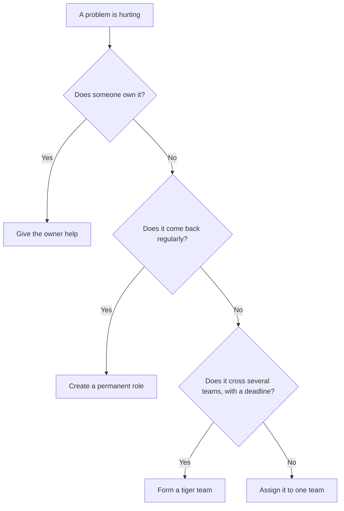
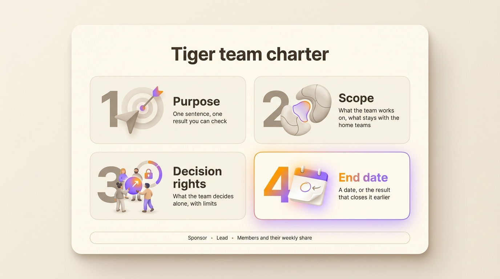
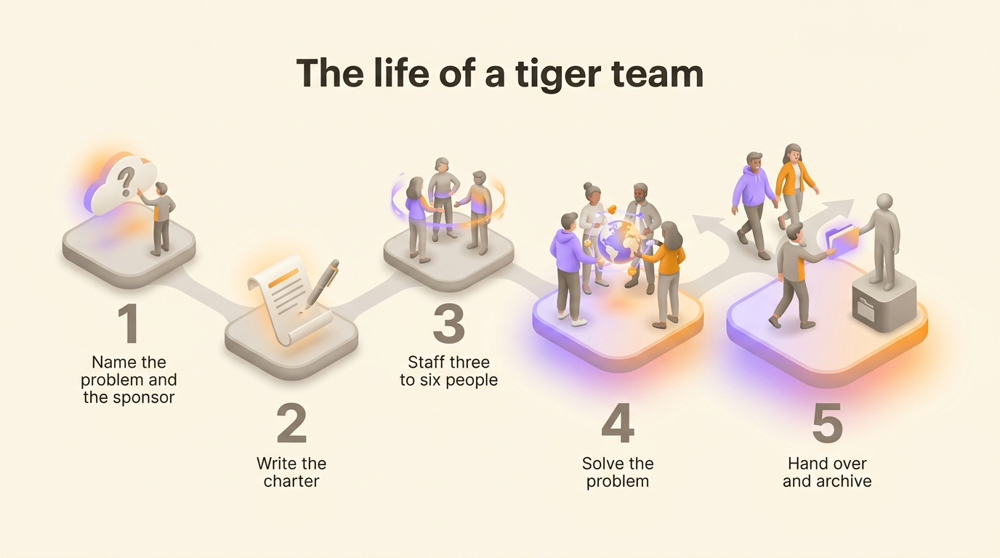

A tiger team is a small group of specialists taken out of their usual teams to solve one specific, urgent problem, then disbanded once the problem is solved. Most of the tiger teams that go wrong were given a problem and nothing else. The ones that work start from four written lines: a purpose, a scope, the decisions the team makes alone, and an end date. This article covers where the term comes from, when a tiger team is the right answer, how to staff it, what to write in its charter and how to close it.

## What a tiger team is

A tiger team has four features that separate it from an ordinary project team. It is small, usually three to six people. Its members come from different disciplines, chosen for what the problem needs. It works on one problem. It is temporary, so its members go back to their teams when the problem is solved.

The term has a second meaning in security. A security tiger team is paid to attack its own organization's defences, physical or digital, to find the weaknesses before someone else does. Most companies now call that a red team. The rest of this article is about the first meaning, the temporary group of troubleshooters.

## Where the term comes from

The earliest written definition dates from 1964. Walter C. Williams, who had directed flight operations for NASA's Mercury program, sat on a panel at an aerospace reliability conference whose proceedings the Society of Automotive Engineers published under the title *Program Management in Design and Development*. Asked how to keep spacecraft reliable on a compressed schedule, he described a tiger team as "a team of undomesticated and uninhibited technical specialists, selected for their experience, energy, and imagination, and assigned to track down relentlessly every possible source of failure in a spacecraft subsystem or simulation".

Apollo 13 made the term famous. In April 1970 an oxygen tank exploded in the spacecraft's service module, two days into the flight. Gene Kranz, the NASA flight director on duty, pulled his shift of controllers, the White Team, off the console rotation so they could work on one question, how to bring three astronauts home with the power, water and oxygen that remained. The press called them the Tiger Team. The crew splashed down four days later. The Apollo 13 mission operations team received the Presidential Medal of Freedom for that rescue.

US government agencies then borrowed the term. From 1989 to 1992, the US Department of Energy under its secretary James Watkins sent tiger teams to assess 35 of its facilities for compliance with environment, safety and health rules. Software companies picked it up later for incidents, migrations and launches that are going badly.

## When a tiger team is the right answer, and when it is not

Form a tiger team when these four conditions hold together:

- the problem crosses several teams, so no single team can fix it alone
- nobody owns it today
- waiting has a cost that grows every week
- the cause is still unknown, so the work starts with finding it

A payment failure that involves the mobile app, the billing service and the payment provider fits. So does a security incident, a failed migration, or a customer about to leave because of a defect that three teams each see one part of.

Three situations look similar and call for something else. When the problem already has an owner, give that person help and leave the ownership where it is. When the same problem comes back every quarter, your structure is missing a permanent role. A temporary team only hides that gap for a few weeks. When the real complaint is that normal decisions take too long, a tiger team speeds up one decision and leaves every other one as slow as before. In that case, write down who decides what.

## How to staff a tiger team

Keep the team small. J. Richard Hackman, a Harvard psychologist who studied teams for four decades, told *Harvard Business Review* in 2009 that his rule of thumb was no double digits, and that he never allowed more than six people on a team in his own courses. Fred Brooks, who managed the development of IBM's OS/360, gave the reason in *The Mythical Man-Month* in 1975. Each person added to a late project has to be brought up to speed by the people already on it. The number of conversations needed also grows faster than the headcount.

1. **Pick people by what the problem needs.** List the systems, customers and skills the problem touches, then find one person for each. Seniority and availability are poor selection criteria.
2. **Name one lead.** The lead runs the meetings, reports to the sponsor and makes the call when the team is split. The lead has no authority over the members outside the tiger team.
3. **State the share of each person's week.** Write "three days a week until 30 November" next to each name. Then agree with each home team what that person stops doing in the meantime, and who covers it.

A tiger team usually makes enemies when it skips the agreement with the home teams. The members keep their roles in their home teams, so each of them has two teams asking for the same week. [A matrix structure](/en/blog/matrix-organizational-structure) creates that tension permanently.

## The charter: purpose, scope, decision rights, end date

A tiger team is a temporary role with people in it. Write it like any other role, with [a purpose, a domain and accountabilities](/en/blog/define-roles), and add the one line a permanent role never needs, the date it ends. The charter fits on half a page.

1. **Purpose.** Write one sentence with a result someone can check. "Bring failed mobile payments back under 1% of attempts."
2. **Scope.** Say what the team works on and what stays with the home teams. "The checkout flow on iOS and Android. Pricing and the web checkout stay where they are."
3. **Decision rights.** List what the team decides without asking anyone, with limits attached. "May roll back any release of the checkout service. May spend up to 5,000 euros on tooling. A change to the payment provider contract goes to the sponsor."
4. **End date.** Give a date and the result that closes the team earlier. "30 November, or as soon as the failure rate has stayed under 1% for two weeks."

Add the sponsor, the lead, and each member with their weekly share. Then settle how the team decides internally. Waiting for everyone to agree is too slow when the team has a week to act. With [consent decision making](/en/blog/consent-decision), a proposal passes as soon as nobody has a reasoned objection to it.

{/* IMAGE regen: api.py image, infographic, 1600x900. Scene: "A one-page charter template shown as a single large rounded sheet of paper lying flat, seen from straight above, on a plain light warm cream background. At the top of the sheet, the title in modern clean bold sans-serif: 'Tiger team charter'. Below the title, four wide rounded cards stacked in a 2x2 grid, each with a large numeral and a short heading in bold, then one line of smaller text. Card 1, numeral '1', heading 'Purpose', line 'One sentence, one result you can check'. Card 2, numeral '2', heading 'Scope', line 'What the team works on, what stays with the home teams'. Card 3, numeral '3', heading 'Decision rights', line 'What the team decides alone, with limits'. Card 4, numeral '4', heading 'End date', line 'A date, or the result that closes it earlier'. Card 4 is the highlighted one, with a small calendar icon. Under the grid, a thin footer strip with three small labels separated by dots: 'Sponsor', 'Lead', 'Members and their weekly share'. No other text anywhere. Generous margins, flat clean layout, soft drop shadow under the sheet." */}

## Tiger team vs task force vs squad vs war room

The four terms get used for one another although they describe different things.

| | Tiger team | Task force | Squad | War room |
|---|---|---|---|---|
| What it is | A small group of specialists on one urgent problem | A larger group studying a broad question | A permanent product team | A place and a way of working |
| Size | Three to six people | Often ten or more, with representatives from each department | Fewer than eight people | Whoever needs to be in the room |
| Lifespan | Days to a few months | Months, sometimes a year | Open-ended | Hours to days |
| Output | The problem solved | A recommendation someone else carries out | A product area that keeps improving | Faster coordination during an incident |
| Authority | Decides inside its charter | Advises a decision maker | Decides on its own product area | Stays with the teams in the room |
| It ends when | The result is reached or the date arrives | The report is delivered | The mission is retired | The incident is closed |

The squad comes from Spotify. In 2012 the agile coaches Henrik Kniberg and Anders Ivarsson described it in *Scaling Agile @ Spotify* as a small self-organizing team of fewer than eight people with a long-term mission. A war room is a room or a chat channel where the people handling an incident sit together. A tiger team often works from one.

## How to dissolve a tiger team without losing what it learned

A tiger team that ends well leaves three things behind: the problem solved, a written account of what it found, and a permanent owner for everything that still needs doing.

1. **Hold a closing review against the charter.** Read the purpose again and say whether the result was reached. When a team reaches its date without its result, the sponsor decides whether to extend it with a new date or to stop it.
2. **Write down what the team found.** Record the cause, the fix, what was tried and dropped, and the decisions made along the way with their reasons. Two pages are enough.
3. **Hand every remaining duty to a permanent role.** If someone has to keep monitoring a system or calling a supplier, make that an accountability of an existing role, or of a new role if none fits. The method for [handing a project over between teams](/en/blog/project-handovers) applies here.
4. **Send the members back on a stated date.** Tell each home team when their colleague returns full time.
5. **Archive the team.** Keep its charter, its decisions and its notes where the next tiger team can read them.

{/* IMAGE regen: api.py image, infographic, 1600x900. Scene: "A horizontal timeline of five steps, read left to right, drawn as five rounded stepping-stone platforms connected by a soft curved path, seen in gentle isometric view. Above the path, the title in modern clean bold sans-serif: 'The life of a tiger team'. Each platform carries a large numeral and, underneath it, a short label. Step 1, numeral '1', label 'Name the problem and the sponsor'. Step 2, numeral '2', label 'Write the charter'. Step 3, numeral '3', label 'Staff three to six people'. Step 4, numeral '4', label 'Solve the problem'. Step 5, numeral '5', label 'Hand over and archive'. A small group of four soft 3D figures stands together on platform 4. On platform 5 the same four figures walk away in different directions, and one hands a folder to a figure standing on a permanent base. Platform 5 is the highlighted one. No other text anywhere. Generous margins." */}

## Common failure modes

**The team has no mandate.** It is told to "look into" the problem and finds out in week two that it cannot change anything without three approvals. A charter with decision rights prevents that.

**The team never ends.** The problem is half solved, the weeks go by and the team keeps meeting out of habit. Six months later it is a department nobody decided to create. With an end date in the charter, the sponsor has to decide on that day whether to extend or stop.

**People are taken without an agreement.** The best engineer of each team disappears for a month, so the home teams miss their own commitments. Agree the trade with each home team before the tiger team starts, in writing.

**The same people are picked every time.** When every emergency calls on the same four people, the organization depends on them and nobody else learns. Add one person who has never been on a tiger team to each new one.

## Setting a tiger team up in Rolebase

In [Rolebase](/en/features), a tiger team is a role like any other. You create it in the org chart with its purpose, its domain and its accountabilities, then you add the lead and the members as roles inside it. Each member keeps their roles in their home team, so the org chart shows both at once. When the work is done, archiving the role keeps its history and everything inside it.

<OrgChartView demo="demo" height="440px" showAllNodes={false} />

## Frequently asked questions

<FaqList>

<FaqItem question="What is a tiger team?">

A tiger team is a small group of specialists taken out of their usual teams to solve one specific, urgent problem, then disbanded once the problem is solved. It usually has three to six members from different disciplines, a named lead and a sponsor. The term also names a security team paid to attack its own organization's defences, which most companies now call a red team.

</FaqItem>

<FaqItem question="Why is it called a tiger team?">

The earliest written definition comes from the proceedings of a 1964 aerospace conference, *Program Management in Design and Development*, in which Walter C. Williams, who had directed flight operations for NASA's Mercury program, described "a team of undomesticated and uninhibited technical specialists" assigned to track down every possible source of failure in a spacecraft. The image is a group that hunts a problem relentlessly. The term became widely known in 1970, when the press gave the name to the flight controllers who brought Apollo 13 home.

</FaqItem>

<FaqItem question="What is the difference between a tiger team and a task force?">

A tiger team is small and solves an urgent problem itself, with authority to act inside its charter. A task force is larger, studies a broader question over months and usually delivers a recommendation that someone else carries out. Choose a tiger team when the problem is narrow and waiting is costly. Choose a task force when the question needs a view from every department.

</FaqItem>

<FaqItem question="How many people should a tiger team have?">

Three to six people is the usual range. The Harvard psychologist J. Richard Hackman, who studied teams for four decades, capped the teams in his own courses at six and gave "no double digits" as his rule of thumb. Above that size, the time spent keeping everyone informed grows faster than the work done.

</FaqItem>

<FaqItem question="How long should a tiger team last?">

A tiger team lasts from a few days to a few months. Its charter names the end date before work starts. A team that needs more than a quarter is usually dealing with a permanent need, which calls for a permanent role or team.

</FaqItem>

<FaqItem question="What does a tiger team do in software development?">

In software, a tiger team is formed for a production incident nobody can explain, a migration that is slipping, a security breach or a performance problem that involves several services. It brings together one engineer per system involved, finds the cause, ships the fix and hands the follow-up to the teams that own those systems.

</FaqItem>

</FaqList>

## Where to start

Take the cross-team problem that has been on the agenda of three meetings this month. Write its charter in four lines: the purpose, the scope, the decisions the team makes alone and the end date. If the purpose takes more than one sentence, split the problem before you form a team.

[Create a free account on Rolebase](/signup) to add that tiger team to your org chart as a role, with its members and its decisions attached. The free plan covers five active members, with no card required. You can also see [everything the platform does](/en/features).
