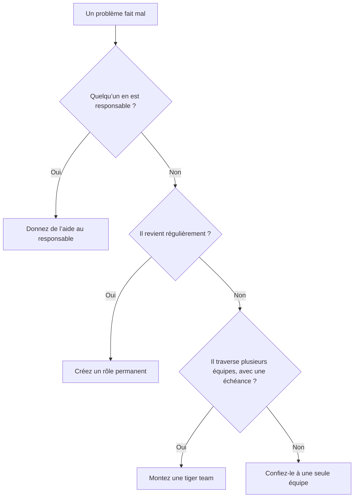
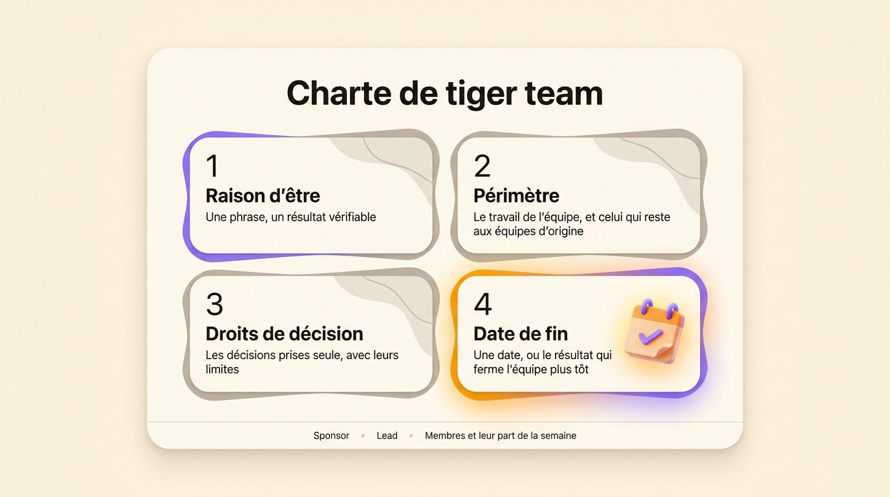
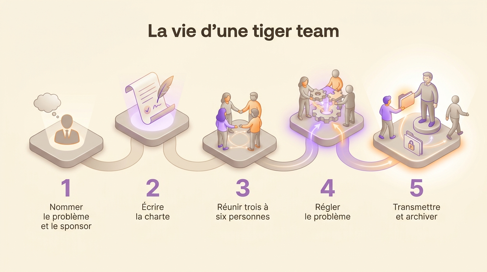

Une tiger team est un petit groupe de spécialistes sortis de leurs équipes habituelles pour régler un problème précis et urgent, puis dissous une fois le problème réglé. La plupart des tiger teams qui tournent mal ont reçu un problème et rien d’autre. Celles qui marchent partent de quatre lignes écrites : une raison d’être, un périmètre, les décisions que l’équipe prend seule et une date de fin. Cet article explique d’où vient le terme, dans quels cas une tiger team est la bonne réponse, comment la composer, quoi écrire dans sa charte et comment la fermer.

## Définition d’une tiger team

Une tiger team se distingue d’une équipe projet ordinaire sur quatre points. Elle est petite, entre trois et six personnes en général. Ses membres viennent de métiers différents, choisis selon les besoins du problème. Elle travaille sur un seul problème. Elle est temporaire, donc ses membres retournent dans leurs équipes quand le problème est réglé.

Le terme a un second sens en sécurité. Une tiger team de sécurité est payée pour attaquer les défenses de sa propre organisation, physiques ou informatiques, et trouver les failles avant quelqu’un d’autre. La plupart des entreprises parlent aujourd’hui de red team. La suite de l’article porte sur le premier sens, celui du groupe temporaire chargé de résoudre un problème.

## L’origine du terme : l’aérospatial américain

La première définition écrite date de 1964. Walter C. Williams, qui avait dirigé les opérations de vol du programme Mercury de la NASA, participe à une table ronde lors d’une conférence sur la fiabilité aérospatiale, dont la Society of Automotive Engineers publie les actes sous le titre *Program Management in Design and Development*. On lui demande comment garder un vaisseau fiable avec un calendrier serré. Il décrit alors la tiger team comme « une équipe de spécialistes techniques indomptés et sans inhibitions, choisis pour leur expérience, leur énergie et leur imagination, et chargés de traquer sans relâche toute source possible de défaillance dans un sous-système ou une simulation du vaisseau ».

Apollo 13 a rendu le terme célèbre. En avril 1970, un réservoir d’oxygène explose dans le module de service du vaisseau, deux jours après le décollage. Gene Kranz, le directeur de vol de la NASA alors en poste, sort son équipe de contrôleurs, la White Team, de la rotation des consoles pour qu’elle travaille sur une seule question : comment ramener trois astronautes avec l’électricité, l’eau et l’oxygène qui restent. La presse la surnomme la Tiger Team. L’équipage amerrit quatre jours plus tard. L’équipe des opérations de la mission Apollo 13 reçoit la médaille présidentielle de la Liberté pour ce sauvetage.

Les administrations américaines ont ensuite repris le terme. De 1989 à 1992, le département de l’Énergie des États-Unis, sous son secrétaire James Watkins, envoie des tiger teams vérifier que 35 de ses sites respectent les règles d’environnement, de sécurité et de santé. Les entreprises du logiciel l’ont adopté plus tard pour les incidents, les migrations et les lancements qui se passent mal.

## Quand monter une tiger team, et quand s’en passer

Montez une tiger team quand ces quatre conditions sont réunies :

- le problème traverse plusieurs équipes, donc aucune ne peut le régler seule
- personne n’en est responsable aujourd’hui
- attendre coûte plus cher chaque semaine
- la cause reste inconnue, donc le travail commence par la chercher

Un échec de paiement qui implique l’application mobile, le service de facturation et le prestataire de paiement entre dans ce cas. C’est aussi le cas d’un incident de sécurité, d’une migration ratée, ou d’un client prêt à partir à cause d’un défaut dont trois équipes voient chacune un morceau.

Trois situations y ressemblent et demandent autre chose. Quand le problème a déjà un responsable, donnez-lui de l’aide et laissez-lui la responsabilité. Quand le même problème revient chaque trimestre, il manque un rôle permanent dans votre structure. Une équipe temporaire cache ce manque pendant quelques semaines seulement. Quand on se plaint surtout de la lenteur des décisions courantes, une tiger team accélère une décision et laisse toutes les autres aussi lentes qu’avant. Dans ce cas, écrivez qui décide quoi.

## Composer une tiger team

Gardez l’équipe petite. J. Richard Hackman, psychologue à Harvard qui a étudié les équipes pendant quarante ans, expliquait à la *Harvard Business Review* en 2009 qu’il avait pour règle de rester sous les dix personnes, et qu’il refusait les équipes de plus de six dans ses propres cours. Fred Brooks, qui a dirigé le développement d’OS/360 chez IBM, en a donné la raison dans *The Mythical Man-Month* en 1975. Chaque personne ajoutée à un projet en retard doit être mise à niveau par celles qui y travaillent déjà. Le nombre de conversations nécessaires augmente aussi plus vite que l’effectif.

1. **Choisissez les personnes selon les besoins du problème.** Listez les systèmes, les clients et les compétences que le problème touche, puis trouvez une personne pour chacun. L’ancienneté et la disponibilité sont de mauvais critères.
2. **Nommez un seul lead.** Le lead anime les réunions, rend compte au sponsor et tranche quand l’équipe est partagée. Il n’a aucune autorité sur les membres en dehors de la tiger team.
3. **Écrivez la part de la semaine de chaque personne.** Notez « trois jours par semaine jusqu’au 30 novembre » à côté de chaque nom. Convenez ensuite avec chaque équipe d’origine de ce que cette personne arrête de faire entre-temps, et de la personne qui reprend ce travail.

Une tiger team se fait en général des ennemis quand elle saute l’accord avec les équipes d’origine. Les membres gardent leurs rôles dans leur équipe d’origine, donc chacun reçoit les demandes de deux équipes pour la même semaine. [Une structure matricielle](/fr/blog/matrix-organizational-structure) installe cette tension en permanence.

## La charte : raison d’être, périmètre, droits de décision, date de fin

Une tiger team est un rôle temporaire avec des personnes dedans. Écrivez-la comme n’importe quel rôle, avec [une raison d’être, un domaine et des redevabilités](/fr/blog/define-roles), et ajoutez la ligne dont un rôle permanent n’a jamais besoin, sa date de fin. La charte tient sur une demi-page.

1. **La raison d’être.** Écrivez une phrase avec un résultat que quelqu’un peut vérifier. « Ramener les paiements mobiles en échec sous 1 % des tentatives. »
2. **Le périmètre.** Dites sur quoi l’équipe travaille et ce qui reste aux équipes d’origine. « Le parcours de paiement sur iOS et Android. Les tarifs et le paiement sur le web restent où ils sont. »
3. **Les droits de décision.** Listez les décisions que l’équipe prend sans demander à personne, avec leurs limites. « Peut annuler n’importe quelle mise en production du service de paiement. Peut dépenser jusqu’à 5 000 euros en outillage. Une modification du contrat avec le prestataire de paiement passe par le sponsor. »
4. **La date de fin.** Donnez une date et le résultat qui ferme l’équipe plus tôt. « Le 30 novembre, ou dès que le taux d’échec est resté sous 1 % pendant deux semaines. »

Ajoutez le sponsor, le lead et chaque membre avec sa part de la semaine. Réglez ensuite la façon dont l’équipe décide en interne. Attendre que tout le monde soit d’accord prend trop de temps quand l’équipe a une semaine pour agir. Avec la [décision par consentement](/fr/blog/consent-decision), une proposition passe dès que personne n’a d’objection argumentée.

{/* IMAGE regen: api.py image, infographic, 1600x900. Scene: "A one-page charter template shown as a single large rounded sheet of paper lying flat, seen from straight above, on a plain background. At the top of the sheet, the title in modern clean bold sans-serif: 'Charte de tiger team'. Below the title, four wide rounded cards stacked in a 2x2 grid, each with a large numeral and a short heading in bold, then one line of smaller text. Card 1, numeral '1', heading 'Raison d’être', line 'Une phrase, un résultat vérifiable'. Card 2, numeral '2', heading 'Périmètre', line 'Le travail de l’équipe, et celui qui reste aux équipes d’origine'. Card 3, numeral '3', heading 'Droits de décision', line 'Les décisions prises seule, avec leurs limites'. Card 4, numeral '4', heading 'Date de fin', line 'Une date, ou le résultat qui ferme l’équipe plus tôt'. Card 4 is the highlighted one, with a small calendar icon. Under the grid, a thin footer strip with three small labels separated by dots: 'Sponsor', 'Lead', 'Membres et leur part de la semaine'. No other text anywhere. Generous margins, flat clean layout, soft drop shadow under the sheet." */}

## Tiger team, task force, squad et war room : les différences

On emploie ces quatre termes l’un pour l’autre alors qu’ils désignent des choses différentes.

| | Tiger team | Task force | Squad | War room |
|---|---|---|---|---|
| Nature | Un petit groupe de spécialistes sur un problème urgent | Un groupe plus large qui étudie une question vaste | Une équipe produit permanente | Un lieu et une façon de travailler |
| Taille | Trois à six personnes | Souvent dix ou plus, avec des représentants de chaque direction | Moins de huit personnes | Les personnes utiles dans la salle |
| Durée | De quelques jours à quelques mois | Des mois, parfois un an | Sans limite | De quelques heures à quelques jours |
| Résultat | Le problème réglé | Une recommandation que d’autres appliquent | Un périmètre produit qui s’améliore en continu | Une coordination plus rapide pendant un incident |
| Autorité | Décide dans les limites de sa charte | Conseille un décideur | Décide sur son périmètre produit | Reste aux équipes présentes |
| Fin | Le résultat est atteint ou la date arrive | Le rapport est remis | La mission est abandonnée | L’incident est clos |

La squad vient de Spotify. En 2012, les coachs agiles Henrik Kniberg et Anders Ivarsson la décrivent dans *Scaling Agile @ Spotify* comme une petite équipe auto-organisée de moins de huit personnes, avec une mission de long terme. Une war room est une salle ou un canal de discussion où les personnes qui traitent un incident travaillent ensemble. Une tiger team s’y installe souvent.

## Dissoudre une tiger team en gardant ce qu’elle a appris

Une tiger team qui se termine bien laisse trois choses : le problème réglé, un compte rendu écrit de ses découvertes et un responsable permanent pour tout le travail qui continue.

1. **Faites une revue de clôture avec la charte sous les yeux.** Relisez la raison d’être et dites si le résultat est atteint. Quand une équipe arrive à sa date sans son résultat, le sponsor décide de la prolonger avec une nouvelle date ou de l’arrêter.
2. **Écrivez ce que l’équipe a trouvé.** Notez la cause, la correction, les pistes essayées puis abandonnées, et les décisions prises en route avec leurs raisons. Deux pages suffisent.
3. **Confiez chaque tâche restante à un rôle permanent.** Si quelqu’un doit poursuivre la surveillance ou rappeler un fournisseur, inscrivez cette tâche dans les redevabilités d’un rôle existant, ou d’un nouveau rôle si aucun ne convient. La méthode pour [passer un projet d’une équipe à une autre](/fr/blog/project-handovers) s’applique ici.
4. **Renvoyez les membres dans leurs équipes à une date annoncée.** Dites à chaque équipe d’origine quand son collègue revient à plein temps.
5. **Archivez l’équipe.** Gardez sa charte, ses décisions et ses notes là où la prochaine tiger team pourra les lire.

{/* IMAGE regen: api.py image, infographic, 1600x900. Scene: "A horizontal timeline of five steps, read left to right, drawn as five rounded stepping-stone platforms connected by a soft curved path, seen in gentle isometric view. Above the path, the title in modern clean bold sans-serif: 'La vie d’une tiger team'. Each platform carries a large numeral and, underneath it, a short label. Step 1, numeral '1', label 'Nommer le problème et le sponsor'. Step 2, numeral '2', label 'Écrire la charte'. Step 3, numeral '3', label 'Réunir trois à six personnes'. Step 4, numeral '4', label 'Régler le problème'. Step 5, numeral '5', label 'Transmettre et archiver'. A small group of four soft 3D figures stands together on platform 4. On platform 5 the same four figures walk away in different directions, and one hands a folder to a figure standing on a permanent base. Platform 5 is the highlighted one. No other text anywhere. Generous margins." */}

## Les échecs les plus fréquents

**L’équipe n’a pas de mandat.** On lui demande de « regarder » le problème, puis elle découvre la deuxième semaine qu’elle a besoin de trois validations pour changer quoi que ce soit. Une charte avec des droits de décision évite cette situation.

**L’équipe ne s’arrête jamais.** Le problème est à moitié réglé, les semaines passent et l’équipe continue de se réunir par habitude. Six mois plus tard, elle est devenue un service que personne n’a décidé de créer. Avec une date de fin dans la charte, le sponsor doit décider ce jour-là de prolonger ou d’arrêter.

**Les personnes sont prises sans accord.** Le meilleur ingénieur de chaque équipe disparaît un mois, donc les équipes d’origine ratent leurs propres engagements. Mettez-vous d’accord par écrit avec chaque équipe d’origine avant le démarrage.

**Les mêmes personnes reviennent à chaque fois.** Quand chaque urgence mobilise les quatre mêmes personnes, l’organisation dépend d’elles et les autres n’apprennent rien. Ajoutez à chaque nouvelle tiger team une personne qui n’en a jamais fait partie.

## Monter une tiger team dans Rolebase

Dans [Rolebase](/fr/features), une tiger team est un rôle comme les autres. Vous la créez dans l’organigramme avec sa raison d’être, son domaine et ses redevabilités, puis vous ajoutez le lead et les membres comme des rôles à l’intérieur. Chaque membre garde ses rôles dans son équipe d’origine, donc l’organigramme montre les deux à la fois. Une fois le travail terminé, vous archivez le rôle, ce qui conserve son historique et tout son contenu.

<OrgChartView demo="demo" height="440px" showAllNodes={false} />

## Questions fréquentes

<FaqList>

<FaqItem question="C’est quoi une tiger team ?">

Une tiger team est un petit groupe de spécialistes sortis de leurs équipes habituelles pour régler un problème précis et urgent, puis dissous une fois le problème réglé. Elle compte en général trois à six membres de métiers différents, un lead et un sponsor. Le terme désigne aussi une équipe de sécurité payée pour attaquer les défenses de sa propre organisation, que la plupart des entreprises appellent aujourd’hui une red team.

</FaqItem>

<FaqItem question="Pourquoi parle-t-on de tiger team ?">

La première définition écrite vient des actes d’une conférence aérospatiale de 1964, *Program Management in Design and Development*, où Walter C. Williams, qui avait dirigé les opérations de vol du programme Mercury de la NASA, décrit « une équipe de spécialistes techniques indomptés et sans inhibitions » chargée de traquer toute source possible de défaillance dans un vaisseau. L’image est celle d’un groupe qui chasse un problème sans relâche. Le terme s’est répandu en 1970, quand la presse a donné ce nom aux contrôleurs de vol qui ont ramené Apollo 13.

</FaqItem>

<FaqItem question="Quelle différence entre une tiger team et une task force ?">

Une tiger team est petite et règle elle-même un problème urgent, avec le droit d’agir dans les limites de sa charte. Une task force est plus large, étudie une question plus vaste pendant des mois et rend le plus souvent une recommandation que d’autres appliquent. Choisissez une tiger team quand le problème est étroit et que l’attente coûte cher. Choisissez une task force quand la question demande l’avis de chaque direction.

</FaqItem>

<FaqItem question="Combien de personnes dans une tiger team ?">

Une tiger team compte en général trois à six personnes. Le psychologue de Harvard J. Richard Hackman, qui a étudié les équipes pendant quarante ans, limitait à six les équipes de ses propres cours et s’était donné pour règle de rester sous les dix. Au-delà, le temps passé à tenir tout le monde informé augmente plus vite que le travail produit.

</FaqItem>

<FaqItem question="Combien de temps dure une tiger team ?">

Une tiger team dure de quelques jours à quelques mois. Sa charte fixe la date de fin avant le début du travail. Une équipe qui a besoin de plus d’un trimestre répond le plus souvent à un besoin permanent, qui demande un rôle ou une équipe permanente.

</FaqItem>

<FaqItem question="À quoi sert une tiger team dans une équipe logicielle ?">

Dans le logiciel, on monte une tiger team pour un incident de production que personne n’explique, une migration qui prend du retard, une faille de sécurité ou un problème de performance qui implique plusieurs services. Elle réunit un ingénieur par système concerné, trouve la cause, livre la correction et confie le suivi aux équipes responsables de ces systèmes.

</FaqItem>

</FaqList>

## Par où commencer

Prenez le problème transverse qui a figuré à l’ordre du jour de trois réunions ce mois-ci. Écrivez sa charte en quatre lignes : la raison d’être, le périmètre, les décisions que l’équipe prend seule et la date de fin. Si la raison d’être demande plus d’une phrase, découpez le problème avant de monter une équipe.

[Créez un compte gratuit sur Rolebase](/signup) pour ajouter cette tiger team à votre organigramme comme un rôle, avec ses membres et ses décisions rattachés. Le plan gratuit couvre cinq membres actifs, sans carte bancaire. Vous pouvez aussi voir [tout ce que fait la plateforme](/fr/features).
