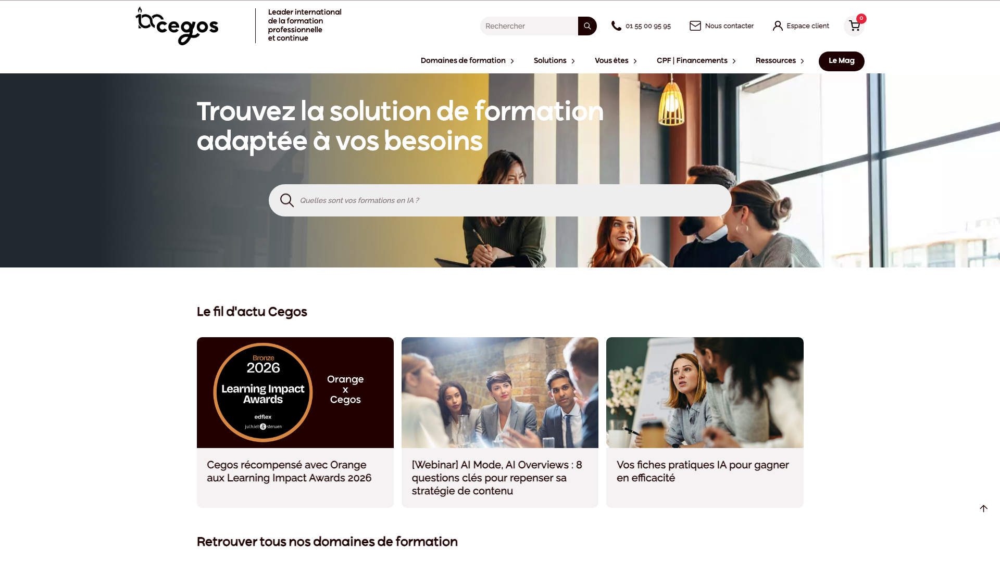
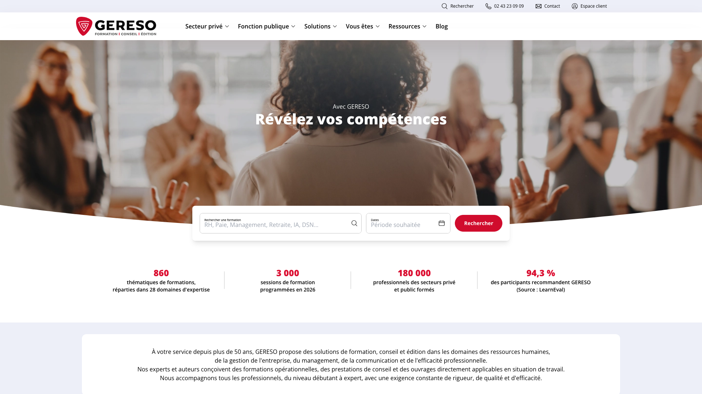
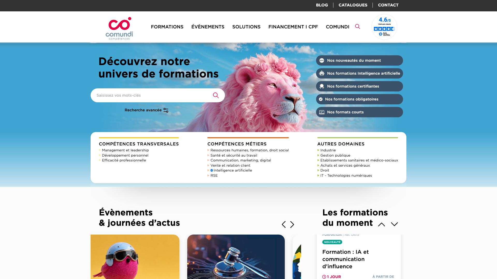
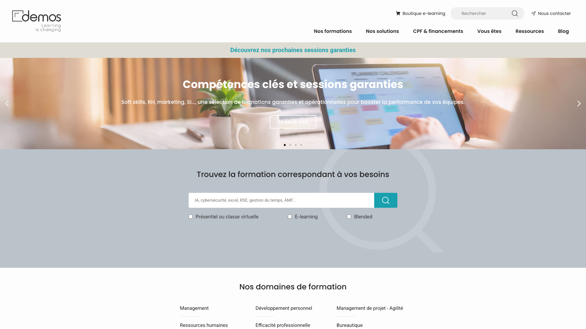
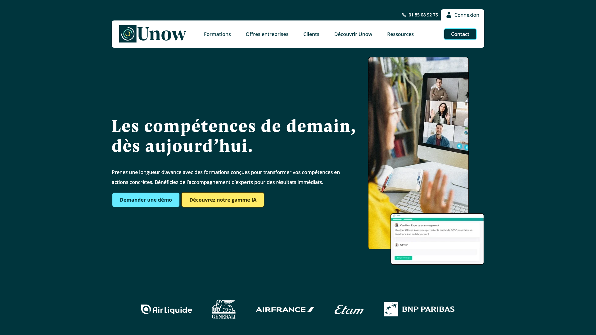
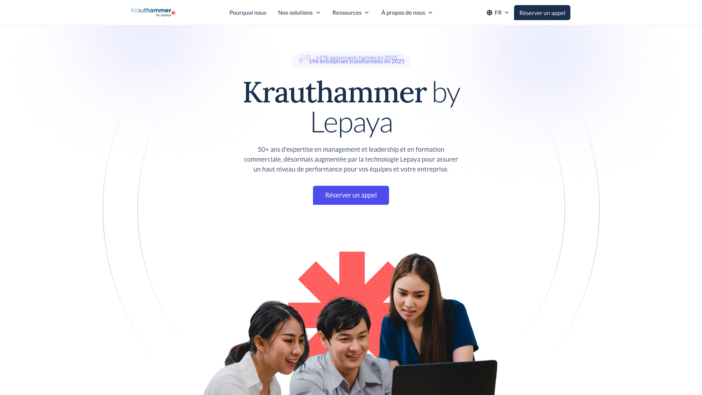

A cross-functional management course teaches how to lead a project or a topic with people who do not report to you: establishing legitimacy, mapping the people involved, winning cooperation and handling disagreement. In France, most of these courses last two or three days and cost €1,528 to €2,250 excluding VAT per participant. This ranking compares ten French courses on length, price, formats, follow-up after the course and published reviews. They fall into two groups: eight courses of two or three days and two programmes spread over several weeks. A separate section covers the courses reserved for French public servants.

Rolebase publishes this ranking. Rolebase makes open-source software where teams write down their roles, mandates and accountabilities, but sells no training. A written mandate gives a cross-functional manager a scope and a set of decisions to make alone, but posture and influence are learned elsewhere, in courses like these. We take that into account in the ranking. Where follow-up is comparable, a course where participants clarify their own mission ranks ahead of the others. None of the links in this article are affiliate links.

Lengths, prices, formats and dates come from each course page, read on 17 October 2026. Prices exclude VAT and are for one participant in an open-enrolment session unless stated otherwise. Ratings are the ones each provider publishes on its page, with the number of reviews when it is given. A rating with no review count carries less weight than one based on a hundred responses, so the table gives the review count next to each rating when the provider publishes it. All ten courses are taught in French.

## How this ranking works

The first group covers two- and three-day courses held in a classroom or a virtual class, the format most providers sell. The second covers two programmes spread over several weeks, where participants go back to work between sessions. The numbers rank courses within each group only. The two spread-out programmes are numbered 9 and 10 because they form the second group.

Within each group, courses are ranked on three questions, in order of priority:

- What happens after the course days? A course with a later assessment, messaging with the trainer or a reinforcement programme ranks ahead of those that end on the last day.
- Does the programme start from the participant's mission? A course that has participants clarify the mission itself and its scope ranks ahead of a course that only has them map the people involved and their allies. That one in turn ranks ahead of a programme focused on running a team.
- What do the published reviews say? Between two ratings each based on more than a hundred reviews, the higher rating wins. A rating published with its review count ranks ahead of one published without it, which in turn ranks ahead of a course with no rating.

The entries also give the cities, the formats and the provider's certification. Nine of the ten providers display Qualiopi, the French quality label for training providers, while Krauthammer by Lepaya displays a quality certificate without naming it. None of the ten courses lists CPF eligibility or a certification in the French national registers (RNCP or RS).

## The 10 courses compared

| Course | Length | Price excl. VAT | Formats | Follow-up after the course | Published reviews |
| --- | --- | --- | --- | --- | --- |
| 1. Lefebvre Dalloz Compétences | 2 days (14 h) | €1,528 | In person, live-streamed, remote, in-house | Transfer phase, assessment after 60 days | 4.8/5 (130 reviews) |
| 2. Cegos | 3 days (21 h) | €2,250 | In person (9 cities), remote class, in-house | Reinforcement programme, usefulness measured at 12 months | 4.6/5 (106 reviews) |
| 3. M2i Formation | 2 days (14 h) | from €1,595 | In person (about 35 cities), remote class, in-house | 30 days of messaging with the trainer | 4.6/5 (461 reviews) |
| 4. GERESO | 2 days | €1,610 | In person in Paris, remote, in-house | Online resources, delayed assessment | 4.5/5 (count not published) |
| 5. Comundi | 3 days (21 h) | €2,050 in Paris, €1,800 remote | In person in Paris, remote, in-house | No follow-up announced | 97% satisfied (17 respondents) |
| 6. Demos | 2 days (14 h) | €1,590 | In person in Paris, virtual class, in-house | No follow-up announced | 4.5/5 (count not published) |
| 7. CCI Pays de la Loire | 2 days (14 h) | €880 (no VAT) | In person (5 cities) | No follow-up announced | No course-level rating |
| 8. ORSYS | 3 days (21 h) | €2,080 | In person (about forty cities), remote class, in-house | No follow-up announced | 4.4/5 over 12 months |
| 9. Unow | 12 h over 4 weeks | €980 | Remote, with a tutor | Review at 6 weeks, 3 months of reminders | 84% satisfied (2024), 4.2/5 (13 reviews) |
| 10. Krauthammer by Lepaya | 5 days over 5 months (35 h) | €4,600 | In person in Paris, mobile app | No follow-up announced after the last day | 4.9 (count not published), 89.9% satisfied across all its courses (4,514 participants) |

## First group: two- and three-day courses

### 1. Lefebvre Dalloz Compétences

[Lefebvre Dalloz Compétences](https://formation.lefebvre-dalloz.fr) was formed in 2022 by merging CSP Docendi, Francis Lefebvre Formation, Dalloz Formation, Elegia and Bärchen, within the legal publishing group Lefebvre Sarrut. Based in La Défense, it offers more than 1,500 courses and holds Qualiopi certification. The former CSP and Elegia websites now redirect to it.

Its course ["Management transversal : animer et coordonner une équipe sans lien hiérarchique"](https://formation.lefebvre-dalloz.fr/formations/management-transversal_40742) (leading and coordinating a team with no reporting line) lasts two days and costs €1,528, lunch included when held in person. It opens with a questionnaire, a quiz and a video, then covers five topics: asserting your position with a formal mission contract, building a network of influence, getting people committed, running a matrix team (rituals, a responsibility matrix, a visual board) and giving feedback. After the course, participants work through a transfer phase in their online space, then the provider assesses them a second time 60 days later.

The sessions on 29 and 30 October, 19 and 20 November and 3 and 4 December 2026 are guaranteed to run. The course can be taken in a classroom, remotely, or as a live-streamed classroom session. It is rated 4.8 out of 5 on 130 verified reviews since 2020, the highest rating in this ranking on a sample of more than a hundred. The programme lists about twenty cities without saying which host a classroom session and which a live-streamed one, so check before you book.

### 2. Cegos

[Cegos](https://www.cegos.fr), based in Issy-les-Moulineaux, reports training more than 250,000 people a year in more than 50 countries and describes itself as active "for more than a century". It holds ISO 9001 and Qualiopi certification.

Its course ["Le management transversal : méthodes et outils pour coordonner les activités sans lien hiérarchique"](https://www.cegos.fr/formations/management-et-leadership/le-management-transversal) (methods and tools to coordinate work with no reporting line) lasts three days and costs €2,250. A placement questionnaire and a video come first. The first module has participants clarify their mission with their own manager and look for their legitimacy. The next ones cover influence without authority (with a grid for analysing the people involved), the coordination of a functional activity, and cooperation in the face of resistance. Every module includes role plays. A final online assessment covers all the modules.

After the course, Cegos offers a reinforcement programme, a feedback module, a reminder sheet and a skills radar. Twelve months after the course, 84% of participants find it useful, according to Cegos. Fifteen sessions are scheduled in nine cities and online, most marked "guaranteed". The course is rated 4.6 out of 5 on 106 reviews. It is, on the other hand, the most expensive course in the first group. Cegos also sells two two-day courses at €1,690 on the same subject, one on leading without authority and one on the leadership of cross-functional managers.

### 3. M2i Formation

[M2i Formation](https://www.m2iformation.fr), based in Courbevoie, reports 150,000 people trained a year, 2,900 trainers and 40 centres. It belongs to the Skolae Formation group, like EFE, and holds Qualiopi certification.

Its course ["Manager en transversal"](https://www.m2iformation.fr/formation-manager-en-transversal/MGOPE-TRANS/) lasts two days and costs from €1,595. It starts with a placement test and videos. Participants then map their contributors, work on three levers of influence with the DISC model and learn to lead change with the DESC and DEPAR methods. Exercises take the form of challenges between teams and role plays. The programme starts from the map of contributors and has no module on the mission itself.

For 30 days after the course, participants can message their trainer. About 121 open-enrolment sessions are scheduled until December 2027 in about 35 cities, plus six remote dates. The course is rated 4.6 out of 5 on 461 reviews, the largest sample in this ranking. EFE sells the same programme under the same title.

### 4. GERESO

[GERESO](https://www.gereso.com), founded in 1978 in Le Mans, reports 400 consultants and authors and 1,500 sessions scheduled in 2026. It also has a centre in Paris and has held Qualiopi certification since 2021.

Its course ["Management transversal : mobiliser une équipe sans lien hiérarchique"](https://www.gereso.com/formations/management/formation-management-transversal) (getting a team on board with no reporting line) lasts two days and costs €1,610. It sets out a precise framework: four forms of cross-functional management and eight conditions for success. Participants then map their network and stakeholders, build an action plan and work on assertiveness. A questionnaire on their expectations is sent fifteen days before the course.

After the course, participants keep access to online resources. GERESO also assesses the course twice, at the end of the session and again later. Four sessions are scheduled in Paris until September 2027, some with a remote option. The course is rated 4.5 out of 5, with no review count published. It also appears in GERESO's public-sector catalogue.

### 5. Comundi

[Comundi](https://www.comundi.fr), founded in 1987, holds Qualiopi certification and publishes the satisfaction rate of each course with its number of respondents.

Its course ["Management transversal : développer son influence et piloter sans autorité hiérarchique"](https://www.comundi.fr/formations/formation-le-management-transversal.html) (building influence and leading without formal authority) lasts three days. It costs €2,050 in Paris and €1,800 remotely. It is meant for people already working across teams, who fill in a self-assessment questionnaire before they come. Participants map their formal and informal network and work on trust, forms of power and persuasion. The programme also suggests rituals for hybrid teams and a maturity check of the cross-functional team.

Seven sessions are scheduled until December 2027, six in Paris and one remote. The course reached 97% satisfaction from 17 respondents in the second half of 2025. Comundi's cross-functional and project management courses as a whole reach 94% from 135 respondents. Comundi announces no follow-up after the course.

### 6. Demos

[Demos](https://www.demos.fr), based in Puteaux, reports 50,000 professionals trained a year and more than 600 experts. It holds ISO 9001 and Qualiopi certification.

Its course ["Management transversal : les fondamentaux"](https://www.demos.fr/formation/management-transversal-les-fondamentaux/) (the fundamentals) lasts two days and costs €1,590. It starts from participants' real situations and covers legitimacy without formal authority and adapting your communication, then influence and cooperation, then cross-functional leadership and a network of allies. One role play deals specifically with getting someone to cooperate when you have no authority over them. The course also includes a case study, which leads to an action plan, and online skills assessments at the start and at the end.

Five sessions are scheduled in Paris and online between December 2026 and November 2027. None is guaranteed yet. The course is rated 4.5 out of 5 over two years, with no review count published. Demos also sells a three-day course focused on persuasion, "Convaincre pour agir sans pouvoir hiérarchique", at €2,090.

### 7. CCI Pays de la Loire

[CCI Formation Pays de la Loire](https://formation.paysdelaloire.cci.fr) brings together the training centres of five local chambers of commerce in western France. The Maine-et-Loire centre reports 4,443 trainees in 2025 and a satisfaction score of 9.1 out of 10. Qualiopi certification is displayed centre by centre.

Its course ["Management transversal : les clés du management transversal pour développer le travail collaboratif"](https://formation.paysdelaloire.cci.fr/management/management-transversal) (the keys to cross-functional management for collaborative work) lasts two days and costs €880 with no VAT charged, the lowest price in this ranking. It covers the stance of a manager outside the hierarchy, influence without formal status, allies and stakeholders, cooperation, then conflict and difficult personalities. The course alternates group work and role plays, and ends with a multiple-choice test and a role play.

Nine in-person sessions are scheduled until November 2027 in Laval, Angers, Le Mans, Saint-Herblain and La Roche-sur-Yon. The page publishes no rating for this course.

### 8. ORSYS

[ORSYS](https://www.orsys.fr), based in La Défense since 1976, reports 450 employees, more than 3,000 trainers and more than 138,000 participants in 2025. It holds Qualiopi certification.

Its course ["Maîtriser le management transversal"](https://www.orsys.fr/formation-maitriser-management-transversal.html) (mastering cross-functional management) lasts three days and costs €2,080, lunches included. The programme compares the roles of expert and leader, then covers team cohesion, motivation, delegation (SMART objectives, the Eisenhower matrix, a delegation contract) and communication. A management style self-assessment, case studies, role plays, an action plan and tests before and after round out the course. The content leans more towards running a team than towards influence without authority.

ORSYS offers the widest choice of dates. Sessions run almost every month online and in La Défense until December 2027, and in about forty other cities, including Brussels, Luxembourg, Geneva and Lausanne. The course is rated 4.4 out of 5 over twelve months. For influence, ORSYS also sells a two-day course at €1,590, "Renforcer son leadership d'influence en environnement transversal".

## Second group: programmes spread over several weeks

In these two programmes, participants go back to work between sessions and apply what they have just learned. Both take a longer commitment, four weeks at Unow and five months at Krauthammer by Lepaya.

### 9. Unow

[Unow](https://www.unow.fr), founded in Paris in 2013, describes itself as the maker of the first French MOOC and holds Qualiopi certification.

Its programme ["Manager en transversal"](https://www.unow.fr/formations/manager-en-transversal/) runs 12 hours over four weeks, fully online, and costs €980. Each week combines a virtual class with the expert, self-paced videos and podcasts, and a challenge to apply at work. The four weeks cover posture and legitimacy, mapping the people involved and negotiation, organising roles and delegating without authority, then trust and feedback.

Unow offers the longest support after the course in this ranking: a skills review at six weeks, three months of reminders, permanent access to the resources and an in-house certificate after a final exam. The next cohorts start on 23 November 2026, 15 March and 15 November 2027. Unow reports 84% satisfaction in 2024 and 4.2 out of 5 on 13 reviews.

### 10. Krauthammer by Lepaya

[Krauthammer](https://www.lepaya.com/fr/krauthammer) has trained managers and salespeople for more than 50 years and now belongs to Lepaya, a training company based in Amsterdam. The brand reports more than 27,000 learners trained in 2025 and 500 clients in 120 countries. It displays a quality certificate for its training.

Its programme ["Management transversal"](https://www.lepaya.com/fr/krauthammer/management-transversal) runs five days spread over five months and costs €4,600. Before it starts, participants set their goals in a meeting with their own manager. The five days cover the role of the cross-functional manager, reaching agreement, moving projects forward, tense situations without authority (conflict, mediation, saying no), then team spirit. Between the days, participants practise at work, exchange with their peers and receive their feedback. Groups have six to twelve people, in Paris, with Lepaya's mobile app alongside.

It is the longest programme in this ranking, and the only one that opens with a meeting between participants and their manager. On the other hand, no follow-up is announced after the last day. The page still showed "dates to come" on 17 October 2026. The course is rated 4.9, with no review count. Across all its courses, the brand reports 89.9% satisfaction from 4,514 participants in 2025.

## For French public servants

Three courses are reserved for the French civil service or open to its staff at a public rate.

- The CNFPT, the training body for French local government staff, runs "Le management de la transversalité" (code SXB48), two introductory days for project leads, policy officers and staff who lead a team with no reporting line. In Brittany, the next session takes place on 3 and 4 December 2026 in Thorigné-Fouillard. For local government staff, their council's contribution to the CNFPT normally covers the course.
- The Institut national du service public (INSP), the school for senior civil servants, runs "Le management stratégique de la transversalité" (code SXMTC) in Strasbourg, three advanced days for directors and senior (category A) managers, free for public servants.
- The IGPDE, the training institute of the French economy and finance ministries, runs ["Manager en transversal"](https://catalogue.igpde.finances.gouv.fr/743-manager-en-transversal.html), two days in Vincennes, at €844 in 2026 for staff from outside the ministry. The next sessions take place on 3 and 4 November 2026 and on 2 and 3 March 2027.

GERESO also lists its course in its public-sector catalogue.

## Also reviewed

[EFE](https://www.efe.fr) sells "Leadership du manager transversal", two days at €1,615 focused on posture, with 60 sessions in about thirty cities and 4.7 out of 5 on 10 reviews. Its other course uses the M2i programme, from the same group. [École polytechnique Executive Education](https://exed.polytechnique.edu/formations/management/management-transverse) runs "Management transverse : stratégies d'influence", two days in Paris at €2,520 including VAT, the only course from a top French school on this exact subject. [CNFCE](https://www.cnfce.com/formation-management-transversal) runs two days at €1,590 in about a dozen cities, rated 4.1 out of 5 on 21 reviews. [Ziggourat](https://www.ziggourat.com) caps its groups at eight people for two days at €1,400, in Paris or online. [IFG Executive Education](https://www.ifgexecutive.com/product/formation-management-transversal/) has the programme most focused on influence and coalitions, at €1,200, but its page gives neither the length nor the dates.

## How to choose

The programmes look much alike from one provider to the next. To narrow the list, answer these five questions instead.

### Is your mandate written down?

A cross-functional manager with no written mandate discovers their scope one refusal at a time. They have to write that mandate themselves. Lefebvre Dalloz Compétences and Cegos help with it, the first with a formal mission contract, the second by having participants clarify their mission with their own manager. Come to the course with a few lines about your mission: why it exists, its scope, the decisions you make alone and what other teams can expect from you. Those lines already make up a [cross-functional mandate written as a role](/en/blog/management-transversal). In [Rolebase](/en/features), the mandate becomes a role shown on the org chart, with its purpose, domain and accountabilities, next to the roles the person keeps in their own team.

### How much time can you give it?

Two days cover the basics of influence and cooperation. Three days, at Cegos, Comundi or ORSYS, leave more room for role plays. If you cannot leave your job for two days in a row, Unow spreads 12 hours over four weeks, rated 4.2 out of 5 on only 13 reviews. If your company is investing in a key person, Krauthammer by Lepaya spreads five days over five months for €4,600 and opens with a meeting with your manager. Its next dates were not yet published on 17 October 2026.

### Who pays?

The ten courses cost between €880 and €4,600, most of them between €1,528 and €2,250. None is eligible for the CPF, so talk to your manager or your HR team. The company can fund the course through its training plan or through its OPCO. For several colleagues, ask for a quote for an in-house session, which most of these providers offer.

### Do you need a session near you?

ORSYS and M2i each cover more than thirty cities, EFE about thirty. Cegos covers nine. GERESO, Comundi and Demos hold their sessions mostly in Paris or online. CCI Pays de la Loire covers five cities in its region at the lowest price.

### What will you do the following Monday?

These courses differ most in what they plan for the return to work. M2i's 30 days of messaging with the trainer, the 60-day assessment at Lefebvre Dalloz Compétences and Unow's three months of reminders push participants to apply what they learned. If your organisation is removing management layers at the same time, more people will end up in your situation. To prepare that [move to horizontal management](/en/blog/horizontal-transition), write their roles down before the manager positions go.

## Frequently asked questions

<FaqList>

<FaqItem question="Which course should I take to become a cross-functional manager?">

For a first course, choose a two- or three-day course that starts from your actual situation and includes follow-up afterwards. Lefebvre Dalloz Compétences (2 days, €1,528, 4.8 out of 5 on 130 reviews) and Cegos (3 days, €2,250, 4.6 out of 5 on 106 reviews) meet both conditions. If you cannot be away for two days, Unow's online programme spreads 12 hours over four weeks for €980.

</FaqItem>

<FaqItem question="How much does cross-functional management training cost in France?">

In October 2026, a two- or three-day open-enrolment course costs between €1,528 and €2,250 excluding VAT per participant at the large French providers. CCI Pays de la Loire offers two days at €880 with no VAT charged, and Unow an online programme at €980. Krauthammer by Lepaya's programme, five days over five months, costs €4,600.

</FaqItem>

<FaqItem question="Can I use my CPF for a cross-functional management course?">

None of the ten courses in this ranking is eligible for the CPF, and none leads to a certification listed in the French national registers (RNCP or RS). Employers fund these short courses through their training plan or through their OPCO. Nine of the ten providers display Qualiopi certification, which OPCOs require before funding a course.

</FaqItem>

<FaqItem question="How long does a cross-functional management course last?">

Half the courses in this ranking last two days, or 14 hours. Cegos, Comundi and ORSYS offer three days. Unow spreads 12 hours over four weeks online, and Krauthammer by Lepaya spreads five days over five months.

</FaqItem>

<FaqItem question="What do you learn in a cross-functional management course?">

The programmes overlap a lot. Participants learn to establish legitimacy with no reporting line, map the people involved and their allies, win cooperation through exchange and persuasion, and handle disagreement with methods such as DESC. Most courses rely on role plays and end with a personal action plan.

</FaqItem>

<FaqItem question="Is it better to take the course in person or online?">

In-person sessions make role plays easier, and role plays take up much of these courses. A virtual class saves travel and sometimes costs less: Comundi charges €1,800 online against €2,050 in Paris. A spread-out programme like Unow's leaves time to apply each week what was covered.

</FaqItem>

<FaqItem question="Is a course enough to give a cross-functional manager authority?">

A course gives posture and influence techniques. It does not say which decisions the cross-functional manager makes alone, or who decides when their project and a team want the same people on the same day. A written mandate settles both points, once management announces it to the teams involved. In Rolebase, you write that mandate as a role, with its purpose, domain and accountabilities, visible to everyone on the org chart.

</FaqItem>

<FaqItem question="Are there cross-functional management courses for French public servants?">

Yes. The CNFPT runs "Le management de la transversalité" over two days for local government staff, the INSP runs "Le management stratégique de la transversalité" over three days for senior (category A) managers, and the IGPDE runs "Manager en transversal" over two days, at €844 for staff from outside the economy and finance ministries.

</FaqItem>

</FaqList>

## Where to start

Write your mandate before choosing the course. A few lines on why your mission exists, its scope and the decisions you make alone are enough to point you towards a course where you work on the mission itself. You also arrive at the course with a real case to work on. For a first course, Lefebvre Dalloz Compétences and Cegos combine work on the mission with follow-up after the course. CCI Pays de la Loire and Unow cost less than €1,000. Unow also suits you if you cannot take time away.

In an organisation where every decision goes up the [chain of command](/en/blog/chain-of-command), a cross-functional manager depends on management for every call. In Rolebase, their mandate becomes a role that you can invite into the teams involved and that everyone sees on the org chart. Rolebase is open source and [free for up to 5 active members](/en/pricing), with every feature included.

<OrgListJsonLd
  name="Cross-Functional Management Training in France: 2026 Top 10"
  description="Ten French cross-functional management courses compared in two groups: two- and three-day courses, and programmes spread over several weeks."
  items={[
    { name: 'Lefebvre Dalloz Compétences', url: 'https://formation.lefebvre-dalloz.fr' },
    { name: 'Cegos', url: 'https://www.cegos.fr' },
    { name: 'M2i Formation', url: 'https://www.m2iformation.fr' },
    { name: 'GERESO', url: 'https://www.gereso.com' },
    { name: 'Comundi', url: 'https://www.comundi.fr' },
    { name: 'Demos', url: 'https://www.demos.fr' },
    { name: 'CCI Formation Pays de la Loire', url: 'https://formation.paysdelaloire.cci.fr' },
    { name: 'ORSYS', url: 'https://www.orsys.fr' },
    { name: 'Unow', url: 'https://www.unow.fr' },
    { name: 'Krauthammer by Lepaya', url: 'https://www.lepaya.com/fr/krauthammer' },
  ]}
/>
