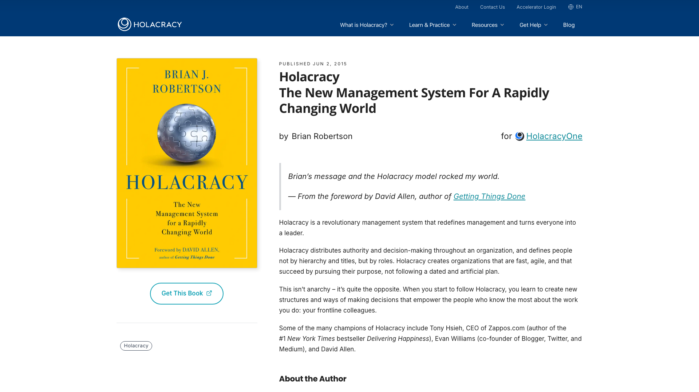

To rethink how your organization works, start with *Reinventing Organizations* by Frederic Laloux, then pick a method book for the model you want to try: *Many Voices One Song* for sociocracy, the Sociocracy 3.0 guide to adopt one practice at a time, and *Holacracy* for holacracy. This ranking covers ten management books on self-management, shared governance, the "liberated company" and roles. It splits them into three groups: five books to understand the models, three to put them into practice and two critical reads. For each book, the entry gives the edition, the argument, the practices it describes and who it is written for.

Rolebase publishes this ranking. Rolebase, which sells no books, makes open-source software where teams write down their roles, run their meetings and make decisions by consent. The links in this article go to each book's own site or its publisher, and none are affiliate links. We read these books because our users mention them when they decide to change how they organize. Because Rolebase works with both sociocracy and holacracy, the criteria below rank the method books on how a team gets started, with no preference for either method.

This ranking appears in English and in French, so we kept books that exist in both languages, in print or free online. The two critical reads are the exception, with no English edition. Ratings come from Goodreads, a widely used reader review site. We recorded them in October 2026, with the number of ratings behind each.

## How this ranking works

Because the three groups answer different needs, the numbers rank books within each group only. The first group holds numbers 1 to 5, the second 6 to 8, the third 9 and 10. Number 10 is therefore the second critical read.

Books for understanding the models are ranked on three questions, in order of priority:

- Does the book describe organizational practices precisely enough to try them: who decides what, how the organization is divided up, how the change starts? A book that details practices ranks ahead of one that mostly describes a mindset or what to take away.
- Does it draw on several organizations? A book that compares several companies ranks ahead of the story of a single one.
- What do readers say? When two books are level on the first two questions, the higher Goodreads rating wins.

Method books are ranked on two questions, in order of priority:

- Can a team start with a single practice, without reorganizing the whole company?
- Can someone new to the subject read it from cover to cover?

Critical reads are ranked on whether the book rests on field research.

The ranking leaves out self-help books and classic team management handbooks, which do not deal with the organization itself.

## The 10 books compared

| Book | Group | Author(s) | First edition | Format | Written for | Goodreads |
| --- | --- | --- | --- | --- | --- | --- |
| 1. Reinventing Organizations | Understand | Frederic Laloux | Nelson Parker, 2014, illustrated edition 2016 | Narrative and case studies | Founders, CEOs, change leads | 4.21 (about 6,400 ratings) |
| 2. Humanocracy | Understand | Gary Hamel, Michele Zanini | Harvard Business Review Press, 2020, expanded 2025 | Essay and case studies | CEOs, HR | 4.00 (1,235 ratings) |
| 3. Turn the Ship Around! | Understand | L. David Marquet | Portfolio, 2013 | Memoir with reflection questions | Managers | 4.22 (22,956 ratings) |
| 4. Freedom, Inc. | Understand | Isaac Getz, Brian M. Carney | Crown Business, 2009 | Narrative and case studies | CEOs | 4.23 (252 ratings) |
| 5. Corporate Rebels | Understand | Joost Minnaar, Pim de Morree | Self-published, 2020 | Short illustrated stories | Everyone | 3.98 (786 ratings) |
| 6. Many Voices One Song | Practice | Ted J. Rau, Jerry Koch-Gonzalez | Sociocracy For All, 2018 | Manual with diagrams | Associations, co-ops, small businesses | 4.28 (81 ratings) |
| 7. Sociocracy 3.0: A Practical Guide | Practice | Bernhard Bockelbrink, James Priest, Liliana David | Free online since 2014 | Library of patterns | Practitioners, agile coaches | 3.74 (19 ratings) |
| 8. Holacracy | Practice | Brian J. Robertson | Henry Holt, 2015 | Technical manual | Practitioners, CEOs | 3.70 (1,627 ratings) |
| 9. Au-delà de l’entreprise libérée | Critical | Thierry Weil, Anne-Sophie Dubey | Presses des Mines, 2020, free PDF, French only | Field study report | Leaders preparing a change | No rating |
| 10. Libérer le travail | Critical | Thomas Coutrot | Seuil, 2018, French only | Political and economic essay | Readers after a critical view | No rating |

## Understanding the models

### 1. Reinventing Organizations, Frederic Laloux

[*Reinventing Organizations*](https://www.reinventingorganizations.com/) was self-published in 2014 under the Nelson Parker imprint. Its author, Frederic Laloux, was an associate partner at McKinsey before he left consulting in 2011. An illustrated edition drawn by Etienne Appert followed in 2016, and a tenth-anniversary paperback came out in 2024. The French edition is published by Diateino.

Laloux argues that every stage of human consciousness has produced its own organizational model. The model he calls "Teal" rests on three ideas: self-management, wholeness (being able to be yourself at work) and an evolving purpose. The book has three parts: the history of organizational models, the practices of around a dozen organizations including Buurtzorg, Morning Star and FAVI, and the conditions for starting or transforming a company. It describes the advice process, self-managing teams, peer-based evaluation and conflict resolution in detail.

Laloux describes what these organizations put in place more than what they remove. The official site reports about a million copies sold across all editions. The book has a 4.21 Goodreads rating from about 6,400 ratings. The German management magazine Haufe criticizes its stage model, borrowed from the American philosopher Ken Wilber, for having little research behind it, and its case studies for all being success stories. The P2P Foundation, a network devoted to the commons, points to a hidden hierarchy, since the model assumes a CEO who has reached the "Teal" stage.

### 2. Humanocracy, Gary Hamel and Michele Zanini

[*Humanocracy*](https://www.humanocracy.com/) came out in 2020 from Harvard Business Review Press, followed by an updated and expanded 432-page edition in 2025. Gary Hamel teaches at London Business School, and he co-founded the Management Lab with Michele Zanini. The French edition, *Humanocratie*, is published by Diateino.

The authors see bureaucracy as the main thing that stops a company from adapting and innovating. They propose replacing it with seven principles: ownership, markets, meritocracy, community, openness, experimentation and paradox. The book has five parts, called motivation, models, mindsets, mobilization and migration, and draws on Haier, Nucor, Handelsbanken, Semco and Buurtzorg.

The practices it describes are concrete: splitting the company into small units accountable for their own results, measuring what bureaucracy costs, and starting the change from a coalition of employees. The book has a 4.00 Goodreads rating from 1,235 ratings. Some readers find its picture of bureaucracy one-sided. The authors themselves admit that their showcase companies needed enormous effort to transform themselves.

### 3. Turn the Ship Around!, L. David Marquet

[*Turn the Ship Around!*](https://davidmarquet.com/turn-the-ship-around-book/) came out in 2013 from Portfolio, with a foreword by Stephen Covey, the author of *The 7 Habits of Highly Effective People*. L. David Marquet tells the story of the years he commanded the US nuclear submarine USS *Santa Fe*, from 1999 to 2001. The French edition, *Comment créer des leaders*, is a Flammarion paperback.

Marquet describes the move from a model where one leader commands and followers obey to one where people decide at their own level. The book's 29 chapters fall into four parts: starting over, control, competence and clarity. The best-known practice fits in one sentence: instead of asking permission, an officer says "I intend to…", and the captain only has to confirm. Each chapter ends with questions to ask in your own team.

It is the most widely read book in this ranking, with a 4.22 Goodreads rating from nearly 23,000 ratings. It tells the story of a single crew, seen by its captain. Some readers also find that the military setting carries over poorly to an office.

### 4. Freedom, Inc., Isaac Getz and Brian M. Carney

[*Freedom, Inc.*](https://freedomincbook.com/) came out in 2009 from Crown Business. Isaac Getz is a professor at ESCP Business School and Brian M. Carney was a journalist on the *Wall Street Journal* editorial page. A revised edition came out in 2016. The French edition, *Liberté & Cie*, is available in paperback from Flammarion.

The book popularized the term "liberated company", which took off in France. Its argument is that when employees can take the actions they themselves judge best, both their engagement and the company's results go up. The CEO becomes a "liberating leader" who sets the vision and leaves the rest to the teams. The book draws on FAVI, Gore, USAA, Harley-Davidson and Sun Hydraulics.

The authors mainly describe what companies take away: symbols of power, controls, layers of sign-off. The book offers no mechanism for deciding together or sharing out responsibilities. It has a 4.23 Goodreads rating from 252 ratings. In a debate published by the French journal *Nouvelle Revue du travail*, the sociologist Danièle Linhart and the economist Thomas Coutrot, among others, argued that the autonomy it brings covers daily work but rarely strategy, and that the CEO alone decides to liberate.

### 5. Corporate Rebels, Joost Minnaar and Pim de Morree

[*Corporate Rebels: Make Work More Fun*](https://www.corporate-rebels.com/book) was self-published in 2020 (224 pages). Joost Minnaar and Pim de Morree left their corporate jobs to visit more than a hundred organizations that work differently, then turned what they saw into a blog and a consultancy. Their site reports more than 50,000 copies sold. The French edition is published by Dunod.

The book follows eight shifts seen in these organizations: from profit to purpose, from pyramid to a network of teams, from directive to supportive leadership, from plans to experiments, from control to trust, from centralized to distributed authority, from secrecy to transparency, and from job descriptions to talents. Each chapter tells the story of a few companies in a few pages.

It is the easiest read in this ranking, though the authors say plainly that it is not a how-to guide. It has a 3.98 Goodreads rating from 786 ratings. Critical readers find it anecdotal. Much of its content is also on the authors' blog.

## Putting it into practice

### 6. Many Voices One Song, Ted J. Rau and Jerry Koch-Gonzalez

[*Many Voices One Song: Shared Power with Sociocracy*](https://www.sociocracyforall.org/many-voices-one-song/) came out in 2018 (about 300 pages). Ted J. Rau and Jerry Koch-Gonzalez co-founded Sociocracy For All, a non-profit that trains people in sociocracy. The non-profit also sells the French edition, *Chaque voix compte*, and offers the first chapter as a free download.

It is a complete manual of the sociocratic circle method. It covers the circle structure and double linking, consent decisions, shaping a proposal, selecting people for roles, facilitating meetings and reviewing decisions on a schedule. It is full of diagrams, and its examples come from associations, co-ops and small businesses.

A team can start by deciding its own matters by consent, without waiting for the rest of the organization. The book has a 4.28 Goodreads rating, the highest in this ranking, from 81 ratings. The authors warn that the method needs a trained facilitator and that it does not erase existing power dynamics.

### 7. Sociocracy 3.0: A Practical Guide, Bernhard Bockelbrink, James Priest and Liliana David

The [Sociocracy 3.0 guide](https://sociocracy30.org/guide/) has been published online since 2014 and is updated continuously. Its three authors developed Sociocracy 3.0 and teach it. The full text is free under a Creative Commons license, and the English PDF runs to 428 pages. A French translation exists, a little behind the English text.

Sociocracy 3.0 is a library of patterns you adopt one at a time, when the need arises. The guide sets out seven principles, including consent, empiricism and transparency, then key concepts such as drivers and domains. It sorts the patterns into ten categories, from meeting formats to building organizations. They include consent decision-making, selecting people for roles, peer review and reviewing agreements.

It is the most modular book in this ranking, and also the densest: you look things up in it rather than read it straight through. It has a 3.74 Goodreads rating from 19 ratings.

### 8. Holacracy, Brian J. Robertson

[*Holacracy: The New Management System for a Rapidly Changing World*](https://www.holacracy.org/r/holacracy-the-new-management-system-for-a-rapidly-changing-world/) came out in 2015 from Henry Holt (240 pages), with a foreword by David Allen, the author of *Getting Things Done*. Brian J. Robertson developed holacracy while running a software company, then founded HolacracyOne. The French edition, *La Révolution Holacracy*, has been published since 2016 by Alisio, an imprint of the Leduc group.

The book explains how a written constitution replaces the hierarchy by distributing authority across roles rather than job titles. It has three parts: why to distribute authority, how it works in practice (governance, operations, facilitating governance meetings, steering), and adoption. It describes roles and circles, the governance meeting where decisions are made by processing objections, the tactical meeting and the processing of tensions. The constitution itself is [free online](https://www.holacracy.org/constitution).

The book is designed for full adoption, by ratifying the constitution. The chapter for organizations that are not ready to adopt it all at once describes a gradual path toward that full adoption. It is a technical manual, easier to follow for readers who already run governance meetings. It has a 3.70 Goodreads rating from 1,627 ratings. Zappos, the largest company to adopt holacracy, lost about 18% of its staff after its 2015 ultimatum, when management offered severance to employees who did not want to adopt it. The company later moved away from the system.

## Critical reads

### 9. Au-delà de l’entreprise libérée, Thierry Weil and Anne-Sophie Dubey

[*Au-delà de l’entreprise libérée*](https://www.pressesdesmines.com/produit/au-dela-de-lentreprise-liberee/) ("Beyond the liberated company: a study of autonomy and its constraints") came out in January 2020 from Presses des Mines (about 170 pages), in the series of La Fabrique de l’industrie, a French think tank on industry. Thierry Weil founded La Fabrique de l’industrie and led a chair on the future of industry and work at MINES ParisTech, where Anne-Sophie Dubey was a doctoral student. The book exists only in French, but the full text is a [free download](https://www.la-fabrique.fr/wp-content/uploads/2020/01/LFI-note32_entreprises-liberees-web.pdf) that a translation tool handles well.

The authors studied about ten organizations, including Lippi, Poult, FAVI, Michelin, a regional health insurance office and Ardelaine. Their conclusion fits in one sentence: autonomy does not organize itself. It needs preparation, support and management tools to match. The book covers meetings, hiring, objectives, evaluation and pay in an autonomous organization, and ends with ten pitfalls to watch for. The authors also observed responsibility that becomes exhausting over time and middle managers left unsettled, asked to give up their role without being offered another. The book also discusses holacracy and sociocracy.

It is the most useful read before launching a transformation, because it describes what went wrong elsewhere. It has no Goodreads page, but the academic journal *Relations industrielles* reviewed it in 2020.

### 10. Libérer le travail, Thomas Coutrot

[*Libérer le travail*](https://www.seuil.com/ouvrage/liberer-le-travail-thomas-coutrot/9782021390377) ("Liberating work: why the left doesn't care and why that must change") came out from Seuil in March 2018 (312 pages). Thomas Coutrot, an economist and labor statistician, headed the working conditions and health department of Dares, the French labor ministry's statistics office, from 2003 to 2022. The book exists only in French.

Coutrot argues that a neo-Taylorist organization of work, driven by financial returns, is wearing down what he calls "living work". His publisher describes liberated-company initiatives as "often trivial and sometimes stimulating". Coutrot takes them as a starting point and makes the case for real workplace democracy, one that also reaches decisions about the organization itself. The French sociologist Dominique Méda called it a very important book.

It is a political and economic essay. Coutrot does no field research in it and teaches no governance method. It serves readers who want to test the enthusiasm of the other books against a view from outside the company. It has no Goodreads rating.

## Also considered

[*Team of Teams*](https://www.penguinrandomhouse.com/books/317066/team-of-teams-by-general-stanley-mcchrystal-tantum-collins-david-silverman-and-chris-fussell/) by General Stanley McChrystal and three co-authors tells how the US special operations command shared information widely and pushed decisions down. It has a 4.10 Goodreads rating from 11,746 ratings, but its French translation is out of print. [*Brave New Work*](https://www.bravenewwork.com/) by Aaron Dignan (2019) offers a canvas of twelve domains for rewriting how a team operates, and has no French edition. *Maverick*, by Ricardo Semler, head of the Brazilian company Semco, is out of print in French, as is *Liberation Management* by the consultant Tom Peters. [*No Rules Rules*](https://www.penguinrandomhouse.com/books/isbn/9780593152386) by Reed Hastings, Netflix's co-founder, and Erin Meyer, a professor at INSEAD, describes Netflix's culture, where decisions are pushed down inside a classic hierarchy. Finally, *Libérer l’entreprise, ça marche ?* (Octarès, 2019), an edited volume led by the researcher Laurent Karsenty, gathers field observations of liberated companies.

## How to choose

The ten books answer different questions. Pick based on what you need to do in the coming months.

### You run the company and want to know where to go

Start with the illustrated edition of *Reinventing Organizations*, about 160 drawn pages, then move to the full edition if the model speaks to you. *Freedom, Inc.* suits you if your question is about your own stance as a leader, but it mostly describes what the organization removes. Before you remove anything, read what holds a [self-managing organization](/en/blog/self-management) together: written roles, a decision rule and a meeting where the structure changes.

### You manage a team in a traditional organization

*Turn the Ship Around!* is the most useful. You can start the "I intend to…" practice on Monday, without asking anyone's permission. Marquet devotes a whole part of the book to clarity, because everyone needs to know what their authority covers. In [Rolebase](/en/features), each role has its purpose, domain and accountabilities, visible to the whole team in the org chart.

### You want a method for deciding and meeting

For an association, a co-op or a small business discovering [sociocracy](/en/blog/sociocracy-intro), *Many Voices One Song* is the most readable manual. To adopt one practice at a time, the Sociocracy 3.0 guide is a free reference. To apply [holacracy](/en/blog/holacracy-intro) by the book, *Holacracy* remains its designer's own text. All three methods rest on [consent decision-making](/en/blog/consent-decision) and the governance meeting. Rolebase offers consent voting on proposals, governance and tactical meeting templates, and a sociocratic organization template with its base roles.

### You are preparing a transformation

Read *Au-delà de l’entreprise libérée* before you announce anything. It is free and runs to about 170 pages. Its ten pitfalls match the reasons so many [liberated companies run out of steam](/en/blog/liberated-company). *Libérer le travail* then gives you the skeptics' arguments.

## Frequently asked questions

<FaqList>

<FaqItem question="What is the best management book for rethinking how an organization works?">

*Reinventing Organizations* by Frederic Laloux is the most complete book on organizations that run without a chain of bosses. It compares around a dozen organizations and details their practices. It has a 4.21 Goodreads rating from about 6,400 ratings. Its illustrated edition is a good first read.

</FaqItem>

<FaqItem question="What should I read about the liberated company?">

*Freedom, Inc.* by Isaac Getz and Brian M. Carney popularized the term in 2009. For a more balanced picture, *Au-delà de l’entreprise libérée* by Thierry Weil and Anne-Sophie Dubey reports a field study of about ten organizations and is free to download, in French only.

</FaqItem>

<FaqItem question="Which book should I read to implement sociocracy?">

*Many Voices One Song* by Ted J. Rau and Jerry Koch-Gonzalez is the most complete manual of the sociocratic circle method, published by Sociocracy For All in 2018. The Sociocracy 3.0 guide, free online, suits a team that wants to adopt one practice at a time.

</FaqItem>

<FaqItem question="Is there a good book on holacracy?">

*Holacracy* by Brian J. Robertson, published by Henry Holt in 2015, is the method's reference book, written by its designer. It explains the constitution, roles and circles, governance meetings and tactical meetings. The Holacracy constitution itself is free online.

</FaqItem>

<FaqItem question="Are there free books on self-management and shared governance?">

Yes. The Sociocracy 3.0 guide is free in full, in English and French, under a Creative Commons license. *Au-delà de l’entreprise libérée* is a free download from La Fabrique de l’industrie, in French. The Holacracy constitution is free online, and Sociocracy For All offers the first chapter of *Many Voices One Song*.

</FaqItem>

<FaqItem question="Which books criticize the liberated company and self-management?">

*Au-delà de l’entreprise libérée* (Presses des Mines, 2020) describes the constraints observed in the field, such as responsibility that becomes exhausting and middle managers left unsettled. *Libérer le travail* by Thomas Coutrot (Seuil, 2018) starts from these initiatives to argue for broader workplace democracy. *Libérer l’entreprise, ça marche ?*, edited by Laurent Karsenty (Octarès, 2019), gathers researchers' observations. All three are in French only.

</FaqItem>

<FaqItem question="Should I read a book before changing how my team is organized?">

Yes, a book helps you choose a model. A single method book, such as *Many Voices One Song* or the Sociocracy 3.0 guide, is then enough to get started. Start by writing down your team's roles, including what each person decides alone, then adopt a rule for shared decisions, such as consent. Rolebase lets you write these roles in a shared org chart.

</FaqItem>

</FaqList>

## Where to start

If you only read one book, make it *Reinventing Organizations*, starting with the illustrated edition. If you need to act in the coming weeks, add a method book, *Many Voices One Song* or the free Sociocracy 3.0 guide, and download *Au-delà de l’entreprise libérée* to see what went wrong elsewhere.

The three method books describe the same condition for autonomy to last: a written structure everyone can read and change. [Rolebase](/en/features) keeps that structure in one place, with roles and their accountabilities in the org chart, meetings and consent decisions. Rolebase is open source and [free for up to 5 active members](/en/pricing), with every feature included.

<OrgListJsonLd
  name="Management Books: 2026 Top 10 to Rethink Your Org"
  description="Ten management books for rethinking how an organization works, ranked in three groups: understanding the models, putting them into practice, and critical reads."
  itemType="Book"
  items={[
    { name: 'Reinventing Organizations', url: 'https://www.reinventingorganizations.com/', authors: ['Frederic Laloux'] },
    { name: 'Humanocracy', url: 'https://www.humanocracy.com/', authors: ['Gary Hamel', 'Michele Zanini'] },
    { name: 'Turn the Ship Around!', url: 'https://davidmarquet.com/turn-the-ship-around-book/', authors: ['L. David Marquet'] },
    { name: 'Freedom, Inc.', url: 'https://freedomincbook.com/', authors: ['Isaac Getz', 'Brian M. Carney'] },
    { name: 'Corporate Rebels', url: 'https://www.corporate-rebels.com/book', authors: ['Joost Minnaar', 'Pim de Morree'] },
    { name: 'Many Voices One Song', url: 'https://www.sociocracyforall.org/many-voices-one-song/', authors: ['Ted J. Rau', 'Jerry Koch-Gonzalez'] },
    { name: 'Sociocracy 3.0: A Practical Guide', url: 'https://sociocracy30.org/guide/', authors: ['Bernhard Bockelbrink', 'James Priest', 'Liliana David'] },
    { name: 'Holacracy', url: 'https://www.holacracy.org/r/holacracy-the-new-management-system-for-a-rapidly-changing-world/', authors: ['Brian J. Robertson'] },
    { name: 'Au-delà de l’entreprise libérée', url: 'https://www.pressesdesmines.com/produit/au-dela-de-lentreprise-liberee/', authors: ['Thierry Weil', 'Anne-Sophie Dubey'] },
    { name: 'Libérer le travail', url: 'https://www.seuil.com/ouvrage/liberer-le-travail-thomas-coutrot/9782021390377', authors: ['Thomas Coutrot'] },
  ]}
/>
