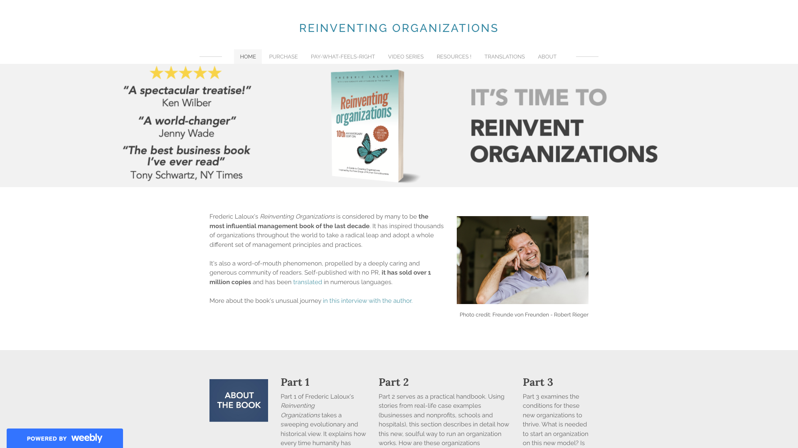
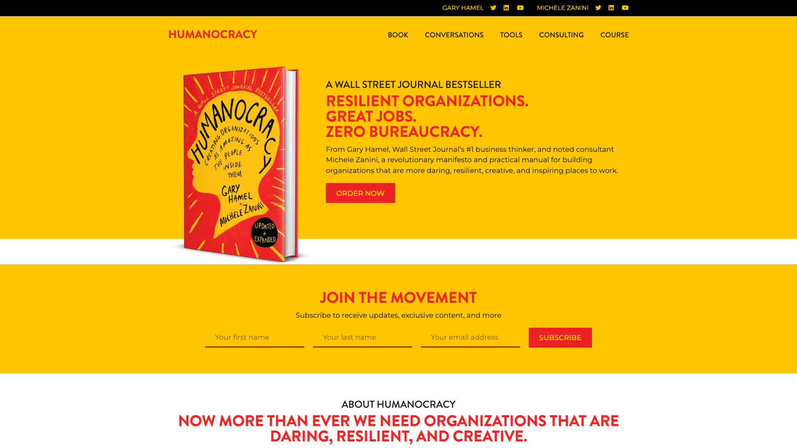
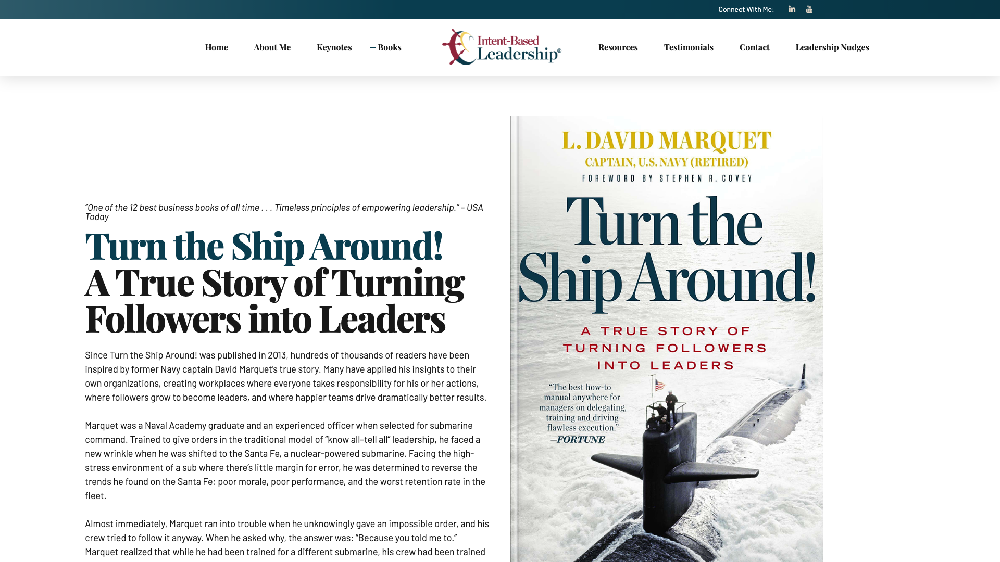
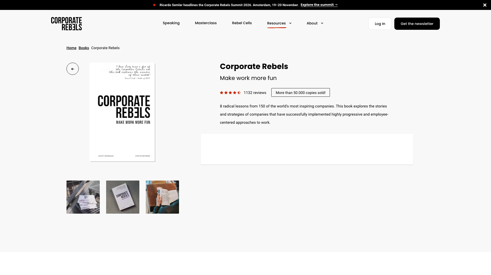
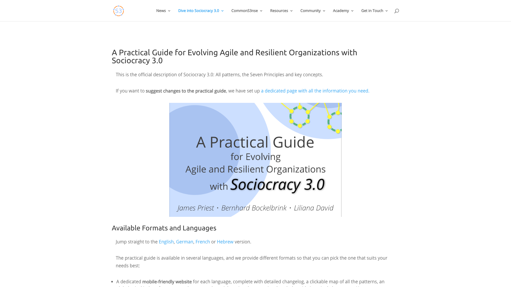
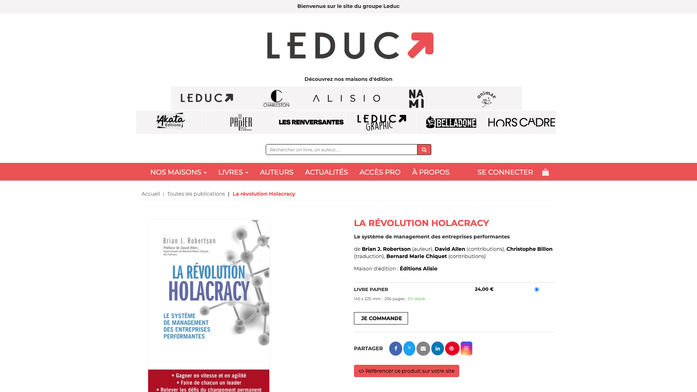
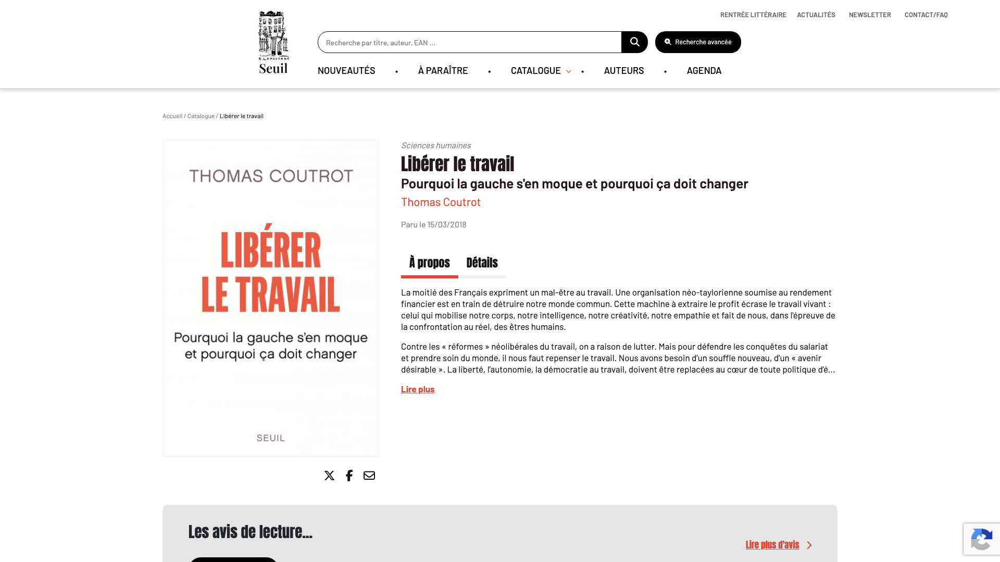

Pour repenser l’organisation d’une entreprise, commencez par *Reinventing Organizations* de Frédéric Laloux, puis choisissez un livre de méthode selon le modèle visé : *Chaque voix compte* pour la sociocratie, le guide de Sociocracy 3.0 pour avancer pratique par pratique, *La Révolution Holacracy* pour l’holacratie. Ce classement retient dix livres de management qui parlent d’autogestion, de gouvernance partagée, d’entreprise libérée et de rôles. Il les répartit en trois groupes : cinq livres pour comprendre les modèles, trois pour les mettre en pratique et deux lectures critiques. Pour chaque livre, la fiche donne l’édition française, la thèse, les pratiques décrites et le lecteur visé.

Rolebase publie ce classement. Rolebase, qui ne vend aucun livre, édite un logiciel open source où les équipes écrivent leurs rôles, tiennent leurs réunions et prennent leurs décisions par consentement. Les liens de cet article mènent vers le site du livre ou de son éditeur, sans affiliation. Nous lisons ces livres parce que nos utilisateurs les citent quand ils décident de changer leur façon de s’organiser. Comme Rolebase s’utilise aussi bien en sociocratie qu’en holacratie, les critères ci-dessous classent les livres de méthode selon la façon de démarrer, sans préférence pour l’une ou l’autre.

Les dix livres existent tous en français, en librairie ou gratuitement en ligne. Les notes viennent de Goodreads, un site d’avis de lecteurs très utilisé. Nous les avons relevées en octobre 2026, avec leur nombre d’avis. Les deux lectures critiques, des ouvrages français sans édition anglaise, n’ont pas de note Goodreads.

## Comment ce classement est construit

Comme les trois groupes répondent à des besoins différents, les numéros classent les livres à l’intérieur de chaque groupe uniquement. Le premier groupe porte les numéros 1 à 5, le deuxième 6 à 8, le troisième 9 et 10. Le numéro 10 est donc la deuxième lecture critique.

Les livres pour comprendre les modèles sont classés selon trois questions, par ordre de priorité :

- Le livre décrit-il des pratiques d’organisation assez précises pour les essayer : qui décide quoi, comment l’organisation se découpe, comment le changement démarre ? Un livre qui détaille des pratiques passe devant un livre qui décrit surtout une posture ou ce qu’il faut retirer.
- S’appuie-t-il sur plusieurs organisations ? Un livre qui compare plusieurs entreprises passe devant le récit d’une seule.
- Que disent les lecteurs ? À égalité sur les deux premières questions, la meilleure note Goodreads l’emporte.

Les livres de méthode sont classés selon deux questions, par ordre de priorité :

- Une équipe peut-elle commencer par une seule pratique, sans réorganiser toute l’entreprise ?
- Un lecteur qui découvre le sujet peut-il le lire du début à la fin ?

Les lectures critiques sont classées selon une question : le livre repose-t-il sur une enquête de terrain ?

Ce classement laisse de côté les livres de développement personnel et les manuels de management d’équipe classiques, qui ne traitent pas de l’organisation elle-même.

## Les 10 livres comparés

| Livre | Groupe | Auteur(s) | Édition française | Format | Pour qui | Goodreads |
| --- | --- | --- | --- | --- | --- | --- |
| 1. Reinventing Organizations | Comprendre | Frédéric Laloux | Diateino, 2015 (rééd. 2024), version illustrée 2017 | Récit et études de cas | Dirigeants, porteurs de projet de transformation | 4,21 (environ 6 400 avis) |
| 2. Humanocratie | Comprendre | Gary Hamel, Michele Zanini | Diateino, 2021 | Essai et études de cas | Dirigeants, RH | 4,00 (1 235 avis) |
| 3. Comment créer des leaders (Turn the Ship Around!) | Comprendre | L. David Marquet | Flammarion Champs, 2022 | Récit avec questions de réflexion | Managers | 4,22 (22 956 avis) |
| 4. Liberté & Cie | Comprendre | Isaac Getz, Brian M. Carney | Fayard, 2012, Flammarion poche, 2016 | Récit et études de cas | Dirigeants | 4,23 (252 avis) |
| 5. Corporate Rebels | Comprendre | Joost Minnaar, Pim de Morree | Dunod, 2020 | Courts récits illustrés | Tout public | 3,98 (786 avis) |
| 6. Chaque voix compte (Many Voices One Song) | Pratiquer | Ted J. Rau, Jerry Koch-Gonzalez | Sociocracy For All, papier et numérique | Manuel avec schémas | Associations, coopératives, PME | 4,28 (81 avis) |
| 7. Un guide pratique de la Sociocratie 3.0 | Pratiquer | Bernhard Bockelbrink, James Priest, Liliana David | Gratuit en ligne | Bibliothèque de pratiques | Praticiens, coachs agiles | 3,74 (19 avis) |
| 8. La Révolution Holacracy | Pratiquer | Brian J. Robertson | Alisio, 2016 (rééd. 2020) | Manuel technique | Praticiens, dirigeants | 3,70 (1 627 avis) |
| 9. Au-delà de l’entreprise libérée | Critique | Thierry Weil, Anne-Sophie Dubey | Presses des Mines, 2020, PDF gratuit | Rapport d’enquête | Dirigeants qui préparent une transformation | Aucune note |
| 10. Libérer le travail | Critique | Thomas Coutrot | Seuil, 2018 | Essai politique et économique | Lecteurs qui veulent un regard critique | Aucune note |

## Comprendre les modèles

### 1. Reinventing Organizations, Frédéric Laloux

[*Reinventing Organizations*](https://www.reinventingorganizations.com/) est paru en 2014 en autoédition, sous la marque Nelson Parker. Son auteur, Frédéric Laloux, était associé chez McKinsey avant de quitter le conseil en 2011. L’édition française, *Reinventing Organizations : vers des communautés de travail inspirées*, est publiée par Diateino depuis 2015 dans une traduction de Philippe Blanchard. Sa réédition de janvier 2024 compte 537 pages. Diateino publie aussi depuis 2017 une version illustrée de 167 pages, dessinée par Etienne Appert.

Laloux défend qu’à chaque stade de la conscience humaine correspond un modèle d’organisation. Le modèle qu’il appelle « Opale » repose sur trois idées : l’autogestion, la possibilité d’être soi-même au travail et une raison d’être qui évolue. Le livre compte trois parties : l’histoire des modèles d’organisation, les pratiques observées dans une douzaine d’organisations, dont Buurtzorg, Morning Star et FAVI, puis les conditions pour lancer ou transformer une entreprise. Il décrit en détail le processus de sollicitation d’avis, les équipes autogérées, l’évaluation entre pairs et la résolution des conflits.

Laloux décrit davantage ce que ces organisations mettent en place que ce qu’elles retirent. Le site officiel annonce environ un million d’exemplaires vendus, toutes éditions confondues. Le livre obtient 4,21 sur Goodreads sur environ 6 400 avis. Le magazine allemand de management Haufe lui reproche un modèle des stades de conscience emprunté au philosophe américain Ken Wilber et peu étayé par la recherche, ainsi que des exemples tous favorables. La P2P Foundation, un réseau consacré aux communs, y relève une hiérarchie implicite, puisque le modèle suppose un dirigeant lui-même parvenu au stade « Opale ».

### 2. Humanocratie, Gary Hamel et Michele Zanini

[*Humanocracy*](https://www.humanocracy.com/) est paru en 2020 aux Harvard Business Review Press, puis dans une édition augmentée de 432 pages en 2025. Gary Hamel enseigne à la London Business School, et il a fondé avec Michele Zanini le Management Lab. L’édition française, [*Humanocratie : libérez les talents et dynamisez votre entreprise*](https://www.diateino.com/humanocratie-p-9273.html), est publiée par Diateino depuis 2021.

Pour les auteurs, la bureaucratie est le premier frein à la capacité d’une entreprise à s’adapter et à innover. Ils proposent de la remplacer par sept principes : la responsabilité de chacun sur les résultats, les mécanismes de marché internes, la méritocratie, la communauté, l’ouverture, l’expérimentation et la capacité à tenir ensemble des objectifs opposés. Le livre compte cinq parties : motivation, modèles, état d’esprit, mobilisation, migration. Il s’appuie sur Haier, Nucor, Handelsbanken, Semco et Buurtzorg.

Les pratiques décrites sont concrètes : découper l’entreprise en petites unités responsables de leurs résultats, mesurer ce que coûte la bureaucratie, lancer le changement depuis une coalition de salariés. Le livre obtient 4,00 sur Goodreads sur 1 235 avis. Certains lecteurs lui reprochent une image partiale de la bureaucratie. Les auteurs reconnaissent eux-mêmes que les entreprises qu’ils citent en exemple ont fourni des efforts considérables pour se transformer.

### 3. Comment créer des leaders (Turn the Ship Around!), L. David Marquet

[*Turn the Ship Around!*](https://davidmarquet.com/turn-the-ship-around-book/) est paru en 2013 chez Portfolio, avec une préface de Stephen Covey, l’auteur des *7 habitudes de ceux qui réalisent tout ce qu’ils entreprennent*. L. David Marquet y raconte les années où il a commandé le sous-marin nucléaire américain USS *Santa Fe*, de 1999 à 2001. Le livre existe en français sous deux titres, tous deux traduits par Jocelyne Roy : *Renversez la vapeur !* (Un monde différent, 2019) et *Comment créer des leaders* (Flammarion, collection Champs, 2022, 290 pages, 10 €). L’édition Flammarion est la plus facile à trouver.

Marquet décrit le passage d’un modèle où un chef commande et des exécutants obéissent à un modèle où chacun décide à son niveau. Le livre compte 29 chapitres, répartis en quatre parties : repartir de zéro, le contrôle, la compétence, la clarté. La pratique la plus connue tient en une phrase : au lieu de demander la permission, l’officier annonce « j’ai l’intention de… », et son supérieur n’a plus qu’à confirmer. Chaque chapitre se termine par des questions à se poser dans sa propre équipe.

Le livre est le plus lu de ce classement, avec 4,22 sur Goodreads sur près de 23 000 avis. Il raconte le parcours d’un seul équipage, vu par son commandant. Certains lecteurs trouvent aussi que l’analogie militaire se transpose mal à un bureau.

### 4. Liberté & Cie, Isaac Getz et Brian M. Carney

[*Freedom, Inc.*](https://liberteetcie.com/) est paru en 2009 chez Crown Business. Isaac Getz est professeur à l’ESCP et Brian M. Carney était journaliste à la page éditoriale du *Wall Street Journal*. L’édition française, *Liberté & Cie : quand la liberté des salariés fait le succès des entreprises*, est parue chez Fayard en 2012. Une édition anglaise révisée a suivi en 2016. L’édition de poche chez Flammarion (2016, 496 pages, 10 €) est toujours disponible.

Le livre a popularisé l’expression « entreprise libérée » en France. Getz et Carney défendent que, quand les salariés peuvent prendre les décisions qu’ils jugent eux-mêmes les meilleures, leur engagement et la performance de l’entreprise augmentent. Le dirigeant y devient un « leader libérateur » qui fixe la vision et laisse les équipes décider du reste. Le livre s’appuie sur FAVI, Gore, USAA, Harley-Davidson et Sun Hydraulics.

Les auteurs décrivent surtout ce que les entreprises retirent : les symboles de pouvoir, les contrôles, les validations en cascade. Le livre ne propose pas de mécanisme pour décider ensemble ni pour répartir les responsabilités. Il obtient 4,23 sur Goodreads sur 252 avis. Dans un débat publié par la *Nouvelle Revue du travail*, la sociologue Danièle Linhart et l’économiste Thomas Coutrot, entre autres, reprochent au modèle une autonomie qui touche le travail quotidien mais rarement la stratégie, et une libération décidée par le seul dirigeant.

### 5. Corporate Rebels, Joost Minnaar et Pim de Morree

[*Corporate Rebels: Make Work More Fun*](https://www.corporate-rebels.com/book) est paru en 2020 en autoédition. Joost Minnaar et Pim de Morree ont quitté leurs postes en entreprise pour visiter plus de cent organisations qui travaillent autrement, puis en ont tiré un blog et une activité de conseil. L’édition française, [*Corporate Rebels : 8 alternatives pour transformer radicalement le travail*](https://www.dunod.com/entreprise-et-economie/corporate-rebels-8-alternatives-pour-transformer-radicalement-travail), est parue chez Dunod en 2020 (224 pages, 24 €), traduite par Louise Péroche. Le site des auteurs annonce plus de 50 000 exemplaires vendus.

Le livre décrit huit évolutions observées dans ces organisations : du profit à la raison d’être, de la pyramide au réseau d’équipes, du chef qui dirige au chef qui soutient, du plan à l’expérimentation, du contrôle à la confiance, de l’autorité centralisée à l’autorité répartie, du secret à la transparence, des fiches de poste aux talents. Chaque chapitre raconte quelques entreprises en quelques pages.

C’est le livre le plus facile à lire de ce classement, mais les auteurs précisent qu’il n’est pas un mode d’emploi. Il obtient 3,98 sur Goodreads sur 786 avis. Les lecteurs critiques le trouvent anecdotique. Une bonne partie de son contenu se lit aussi sur le blog des auteurs.

## Mettre en pratique

### 6. Chaque voix compte (Many Voices One Song), Ted J. Rau et Jerry Koch-Gonzalez

*Many Voices One Song: Shared Power with Sociocracy* est paru en 2018 (environ 300 pages). Ted J. Rau et Jerry Koch-Gonzalez ont cofondé Sociocracy For All, une association qui forme à la sociocratie. L’association vend aussi l’édition française, [*Chaque voix compte : partager le pouvoir avec la sociocratie*](https://www.sociocracyforall.org/fr/produit/chaque-voix-compte-livre/), en papier et en numérique, et propose son premier chapitre en téléchargement gratuit.

C’est un manuel complet de la méthode sociocratique des cercles. Il décrit la structure en cercles et le double lien, la décision par consentement, la préparation d’une proposition, le choix des personnes pour un rôle, l’animation des réunions et les révisions régulières des décisions. Les schémas sont nombreux et les exemples viennent d’associations, de coopératives et de petites entreprises.

Une équipe peut commencer par le consentement sur ses propres décisions, sans attendre que le reste de l’organisation suive. Le livre obtient 4,28 sur Goodreads, la meilleure note de ce classement, sur 81 avis. Les auteurs préviennent eux-mêmes que la méthode demande un facilitateur formé et ne fait pas disparaître les rapports de pouvoir existants.

### 7. Un guide pratique de la Sociocratie 3.0, Bernhard Bockelbrink, James Priest et Liliana David

Le [guide de Sociocracy 3.0](https://sociocracy30.org/guide/) est publié en ligne depuis 2014 et mis à jour en continu. Ses trois auteurs ont conçu Sociocracy 3.0 et l’enseignent. Le texte est gratuit en entier, sous licence Creative Commons. Sa [version française](https://patterns-fr.sociocracy30.org) date d’avril 2024 et a un peu de retard sur la version anglaise. La version PDF anglaise compte 428 pages.

Sociocracy 3.0 est une bibliothèque de pratiques qu’on adopte une par une, au moment où le besoin apparaît. Le guide pose sept principes, dont le consentement, l’empirisme et la transparence, puis des notions de base comme le besoin qui motive une action et le domaine d’un rôle. Il range ensuite les pratiques en dix catégories, des formats de réunion à la construction de l’organisation. On y trouve la décision par consentement, le choix des personnes pour un rôle, la revue entre pairs et la révision des accords.

C’est le livre le plus modulaire de ce classement, mais aussi le plus dense : il se consulte plutôt qu’il ne se lit d’un trait. Il obtient 3,74 sur Goodreads sur 19 avis.

### 8. La Révolution Holacracy, Brian J. Robertson

*Holacracy: The New Management System for a Rapidly Changing World* est paru en 2015 chez Henry Holt, avec une préface de David Allen, l’auteur de *Getting Things Done*. Brian J. Robertson a conçu l’holacratie quand il dirigeait une entreprise de logiciels, puis a fondé HolacracyOne. L’édition française, [*La Révolution Holacracy : le système de management des entreprises performantes*](https://www.editionsleduc.com/produit/789/9791092928518/La%20revolution%20Holacracy) (256 pages, 24 €), est publiée depuis 2016 par Alisio, une maison du groupe Leduc, et a été rééditée en 2020. Christophe Billon l’a traduite. Bernard Marie Chiquet, qui a introduit l’holacratie en France, en signe l’avant-propos.

Le livre explique comment une constitution écrite remplace la hiérarchie en répartissant l’autorité entre des rôles plutôt qu’entre des postes. Il compte trois parties : pourquoi répartir l’autorité, le fonctionnement concret (gouvernance, opérations, animation des réunions de gouvernance, pilotage), puis l’adoption. Il décrit les rôles et les cercles, la réunion de gouvernance où les décisions se prennent par traitement des objections, la réunion de triage et le traitement des tensions. La constitution elle-même est [gratuite en ligne](https://www.holacracy.org/constitution).

Le livre est pensé pour une adoption complète, par ratification de la constitution. Le chapitre destiné aux organisations qui ne sont pas prêtes à l’adopter d’un coup décrit un chemin progressif vers cette adoption complète. C’est un manuel technique, plus facile à suivre pour qui pratique déjà des réunions de gouvernance. Il obtient 3,70 sur Goodreads sur 1 627 avis. Zappos, la plus grande entreprise à avoir adopté l’holacratie, a perdu environ 18 % de ses salariés après l’ultimatum de 2015, quand sa direction a proposé une indemnité de départ aux salariés qui ne voulaient pas l’adopter. L’entreprise s’est ensuite éloignée du système.

## Lectures critiques

### 9. Au-delà de l’entreprise libérée, Thierry Weil et Anne-Sophie Dubey

[*Au-delà de l’entreprise libérée. Enquête sur l’autonomie et ses contraintes*](https://www.pressesdesmines.com/produit/au-dela-de-lentreprise-liberee/) est paru en janvier 2020 aux Presses des Mines (environ 170 pages, 22 €), dans la collection des notes de La Fabrique de l’industrie, un laboratoire d’idées sur l’industrie. Thierry Weil a fondé La Fabrique de l’industrie et animait la chaire Futurs de l’industrie et du travail de MINES ParisTech. Anne-Sophie Dubey y préparait sa thèse. Le texte intégral est [téléchargeable gratuitement](https://www.la-fabrique.fr/wp-content/uploads/2020/01/LFI-note32_entreprises-liberees-web.pdf). Le livre n’existe qu’en français.

Les auteurs ont enquêté dans une dizaine d’organisations, dont Lippi, Poult, FAVI, Michelin, la CPAM des Yvelines et Ardelaine. Leur conclusion tient en une phrase : l’autonomie ne s’organise pas toute seule. Elle demande de la préparation, du soutien et des outils de gestion adaptés. Le livre traite des réunions, du recrutement, des objectifs, de l’évaluation et de la rémunération dans une organisation autonome, puis termine sur dix points de vigilance. Les auteurs observent aussi une responsabilisation qui devient épuisante sur la durée et des managers intermédiaires déstabilisés, à qui l’on demande de quitter leur rôle sans leur en proposer un autre. Le livre aborde aussi l’holacratie et la sociocratie.

C’est la lecture la plus utile avant de lancer une transformation, parce qu’elle décrit ce qui a coincé ailleurs. Elle ne figure pas sur Goodreads, mais la revue universitaire *Relations industrielles* lui a consacré un compte rendu en 2020.

### 10. Libérer le travail, Thomas Coutrot

[*Libérer le travail. Pourquoi la gauche s’en moque et pourquoi ça doit changer*](https://www.seuil.com/ouvrage/liberer-le-travail-thomas-coutrot/9782021390377) est paru au Seuil en mars 2018 (312 pages, 22 €). Thomas Coutrot, économiste et statisticien du travail, a dirigé de 2003 à 2022 le département conditions de travail et santé de la Dares, le service statistique du ministère du Travail. Le livre n’existe qu’en français.

Coutrot défend qu’une organisation du travail néotaylorienne, soumise au rendement financier, abîme ce qu’il appelle le travail vivant. Son éditeur présente les démarches d’entreprise libérée comme « souvent futiles et parfois stimulantes ». Coutrot les prend comme point de départ et plaide pour une vraie démocratie au travail, qui touche aussi les décisions sur l’organisation elle-même. La sociologue Dominique Méda l’a qualifié de livre très important.

C’est un essai politique et économique. Coutrot n’y mène pas d’enquête de terrain et ne propose aucune méthode de gouvernance. Le livre sert au lecteur qui veut confronter l’enthousiasme des autres livres à un regard extérieur à l’entreprise. Il n’a pas de note sur Goodreads.

## Également étudiés

[*Team of Teams*](https://www.penguinrandomhouse.com/books/317066/team-of-teams-by-general-stanley-mcchrystal-tantum-collins-david-silverman-and-chris-fussell/), du général Stanley McChrystal et de trois coauteurs, raconte comment le commandement des forces spéciales américaines a partagé l’information et poussé les décisions vers le bas. Il obtient 4,10 sur Goodreads sur 11 746 avis, mais sa traduction française, *Une stratégie d’équipes* (Alma, 2020), est épuisée. [*Brave New Work*](https://www.bravenewwork.com/) d’Aaron Dignan (2019) propose une grille de douze domaines pour réécrire le fonctionnement d’une équipe, sans édition française. *Maverick* de Ricardo Semler, patron de l’entreprise brésilienne Semco, a été traduit chez Dunod en 1993 sous le titre *À contre-courant*, aujourd’hui indisponible, comme *L’entreprise libérée* du consultant Tom Peters (Dunod, 1993). [*La règle ? Pas de règles !*](https://www.buchetchastel.fr/catalogue/la-regle-pas-de-regles/) (Buchet-Chastel, 2021), de Reed Hastings, cofondateur de Netflix, et Erin Meyer, professeure à l’Insead, décrit la culture de Netflix, où les décisions se répartissent à l’intérieur d’une hiérarchie classique. Enfin, *Libérer l’entreprise, ça marche ?* (Octarès, 2019), un ouvrage collectif coordonné par le chercheur Laurent Karsenty, réunit des observations d’entreprises libérées.

## Comment choisir

Chacun des dix livres répond à une question différente. Choisissez d’après ce que vous devez faire dans les prochains mois.

### Vous dirigez et voulez savoir vers quoi aller

Commencez par la version illustrée de *Reinventing Organizations*, 167 pages dessinées, puis passez à l’édition complète si le modèle vous parle. *Liberté & Cie* convient si votre question porte sur votre propre posture de dirigeant, mais il décrit surtout ce que l’organisation retire. Avant de retirer quoi que ce soit, lisez aussi ce qui fait tenir une [organisation autogérée](/fr/blog/self-management) : des rôles écrits, une règle de décision et une réunion où la structure évolue.

### Vous managez une équipe dans une organisation classique

*Comment créer des leaders* est le plus utile. La pratique du « j’ai l’intention de… » s’applique dès lundi, sans demander l’autorisation à personne. Marquet consacre une partie entière à la clarté, parce que chacun doit savoir sur quoi porte son autorité. Dans [Rolebase](/fr/features), chaque rôle a sa raison d’être, son domaine et ses redevabilités, visibles de toute l’équipe dans l’organigramme.

### Vous voulez une méthode pour décider et vous réunir

Pour une association, une coopérative ou une PME qui découvre la [sociocratie](/fr/blog/sociocracy-intro), *Chaque voix compte* est le manuel le plus lisible. Pour adopter une pratique à la fois, le guide de Sociocracy 3.0 est une référence gratuite. Pour appliquer l’[holacratie](/fr/blog/holacracy-intro) à la lettre, *La Révolution Holacracy* reste le texte de son concepteur. Les trois méthodes reposent sur la [décision par consentement](/fr/blog/consent-decision) et la réunion de gouvernance. Rolebase propose un vote en mode consentement sur les propositions, des modèles de réunion de gouvernance et de triage, et un modèle d’organisation sociocratique avec ses rôles de base.

### Vous préparez une transformation

Lisez *Au-delà de l’entreprise libérée* avant d’annoncer quoi que ce soit. Il est gratuit et compte environ 170 pages. Ses dix points de vigilance recoupent les raisons pour lesquelles tant d’[entreprises libérées s’essoufflent](/fr/blog/liberated-company). *Libérer le travail* vous donnera ensuite les arguments des sceptiques.

## Questions fréquentes

<FaqList>

<FaqItem question="Quel est le meilleur livre de management pour repenser son organisation ?">

*Reinventing Organizations* de Frédéric Laloux est le livre le plus complet sur les organisations qui fonctionnent sans chaîne de chefs. Il compare une douzaine d’organisations et détaille leurs pratiques. Il obtient 4,21 sur Goodreads sur environ 6 400 avis. Son édition française est publiée par Diateino, avec une version illustrée de 167 pages pour une première lecture.

</FaqItem>

<FaqItem question="Quel livre lire sur l’entreprise libérée ?">

*Liberté & Cie* d’Isaac Getz et Brian M. Carney a popularisé l’expression en France et reste disponible en poche chez Flammarion. Pour une vue d’ensemble plus nuancée, *Au-delà de l’entreprise libérée* de Thierry Weil et Anne-Sophie Dubey rend compte d’une enquête dans une dizaine d’organisations et se télécharge gratuitement.

</FaqItem>

<FaqItem question="Quel livre pour mettre en place la sociocratie ?">

*Chaque voix compte* de Ted J. Rau et Jerry Koch-Gonzalez est le manuel le plus complet de la méthode sociocratique des cercles. Sociocracy For All le vend en français, en papier et en numérique. Le guide de Sociocracy 3.0, gratuit et traduit en français, convient mieux à une équipe qui veut adopter une pratique à la fois.

</FaqItem>

<FaqItem question="Reinventing Organizations existe-t-il en français ?">

Oui. Diateino publie *Reinventing Organizations : vers des communautés de travail inspirées*, traduit par Philippe Blanchard. Sa réédition de janvier 2024 compte 537 pages. Une version illustrée de 167 pages, dessinée par Etienne Appert, est parue chez le même éditeur en 2017.

</FaqItem>

<FaqItem question="Quel livre lire sur l’holacratie ?">

*La Révolution Holacracy* de Brian J. Robertson (Alisio), traduction de *Holacracy* paru chez Henry Holt en 2015, est le livre de référence de la méthode, écrit par son concepteur. Il explique la constitution, les rôles et les cercles, les réunions de gouvernance et de triage. La constitution de l’holacratie est elle-même gratuite en ligne.

</FaqItem>

<FaqItem question="Existe-t-il des livres gratuits sur l’autogestion et la gouvernance partagée ?">

Oui. Le guide de Sociocracy 3.0 est gratuit en entier, en français et en anglais, sous licence Creative Commons. *Au-delà de l’entreprise libérée* se télécharge gratuitement sur le site de La Fabrique de l’industrie. La constitution de l’holacratie est aussi en libre accès, et Sociocracy For All offre le premier chapitre de *Chaque voix compte*.

</FaqItem>

<FaqItem question="Quels livres critiquent l’entreprise libérée ?">

*Au-delà de l’entreprise libérée* (Presses des Mines, 2020) décrit les contraintes observées sur le terrain, comme l’épuisement lié à la responsabilisation et le désarroi des managers intermédiaires. *Libérer le travail* de Thomas Coutrot (Seuil, 2018) part de ces démarches pour plaider en faveur d’une démocratie au travail plus large. *Libérer l’entreprise, ça marche ?*, coordonné par Laurent Karsenty (Octarès, 2019), réunit des observations de chercheurs.

</FaqItem>

<FaqItem question="Faut-il lire un livre avant de changer l’organisation de son équipe ?">

Oui, un livre aide à choisir un modèle. Un seul livre de méthode, comme *Chaque voix compte* ou le guide de Sociocracy 3.0, suffit ensuite pour démarrer. Commencez par écrire les rôles de votre équipe, avec ce que chacun décide seul, puis adoptez une règle pour les décisions communes, comme le consentement. Avec Rolebase, vous écrivez ces rôles dans un organigramme partagé.

</FaqItem>

</FaqList>

## Par où commencer

Si vous ne deviez lire qu’un livre, prenez *Reinventing Organizations*, dans sa version illustrée pour commencer. Si vous devez agir dans les prochaines semaines, ajoutez un livre de méthode, *Chaque voix compte* ou le guide gratuit de Sociocracy 3.0, et téléchargez *Au-delà de l’entreprise libérée* pour savoir ce qui a coincé ailleurs.

Les trois livres de méthode décrivent la même condition pour que l’autonomie dure : une structure écrite que tout le monde peut lire et faire évoluer. [Rolebase](/fr/features) réunit cette structure au même endroit, avec les rôles et leurs redevabilités dans l’organigramme, les réunions et les décisions par consentement. Rolebase est open source et [gratuit jusqu’à 5 membres actifs](/fr/pricing), avec toutes les fonctionnalités.

<OrgListJsonLd
  name="Livre management : les 10 meilleurs en 2026"
  description="Dix livres de management pour repenser son organisation, classés en trois groupes : comprendre les modèles, les mettre en pratique, et lectures critiques."
  itemType="Book"
  items={[
    { name: 'Reinventing Organizations', url: 'https://www.reinventingorganizations.com/', authors: ['Frédéric Laloux'] },
    { name: 'Humanocratie', url: 'https://www.diateino.com/humanocratie-p-9273.html', authors: ['Gary Hamel', 'Michele Zanini'] },
    { name: 'Comment créer des leaders', url: 'https://davidmarquet.com/turn-the-ship-around-book/', authors: ['L. David Marquet'] },
    { name: 'Liberté & Cie', url: 'https://liberteetcie.com/', authors: ['Isaac Getz', 'Brian M. Carney'] },
    { name: 'Corporate Rebels', url: 'https://www.dunod.com/entreprise-et-economie/corporate-rebels-8-alternatives-pour-transformer-radicalement-travail', authors: ['Joost Minnaar', 'Pim de Morree'] },
    { name: 'Chaque voix compte', url: 'https://www.sociocracyforall.org/fr/produit/chaque-voix-compte-livre/', authors: ['Ted J. Rau', 'Jerry Koch-Gonzalez'] },
    { name: 'Un guide pratique de la Sociocratie 3.0', url: 'https://patterns-fr.sociocracy30.org', authors: ['Bernhard Bockelbrink', 'James Priest', 'Liliana David'] },
    { name: 'La Révolution Holacracy', url: 'https://www.editionsleduc.com/produit/789/9791092928518/La%20revolution%20Holacracy', authors: ['Brian J. Robertson'] },
    { name: 'Au-delà de l’entreprise libérée', url: 'https://www.pressesdesmines.com/produit/au-dela-de-lentreprise-liberee/', authors: ['Thierry Weil', 'Anne-Sophie Dubey'] },
    { name: 'Libérer le travail', url: 'https://www.seuil.com/ouvrage/liberer-le-travail-thomas-coutrot/9782021390377', authors: ['Thomas Coutrot'] },
  ]}
/>
