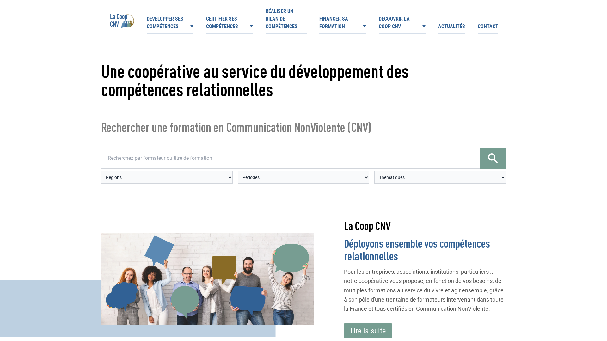
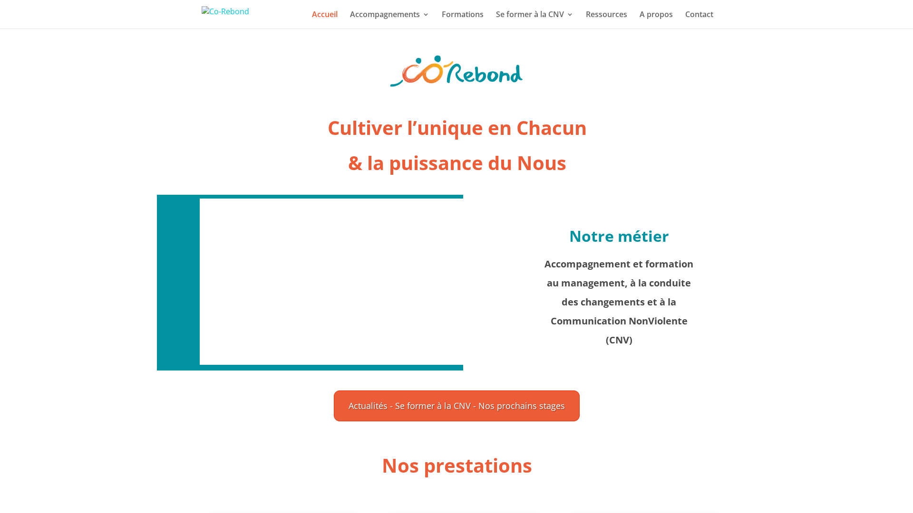
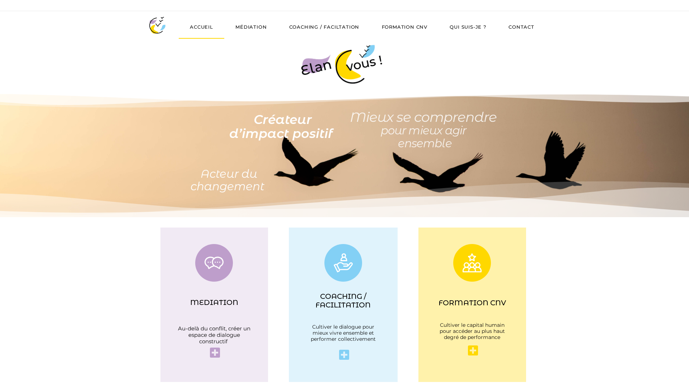
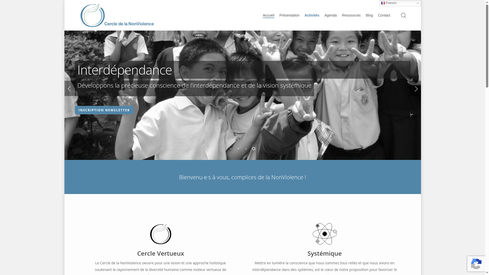
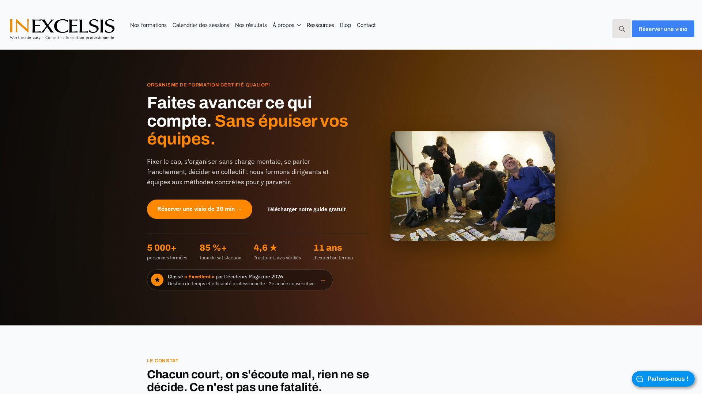
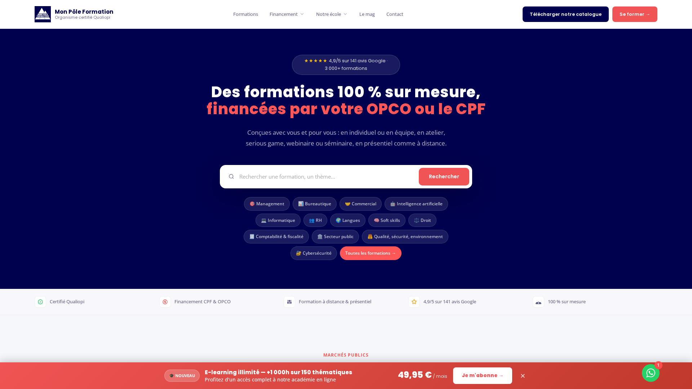
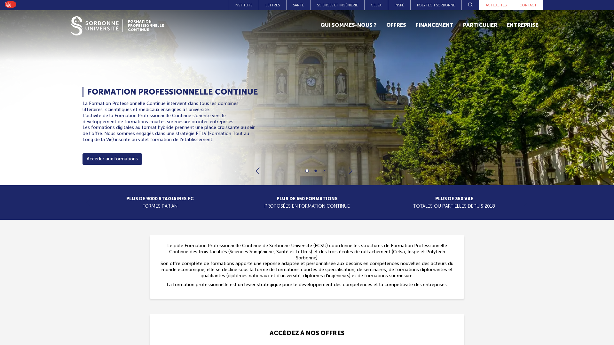
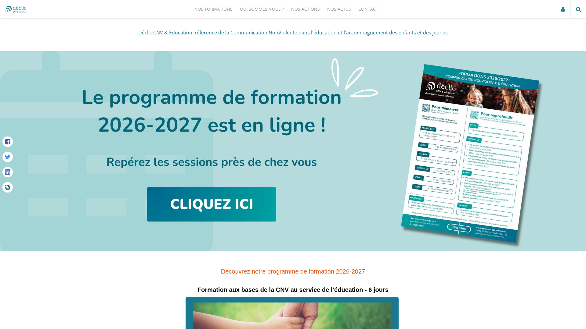

Une équipe veut parler de ses désaccords sans les laisser s’envenimer. Faut-il choisir un stage de deux jours, un parcours de plusieurs mois ou un cursus spécialisé ? En France, les formations à la communication non violente (CNV) se répartissent entre les bases animées par des formateurs certifiés, les stages construits pour les équipes et les parcours liés à un métier. Ce classement compare huit options sur la durée, le public, la pratique, la certification, le prix et les modalités de financement. Les programmes et tarifs cités viennent des pages officielles consultées le 29 octobre 2026.

Rolebase publie cette sélection. L’éditeur développe un logiciel open source de gouvernance d’équipe, où les organisations écrivent les rôles, structurent leurs réunions et consignent leurs décisions. Les organismes de cette sélection assurent les formations à la CNV. La sélection distingue donc les offres selon ce qu’elles enseignent et le public qu’elles visent. Les liens vers les organismes ne sont pas affiliés. Les parcours certifiants s’adressent à celles et ceux qui veulent structurer leur pratique, tandis que les stages courts permettent à une équipe d’essayer la méthode sur des situations de travail. Les formations sectorielles, elles, partent du quotidien des métiers de santé ou d’éducation. Les tarifs indiqués distinguent les prix par personne des prix par jour ou par groupe. Quand un organisme publie un tarif sur devis, le tableau le précise au lieu de fabriquer une estimation. Les sessions et prix peuvent changer, vérifiez les conditions directement auprès du prestataire avant de réserver.

## Comment ce classement est construit

Les huit offres sont réparties en trois groupes, car un stage de deux jours ne répond pas au même besoin qu’un diplôme universitaire de 98 heures. Le premier groupe rassemble les cursus de base progressifs, dont certains s’inscrivent dans le parcours vers une certification. Le deuxième regroupe les formations professionnelles courtes ou conçues pour une équipe. Le troisième comprend les formations destinées à un secteur précis.

Dans chaque groupe, l’ordre privilégie la précision du public et des compétences, puis la place de la pratique et du suivi, la lisibilité de la certification et du financement, et enfin le détail des prix et formats. Dans le premier groupe, La Coop CNV passe en tête parce que le certificateur publie les étapes, les critères d’accès et le prix total du parcours. Co-Rebond décrit ensuite un cursus de six jours avec des tarifs par statut. ÉlanCvous complète le groupe avec ses tarifs par module et par public. Dans le deuxième groupe, le Cercle de la NonViolence précède In Excelsis et Mon Pôle Formation grâce à ses formats pour équipes, ses tarifs par durée et ses chiffres d’activité publiés. Pour le troisième groupe, Sorbonne Université précise la durée, le prix, l’admission et l’évaluation de son diplôme, tandis que Déclic indique un parcours adapté à l’éducation, avec un tarif sur devis. Les tarifs viennent des pages des organismes. Les taux de satisfaction et les chiffres de fréquentation restent attribués à l’organisme qui les publie.

La certification de formateur du Center for Nonviolent Communication (CNVC) et la certification professionnelle française « Dialoguer avec la CNV pour mieux coopérer » ne désignent pas le même parcours. La première autorise son titulaire à enseigner la CNV sous la certification du CNVC. La seconde reconnaît un premier niveau de pratique en contexte professionnel et ne donne pas le droit de former à la CNV. L’inscription au Répertoire spécifique (RS) de cette dernière était annoncée pour trois ans à partir du 31 mai 2024. Vérifiez son statut en vigueur et les conditions de financement avant une inscription en 2026.

## Les 8 formations comparées

| Rang | Formation | Durée et format | Tarif publié | Certification ou public |
| --- | --- | --- | --- | --- |
| 1 | La Coop CNV, parcours « Dialoguer avec la CNV pour mieux coopérer » | 7 jours de formation, puis épreuve à distance | 1 740 € le parcours complet | Certification professionnelle, éligibilité au CPF sous conditions |
| 2 | Co-Rebond, cursus de base | 6 jours en deux modules | De 780 € à 1 200 € selon le statut, devis pour les autres | Parcours de base, éligibilité au parcours de certification selon la structure |
| 3 | ÉlanCvous, parcours professionnel | 6 jours en trois modules de 2 jours | 2 640 € pour les entreprises | Formatrice déclarée certifiée CNVC |
| 4 | Cercle de la NonViolence, formation d’équipe | De 2 heures à 7 jours | De 1 300 € à 1 400 € par jour pour les formats indiqués | Professionnels du soin et de l’accompagnement |
| 5 | In Excelsis, formation en entreprise | 2 jours, 4 à 8 participants | 2 100 € HT par participant | Financement OPCO selon accord de branche |
| 6 | Mon Pôle Formation | 2 jours, présentiel ou à distance | À partir de 1 590 € HT | Attestation de fin de formation, parcours non certifiant |
| 7 | Sorbonne Université, DU pour les professionnels de santé | 98 heures, en présentiel | 1 980 € | Diplôme universitaire, public de santé ciblé |
| 8 | Déclic CNV & Éducation | 6 jours, selon calendrier | Sur devis | Personnes ayant un rôle éducatif |

Les trois premières formations proposent un parcours de base et des options de certification. La Coop CNV, Co-Rebond et ÉlanCvous s’adressent à des publics et à des niveaux d’engagement différents.

## 1. La Coop CNV, parcours « Dialoguer avec la CNV pour mieux coopérer »

[La Coop CNV](https://lacoopcnv.com/certification-dialoguer-cnv-cooperer/) porte la certification professionnelle « Dialoguer avec la CNV pour mieux coopérer ». Le parcours complet réunit les trois modules de base, soit six jours, une journée de consolidation et de préparation à distance, puis une mise en situation de certification de 30 minutes. Le tarif annoncé par le certificateur est de 220 € par jour de formation et de 200 € pour l’épreuve, soit 1 740 € au total depuis le module 1. Il existe aussi des parcours plus courts pour les personnes ayant déjà suivi une partie des modules.

Cette certification s’adresse aux personnes qui travaillent au service du bien commun, notamment dans l’économie sociale et solidaire, les coopératives, les associations, le secteur public ou les entreprises à mission. L’organisme habilité vérifie l’éligibilité. La mobilisation du CPF impose de suivre le parcours avec un seul organisme habilité. La certification valide un premier niveau de dialogue professionnel. Elle n’autorise pas à transmettre la CNV. Si votre objectif est d’animer vous-même des formations, demandez au CNVC les étapes de sa certification de formateur, qui suit un autre parcours.

## 2. Co-Rebond, cursus de base en deux modules

[Co-Rebond](https://cnvformations.fr/formations/cursus-de-6-jours-entreprise-cursus-4-5-6-nov-2026-2-3-4-dec-2026-lyon/) propose un cursus de base de six jours, répartis en deux modules de trois jours. Les exemples et les situations de pratique peuvent relier les bases de la CNV au travail, tout en laissant le parcours ouvert au grand public. Le cursus comprend les étapes d’observation, de clarification des ressentis et des besoins, puis la formulation d’une demande et la pratique du dialogue.

La page d’une session 2026 indique 780 € pour un particulier et 1 200 € pour les professions libérales, les TPE et les petites associations. Les autres tarifs varient selon la taille de la structure, et le site invite les organisations à demander un devis. Des tarifs réduits peuvent aussi s’appliquer. Co-Rebond indique que le cursus peut s’inscrire dans le parcours vers la certification « Dialoguer avec la CNV pour mieux coopérer », sous réserve que la structure et le participant répondent aux conditions d’éligibilité. Le détail du calendrier varie selon la session. Consultez la page du cursus avant de choisir vos dates.

## 3. ÉlanCvous, bases de la CNV en milieu professionnel

[ÉlanCvous](https://elancvous.fr/formation-cnv) présente un cycle de base en trois modules de deux jours : introduction à la CNV, ouverture au dialogue et pratique du dialogue. La formatrice indique être certifiée par le CNVC. Le programme prévoit donc six jours pour passer des premières étapes du processus aux échanges en situation de désaccord. La page présente aussi des modules d’approfondissement consacrés au pouvoir, au corps, au leadership et à l’authenticité dans la relation.

Les tarifs sont différenciés selon le public. Un module de deux jours coûte 230 € pour les particuliers, 360 € pour les indépendants et les TPE, et 880 € pour les entreprises. Le cycle de six jours revient à 2 640 € pour une entreprise au tarif affiché. Cette différence aide les équipes à budgéter un parcours plus long que l’initiation, tandis que les particuliers peuvent suivre les mêmes bases à un tarif inférieur. La page ne présente pas ce parcours comme la certification professionnelle « Dialoguer avec la CNV pour mieux coopérer ». Si la reconnaissance CPF est déterminante, vérifiez le parcours certifiant et ses conditions auprès de son certificateur.

Les trois formations suivantes proposent des formats professionnels courts ou adaptés à une équipe. Leurs tarifs s’appliquent soit par participant, soit au groupe, selon la formule.

## 4. Cercle de la NonViolence, parcours pour les équipes

Le [Cercle de la NonViolence](https://cercle-cnv.com/formations-cnv-intra/) construit des formations pour les professionnels du soin et de l’accompagnement. Son catalogue 2026 propose plusieurs formats : atelier de deux heures, journée de découverte, module de base de deux jours et parcours de cinq à sept jours. Les équipes peuvent ainsi commencer par une séance de sensibilisation ou travailler les bases sur plusieurs journées. Le collectif déclare réunir 15 formateurs en 2026 et avoir formé plus de 1 400 personnes, en contexte professionnel et personnel.

Pour les groupes de six à seize personnes, le tarif publié est de 1 400 € par jour pour une à trois journées, puis de 1 300 € par jour à partir de cinq journées. Le site indique que les formations professionnelles sont financées par les OPCO. Le montant final dépend du format choisi et de la proposition faite à l’organisation. Cette offre convient surtout aux établissements qui veulent faire travailler une équipe sur des situations liées au soin ou à l’accompagnement. Pour un participant isolé, le Cercle indique que les personnes peuvent rejoindre des stages interentreprises quand le groupe compte moins de six personnes.

## 5. In Excelsis, pratique de la CNV au travail

[In Excelsis](https://www.inxl.fr/formation/cnv/) propose deux jours de formation en présentiel pour des groupes de quatre à huit participants. Le tarif interentreprises annoncé est de 2 100 € HT par participant. Les exercices abordent l’observation, les sentiments, les besoins et les demandes, puis l’écoute et les échanges professionnels difficiles. Les participants peuvent s’entraîner à partir de situations concrètes, avec des jeux de rôle et des exercices filmés. Le groupe restreint laisse du temps pour rejouer les dialogues et recevoir un retour.

La page indique que les formateurs ont suivi au moins 20 jours de formation à la CNV ou exercent comme médiateurs professionnels par la CNV. Elle précise aussi que la formation ne s’adresse pas à des formateurs certifiés par le CNVC en tant que tels, et qu’elle ne mène pas à la certification de formateur. L’organisme affiche un taux de recommandation de 80 %, en précisant que l’échantillon reste limité, ainsi qu’une note Trustpilot de 4,6/5 datée de septembre 2026. Le financement OPCO dépend de l’accord de branche. Le prix correspond à une place interentreprises, tandis que le format intra se chiffre sur devis.

## 6. Mon Pôle Formation, formation de deux jours

[Mon Pôle Formation](https://monpoleformation.fr/formation/communication-non-violente-observer-exprimer-ses-besoins-et-demander/) annonce une formation de deux jours, soit 14 heures, en présentiel ou à distance. Son prix commence à 1 590 € HT. Le programme suit le passage de l’observation à l’expression des besoins et à une demande claire, avec des exercices et des mises en situation. Les sessions interentreprises conviennent aux participants de plusieurs organisations. Une session intra permet à une équipe de travailler ses propres situations.

L’organisme publie des dates allant jusqu’en 2027 et des réductions pour plusieurs participants inscrits à une même session interentreprises. La page indique que la formation n’est pas certifiante et que chaque participant reçoit une attestation de fin de formation. Ce format peut convenir à une personne qui cherche un stage court et structuré sans viser une certification professionnelle spécifique. Avant l’inscription, comparez le tarif de la session retenue avec le prix de départ et vérifiez les modalités de financement applicables à votre organisation.

Les deux dernières offres s’adressent à des métiers précis. Sorbonne Université cible les professionnels de santé, tandis que Déclic CNV & Éducation forme les personnes travaillant dans l’éducation.

## 7. Sorbonne Université, diplôme universitaire pour les professionnels de santé

La formation continue de [Sorbonne Université](https://fc.sorbonne-universite.fr/nos-offres/du-communication-non-violente-pour-les-professionnels-de-la-sante/) propose un diplôme universitaire consacré à la CNV pour les professionnels de santé. Le cursus compte 98 heures en présentiel et coûte 1 980 €. Il cible principalement les médecins hospitaliers, avec des places aussi prévues pour les cadres de santé et les cadres administratifs. Le programme aborde la qualité de la relation de soin, l’écoute, l’expression des difficultés, la gestion des tensions et la coopération dans les équipes de santé.

Les enseignements se répartissent en modules sur plusieurs mois. Le programme réserve une large place aux travaux dirigés et pratiques, aux mises en situation et aux groupes de pratique à distance. Les participants rédigent aussi un mémoire et le soutiennent oralement. Ce format va bien au-delà d’un stage d’initiation de deux jours et demande un engagement sur l’année universitaire. Il s’adresse à un public professionnel précis, avec des critères de candidature et des possibilités de financement par l’employeur ou un organisme financeur. Les modalités et le calendrier doivent être vérifiés auprès de l’université pour chaque promotion.

## 8. Déclic CNV & Éducation, bases appliquées aux métiers éducatifs

[Déclic CNV & Éducation](https://www.declic-cnveducation.org/formation/se-former-aux-bases-de-la-cnv-en-2025-avec-declic/) adapte les bases de la CNV à la relation éducative. Son parcours de six jours s’adresse aux personnes qui travaillent dans l’éducation et s’appuie sur les situations du quotidien éducatif. Les sessions 2026-2027 annoncées couvrent plusieurs villes, dont Marseille, Lyon, Vannes, Paris et Bordeaux. Des formatrices et formateurs certifiés CNVC interviennent sur ces parcours.

Déclic est certifié Qualiopi et indique que les prises en charge peuvent dépendre du statut du participant et de son établissement. Le tarif de la formation est établi sur devis, ce qui rend la comparaison des coûts moins immédiate que pour les offres dont le prix est public. La formation donne une attestation de réalisation. Elle ne doit pas être confondue avec une certification professionnelle de formateur CNVC. Cette spécialisation se distingue par son public : elle aide les professionnels de l’éducation à relier les bases de la CNV aux situations rencontrées avec les enfants, les jeunes et les équipes éducatives.

## Comment choisir une formation CNV

Commencez par définir ce que vous voulez faire après la formation. Pour découvrir le processus et pratiquer des dialogues difficiles, deux jours peuvent suffire à poser les bases. In Excelsis et Mon Pôle Formation publient des formats de 14 heures. Comparez le nombre de participants, les exercices, le suivi et le tarif final, plutôt que le seul titre « communication non violente ».

Si vous cherchez une reconnaissance professionnelle, vérifiez le nom exact de la certification et les conditions d’accès. La certification « Dialoguer avec la CNV pour mieux coopérer » concerne un premier niveau de pratique et peut ouvrir un financement CPF aux personnes éligibles. La certification du formateur CNVC suit un parcours différent, pensé pour transmettre la méthode. Les mots « certifiant » et « certifié » ne suffisent donc pas à savoir ce que vous pourrez faire à la fin.

Pour former une équipe entière, demandez un devis intra qui précise le nombre de participants, les situations travaillées, la durée et les modalités de financement. Le Cercle de la NonViolence annonce des formats conçus pour le soin et l’accompagnement. La Coop CNV construit aussi des interventions pour les organisations. Un tarif journalier peut couvrir le groupe entier, tandis qu’un tarif interentreprises s’applique à chaque participant.

Enfin, choisissez un parcours spécialisé quand le contexte professionnel change les situations à travailler. Sorbonne Université s’adresse aux professionnels de santé. Déclic CNV & Éducation vise les métiers éducatifs. Dans une équipe qui répartit les responsabilités entre plusieurs rôles, la CNV peut aider à exprimer un désaccord ou une difficulté. Dans Rolebase, une personne peut [exprimer une tension dans le rôle concerné](/fr/guides/raise-a-tension), puis la traiter en discussion, proposition, tâche ou décision. L’outil organise ce travail de gouvernance. Il ne remplace pas la formation relationnelle.

Les formations générales au management transversal ne sont pas comparées ici. Le classement dédié aux [formations au management transversal](/fr/blog/top-cross-functional-management-training) examine cette autre compétence.

## Questions fréquentes

<FaqList>

<FaqItem question="Quelle formation CNV choisir pour commencer ?">

Pour découvrir les bases, choisissez un stage de deux jours si vous souhaitez une première pratique, ou un cursus de six jours si vous voulez progresser sur plusieurs modules. ÉlanCvous publie un parcours de trois modules de deux jours. Co-Rebond propose six jours répartis en deux modules. Pour une pratique en équipe de soin ou d’accompagnement, le Cercle de la NonViolence propose aussi des formats de deux à sept jours. Demandez si les mises en situation utilisent des exemples apportés par les participants et si les exercices se poursuivent après le stage. Ces détails aident à distinguer un premier aperçu d’un parcours d’apprentissage suivi.

</FaqItem>

<FaqItem question="Combien coûte une formation en communication non violente ?">

Les tarifs dépendent de la durée et du public. Mon Pôle Formation affiche un prix à partir de 1 590 € HT pour deux jours. In Excelsis annonce 2 100 € HT par participant pour deux jours en interentreprises. Le parcours complet « Dialoguer avec la CNV pour mieux coopérer » coûte 1 740 € selon le tarif affiché par son certificateur. Pour une formation intra, demandez le prix par groupe et vérifiez si le devis comprend les frais annexes. Une certification professionnelle ou un diplôme universitaire suit une autre logique de prix qu’un stage de deux jours. Comparez le nombre d’heures, le public admis et l’évaluation finale en même temps que le montant.

</FaqItem>

<FaqItem question="Une formation CNV est-elle éligible au CPF ?">

Certaines sessions peuvent s’inscrire dans la certification professionnelle « Dialoguer avec la CNV pour mieux coopérer », sous réserve de l’éligibilité du participant et de sa structure. La Coop CNV publie un tarif de 1 740 € pour le parcours complet. Cette certification porte sur la pratique professionnelle de la CNV et ne donne pas le droit de former à la méthode. Vérifiez le statut actuel de la certification, les règles du CPF et l’offre précise avant l’inscription. Le certificateur précise que le parcours comprend six jours de bases, une journée de préparation et une mise en situation de 30 minutes. L’organisme habilité vérifie que le participant peut s’inscrire.

</FaqItem>

<FaqItem question="Quelle différence entre une certification CNVC et une certification RS ?">

Le CNVC certifie des formateurs qui peuvent transmettre la CNV sous sa certification. La certification « Dialoguer avec la CNV pour mieux coopérer », portée par La Coop CNV, reconnaît un premier niveau de pratique de la CNV dans un contexte professionnel. Elle n’autorise pas à enseigner la CNV. Ce sont deux parcours et deux objectifs distincts.

</FaqItem>

<FaqItem question="Peut-on suivre une formation CNV à distance ?">

Oui. Certaines formations combinent des sessions en présence et une préparation ou une évaluation à distance. In Excelsis propose aussi des formats d’entreprise en français ou en anglais, et Mon Pôle Formation affiche des sessions en classe virtuelle. La formation à distance permet de suivre le cours sans déplacement. Vérifiez la durée des exercices en groupe et les modalités de pratique en direct. Pour une équipe, demandez si les participants s’entraînent sur leurs propres cas et comment le formateur organise les retours lorsque chacun se connecte à distance.

</FaqItem>

<FaqItem question="La CNV remplace-t-elle une formation à la gestion des conflits ?">

La CNV propose un cadre pour observer une situation, exprimer ce que l’on ressent et ce dont on a besoin, puis formuler une demande. Une formation spécialisée en gestion des conflits peut couvrir d’autres méthodes, la médiation ou la prévention des risques. Choisissez selon les situations de travail à traiter et les compétences attendues. Pour une répartition de responsabilité ou une décision d’équipe, [la réunion de gouvernance](/fr/blog/governance-meeting) décrit un processus complémentaire. Les deux approches peuvent se compléter : une formation apprend à mener le dialogue, tandis qu’une réunion de gouvernance traite la décision ou les rôles qui doivent évoluer.

</FaqItem>

<FaqItem question="Une formation de deux jours suffit-elle pour devenir formateur CNV ?">

Non. Deux jours permettent de découvrir ou de pratiquer des bases, mais ils ne remplacent pas le parcours de certification de formateur du CNVC. La page du CNVC décrit un parcours de plusieurs années, fondé sur l’intégration de la méthode, la pratique et la transmission. La certification « Dialoguer avec la CNV pour mieux coopérer » reconnaît elle aussi un premier niveau de pratique professionnelle, sans autoriser à former. Avant de choisir une formation destinée à devenir formateur, consultez l’annuaire des formateurs certifiés et demandez au CNVC les étapes de son processus actuel.

</FaqItem>

</FaqList>

## Pour commencer

Une bonne formation CNV correspond au besoin précis de la personne ou de l’équipe. Un stage court aide à découvrir le processus. Un cursus de plusieurs jours laisse davantage de place à la pratique. Un diplôme universitaire ou une formation sectorielle relie la CNV à un métier précis. Vérifiez le programme, le prix complet, le public, les financements possibles et la certification annoncée avant de vous inscrire.

Quand un désaccord concerne aussi la répartition des responsabilités, l’équipe peut le formuler comme une tension et en parler dans le rôle concerné. Dans Rolebase, l’organigramme, les discussions et les décisions restent rattachés aux rôles. Découvrez [les fonctionnalités de gouvernance d’équipe de Rolebase](/fr/features) ou [créez un compte gratuit jusqu’à cinq membres actifs](/fr/pricing).

<OrgListJsonLd
  name="Formations CNV en France : les 8 meilleures en 2026"
  description="Huit formations à la communication non violente en France comparées en trois groupes : parcours de base et certification, stages professionnels, et cursus spécialisés."
  items={[
    { name: 'La Coop CNV', url: 'https://lacoopcnv.com/' },
    { name: 'Co-Rebond', url: 'https://co-rebond.fr/' },
    { name: 'ÉlanCvous', url: 'https://elancvous.fr/' },
    { name: 'Cercle de la NonViolence', url: 'https://cercle-cnv.com/' },
    { name: 'In Excelsis', url: 'https://www.inxl.fr/' },
    { name: 'Mon Pôle Formation', url: 'https://monpoleformation.fr/' },
    { name: 'Sorbonne Université', url: 'https://www.sorbonne-universite.fr/' },
    { name: 'Déclic CNV & Éducation', url: 'https://www.declic-cnveducation.org/' },
  ]}
/>
