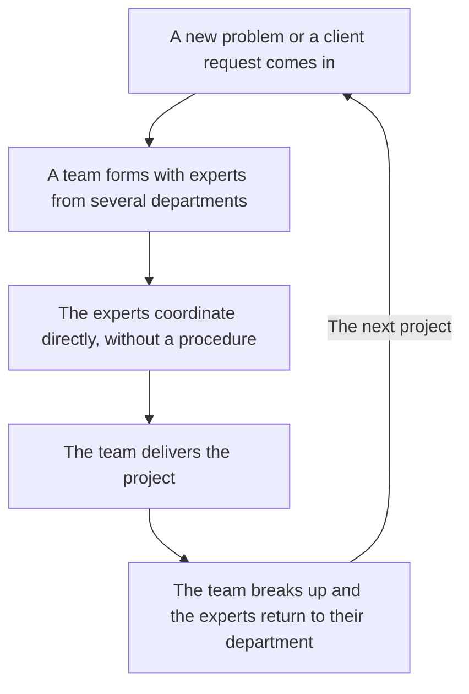
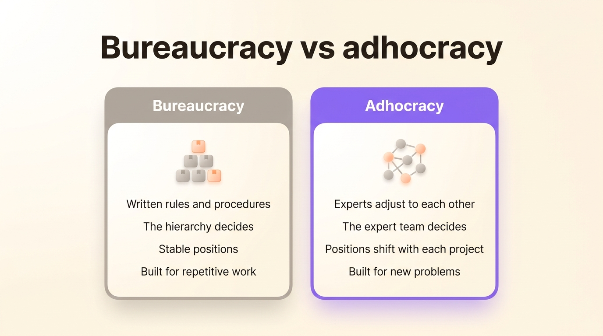
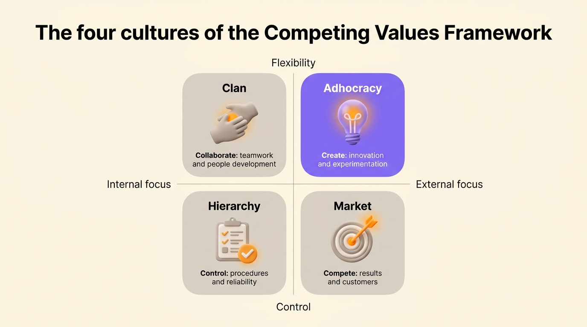

An adhocracy is a flexible form of organization that puts together a team of experts for each problem, lets them coordinate directly with each other, and breaks the team up once the work is done. The management scholar Henry Mintzberg described it in 1979 as the opposite of bureaucracy: few rules, few fixed positions, and decisions made by the people who hold the expertise.

The word joins the Latin *ad hoc*, "for this purpose," to the Greek suffix *-cracy*, "rule." You also see it spelled ad-hocracy or ad hocracy. An advertising agency, a film production company and a consultancy that builds a new team for every client are the usual examples.

## Where the word adhocracy comes from

In 1968, the organizational psychologist Warren Bennis and the sociologist Philip Slater published *The Temporary Society*. They predicted that companies would replace stable departments with temporary task forces, put together around a problem and dissolved once it was solved. Some reference works, Wiktionary among them, also credit them with coining the word.

The futurist Alvin Toffler made the word popular. In *Future Shock*, published in 1970, he devoted a chapter to it, titled "Organization: The Coming Ad-hocracy." Toffler argued that the pace of change would make bureaucracy obsolete. Organizations would form a group around each project and dismantle it at the end. Each group would last only as long as its project, too short a time to wait for decisions from the hierarchy.

Henry Mintzberg, a management professor at McGill University in Montreal, turned the idea into a model. In *The Structuring of Organizations* (1979), he credits Toffler with the term and makes adhocracy one of his five configurations. Robert Waterman, co-author of *In Search of Excellence*, gave it a looser meaning in 1990 in *Adhocracy: The Power to Change*: any arrangement that cuts across the usual bureaucratic lines to seize an opportunity or solve a problem.

## Adhocracy in Mintzberg's model

Mintzberg classifies organizations by the way they coordinate work. He names five configurations, each built on one main coordination mechanism:

| Configuration | Main coordination mechanism | Typical example |
|---|---|---|
| Simple structure | Direct supervision by the boss | A young startup run by its founder |
| Machine bureaucracy | Standardized work processes | A car plant, a call center |
| Professional bureaucracy | Standardized skills | A hospital, a university |
| Divisionalized form | Standardized outputs | A group with business units |
| Adhocracy | Mutual adjustment | An ad agency, a space program |

In an adhocracy, nobody can write the procedure in advance because the problem is new each time. Experts from different fields work it out among themselves, in small project teams, through what Mintzberg calls mutual adjustment. In his words, the adhocracy has to "fuse experts drawn from different disciplines into smoothly functioning ad hoc project teams."

People usually stay attached to a home department, engineering or design for instance, which hires and trains them. The work itself happens in the project teams, which often gives the adhocracy a matrix structure. Mintzberg sees adhocracy as the form suited to an environment that is both complex and changing fast, where an organization has to keep innovating.

### Operating and administrative adhocracy

Mintzberg distinguishes two variants:

- The operating adhocracy solves problems for its clients. Advertising agencies, consultancies, film production companies and design studios work this way. Mintzberg studied the National Film Board of Canada in 1985, in a paper co-written with Alexandra McHugh: the institution made around 75 films a year and coordinated the work mostly through mutual adjustment, whatever the plans said.
- The administrative adhocracy runs projects for itself and keeps its routine production separate, sometimes outsourced. Mintzberg's textbook case is NASA's moon program in the 1960s.

## Adhocracy vs bureaucracy

Bureaucracy, in the sense of the German sociologist Max Weber, writes the rules down, defines each position and settles every disagreement by going up the hierarchy. Adhocracy does the reverse on each point:

| | Bureaucracy | Adhocracy |
|---|---|---|
| How work is coordinated | Written rules and procedures | Experts adjusting to each other |
| Who decides | The hierarchy | The team that holds the expertise |
| Positions | Stable, described in a job description | Shift from one project to the next |
| Grouping | Departments by function | Temporary project teams, often in a matrix |
| Best suited to | Repetitive, predictable work | New, complex problems |
| Main weakness | Rigid when things change | Inefficient on routine work |

{/* IMAGE regen: api.py image, infographic, 1600x900. Scene: "Two side-by-side vertical cards comparing two ways of organizing work, with a large bold modern sans-serif title at the top that reads exactly: Bureaucracy vs adhocracy. No people and no decorative scenes, only the two cards with their icons and text. Left card, header 'Bureaucracy', a small icon of a stacked pyramid of boxes, four short lines: 'Written rules and procedures', 'The hierarchy decides', 'Stable positions', 'Built for repetitive work'. Right card, header 'Adhocracy', a small icon of several round nodes linked in a loose network, four short lines: 'Experts adjust to each other', 'The expert team decides', 'Positions shift with each project', 'Built for new problems'. Left card in warm grey, right card highlighted in purple, small orange accents on the icons. Soft rounded shapes, generous spacing." Regenerate if the rows of the "Adhocracy vs bureaucracy" table change. Last data sync: 2026-10-27. */}

Both forms coexist inside most companies. A software company can run its support desk as a machine bureaucracy, with scripts and response times, and its product teams as an adhocracy. Toffler predicted that adhocracy would replace bureaucracy. Most repetitive work is still run as a bureaucracy, though.

## The limits of adhocracy

Mintzberg himself lists the weaknesses of the form without softening them:

- It is unstable. Mintzberg writes that "Adhocracy is the least stable form of structure" and that "all kinds of forces drive the Adhocracy to bureaucratize itself as it ages." A successful project turns into a product, the product needs procedures, and the procedures harden.
- It costs a lot in coordination. Mutual adjustment means meetings, discussions and constant negotiation. In Mintzberg's words, adhocracy "is simply not an efficient structure" and "is not competent at doing ordinary things."
- It demands a high tolerance for ambiguity. Without a stable position or a clear boss, each person has to keep working out what is expected of them. Some people enjoy that freedom. For others, the constant guessing becomes exhausting.
- It breeds conflict. When nobody has written down who decides, power goes to whoever pushes hardest or knows the right people.

Ambiguity and conflict share a cause: in an adhocracy, nobody settles who has the last word on a given question. Mintzberg's model describes how teams form and coordinate, and leaves that question open. Mutual adjustment works well among a few experts who trust each other. Once the organization reaches a few dozen people, the unwritten agreements often stop holding.

## Adhocracy culture in the Competing Values Framework

The word has a second life in research on organizational culture. In *Diagnosing and Changing Organizational Culture* (1999), Kim Cameron and Robert Quinn, both professors at the University of Michigan, sort cultures along two axes, flexibility versus control and internal versus external focus. They get four types:

- The clan culture is flexible and turned inward: it runs like a family and values developing its people.
- The adhocracy culture is flexible and turned outward: it values innovation, experimentation and taking risks.
- The market culture is controlled and turned outward: it values results and competition.
- The hierarchy culture is controlled and turned inward: it values procedures, efficiency and reliability.

{/* IMAGE regen: api.py image, infographic, 1600x900. Scene: "A clean two-by-two matrix with a large bold modern sans-serif title at the top that reads exactly: The four cultures of the Competing Values Framework. The horizontal axis is labeled 'Internal focus' on the left and 'External focus' on the right. The vertical axis is labeled 'Flexibility' at the top and 'Control' at the bottom. Four rounded quadrants, each with a small icon, a header and one short line. Top left: header 'Clan', icon of two hands joined, line 'Collaborate: teamwork and people development'. Top right: header 'Adhocracy', icon of a lightbulb, line 'Create: innovation and experimentation'. Bottom left: header 'Hierarchy', icon of a checklist, line 'Control: procedures and reliability'. Bottom right: header 'Market', icon of a target, line 'Compete: results and customers'. The Adhocracy quadrant is highlighted in purple, the three others in warm grey, small orange accents on the icons. No people, soft rounded shapes, generous spacing." Regenerate if the four culture types described in the "Adhocracy culture in the Competing Values Framework" section change. Last data sync: 2026-10-27. */}

Their questionnaire, the Organizational Culture Assessment Instrument (OCAI), measures how much of each culture an organization shows today and how much its members would like. The adhocracy culture concerns how people behave, independently of the structure Mintzberg described. A bureaucratic company can therefore still run a few teams with an adhocracy culture.

## Adhocracy and self-organization

Adhocracy belongs to the same family as the [flat organization](/en/glossary/organisation-horizontale): both cut down the role of the hierarchy and leave decisions to the people doing the work. They differ in how long teams last. A flat organization keeps stable teams with few management layers, while an adhocracy keeps reshuffling its teams around projects.

The [problems that hierarchy creates](/en/blog/hierarchy-problems) are real: decisions slow down at every layer and information gets filtered on its way up. But once the layers are gone, a flat organization and an adhocracy still have to settle who decides what. In a structure with no written authority, decisions often end up with the founder or the loudest voice. That risk is the main thing to weigh in the [flat vs hierarchical](/en/blog/flat-vs-hierarchical) choice.

[Holacracy](/en/glossary/holacratie) and [sociocracy](/en/glossary/sociocratie) answer the question of who decides, which an adhocracy leaves open. They keep the flexibility, since roles change as often as the work requires, but they write each role down along with its purpose, its accountabilities and the domain it controls. The changes go through a [governance meeting](/en/glossary/reunion-de-gouvernance) rather than through informal negotiation. Teams keep adapting to each new problem while knowing who has the final say.

An organization built on [roles](/en/glossary/role) keeps the flexibility of an adhocracy and fixes its main weakness, the unclear authority. A person can hold several roles and move from one project to another, while each role keeps its responsibilities in writing. [Rolebase](/en/features) is a platform where an organization writes down its roles, runs its meetings and keeps its org chart. The org chart is built from these roles, so when a team re-forms around a new project, everyone can see who holds which responsibility.

## Frequently asked questions

<FaqList>

<FaqItem question="What is an example of an adhocracy?">

Advertising agencies, consultancies, architecture firms and film production companies are operating adhocracies: each client project brings together a different team of experts. The management professor Henry Mintzberg studied an adhocracy of this kind, the National Film Board of Canada. NASA during the Apollo program is the classic example of an administrative adhocracy.

</FaqItem>

<FaqItem question="What is the difference between adhocracy and bureaucracy?">

A bureaucracy coordinates work through written rules, stable positions and a hierarchy that settles disagreements. In an adhocracy, experts adjust to each other in temporary project teams. Bureaucracy works best on repetitive work. New and complex problems call for an adhocracy.

</FaqItem>

<FaqItem question="Who came up with the term adhocracy?">

The organizational psychologist Warren Bennis and the sociologist Philip Slater described temporary, problem-based organizations in *The Temporary Society* in 1968. The futurist Alvin Toffler made the word "ad-hocracy" popular in *Future Shock* in 1970. The management professor Henry Mintzberg turned it into one of his five organizational configurations in 1979.

</FaqItem>

<FaqItem question="What is the difference between adhocracy and holacracy?">

An adhocracy forms teams around each project and leaves roles loosely defined, so authority is negotiated informally. Holacracy also lets the structure change often, but it writes every role down with its purpose and accountabilities and changes the roles through a set governance process.

</FaqItem>

<FaqItem question="What is an adhocracy culture?">

In the Competing Values Framework of Kim Cameron and Robert Quinn, two University of Michigan professors, an adhocracy culture is one of four culture types, alongside clan, market and hierarchy. It combines flexibility with an outward focus and values innovation, experimentation and risk-taking. Leaders in this culture act as entrepreneurs and visionaries.

</FaqItem>

</FaqList>
