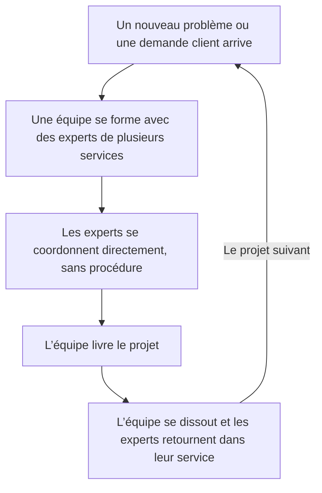

L’adhocratie est une forme d’organisation souple qui réunit une équipe d’experts pour chaque problème, les laisse se coordonner directement entre eux, puis dissout l’équipe une fois le travail terminé. Le chercheur en management Henry Mintzberg l’a décrite en 1979 comme l’opposé de la bureaucratie : peu de règles, peu de postes figés, et des décisions prises par ceux qui ont l’expertise.

Le mot associe le latin *ad hoc*, « pour cet usage », au suffixe grec *-cratie*, « pouvoir ». On le trouve aussi écrit ad-hocratie. Une agence de publicité, une société de production de films ou un cabinet de conseil qui monte une nouvelle équipe pour chaque client en sont les exemples habituels.

## D’où vient le mot adhocratie

En 1968, le psychologue des organisations Warren Bennis et le sociologue Philip Slater publient *The Temporary Society*. Ils y prédisent que les entreprises remplaceront leurs services stables par des groupes de travail temporaires, montés autour d’un problème et dissous une fois celui-ci réglé. Certains ouvrages de référence, dont le Wiktionary anglophone, leur attribuent aussi l’invention du mot.

Le futurologue Alvin Toffler a rendu le mot populaire. Dans *Le Choc du futur* (*Future Shock*), paru en 1970, il lui consacre un chapitre intitulé « Organization: The Coming Ad-hocracy ». Pour Toffler, la vitesse du changement allait rendre la bureaucratie obsolète. Les organisations formeraient un groupe autour de chaque projet et le démonteraient à la fin. Chaque groupe ne durerait que le temps de son projet, trop peu pour attendre les décisions de la hiérarchie.

Henry Mintzberg, professeur de management à l’université McGill de Montréal, a fait de cette idée un modèle. Dans *The Structuring of Organizations* (1979), traduit en français sous le titre *Structure et dynamique des organisations*, il attribue le terme à Toffler et fait de l’adhocratie l’une de ses cinq configurations. Robert Waterman, coauteur du *Prix de l’excellence*, lui donne un sens plus large en 1990 dans *Adhocracy: The Power to Change* : toute organisation qui sort des circuits bureaucratiques habituels pour saisir une occasion ou régler un problème.

## L’adhocratie dans le modèle de Mintzberg

Mintzberg classe les organisations selon la façon dont elles coordonnent le travail. Il distingue cinq configurations, chacune fondée sur un mécanisme de coordination principal :

| Configuration | Mécanisme de coordination principal | Exemple type |
|---|---|---|
| Structure simple | Supervision directe par le patron | Une jeune startup dirigée par son fondateur |
| Bureaucratie mécaniste | Standardisation des procédés de travail | Une usine automobile, un centre d’appels |
| Bureaucratie professionnelle | Standardisation des qualifications | Un hôpital, une université |
| Structure divisionnalisée | Standardisation des résultats | Un groupe organisé en divisions |
| Adhocratie | Ajustement mutuel | Une agence de publicité, un programme spatial |

Dans une adhocratie, personne ne peut écrire la procédure à l’avance, parce que le problème change à chaque fois. Des experts de métiers différents trouvent la solution entre eux, en petites équipes projet, par ce que Mintzberg appelle l’ajustement mutuel. L’adhocratie doit selon lui réussir à fondre des experts venus de disciplines différentes dans des équipes projet qui fonctionnent sans heurts.

Chacun reste en général rattaché à un service d’origine, l’ingénierie ou le design par exemple, qui le recrute et le forme. Le travail se fait dans les équipes projet, ce qui donne souvent à l’adhocratie une structure matricielle. Mintzberg voit dans l’adhocratie la forme adaptée à un environnement à la fois complexe et changeant, où une organisation doit innover en permanence.

### Adhocratie opérationnelle et adhocratie administrative

Mintzberg distingue deux variantes :

- L’adhocratie opérationnelle règle des problèmes pour ses clients. Les agences de publicité, les cabinets de conseil, les sociétés de production de films et les studios de design fonctionnent ainsi. Mintzberg a étudié l’Office national du film du Canada en 1985, dans un article écrit avec Alexandra McHugh : l’institution produisait environ 75 films par an et coordonnait ce travail surtout par ajustement mutuel, quels que soient les plans.
- L’adhocratie administrative mène des projets pour elle-même et isole sa production courante, qu’elle sous-traite parfois. L’exemple type de Mintzberg est le programme lunaire de la NASA dans les années 1960.

## Adhocratie et bureaucratie

La bureaucratie, au sens du sociologue allemand Max Weber, écrit les règles, définit chaque poste et tranche chaque désaccord en remontant la hiérarchie. L’adhocratie fait l’inverse sur chaque point :

| | Bureaucratie | Adhocratie |
|---|---|---|
| Coordination du travail | Règles et procédures écrites | Ajustement mutuel entre experts |
| Décision | La hiérarchie | L’équipe qui a l’expertise |
| Postes | Stables, décrits dans une fiche de poste | Changent d’un projet à l’autre |
| Regroupement | Services par fonction | Équipes projet temporaires, souvent en matrice |
| Travail adapté | Répétitif et prévisible | Problèmes nouveaux et complexes |
| Faiblesse principale | Rigide quand tout change | Peu efficace sur la routine |

{/* IMAGE regen: api.py image, infographic, 1600x900. Scene: "Two side-by-side vertical cards comparing two ways of organizing work, with a large bold modern sans-serif title at the top that reads exactly: Bureaucratie ou adhocratie. No people and no decorative scenes, only the two cards with their icons and text. Left card, header 'Bureaucratie', a small icon of a stacked pyramid of boxes, four short lines: 'Règles et procédures écrites', 'La hiérarchie décide', 'Postes stables', 'Faite pour le travail répétitif'. Right card, header 'Adhocratie', a small icon of several round nodes linked in a loose network, four short lines: 'Les experts s’ajustent entre eux', 'L’équipe d’experts décide', 'Les postes changent à chaque projet', 'Faite pour les problèmes nouveaux'. Left card in warm grey, right card highlighted in purple, small orange accents on the icons. Soft rounded shapes, generous spacing." Regenerate if the rows of the "Adhocratie et bureaucratie" table change. Last data sync: 2026-10-27. */}

Les deux formes cohabitent dans la plupart des entreprises. Un éditeur de logiciels peut organiser son support comme une bureaucratie mécaniste, avec des scripts et des délais de réponse, et ses équipes produit comme une adhocratie. Toffler prédisait que l’adhocratie remplacerait la bureaucratie. L’essentiel du travail répétitif reste pourtant organisé en bureaucratie.

## Les limites de l’adhocratie

Mintzberg dresse lui-même la liste des faiblesses de cette forme, sans les adoucir :

- Elle est instable. Mintzberg la décrit comme la moins stable des structures et note que toutes sortes de forces la poussent à se bureaucratiser en vieillissant. Un projet réussi devient un produit, le produit demande des procédures, et les procédures se figent.
- Elle coûte cher en coordination. L’ajustement mutuel veut dire des réunions, des discussions et des négociations permanentes. Pour Mintzberg, l’adhocratie n’est tout simplement pas une structure efficace, ni compétente pour faire les choses ordinaires.
- Elle demande une forte tolérance à l’ambiguïté. Sans poste stable ni chef clairement identifié, chacun doit sans cesse deviner ce qu’on attend de lui. Certains apprécient cette liberté. D’autres finissent épuisés à force de deviner.
- Elle crée des conflits. Quand personne n’a écrit qui décide, le pouvoir va à celui qui pousse le plus fort ou qui connaît les bonnes personnes.

L’ambiguïté et les conflits ont la même origine : dans une adhocratie, personne ne fixe qui a le dernier mot sur un sujet donné. Le modèle de Mintzberg décrit comment les équipes se forment et se coordonnent, et laisse cette question ouverte. L’ajustement mutuel marche bien entre quelques experts qui se font confiance. Quand l’organisation atteint quelques dizaines de personnes, les accords tacites ne tiennent souvent plus.

## La culture adhocratique selon Cameron et Quinn

Le mot a une seconde vie dans les recherches sur la culture d’entreprise. Dans *Diagnosing and Changing Organizational Culture* (1999), Kim Cameron et Robert Quinn, tous deux professeurs à l’université du Michigan, classent les cultures selon deux axes : flexibilité ou contrôle, et orientation interne ou externe. Ils obtiennent quatre types :

- La culture clan est souple et tournée vers l’interne : elle fonctionne comme une famille et valorise le développement de ses membres.
- La culture adhocratique est souple et tournée vers l’extérieur : elle valorise l’innovation, l’expérimentation et la prise de risque.
- La culture de marché est contrôlée et tournée vers l’extérieur : elle valorise les résultats et la compétition.
- La culture hiérarchique est contrôlée et tournée vers l’interne : elle valorise les procédures, l’efficacité et la fiabilité.

{/* IMAGE regen: api.py image, infographic, 1600x900. Scene: "A clean two-by-two matrix with a large bold modern sans-serif title at the top that reads exactly: Les quatre cultures du modèle de Cameron et Quinn. The horizontal axis is labeled 'Orientation interne' on the left and 'Orientation externe' on the right. The vertical axis is labeled 'Flexibilité' at the top and 'Contrôle' at the bottom. Four rounded quadrants, each with a small icon, a header and one short line. Top left: header 'Clan', icon of two hands joined, line 'Collaborer : esprit d’équipe et développement des personnes'. Top right: header 'Adhocratie', icon of a lightbulb, line 'Créer : innovation et expérimentation'. Bottom left: header 'Hiérarchie', icon of a checklist, line 'Contrôler : procédures et fiabilité'. Bottom right: header 'Marché', icon of a target, line 'Rivaliser : résultats et clients'. The Adhocratie quadrant is highlighted in purple, the three others in warm grey, small orange accents on the icons. No people, soft rounded shapes, generous spacing." Regenerate if the four culture types described in the "La culture adhocratique selon Cameron et Quinn" section change. Last data sync: 2026-10-27. */}

Leur questionnaire, l’Organizational Culture Assessment Instrument (OCAI), mesure la part de chaque culture dans une organisation aujourd’hui et celle que ses membres souhaiteraient. La culture adhocratique concerne la façon dont les gens se comportent, indépendamment de la structure décrite par Mintzberg. Une entreprise bureaucratique peut donc très bien abriter quelques équipes à la culture adhocratique.

## Adhocratie et auto-organisation

L’adhocratie appartient à la même famille que l’[organisation horizontale](/fr/glossary/organisation-horizontale) : les deux réduisent le rôle de la hiérarchie et laissent les décisions à ceux qui font le travail. Elles diffèrent par la durée de vie des équipes. Une organisation horizontale garde des équipes stables avec peu de niveaux de management, alors qu’une adhocratie recompose sans cesse ses équipes autour des projets.

Les [défauts de la hiérarchie](/fr/blog/hierarchy-problems) sont réels : les décisions ralentissent à chaque niveau et l’information se filtre en remontant. Mais une fois les niveaux supprimés, l’organisation horizontale et l’adhocratie doivent toujours régler la question de qui décide quoi. Dans une structure sans autorité écrite, les décisions finissent souvent chez le fondateur ou chez celui qui parle le plus fort. Ce risque est le principal point à peser quand on choisit entre [structure plate et structure hiérarchique](/fr/blog/flat-vs-hierarchical).

L’[holacratie](/fr/glossary/holacratie) et la [sociocratie](/fr/glossary/sociocratie) répondent à la question de qui décide, que l’adhocratie laisse ouverte. Elles gardent la souplesse, puisque les rôles changent aussi souvent que le travail l’exige, mais elles écrivent chaque rôle avec sa raison d’être, ses redevabilités et le domaine qu’il contrôle. Les changements passent par une [réunion de gouvernance](/fr/glossary/reunion-de-gouvernance) plutôt que par une négociation informelle. Les équipes continuent de s’adapter à chaque nouveau problème, tout en sachant qui a le dernier mot.

Une organisation par [rôles](/fr/glossary/role) garde la souplesse de l’adhocratie et corrige sa principale faiblesse, le flou sur qui décide. Une personne peut tenir plusieurs rôles et passer d’un projet à l’autre, tandis que chaque rôle garde ses responsabilités par écrit. [Rolebase](/fr/features) est une plateforme où une organisation décrit ses rôles, tient ses réunions et suit son organigramme. L’organigramme se construit à partir de ces rôles, si bien que lorsqu’une équipe se recompose autour d’un nouveau projet, chacun voit qui porte quelle responsabilité.

## Questions fréquentes

<FaqList>

<FaqItem question="Quels sont des exemples d’adhocratie ?">

Les agences de publicité, les cabinets de conseil, les agences d’architecture et les sociétés de production de films sont des adhocraties opérationnelles : chaque projet client réunit une équipe d’experts différente. Le professeur de management Henry Mintzberg a étudié une adhocratie de ce type, l’Office national du film du Canada. La NASA du programme Apollo est l’exemple classique d’adhocratie administrative.

</FaqItem>

<FaqItem question="Quelle est la différence entre adhocratie et bureaucratie ?">

Une bureaucratie coordonne le travail par des règles écrites, des postes stables et une hiérarchie qui tranche les désaccords. Dans une adhocratie, les experts s’ajustent entre eux au sein d’équipes projet temporaires. La bureaucratie marche bien sur le travail répétitif. Pour les problèmes nouveaux et complexes, mieux vaut une adhocratie.

</FaqItem>

<FaqItem question="Qui a inventé le terme adhocratie ?">

Le psychologue des organisations Warren Bennis et le sociologue Philip Slater ont décrit des organisations temporaires, bâties autour des problèmes, dans *The Temporary Society* en 1968. Le futurologue Alvin Toffler a popularisé le mot « ad-hocracy » dans *Le Choc du futur* en 1970. Le professeur de management Henry Mintzberg en a fait l’une de ses cinq configurations organisationnelles en 1979.

</FaqItem>

<FaqItem question="Quelle est la différence entre adhocratie et holacratie ?">

Une adhocratie forme des équipes autour de chaque projet et laisse les rôles flous, si bien que l’autorité se négocie de façon informelle. L’holacratie permet elle aussi de changer souvent la structure, mais elle écrit chaque rôle avec sa raison d’être et ses redevabilités, puis le modifie selon un processus de gouvernance défini.

</FaqItem>

<FaqItem question="Qu’est-ce qu’une culture adhocratique ?">

Dans le modèle des valeurs concurrentes de Kim Cameron et Robert Quinn, deux professeurs de l’université du Michigan, la culture adhocratique est l’un des quatre types de culture, avec le clan, le marché et la hiérarchie. Elle associe la flexibilité à une orientation vers l’extérieur et valorise l’innovation, l’expérimentation et la prise de risque. Les dirigeants s’y comportent en entrepreneurs et en visionnaires.

</FaqItem>

</FaqList>
